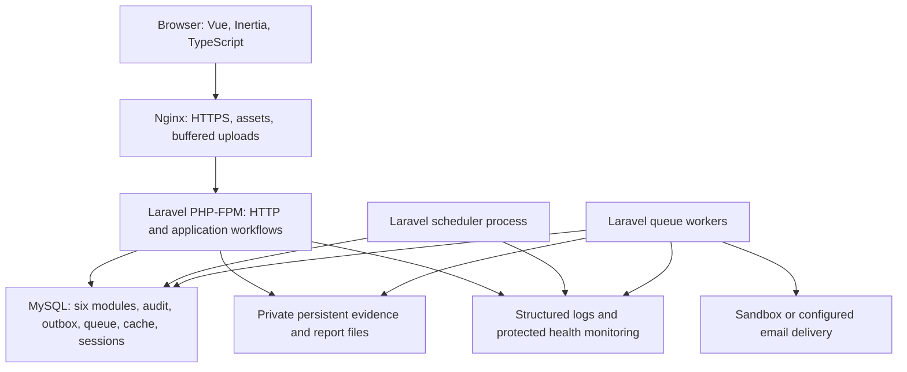
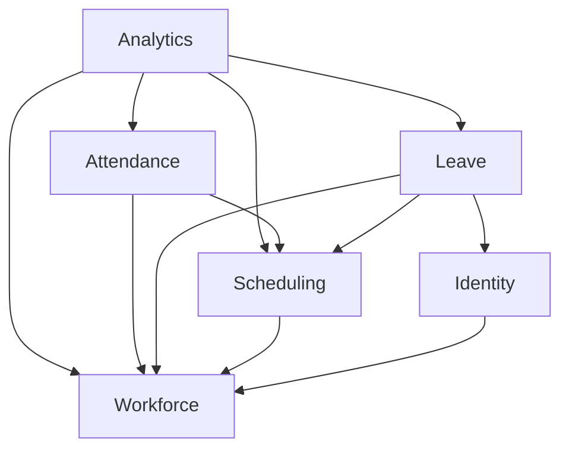
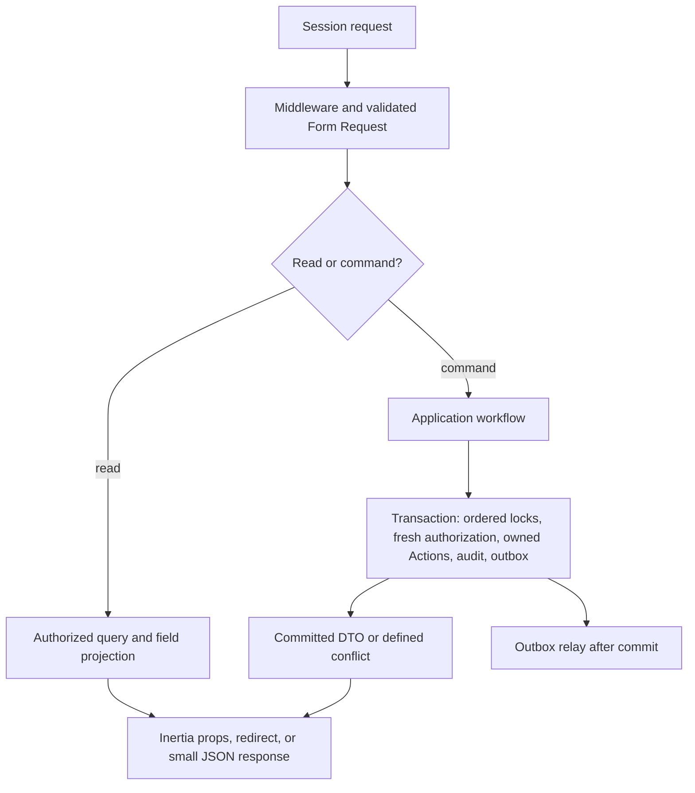
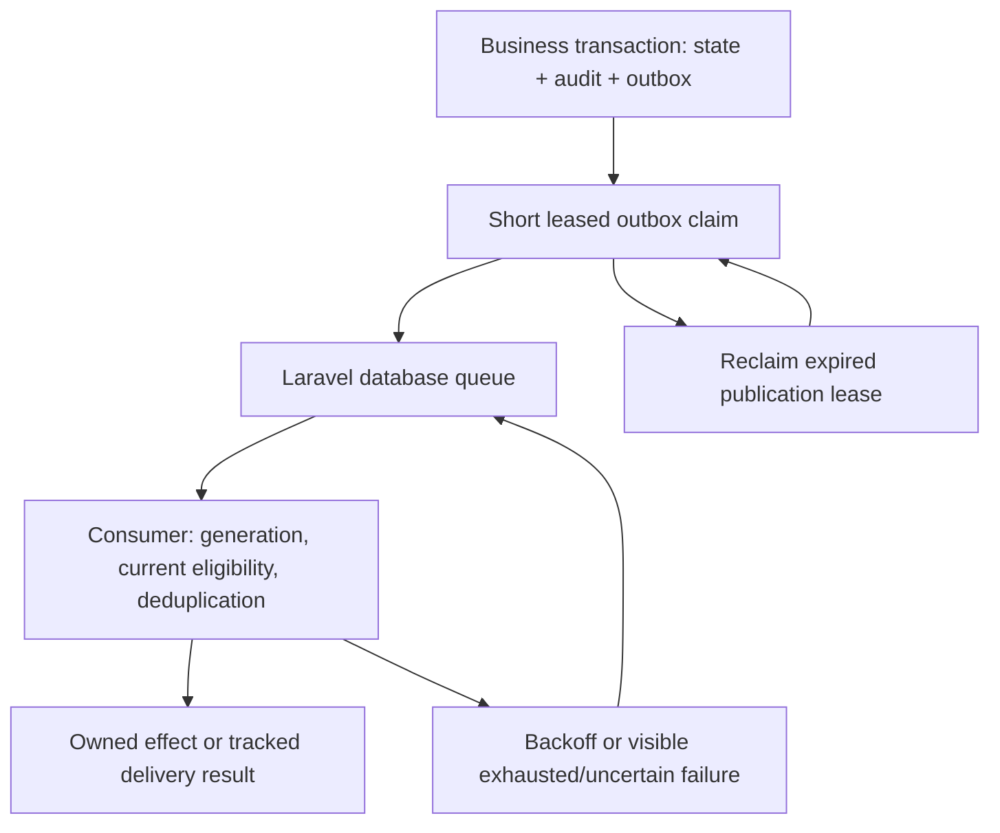

# Professional HRIS — Phase 1 Technical Architecture

## 1. Document Information & Architecture Status

| Attribute           | Value                                                                                                                             |
| ------------------- | --------------------------------------------------------------------------------------------------------------------------------- |
| Product / phase     | Professional HRIS — Phase 1 MVP                                                                                                   |
| Canonical path      | docs/phase-1/ARCHITECTURE.md                                                                                                      |
| Version             | 1.0 — Technical Architecture Baseline                                                                                             |
| Date                | 22 October 2026 (Asia/Jakarta)                                                                                                    |
| Status              | Architecture decisions established for schema design and implementation; implementation and release validation remain outstanding |
| Product authority   | PRD.md version 1.0 — Approved Requirements Baseline, dated 22 October 2026                                                        |
| Source verification | 28 locked business decisions; 21 APPROVED operational decisions; 136 unique requirement IDs; WF-01–WF-18; AC-01–AC-48             |
| Source SHA-256      | aad0e06d15a7c8b92629a2ed04e174bfaac2b5acbc7a4bcac3678a14d03dc494                                                                  |
| Intended readers    | Project owner, developer, reviewers, and Codex CLI                                                                                |
| Next specification  | DATABASE-SCHEMA.md, derived from this document and the approved PRD                                                               |

This document records technical choices, not a new product approval or evidence that software has passed acceptance. The PRD remains unchanged and takes precedence on business behavior. All six revised decisions—OD-03, OD-08, OD-12, OD-14, OD-16, and OD-20—are used in their final approved form.

## 2. Executive Architecture Summary

Build one Laravel application with six feature modules: Identity, Workforce, Scheduling, Attendance, Leave, and Analytics. Serve Vue 3 and TypeScript pages through Inertia, with Laravel routes, session authentication, and one MySQL database. Deploy an immutable application image with Docker Compose on a small Linux server. Separate PHP HTTP, worker, and scheduler processes while sharing the same application release.

Each module owns its authoritative state and rules. Application workflows coordinate operations that cross module boundaries in one MySQL transaction. Attendance and Leave do not call each other: the workflow reads each module's contracts, enforces their shared conflict rule, and invokes their owned commands. A stable employee coordination row serializes competing schedule, attendance, leave, and employment writes, including conflicts for which no business row exists yet.

Persist critical audit evidence and an outbox obligation with each relevant business mutation. Use Laravel's database queue, database cache, and database sessions initially. Store validated photos and exports on a private persistent filesystem; manage its nontransactional boundary explicitly. Analytics uses versioned occurrence facts and one metric calculator shared by dashboard, drill-down, and CSV. Public demo operation requires a separately isolated synthetic dataset and server-selected fixtures.

The design targets the PRD's measured 500-employee, 250,000+-attendance-record, 50-user workload. It does not claim the latency, recovery, security, or release targets have already been achieved.

## 3. Architectural Goals and Constraints

| Goal or constraint | Architectural consequence |
| --- | --- |
| Exactly six MVP business modules | Audit, notifications, exports, storage, retention, monitoring, and operations remain supporting infrastructure |
| Solo developer with Codex assistance | Normal Laravel conventions, feature directories, small Actions, explicit workflows, and executable boundary checks |
| Accurate attendance and leave | Shared conflict coordination, immutable referenced context, fixed-point ledger, and independent reviews |
| Scoped multi-role access | Permission-specific employee sets and field masks applied before query, aggregation, serialization, and delivery |
| Historical meaning | Separate effective time from recording time; preserve employment periods, occurrence revisions, and calculation versions |
| Integrated frontend | Inertia uses Laravel web routes; no separate frontend API server, JWT platform, or duplicated client business engine |
| Small-server deployment | MySQL also supports queue/cache/session workloads; limited worker concurrency; no Redis or broker requirement |
| Reliable asynchronous work | Transactional outbox, recoverable jobs, deduplication, and visible failures |
| Quality-gated release | Pest, MySQL concurrency tests, Playwright, SIT/UAT, benchmark, and restore evidence |
| Phase 2 excluded | Extension contracts only; no payroll, overtime compensation, performance scoring, ATS modules, or dormant tables |

The next database document will specify columns, indexes, foreign keys, and migrations. Logical records and constraint intentions here establish requirements for that schema; they are not a complete schema.

## 4. Source Requirements & Traceability

The entire approved PRD was inspected before authoring, including its permission catalog, state transitions, conflict matrix, formulas, workflows, acceptance criteria, and final OD definitions. Source verification found all 21 OD status records explicitly APPROVED. The canonical PRD matches the supplied final attachment byte for byte.

Authority order is: approved PRD → locked stack → decisions in this architecture → verified framework documentation → implementation detail. An architecture implementation choice cannot alter a PRD threshold, permission, workflow, scope, or acceptance criterion.

Section 31 maps all 136 requirement IDs and all BR, OD, WF, and AC IDs. Those mappings describe design and required verification, not executed tests. Requirement IDs remain the PRD's identifiers; ADR identifiers record technical decisions only.

## 5. Architecture Principles

1. Authoritative business state has one owning module. Cross-module reads return immutable DTOs or query results, never a mutable Eloquent model.
2. Required invariants are enforced synchronously in the committing workflow. Events do not repair an invalid state that was allowed to commit.
3. Controllers adapt HTTP; Actions implement use cases; focused domain services calculate rules; workflows own cross-module transactions.
4. Current authorization and effective historical context answer different questions and use different time bases.
5. A retry repeats an identified intent. It cannot create another clock event, approval, reservation, debit, reversal, or accrual.
6. Referenced evidence is append-only at the business level. Corrections and compensating entries preserve the original.
7. Side effects have explicit delivery and failure semantics. A database commit is not an email acknowledgment or an atomic filesystem commit.
8. Optimize measured queries and resource contention before adding infrastructure. Maintain one deployable application and one operational database.
9. Browser hints and synthetic fixtures never establish real-data authority.
10. Dependency or architecture changes must identify their requirement, boundary impact, migration impact, and relevant checks.

## 6. Technology Selection & Compatibility

### 6.1 Selected baseline

The following are selected stable version families or explicit compatible ranges, checked against primary documentation and publisher metadata on 22 October 2026. Exact patches, image digests, and transitive dependencies must be frozen in lockfiles during implementation. No dependencies were installed or resolved as part of this document; compatibility of the completed lockfiles and application still requires CI.

| Concern | Selected baseline | Compatibility evidence and reason |
| --- | --- | --- |
| PHP / Laravel | PHP 8.4; Laravel ^13.23 | Laravel 13 supports PHP 8.3–8.5; the chosen Pest Laravel plugin requires Laravel ^13.23 and PHP ^8.4 [S01, S11] |
| Inertia integration | inertiajs/inertia-laravel ^3.0 and @inertiajs/vue3 ^3.0 | Both adapter families are declared together in Laravel's official Vue starter kit [S02, S03] |
| Vue / TypeScript | Vue ^3.5; TypeScript 5.x; strict type checking | The official starter kit declares Vue ^3.5 and TypeScript ^5; use Composition API and vue-tsc [S03] |
| Asset build | Vite 8.x; @vitejs/plugin-vue 6.x; laravel-vite-plugin 3.x; Node 22 LTS, latest supported patch ≥22.12 | Starter-kit manifests and Vite's Node requirements align; Node is a build/CI dependency, not a production application service [S03, S04] |
| Styling / primitives | Tailwind CSS 4.1.x; shadcn-vue source components using Reka UI 2.x | Official kit uses Tailwind 4.1 and Reka 2; shadcn-vue supplies Vue/Vite installation and form integration [S03, S05] |
| Tables | @tanstack/vue-table 8.x | Use the documented v8 Vue adapter and manual server pagination APIs; do not follow a different major's latest examples [S06] |
| Charts | echarts 6.x, direct typed ESM integration | Official ECharts 6 release documentation; a thin local Vue wrapper avoids another adapter dependency [S07] |
| Forms | vee-validate 4.15.1 + @vee-validate/zod 4.15.1 + zod ≥3.24.0 and <4 | Official v4 typed-schema integration; deliberately retain the adapter's Zod 3 API family. V5 beta examples and Zod 4 APIs are excluded from this baseline [S08] |
| Client state | Vue composables and component state | No Pinia dependency initially; add only for a demonstrated shared client-only state requirement |
| Database | MySQL 8.4 LTS, InnoDB, utf8mb4, UTC connection timezone | Explicit row locks and transaction isolation are supported; no SQLite equivalence claim [S09] |
| Authentication support | Laravel Fortify 1.x, at least the starter kit's 1.37.2 baseline | First-party session/password infrastructure; custom invitations and scoped authorization remain project logic [S02, S10] |
| Exact leave arithmetic | brick/math ^1.0, with PHP BCMath extension for acceleration | Publisher requires PHP ^8.2; Laravel 13 permits ^1.0. Use BigRational/BigDecimal instead of binary floating point [S12] |
| Evidence processing | Imagick stable 3.8.x over maintained ImageMagick 7.1.x, plus PHP Fileinfo | One raster decoder handles orientation and metadata across JPEG/PNG/WebP; publisher PHP requirements include PHP 8.4. Verify codecs, security policy and the built extension together [S13] |
| Backend quality tools | Pest ^5.0.1; pest-plugin-laravel ^5.0.1; Pint 1.x; Larastan 3.x | Pest plugin's published requirements align with PHP 8.4 and Laravel ^13.23; official kit supplies Pint/Larastan integration [S02, S11] |
| Browser tests | @playwright/test stable 1.x and its matching pinned browser image/binaries | Official installation supports current Node 22; keep package and browser-image versions matched [S14] |
| Runtime / delivery | Docker Compose v2; maintained stable Nginx; PHP-FPM 8.4; GitHub Actions | Pin supported patches/digests at build time; health-based startup is explicit [S15] |
| Backup utility | Restic stable 0.19.x, pinned at implementation | Encrypted, checked, off-host backup repository; repository destination remains a deployment choice [S16] |

Use the official Vue starter kit as a compatibility reference and starting convention. Remove public registration and unrelated generated features before exposing routes. Do not adopt its optional passkeys, AI tooling, SSR process, Vite Plus, or other packages merely because the moving starter-kit main branch contains them. Use plain stable Vite for this application.

Significant supporting additions are Fortify for established authentication handling, brick/math for exact cumulative arithmetic, Imagick/ImageMagick for bounded raster orientation/normalization, and development-only static analysis/formatting. Laravel supplies validation, queues, scheduler, notifications, filesystem abstraction, encryption, policies, sessions, and cache. No modular framework, permissions package, spreadsheet package, workflow engine, event broker, Horizon, Sanctum, or chart wrapper is required. The CSV writer uses PHP's standard CSV handling.

### 6.2 Compatibility verification policy

At bootstrap, resolve only stable packages with strict peer checks; commit Composer/npm lockfiles. Run Composer platform checks and dependency audit, npm clean install and audit, PHP static analysis, vue-tsc, production build, Pest, and an Inertia form/upload smoke test. Do not use --force or --legacy-peer-deps to conceal a conflict. The VeeValidate and adapter versions move together; a future Zod-major or Inertia-major upgrade requires a reviewed compatibility change.

Verify the pinned Nginx ingress timing hook with a deliberately queued PHP-FPM request, and the Imagick codecs against all three accepted formats. Browser support follows OD-20's current/previous supported desktop versions and current Android Chrome/iOS Safari, assessed at release rather than frozen to today's browser patch. These are engineering verification gates, not additional owner business approvals.

### 6.3 Primary technical references

These sources support framework capabilities and compatibility. The selections and trade-offs in this document are project architecture decisions.

| Ref | Primary source |
| --- | --- |
| S01 | [Laravel 13 releases and PHP support](https://laravel.com/docs/13.x/releases) |
| S02 | [Official Laravel Vue starter kit Composer manifest](https://github.com/laravel/vue-starter-kit/blob/main/composer.json) |
| S03 | [Official Laravel Vue starter kit npm manifest](https://github.com/laravel/vue-starter-kit/blob/main/package.json) |
| S04 | [Vite 8 release and Node requirements](https://vite.dev/blog/announcing-vite8) |
| S05 | [shadcn-vue Vite integration](https://shadcn-vue.com/docs/installation/vite) and [VeeValidate forms](https://shadcn-vue.com/docs/forms/vee-validate) |
| S06 | [TanStack Table v8 Vue adapter](https://tanstack.com/table/v8/docs/framework/vue/vue-table) and [pagination](https://tanstack.com/table/v8/docs/guide/pagination) |
| S07 | [Apache ECharts 6 release](https://echarts.apache.org/handbook/en/basics/release-note/v6-feature/) |
| S08 | [VeeValidate v4 Zod integration](https://vee-validate.logaretm.com/v4/integrations/zod-schema-validation/) and [publisher releases](https://github.com/logaretm/vee-validate/releases) |
| S09 | [MySQL 8.4 transaction isolation](https://dev.mysql.com/doc/refman/8.4/en/innodb-transaction-isolation-levels.html) and [locking reads](https://dev.mysql.com/doc/refman/8.4/en/innodb-locking-reads.html) |
| S10 | [Laravel Fortify](https://laravel.com/docs/13.x/fortify) |
| S11 | [Pest installation](https://pestphp.com/docs/installation) and [published Laravel plugin requirements](https://packagist.org/packages/pestphp/pest-plugin-laravel) |
| S12 | [brick/math publisher metadata and arithmetic API](https://packagist.org/packages/brick/math) and [Laravel 13 dependency ranges](https://github.com/laravel/framework/blob/13.x/composer.json) |
| S13 | [Imagick stable publisher requirements](https://pecl.php.net/package/imagick/3.8.0), [ImageMagick formats](https://imagemagick.org/formats/), [security policy](https://imagemagick.org/security-policy/), and [PHP Fileinfo](https://www.php.net/manual/en/book.fileinfo.php) |
| S14 | [Playwright installation and supported runtime](https://playwright.dev/docs/intro) |
| S15 | [Docker Compose health-based dependency startup](https://docs.docker.com/compose/how-tos/startup-order/) |
| S16 | [Restic official documentation](https://restic.readthedocs.io/en/stable/) |
| S17 | [Laravel queues](https://laravel.com/docs/13.x/queues), [scheduler](https://laravel.com/docs/13.x/scheduling), and [cache locks](https://laravel.com/docs/13.x/cache#atomic-locks) |
| S18 | [Nginx FastCGI request buffering](https://nginx.org/en/docs/http/ngx_http_fastcgi_module.html#fastcgi_request_buffering), [time variable](https://nginx.org/en/docs/http/ngx_http_core_module.html#var_msec), and [FastCGI implementation](https://github.com/nginx/nginx/blob/master/src/http/modules/ngx_http_fastcgi_module.c) |

## 7. System Context & Container Architecture



The Vue application is an asset of the Laravel deployment. First navigation renders an Inertia page; subsequent requests receive authorized page props through the same session-protected web routes. Small same-origin endpoints serve clock-command/status and export-status responses where JSON is appropriate. They are HTTP adapters within the monolith, not a separately deployed API.

HTTP commits authoritative changes. Workers execute durable obligations through the same application workflows and module contracts. The scheduler discovers due work and relays outbox entries; it does not contain business calculations. MySQL and private volumes stay on the internal Compose network/host. Only HTTPS is public. Monitoring sees redacted identifiers and operational state, never photos, tokens, reasons, or raw coordinates.

## 8. Modular Monolith Structure

Select a feature-oriented structure inside normal Laravel. A dedicated modular framework would add registration, scaffolding, and upgrade conventions without providing stronger transaction or authorization guarantees at this scale.

Recommended paths, to be created by later implementation tasks:

```text
app/Application/Workflows/Attendance/ClockInWorkflow.php
app/Application/Workflows/Leave/SubmitLeaveWorkflow.php
app/Application/Workflows/Employment/ApplyOffboardingWorkflow.php
app/Modules/Identity/{Actions,Contracts,Domain,Models,Policies,Queries,Events}/
app/Modules/Workforce/{Actions,Contracts,Domain,Models,Policies,Queries,Events}/
app/Modules/Scheduling/{Actions,Contracts,Domain,Models,Policies,Queries,Events}/
app/Modules/Attendance/{Actions,Contracts,Domain,Models,Policies,Queries,Events}/
app/Modules/Leave/{Actions,Contracts,Domain,Models,Policies,Queries,Events}/
app/Modules/Analytics/{Actions,Contracts,Domain,Models,Policies,Queries,Events}/
app/Shared/{Authorization,Coordination,Audit,Outbox,Evidence,Reporting,Delivery,Operations}/
app/Http/Controllers/{Identity,Workforce,Scheduling,Attendance,Leave,Analytics}/
app/Http/Requests/{Identity,Workforce,Scheduling,Attendance,Leave,Analytics}/
app/Http/Middleware/
app/Http/Resources/
app/Jobs/{Delivery,Attendance,Leave,Analytics,Operations}/
app/Notifications/
app/Console/Commands/
app/Providers/
bootstrap/{app.php,providers.php}
routes/{web.php,console.php}
database/{migrations,factories,seeders}/
resources/js/pages/{identity,workforce,scheduling,attendance,leave,analytics}/
resources/js/components/{ui,forms,tables,charts}/
resources/js/features/{identity,workforce,scheduling,attendance,leave,analytics}/
resources/js/{layouts,composables,types,lib}/
tests/Unit/{Identity,Workforce,Scheduling,Attendance,Leave,Analytics}/
tests/Feature/{Identity,Workforce,Scheduling,Attendance,Leave,Analytics,Workflows}/
tests/{Architecture,Concurrency}/
tests/e2e/
```

Directories describe responsibilities; do not generate empty layers or one interface per class. Use PascalCase PHP classes and Vue components, explicit verb-named Actions such as ReserveLeave or RecordClockIn, noun-named Queries, and past-tense events such as LeaveApproved. Namespaces use App\Modules\ModuleName. Paths under pages resolve consistently through the Inertia page resolver; choose one casing convention and preserve it across Linux CI.

Eloquent remains the module's persistence tool. No generic repository layer wraps every model. Interfaces belong at cross-module or external boundaries that need substitution: ScheduleResolver, WorkforceContextReader, ScopedAuthorizer, EvidenceStore, and module command/read contracts. DTOs are immutable, typed, and purpose-specific; precision-bearing quantities are strings/value objects, never JSON floats.

## 9. Module Boundaries & Dependency Rules

### 9.1 Permitted dependencies

An arrow means a compile-time dependency on a public contract. All modules may depend on Shared primitives. Shared contains no imports of module implementations.



Application/Workflows depends on the required module contracts and Shared infrastructure. Controllers, console commands, and jobs call workflows or authorized read handlers. Modules never import Application/Workflows, HTTP adapters, or jobs. This direction prevents a hidden cycle through a module-local controller or listener.

Shared's ScopedAuthorizer port is implemented by Identity and wired in a service provider. Identity reads Workforce's trusted reporting-context query. Workforce's read contract does not call authorization again; the calling application entry point owns that check. Workforce write Actions may use the shared port, without importing Identity implementation or creating a recursive read/authorization call.

Analytics may compose public read contracts; source modules do not call Analytics internally. Workflows call Analytics' small invalidation contract in the committing transaction. Jobs outside modules consume module events. Cross-module Eloquent relationships that expose save/delete are forbidden. Public contracts return DTOs and accept explicit command DTOs; internal models never escape them.

### 9.2 Identity — Authentication & Authorization

| Boundary | Contract |
| --- | --- |
| Owns | Accounts, optional unique employee links, invitations, session/access revocation, role definitions, permission catalog, permission/scope grants, assignments, authorization revision |
| Rules/invariants | No implicit role hierarchy; union scopes only within the same permission; intersect distinct required permissions; no self-escalation or final-admin removal; token single use; public demo administration denial |
| Internal layers | Account/role Actions; grant and session domain rules; owned Eloquent models; ScopedAuthorizer implementation; account/grant Queries; capability DTOs and Laravel policies |
| Public operations | InviteEmployee, ActivateInvitation, DisableAccount, ChangeRoles, ResolveAccess, EligibleAccountsForStage, RevokeSessions |
| Dependencies | Workforce read contract for account link, effective employment eligibility, and current reporting graph; Shared audit, coordination, security/time primitives |
| Events | AccountInvited, AccountAccessChanged, GrantsChanged; workflow-owned handlers create safe notifications and invalidate access-dependent artifacts |
| Authorization | Permission catalog from PRD Section 8; exact role/security permission; sensitive reauthentication; no unconditional Super Admin bypass |
| Transactions | Link/invitation uniqueness and token acceptance; security changes under exclusive company fence plus required audit/outbox; account changes coordinated with Workforce |
| Tests / references | Scoped-set algebra, revocation, token/session flows, escalation prevention; AUTH-001–AUTH-008, SEC-001, SEC-002, SEC-009; WF-01–WF-03 |

### 9.3 Workforce — Employee & Organization Management

| Boundary | Contract |
| --- | --- |
| Owns | Stable employee identity, employment periods, lifecycle/type, effective organization assignments, reporting relationships, single-company organization/timezone metadata, departments, locations, positions, levels, retired-reference history |
| Rules/invariants | Optional account; effective intervals cannot overlap illegally; current/future graph acyclic; no employment extension or fabricated clock-out; rehire preserves identity and old period |
| Internal layers | Hire/change/retire Actions; interval and graph validators; effective-context Queries; owned temporal models; field-aware policies and immutable context DTOs |
| Public operations | CreateEmployee, RecordEmploymentChange, EndEmployment, StartRehirePeriod, ContextAt, CurrentTeam, EmploymentEligibilityAt, PreviewEmploymentContextChange |
| Dependencies | Shared primitives/security port; no Attendance, Leave, or Scheduling import. Offboarding coordination belongs to the application workflow |
| Events | EmployeeCreated, EmploymentContextChanged, EmploymentEnded, ReportingGraphChanged |
| Authorization | Employee/organization permissions and specific field masks; read/list/export apply identical employee set; current graph controls access |
| Transactions | Employee anchor creation with employee identity; effective changes and graph validation under company fence/employee anchors; offboarding workflow coordinates account and dependent exception ownership |
| Tests / references | Future cycles, backdating/stale versions, timezone history, overnight offboarding/rehire; ORG-001–ORG-004, EMP-001–EMP-008, RULE-001; WF-04–WF-06 |

### 9.4 Scheduling — Shift Management

| Boundary | Contract |
| --- | --- |
| Owns | Shift templates/revisions, breaks, weekly and rotating definitions, dated assignments, special overrides, holiday layers, resolved occurrence revisions, protected schedule context |
| Rules/invariants | One deterministic resolver; explicit overnight end day; duration >0 and <24h; half-open overlap checks; same-priority conflicts fail; referenced occurrences frozen |
| Internal layers | Publish/override Actions; ScheduleResolver and interval domain services; impact Queries; owned models; permission-aware policies; occurrence/policy-source DTOs |
| Public operations | ResolveOccurrence, ResolveWorkSegments, PreviewPublication, PublishAssignments, ChangeCalendar, ProtectOccurrenceContext |
| Dependencies | Workforce context read contract; Shared time/coordination/audit |
| Events | SchedulePublished, CalendarChanged, OccurrenceContextChanged |
| Authorization | Separate schedule/calendar/override actions from PRD catalog; permissions checked for every affected employee before whole-batch publication |
| Transactions | One validated batch commit; employee anchors even when no occurrence exists; protected-context checks; pending-leave invalidation coordinated through workflow |
| Tests / references | Calendar/regular precedence, recurrence, DST, adjacency/overnight races, protected history; SHIFT-001–SHIFT-009, RULE-002, RULE-004; WF-07–WF-08 |

### 9.5 Attendance — Attendance Management

| Boundary | Contract |
| --- | --- |
| Owns | Attendance-policy/geofence definitions and effective company/location/shift overrides, clock evidence references/events, per-occurrence attendance session, resolved policy snapshots, evaluations and revisions, correction requests/decisions, owned attendance exceptions |
| Rules/invariants | Eligible authenticated employee; server receipt time; one session; separate validated image per action; policy windows; GPS checks; independent correction; no invented closure |
| Internal layers | Record/revise/reconcile Actions; policy/geofence/evaluation services; owned models; effective-evidence Queries; photo-specific policies; receipt/evaluation DTOs |
| Public operations | ConfigureAttendancePolicy, AttendanceConflictFacts, OpenOccurrence, RecordClockIn, RecordClockOut, RequestCorrection, ApplyCorrection, ReconcileOccurrence |
| Dependencies | Scheduling resolver/context contract; Workforce context contract; Shared authorization/evidence/time/audit. No Leave import |
| Events | ClockRecorded, CorrectionRequested, AttendanceRevised, AttendanceReconciled, AttendanceExceptionOpened |
| Authorization | Self clock actions; scoped attendance reads; attendance.view plus attendance.photo.view for images; independent reviewers exclude submitter and affected employee |
| Transactions | Clock/correction/evaluation under employee anchor with immutable schedule/policy references, required audit, and outbox; workflow checks Leave facts in the same transaction |
| Tests / references | Real capture path, upload failures, GPS boundaries, idempotency, midnight/termination, correction/reconciliation; ATT-001–ATT-013, RULE-003, RULE-009, DATA-009; WF-09–WF-11 |

### 9.6 Leave — Leave Management

| Boundary | Contract |
| --- | --- |
| Owns | Leave types/policy versions, entitlement calculations, buckets/lineage, immutable economic ledger, reservations, requests/segments, workflow snapshots/stages, decisions, delegation, cancellation and reversal |
| Rules/invariants | Posted eligible units only; per-bucket nonnegative available amount; exact accrual; atomic cross-period allocation; sequential independent review; no automatic approval; frozen approved context |
| Internal layers | Reserve/decide/post/reverse Actions; duration, bucket-allocation, accrual and stage-selection services; owned models; balance/workflow Queries; sensitive-reason policies; exact quantity DTOs |
| Public operations | PreviewLeave, LeaveConflictFacts, ReserveRequest, DecideStage, CancelPending, DecideApprovedCancellation, PostDueEntitlement, ReassignStage, RevalidatePendingCalculation |
| Dependencies | Scheduling work-segment resolver, Workforce effective context, Identity eligible-account read contract; Shared authorization/coordination/audit. No Attendance import |
| Events | LeaveSubmitted, StageOpened, StageDecided, LeaveApproved, LeaveRejected, LeaveCancelled, EntitlementPosted, RouteBlocked |
| Authorization | Read/action scope intersections, sensitive leave-reason permission, current assignment/delegation and independent actor history; workflow exceptions need leave.workflow.manage |
| Transactions | Entire reserve/create-route, final debit/release, rejection/release, cancellation/reversal, accrual/carry/expiry each atomic; workflow obtains Attendance conflict facts under same employee anchor |
| Tests / references | Precision, period split/lineage, bucket races, stale schedule, routing/fallback/independence; LEAVE-001–LEAVE-015, RULE-003, RULE-005–RULE-007; WF-12–WF-16 |

### 9.7 Analytics — Dashboard & Analytics

| Boundary | Contract |
| --- | --- |
| Owns | Derived occurrence facts, aggregate revisions, metric contract, reporting snapshots and freshness metadata. It owns no original employee/clock/leave state |
| Rules/invariants | PRD formulas and cutoff; scope before aggregation; ratio of sums; visible N/A/coverage; consistent dashboard/detail/CSV versions; current access despite historical grouping |
| Internal layers | Fact invalidation/refresh Actions; MetricsCalculator; scoped reporting Queries; derived models; dashboard policies and typed result DTOs |
| Public operations | MarkSourcesDirty, RefreshFacts, PrepareReport, MetricResults, AuthorizedDrillDown, ExportSourceSnapshot |
| Dependencies | Public Workforce, Scheduling, Attendance, and Leave read contracts; Shared authorization/reporting/storage primitives |
| Events | ReportFactsRefreshed; consumes source changes through workflow-owned outbox handlers |
| Authorization | Dashboard and all relevant source permissions intersect; field-specific access and export permission remain distinct |
| Transactions | Small invalidation/version write joins business transaction; fact refresh compares source version under employee anchor; report snapshot is read-only |
| Tests / references | Golden KPI fixtures, historical grouping, freshness and export parity/revocation; DASH-001–DASH-009, RULE-008, NFR-007, NFR-008; WF-17–WF-18 |

## 10. Backend Application Architecture

### 10.1 Responsibilities and request paths

| Layer | Responsibility |
| --- | --- |
| Route/middleware | Web session, account/effective employment checks, CSRF, rate limits, correlation ID, demo environment guard |
| Form Request | Allowed input shape, types, known enum/reference values, upload envelope, required fields; reject unknown privileged fields. Its authorization is an early check, not the final transactional guard |
| Controller | Call one read handler or workflow; return Inertia/redirect/JSON; no ledger, schedule, hierarchy, geofence, or workflow calculation |
| Application workflow | Determine affected resources, open/retry transaction, lock in order, reauthorize, read owned facts, coordinate invariants, call owned commands, persist audit/outbox |
| Module Action | Change only owned state and enforce its domain preconditions; join the workflow transaction; no independent commit or remote side effect |
| Domain service | Deterministic calculations and transitions; pass time/context explicitly; independently unit testable |
| Query | Scope predicates, projections, eager loading, sorting/pagination and immutable read DTOs; no hidden write during a read |
| Resource/serializer | Explicit authorized fields; no raw Eloquent to Inertia, exception payload, or CSV |
| Job/command | Load durable IDs and current execution context, call workflow/read handler, report/retry outcome; no alternative business implementation |



Read handlers obtain current authorization at the query boundary, apply it to rows and counts, and build masked DTOs. Administrative configuration writes use preview plus expected version, authorization of every affected target, the necessary company fence, impact revalidation, and atomic publication. Long-running reports create a durable export request and outbox entry, return a queued status, and expose a protected status route; do not hold HTTP open while building a CSV.

### 10.2 Command and error conventions

Every critical command includes an idempotency key and an expected aggregate version where stale intent matters. Command context carries actor ID, company/dataset generation, correlation ID, receipt time when applicable, and required permissions. Never trust client employee ID for self clocking, submitted effective balances, stage status, policy mode, or calculated amounts.

Use typed result/error codes such as SCHEDULE_UNASSIGNED, GPS_ACCURACY, WORK_CONFLICT, ROUTE_BLOCKED, STALE_VERSION, and COMMAND_IN_PROGRESS. Human messages explain the next valid action without leaking hidden records. Validation uses Laravel error bags/422 semantics; unauthenticated or expired sessions use normal Laravel/Inertia authentication behavior; denied target reads use a consistent 404/403 policy without existence leakage; stale/idempotency conflicts use 409; transient contention is retryable and never represented as a business approval.

Successful form mutations redirect to a freshly authorized page with a concise flash outcome. Clock/status JSON returns command ID, committed record/version, server timestamp and evaluation state; a lost response can be recovered by authenticated command lookup. Serialization occurs from the committed result. Audit or transaction failure cannot return success. Central exception handling logs a redacted correlation ID and maps expected domain failures; no SQL traces or private evidence paths reach the browser.

## 11. Frontend Architecture

### 11.1 Pages, components, and state

Use Vue Single File Components with script setup, strict TypeScript, explicit props/emits, and typed backend DTOs. Inertia pages compose layouts and feature components; they do not implement business formulas or fetch unrestricted data for local filtering. Domain components live under features/module; shared form/table/chart wrappers live under components; shadcn-vue primitives are maintained under components/ui.

Authoritative employee, permissions, stages, balances, schedules, and metrics arrive from Laravel. Keep form drafts, dialog state, camera preview, and table interactions local. Composables encapsulate reusable behavior such as useAuthorizedTable, useClockSubmission, useCaptureSession, and useReportFilters. No Pinia store is needed initially. A later justification must identify client-only state shared across pages that cannot reasonably live in a layout/composable or URL; server business state must not acquire a second client authority.

Use reviewed shadcn-vue Button, Dialog, AlertDialog, Input, Select, Form/Field, Table, Sheet, and related primitives. Wrap or extend them once when behavior repeats. Agents must inspect existing components before creating another button/dialog/form system. Primitive updates are reviewed source changes; they are not a reason to rewrite every feature.

### 11.2 Forms and attendance UI

VeeValidate owns field state and client feedback; Zod 3 schemas describe user-input shape through toTypedSchema. Seed complete initial values and test cross-field errors because refinements may not run on missing fields. Submit one validated payload through Inertia/router or the clock endpoint, map Laravel field errors back into VeeValidate, and avoid competing form-state owners. Laravel always repeats structural validation and all current domain checks.

Preserve drafts on recoverable validation errors; show pending, committed, stale, failed, and retry states. Disable duplicate UI submissions for usability while relying on server idempotency for correctness. A retake changes the capture intent/key; a network retry of the same intent reuses its key and content. Stop camera tracks on navigation and release object URLs. Genuine camera and geolocation APIs are called only in eligible private/non-demo operation over HTTPS. Public synthetic pages do not call them at all.

### 11.3 Tables, charts, and accessibility

TanStack Vue Table v8 uses manualPagination, manualSorting, and manualFiltering. Laravel validates a sort/filter allowlist and performs all database pagination; default page size is 25, maximum 100. Canonical query-string state controls page, size, sort, search, filters, timezone and report token. Changing filters resets page. Totals and search suggestions use the same authorization predicate as rows. Authorized columns originate from server field descriptors; hiding a column cannot authorize data delivery. Never download all history to make a client-side table.

Import ECharts' needed charts/components/renderers through ESM. A local typed wrapper initializes after mount, resizes through ResizeObserver, and disposes on unmount. Charts consume server series with unit, numerator, denominator, cutoff, grouping, metric version, coverage and freshness. Click events navigate with a server-issued report token and validated drill-down dimensions; the backend reauthorizes. The browser formats values and renders series; it does not recalculate HR metrics.

Provide keyboard navigation, labels, focus restoration after dialogs, accessible errors, reduced-motion behavior, responsive tables/forms, and non-color-only state markers. Charts include readable values/table equivalents. Use explicit loading skeletons, no-data versus N/A distinction, permission-aware empty states, stale/incomplete labels, recoverable errors, and confirmed success. Visual tokens, typography and layouts belong to the future DESIGN-SYSTEM.md.

## 12. Authentication & Authorization Design

### 12.1 Authentication and account lifecycle

Use Laravel's web guard and database sessions with Fortify for authentication/password handling. Invitation-only activation is a project Action with a hashed, single-use, 48-hour token; resend revokes the previous invitation. Password-reset tokens expire after 60 minutes, do not enumerate accounts, and do not reactivate a disabled account. Passwords have the approved minimum of 12 characters and use Laravel's configured secure hasher.

Regenerate session IDs on login; invalidate on logout, deactivation and password reset. Enforce both 30-minute idle and 8-hour absolute lifetime using server timestamps; disable remember-me. Store an account security revision in the session and compare it on every request. Require password reauthentication within 15 minutes for sensitive actions. Apply OD-02's login/reset limit of five attempts per minute to relevant account/IP keys; do not let changing a display field evade limits. HTTPS cookies are Secure, HttpOnly and appropriate SameSite; Laravel CSRF protection applies to mutations.

Employee identity and login account are separate. The optional one-to-one link is unique on both relevant sides; provisioning races lock the employee anchor and return one existing outcome. An account without an employee link can have legitimate company-level permissions, but receives empty team/self employee sets. Enabled account state alone never overrides ended employment for clocking.

### 12.2 Scoped permission algebra

Implement a small project-owned scoped RBAC evaluator, using Laravel policies/gates as adapters. An established package such as spatie/laravel-permission can manage role/permission membership, but its membership and tenant/team facilities do not themselves implement this PRD's permission-specific reporting-tree sets, field intersections, current hierarchy, or separation-of-duty rules. Adding it would retain the difficult custom evaluator and add cache semantics. It is not selected.

For actor u and exact permission p:

```text
GrantSet(u,p) = union of employee sets contributed by u's grants for p only
all  = all employee identities within this company's permitted resource domain
team = active direct and indirect subordinates of u's linked employee, excluding self
self = u's linked employee
RequiredSet(u,{p1,...,pn}) = intersection of GrantSet(u,pi)
```

No role inheritance, no most-powerful-role shortcut, and no unconditional Super Admin authorization callback. Permission catalogs, default grants, allowed scopes and global-only security actions come from PRD Section 8. all on employee.view cannot widen leave.approve=team. Team plus self for the same permission can produce a union; a sensitive field still needs its own permission on the same target.

Resolve the current reporting graph using effective server time, not the historical report date. Use a MySQL recursive CTE over effective edges; at the approved workforce scale, a request-scoped set of employee IDs is acceptable. Validate acyclicity on writes, including future effective breakpoints. Avoid a cross-request hierarchy/grant cache initially; per-request memoization includes the evaluated instant and cannot survive a scheduled boundary.

### 12.3 Enforcement contracts

| Entry point | Required enforcement |
| --- | --- |
| Command / approval | ScopedAuthorizer.require(actor, permission set, target) plus current assignment, state/version, employment and independent actor checks under transaction locks |
| List / search / counts | AuthorizedEmployeeSet converted to a query predicate before joins, totals, facets and pagination |
| Sensitive fields | FieldProjection intersects general read permission with each relevant sensitive permission; explicit serializer allowlist |
| Attendance photo | Current account + attendance.view + attendance.photo.view for that employee; reference ownership, dataset generation and file state |
| Leave reason | Summary read does not imply sensitive reason access; use PRD-specific reason permission and field projection |
| Dashboard / drill-down | Dashboard permission intersects required source-read permissions, employee sets and requested grouping/fields |
| CSV | Source read plus specific export permission and field access at request, execution, publication and download |
| Notifications | Center/unread/read belong only to the recipient; target links reauthorize current source access |
| Stage selection / decision | Eligible enabled candidate, current required read/approval scope, valid delegation, actual prior-stage actor history, requester exclusion and stage order |

Inertia capability props help render navigation and disabled actions. They never replace these backend checks, and hidden fields never enter the props. Stage assignment is necessary, not sufficient authority. No approved workflow exception can allow requester self-approval or a cascading multi-stage decision.

### 12.4 Invalidation and revocation

Role, grant, account-link and reporting changes increment the authorization revision in the same transaction as their audit and outbox record. Security/hierarchy writes take the exclusive company command fence; sensitive commands take its shared side. Recheck effective employment/account status at the current instant even if a due scheduler job has not materialized the change yet.

Sessions, next page/query checks, private files and export checks use current state. A scheduled effective reporting boundary is resolved from temporal data on the next check rather than relying on a delayed cache invalidator. Export manifests include access fingerprint and generation; any changed authorized set/fields invalidates that artifact and requires regeneration. Check current authorization on a separate fresh connection during a report's historical snapshot transaction.

Authorization linearizes at an authorized database read or file-stream open. A later revocation blocks the next check and any not-yet-published artifact; bytes already transmitted by an in-flight response cannot be recalled. Do not issue public or long-lived presigned photo/export URLs that would bypass the next server check.

## 13. Employee & Organization Temporal Architecture

### 13.1 Effective context and recorded history

Keep stable employee identity, employment period, employment lifecycle, employment type, and account access as separate concepts. An effective assignment is valid on a half-open interval [effective_from, effective_to); recorded_at states when it was entered. Preserve the original recorded fact and an audited replacement/supersession for corrections. This is effective-dated relational history, not event sourcing or a full generic bitemporal framework.

Employee creation validates code, name, start date, employment type and lifecycle. Activation also requires valid department, position, organizational level and location; a root manager may be absent. Login email is required only when provisioning an account. Apply OD-04's identifier/field rules and return explicit missing-field errors; do not infer active status from an incomplete record.

Store instants in UTC with subsecond precision, and preserve the IANA timezone and original local meaning needed to explain the event. Date-only employment boundaries mean 00:00 in their approved local timezone. An occurrence keeps its timezone, UTC bounds, local start date, employment-period ID, organization context and source revision; a transfer cannot reinterpret yesterday's shift in today's location.

ContextAt(employee, instant) resolves the applicable employment/organization facts. CurrentTeam uses now; a historical distribution or occurrence grouping uses the PRD's historical/as-of instant. Current access always filters the historical query first. Workforce distribution counts distinct active/probation employee identities, including those without accounts.

Temporal writes lock the employee anchor, check expected version, reject illegal overlapping periods, and preserve references to retired organization records. Reporting/department graph changes also take the exclusive company fence, validating cycles at every effective breakpoint of the changed interval, including future edges. A future-dated change does not change present access early. Due jobs materialize status/notifications idempotently; authorization and eligibility queries remain effective-time aware if a job is delayed.

Backdated changes run an impact query over referenced occurrences, attendance, approved leave, entitlement and reports. They cannot silently regenerate protected context. Return a stale/protected conflict with a required authorized resolution; use a reasoned correction/supersession where already permitted by the PRD. Do not create a new generic approval process for routine valid future transfers.

### 13.2 Offboarding and rehire

The offboarding workflow uses Workforce, Identity, Scheduling, Attendance and Leave public contracts. Preview when scheduling the end and recheck immediately before application. Identify open/overnight sessions, work expectations crossing the boundary, future shifts, pending leave/reservations and approval responsibilities. Persist exception ownership and alerts so a no-account employee is not an abandoned work item.

For a 22:00–06:00 occurrence with termination at 00:00:

1. HR sees the actual intersection. HR can explicitly revise the end boundary, preserving original values/reason/audit, or start the independent attendance-resolution path.
2. If the boundary stays at 00:00, employment eligibility ends at 00:00. Requests enforce that instant, disable account access, and invalidate sessions without waiting for the scheduler. Ordinary clock-out fails.
3. The due workflow records the ended state and retained HR-owned exception. It never extends eligibility, creates clock-out-only access, or invents an end timestamp.
4. Independent correction can establish a factual end from evidence, or retain missing evidence with an explicit reviewed resolution. It does not reactivate the account or change employment dates.
5. Reconciliation preserves original schedule/evidence and requires the explicit resolution of applicable work expectations. It cannot silently penalize the employee for scheduled time after employment ended.

Rehire reuses identity, creates a new nonoverlapping period and separately authorized account reactivation. Old sessions remain attached to the old period. Leave bucket eligibility, reservations and any reversal follow their existing lineage and policy; rehire does not reset a balance or transfer it silently. System offboarding jobs use an explicit system actor and the same locks/audit contracts, not an unrestricted user-role bypass.

## 14. Shift Scheduling Architecture

### 14.1 One authoritative resolver

Select a bounded hybrid. Definitions and revisions are authoritative for future planning; Scheduling materializes concrete occurrences for the next 90 days of open-ended recurrence and whenever a longer-range request needs one. Referenced occurrences are immutable revisions. This bounds routine work while retaining a stable identity/context for attendance, leave and reporting.

Resolve calendar layers in order: authorized special assignment → location exception → company calendar → regular schedule. A layer explicitly supplies working/non-working and a valid shift source or falls through. Regular resolution is dated assignment → anchored rotation → weekly recurrence. Equal-priority conflicting results fail. An ordinary individual dated assignment cannot silently defeat a holiday; it needs an authorized special classification. Preserve holiday-work classification without calculating compensation.

Resolve local start/end with explicit end-day and valid nonworking breaks, convert through the preserved IANA timezone, and verify elapsed duration >0 and <24h. Reject nonexistent/ambiguous local times unless the operation explicitly resolves the offset. Working intervals are half-open, so adjacent shifts are allowed. Compare actual resulting intervals, including the previous/next local date for overnight spill; dates alone do not prove nonoverlap.

### 14.2 Publication and protection

Preview includes affected employees/finite intervals, old and new results, attendance, approved/pending leave, employment-ending intersections, and protected references. Publish the entire authorized batch in one transaction after locking all affected employee anchors in ascending order. Recheck the preview's configuration/version fingerprint; no silent partial publication or last-write-wins.

For finite assignments validate the whole affected interval. Open-ended recurrences use the approved 90-day preview and mandatory validation of every later materialized occurrence. A calendar/template change also revalidates every affected finite assignment interval and all already materialized future occurrences, including those beyond the routine horizon. A horizon is not authority to overwrite an unchecked finite or referenced interval.

The materializer, Attendance workflow and Leave workflow call the same ScheduleResolver under the employee anchor before creating/referencing an occurrence. Lock the stable anchor even if a conflict query returns zero rows. A unique occurrence business identity and revision rules provide a final duplicate safeguard. Distinguish a resolved nonworking day from an unassigned schedule.

Attendance, approved leave and finalized report references protect context. Prospective revisions replace only eligible unreferenced future results; explicit correction/resolution preserves old versions. Pending leave calculations are marked stale synchronously when affected. Final approval checks that marker/source fingerprint even if a notification/refresh job has not run. Recalculation requires requester acceptance/resubmission and atomic reservation adjustment; it cannot silently increase a charge. Notifications are durable after-commit work.

## 15. Attendance Processing Architecture

### 15.1 Command sequence and authoritative time

Use one workflow per clock action, with common policy/evidence services. The sequence intentionally performs expensive raster work outside the business lock, then rechecks every mutable fact under lock.

| Step | Operation and owner |
| --- | --- |
| 1 | Middleware authenticates current account, checks employee link/effective eligibility, CSRF, rate limit and server dataset mode |
| 2 | Read idempotency status for actor/action/key; current authorization is required even to return a prior result. A matching committed command returns it; changed intent under the same key fails |
| 3 | Scheduling resolves the candidate occurrence; Attendance resolves each attendance-policy field and expected remaining-work segments; Workforce supplies effective context. These are preliminary checks |
| 4 | Validate server-selected geofence mode and supplied GPS only where required; validate online command shape and photo envelope |
| 5 | EvidenceStore validates bytes/format/dimensions, applies orientation, re-encodes without EXIF, and persists private immutable evidence through a staging manifest/lease. No business row lock spans decode or filesystem I/O |
| 6 | A short durable receipt transaction claims actor/action/key and validated content hash, retains the first complete upload receipt instant and ready evidence reference, and exposes resumable processing status. A receipt is technical state, not a clock event |
| 7 | Open the critical transaction; acquire the company shared fence, principal and employee anchors, command receipt and owned rows in Section 17 order |
| 8 | Recheck account/employment, exact permissions, intent/version, schedule and policy sources, current Leave conflict facts, GPS against the final location/mode, open session, windows, and evidence-ready state. A changed preliminary context must be re-evaluated |
| 9 | Attendance records the event/session/evaluation and references the frozen occurrence/policy/evidence. For valid clock-in against pending leave, Leave marks the conflicting pending calculation through its owned command |
| 10 | Persist required audit, Analytics dirty/version marker, notification/reconciliation outbox obligations and the command's committed result in the same SQL transaction |
| 11 | Commit, then return the committed DTO/response. No success while photo durability/reference or required audit remains pending |
| 12 | Relay after-commit obligations; refresh reporting and notify without changing the recorded clock time |

At the trusted upload ingress, buffer the full request and attach a server-generated receipt timestamp at the post-body FastCGI handoff, before PHP-FPM execution/queue delay. The selected Nginx adapter evaluates its current-time FastCGI parameter at that handoff; strip any client header/parameter with the same purpose and restrict direct FPM access. Nginx's buffering/source ordering supports this approach [S18]; exact handoff placement is an implementation inference that must be verified against the pinned image with timing traces. Do not substitute request-start time, client capture time, middleware-start time after a queue wait, or post-decode time.

Persist the first complete receipt instant for the successfully validated idempotent intent. Internal deadlock retries and recovery reuse it. Concurrent matching receipts elect one retained receipt under their unique key; the elected command retains its original ingress instant through preprocessing and retry, and differing content cannot replace it. Invalid photo/upload never creates a clock event. If a pending intent is resumed, revalidate current eligibility/authority and conflicts; possession of an old receipt cannot reactivate employment or bypass current access.

The receipt retains only minimal geofence validation evidence and its policy fingerprint. It does not save raw GPS to make recovery convenient. Resuming an uncommitted intent requiring GPS revalidation needs the matching original submitted input again; otherwise return a recoverable stale/retry outcome. A worker cannot invent coordinates or silently reuse a result against a changed geofence policy.

The one-second target includes all work after complete server receipt: FPM waiting, validation/decoding, private persistence, receipt claim, lock waiting, SQL/audit commit, and response preparation. Keep the ingress clock synchronized and report the measured handoff uncertainty. A benchmark cannot claim the target using only an application timer that excludes upstream waiting.

### 15.2 Policy and geolocation

Resolve every attendance-policy field as shift override → location override → company default, distinguishing unset from explicitly disabled. Freeze values, sources and versions with evaluation. Default early clock-in starts 60 minutes before expected remaining-work start; latest clock-in is strictly before remaining-work end. Five-minute grace determines the late flag, while late duration is measured from expected start without subtracting grace. Clock-out must be later than clock-in and at most expected end +4 hours. Evaluate exact seconds before presentation rounding; flag early departure without overtime calculation.

Attendance owns these policy/geofence definitions in its own records referencing Workforce location IDs and Scheduling shift IDs. Workforce owns location identity/timezone; Scheduling owns shift intervals. An administrative policy workflow validates referenced context, takes the appropriate configuration fence, versions Attendance's policy and audits it without writing another module's tables or replacing a protected evaluation.

GPS is disabled until configured. Collect it only when policy requires it. Validate finite coordinates/ranges and accuracy a≥0. Select one pure server Haversine distance service using mean Earth radius 6,371,008.8 m, radians and finite double-precision arithmetic; test longitude wrapping and numerical-domain clamping of the intermediate haversine term. This spherical distance convention is an implementation choice shared by every geofence evaluation. Do not round distance, add a boundary tolerance or accept the client's calculated distance. Apply:

```text
Standard: d ≤ radius AND a ≤ maximum_accuracy
Strict:   d + a ≤ radius AND a ≤ maximum_accuracy
```

At radius 200 m and maximum accuracy 100 m, d=200/a=100 passes Standard but fails Strict; d=100/a=100 passes Strict; a=100.01 fails both; d=200.01 fails Standard. Reject manual-coordinate/mode claims, invalid values, denied/unavailable/timeout, poor accuracy, outside and Strict uncertainty with specific retry/correction guidance. GPS is not identity proof.

Default persistence contains only the minimum policy mode/result and nonprecise evidence needed to explain validation. Raw precise location is not stored, logged, emailed or exported by default. Persisting it later requires the PRD's purpose/category and retention controls, not a convenient debugging flag.

### 15.3 Photos and filesystem consistency

Accept decoded JPEG/PNG/WebP, at most 5 MiB, shorter side ≥480 px and longer side ≤4096 px. Check declared extension/MIME against detected content and successful decode; reject SVG/GIF, malformed/deceptive files and decompression hazards. Use Imagick to apply decoded orientation before stripping profiles/metadata and re-encoding a normalized still raster with top-left orientation. Test all rotated/mirrored cases, including metadata-bearing PNG/WebP, and ensure EXIF/location metadata is absent from saved bytes. The UI captures a new photo for each action, permits retake and offers no gallery fallback. Browser capture cannot cryptographically prove live identity.

Build the decoder with required JPEG/PNG/WebP codecs and a restrictive ImageMagick policy allowing only those raster coders, with external delegates, URL/vector/document/pseudo-format input disabled. Prefer an 8-bit-channel build for camera evidence. Initial per-request budgets are PHP memory 128 MiB plus native codec memory up to 192 MiB, one codec thread and bounded private scratch space; measure native resident memory because PHP's limit does not cover all extension allocation. Dimension checks and codec resource limits precede full decode. Patch the extension/library with the application image; no shell command processes an untrusted filename.

Use Laravel's private local filesystem adapter over a persistent volume. Random immutable keys, normalized extension, content hash and manifest state prevent overwrite/path injection. Do not create a public storage symlink for evidence.

| Boundary/failure | Required behavior |
| --- | --- |
| Upload staging | Register a leased staging manifest for a server-owned key; write/decode to private temporary space; no public URL |
| Validated evidence | Write/close and verify the normalized file; atomically rename within the same volume to its immutable private key; mark ready and retain receipt metadata |
| SQL business commit | Under ordered locks, attach only ready, owned, generation-matching evidence; commit its reference with the event/audit/result |
| File persisted, SQL failed | Leave unattached evidence for a retry or controlled cleanup; no successful event and no deletion of another command's evidence |
| Commit succeeded, response lost | Command lookup returns the recorded result and existing file reference; no new event or overwrite |
| Process crash | Receipt/lease recovery determines ready/committed state. Unknown outcome checks SQL before any retry or deletion |
| Cleanup | Claim an expired unattached manifest under its employee/evidence locks; recheck references/holds and mark deleting before removing bytes. Attachment rejects deleting state. Retry failed deletion |
| Untracked filesystem orphan | Inventory only old keys outside active upload leases; investigate/recheck before deletion under the approved temporary-upload policy |
| Missing referenced file | Scanner records an integrity incident and alert; restore controlled evidence if available. Do not fabricate a replacement photo or successful historical capture |

The filesystem and MySQL do not share an atomic transaction. Persisting evidence before the business reference favors a recoverable orphan over a committed missing reference. Flush/rename behavior and volume durability need fault testing; host/disk loss is handled through backup/recovery, not a false SQL guarantee. No storage or remote call occurs while business locks are held; the ready-manifest check and file existence verification are local and bounded.

Photo reads use a current authorized application route, verify both attendance permissions and record scope, and stream the private file with no-store behavior and safe content type/disposition. No stable filesystem path enters page props. File deletion, holds, reset, download-open and attachment share manifest state coordination.

### 15.4 Conflicts, corrections, and reconciliation

Approved leave removes covered working segments; a clock-in in a covered segment fails. Pending leave does not excuse attendance: valid clocking commits and marks the conflicting request, blocking its later approval. A just-late clock-out around the second-half leave boundary closes earlier work without asserting work throughout that leave segment. An unresolved open session provides uncertain overlap evidence and blocks conflicting final approval until reviewed.

Clock-out locates the original open occurrence across midnight/month/year and checks current account/employment eligibility. No matching occurrence or expired ordinary window leads to correction, not auto-assignment or backdating. Offboarding follows Section 13 exactly.

Correction requests retain original/requested values, reason, submitter, affected employee and expected evaluation version. One pending correction per occurrence is enforced by the schema's unique active marker plus employee lock. HR initiation for an employee without access requires attendance.resolve. Decision requires current review permission/scope and an independent actor excluding submitter and affected employee. Revalidate stale requests and cross-module conflicts before applying a new effective revision.

Reconciliation runs every 15 minutes after the latest permitted clock-out +15 minutes, with a nightly sweep. Keep prior evaluation versions. Missing clock-out means present but incomplete if clock-in is valid; never insert an end. Unassigned, ongoing, unknown, conflicted, fully excused and evaluable absent states remain distinct. Corrections produce a new evaluation/source version, dirty reporting and recoverable refresh work.

```mermaid
sequenceDiagram
    participant HTTP as HTTP adapter
    participant Evidence as Evidence store
    participant Flow as Clock workflow
    participant DB as MySQL
    participant Relay as Outbox relay
    HTTP->>Evidence: Validate and persist private photo outside business lock
    Evidence-->>HTTP: Ready evidence and first receipt
    HTTP->>Flow: Validated clock intent
    Flow->>DB: Begin; fence and stable employee lock
    Flow->>DB: Fresh auth, schedule, leave and intent checks
    alt Valid and nonconflicting
        Flow->>DB: Owned changes + audit + dirty marker + outbox + result
        Flow->>DB: Commit
        Flow-->>HTTP: Committed result
        Relay->>DB: Claim committed obligation
    else Invalid or stale
        Flow->>DB: Roll back
        Flow-->>HTTP: Specific recoverable failure
    end
```

## 16. Leave Management & Workflow Architecture

### 16.1 Policy, quantities, and ledger ownership

Leave owns all economic posting logic; no module or administrator directly edits a cached balance. Resolve effective policy employee override → location → company; department is not another policy layer. Retain eligibility, amount, calculation basis and version. Annual grant and monthly accrual are explicit alternatives unless policy explicitly defines distinct components; never implicitly double-credit. Entitlement amounts are configured policy, not assumed law. Company timezone defines Jan 1–Dec 31 periods.

Represent posted days as signed four-decimal fixed-point quantities, serialized as strings. Calculate proration/accrual with BigRational, round cumulative totals HALF_UP to four decimals, and use BigDecimal or scaled integers for posted arithmetic. Two-decimal display never feeds a calculation.

For each employee/type/period and each due closed month, compute the unrounded cumulative eligible contributions:

```text
CumulativeDue = HALF_UP_4(sum(A_month / 12 × eligible_calendar_days / days_in_month))
PostingDelta = CumulativeDue - already_posted_cumulative_entitlement
Available(bucket) = signed_posted_balance(bucket) - active_reservations(bucket)
```

Use only closed months due under OD-12. Lock the employee and calculation scope, compare processed-through/version, post the positive due difference and advance the marker atomically. Retried/older jobs are no-ops. Historical negative differences require an authorized compensating adjustment respecting reservations, not an automatic negative older job. A one-day annual amount over twelve fully eligible months totals 1.0000, not 0.9996.

Ledger effects include allocations, accrual, carry-in/out, consumption, expiry, signed adjustments and linked reversals. Every economic command has a unique business-effect key. Derived totals must reconcile to ledger and active reservations; a projection discrepancy raises an integrity incident. Never repair it by editing the total.

### 16.2 Buckets and reservation lifecycle

Eligibility is checked by employee/type, covered occurrence start date/period, bucket valid-from and expiry semantics. Expected future accrual is forecast only, not a posted credit. Future requests may use actually posted eligible units; no borrowing or synthetic advance credit.

Allocate eligible posted buckets by earliest expiry, then valid-from, then immutable bucket ID; nonexpiring buckets sort last. Split charges by each occurrence's local start-date period. A Dec 31 overnight occurrence stays in that year; Jan 1 is another period. Lock all required buckets under the employee anchor and validate the entire request before any reservation commits. A surplus in another period cannot conceal a deficit.

| Operation | One atomic Leave effect |
| --- | --- |
| Submission | Validate all segments, eligible posted units and valid first-stage route; create request/snapshots and all reservations together |
| Intermediate approval | Record one decision and next-stage state; keep reservations |
| Final approval | Revalidate schedule/version, evidence conflict, eligibility and retained allocation; post linked consumption debits and release reservations together |
| Rejection / pending cancellation | Close undecided work and release each active reservation once; no consumption reversal exists |
| Approved cancellation | After independent authorized HR review, reverse the original consumed units once to their original lineage; release effective leave only when that decision commits |
| Expiry | Debit only eligible unreserved remainder; active valid reservations remain protected |
| Release/reversal after expiry | Apply the linked expiry effect to expired units in the same transaction; do not make them newly spendable |
| Carry-over | Paired source carry-out and receiving carry-in for eligible unreserved remainder, configured cap/expiry and retained lineage; one atomic move, no double availability |
| Adjustment | Authorized reasoned signed ledger entry; cannot reduce available funds below active commitments or bypass bucket eligibility |

The final approval can consume a valid protected reservation after the bucket's nominal expiry according to OD-12; nominal expiry does not invalidate protected reserved units. It cannot substitute an unrelated expired/unreserved bucket. Cross-period consume/release/reverse transitions remain all-or-nothing. Uniqueness covers consumption per request/allocation, reversal per original debit and authorized cancellation, carry pair/period, and expiry effect lineage.

Whole future approved cancellation requires submission before the first segment and independent HR review. Approved leave remains effective while cancellation is pending. Used/historical/partial cases require the explicit authorized unit/evidence resolution allowed by OD-13; ordinary cancellation is not a bulk historical rewrite.

### 16.3 Schedule-aware duration and stale calculations

Use Scheduling's exact working segments, excluding breaks and resolved nonworking days. Full day charges 1; first/second half charges 0.5 regardless of shift length. Split by half the exact working duration, carrying an odd-duration boundary precisely; do not round the time boundary to fit display. Unknown schedule, zero duration, known attendance conflict, overlapping pending/approved leave and backdated employee self-service fail. Disjoint halves can coexist.

Submission and final approval obtain Attendance conflict facts through the application workflow under the same employee anchor used by clock commands. Schedule changes mark pending requests stale. Explicit requester acceptance/resubmission recalculates all segments, updates snapshots, adjusts all reservations and revalidates routing atomically; rejection of the new allocation leaves the prior committed state intact. Approved calculations and occurrence/policy context remain frozen.

### 16.4 Bounded sequential approval mechanism

Use ordered stage records with a snapshotted workflow version and selectors, not a general BPMN engine. Default routing is direct manager then eligible HR pool. Configuration supports an ordered list of approved selectors/fallbacks from the PRD. Snapshot policy and exception settings at submission; resolve actual eligible accounts when a stage opens and recheck them at decision.

An organizational-root employee's missing direct manager uses only an explicitly configured eligible independent fallback filling that same stage. Other missing/unavailable-route triggers need their configured fallback or audited HR reassignment; they cannot imply a stage skip. Invalid first route rejects submission with no reservations. An unavailable later route becomes visibly blocked, retains reservations and creates an HR alert.

Each decision requires current read/approval scope, assignment, account state, stage/version, and separation of duties. Exclude the requester always. By default, exclude every actual earlier-stage approver, including actions via delegation or reassignment. Multiple roles or Super Admin do not change that history. Reusing an actor is possible only through the explicit reasoned leave.workflow.manage-authorized exception snapshotted in that workflow and audited at configuration and use; it never enables self-approval, skipping, or deciding multiple stages in one command.

Delegation uses current existing permissions/scope, no chain/self delegation, and the configured inclusive date range interpreted as [start 00:00, day after end 00:00) in company timezone. Recheck prior-stage actor history when assigning and deciding. HR reassignment affects only undecided work, requires reason and existing authority; HR intervention does not confer leave.workflow.manage.

Reminder at 24 hours and escalation at 48 hours use stage-open timestamps and retained delivery keys, at most once per 24 hours per pending stage as specified. Escalation notifies/requests intervention; it never approves. Stage decision and cancellation share locks, expected version and unique decision/effect keys.

```mermaid
sequenceDiagram
    participant Edge as HTTP or job
    participant Flow as Leave workflow
    participant Sources as Public module contracts
    participant DB as MySQL
    Edge->>Flow: Submit leave with intent and expected context
    Flow->>DB: Begin; ordered employee and bucket locks
    Flow->>Sources: Fresh scope, schedule, attendance and first route
    alt All segments and posted buckets eligible
        Flow->>DB: Request + route + reservations + audit + outbox
        Flow->>DB: Commit
    else Missing entitlement or route
        Flow->>DB: Roll back entire submission
    end
    Edge->>Flow: Final-stage decision with expected version
    Flow->>DB: Begin; same employee/request/bucket coordination
    Flow->>Sources: Recheck actor, schedule, attendance and allocation
    Flow->>DB: Decision + debit + release + audit + outbox
    Flow->>DB: Commit or roll back as one unit
```

## 17. Transactional Consistency & Concurrency

### 17.1 Isolation and stable coordination

Use InnoDB transactions on the same MySQL connection for every cross-module write. Configure command connections explicitly for READ COMMITTED and row-based binary logging. Fresh reads after acquiring the coordination locks avoid accidentally using an earlier repeatable-read snapshot. Isolation alone is insufficient: every writer of an affected invariant must acquire the same anchors. Reporting uses a separate read-only REPEATABLE READ snapshot connection described in Section 20 [S09].

Provision a stable company command fence and a stable coordination row for every employee. Create the employee anchor with employee identity, before any schedule/attendance/leave exists. Ordinary employee commands take the company fence FOR SHARE and their employee anchors FOR UPDATE. Security, graph, global policy/publication requiring a consistent affected set, retention-policy/hold changes, and demo reset take the company fence FOR UPDATE. Choose the mode before locking; never upgrade a shared fence mid-transaction.

A lock on an absent attendance, overlap or reservation row does not serialize a competing insertion reliably. The existing employee anchor does. Calendar/batch workflows determine and authorize the whole affected set under the company fence, then lock every affected employee in ascending ID order. The approved all-or-nothing batch is not split into independently committed chunks. Expensive impact preparation happens before locks and is verified by source versions after acquisition.

### 17.2 Lock order and transaction discipline

All mutation workflows follow this order, omitting inapplicable categories:

1. Company command fence, shared or exclusive as predetermined.
2. Existing principal/account coordination rows, ascending account ID, for affected access/security state.
3. Employee coordination rows, ascending employee ID, including every employee whose invariant is modified.
4. Idempotency/receipt record for the command.
5. Owned schedule/occurrence rows, then attendance aggregate/correction rows, then leave request/stage rows, then leave bucket/calculation-scope rows; IDs ascend within each category.
6. Evidence manifest reference state and derived fact invalidation rows; required audit/outbox/result inserts.

Discover the required IDs from preliminary reads, then lock and re-read; if a fresh fact expands the set, abort/restart with the full set rather than acquiring an earlier category late. Employee anchors serialize absence checks, interval inserts, reservation changes, corrections, reconciliation, expiry and offboarding. Shared bucket locks alone cannot coordinate an attendance conflict.

Do not open a transaction in a controller, listener, or nested module commit. The application workflow owns one outer transaction; module Actions join it. Keep network calls, raster decoding, CSV formatting and large file copies outside it. The receipt/staging transaction is separate technical state and cannot claim a business success. Queue reservation and outbox-claim transactions finish before invoking a business workflow; do not hold their rows while acquiring employee locks.

### 17.3 Constraints, versions, retries and outcomes

The schema must back application rules with unique/reference constraints: unique employee-account link and invitation consumption, occurrence identity, clock action per occurrence/session, one active pending correction marker, stage decision identity, economic-effect keys, receipt intent, notification delivery key and report generation identity. MySQL has no generic exclusion constraint for temporal overlap; explicit anchor-protected interval checks remain required. Use check constraints for locally valid amounts/ranges and foreign keys for retained references where applicable; do not cascade-delete protected HR history.

Use optimistic versions for previews and user edits to employment, schedules, policy, correction and approval state. A mismatched version fails visibly rather than overwriting a newer decision. Hash canonical command content and bind idempotency to actor, command kind, target, dataset generation and key. A matching committed intent returns its original authorized result; different content yields conflict; in-progress claims return a resumable status. Economic uniqueness survives transport-key changes.

Retry deadlock/lock-timeout failures by rolling back the complete business transaction and re-entering with fresh facts and the same intent/receipt, at most three attempts with short jitter within the request/job budget. Report retryable contention after exhaustion. Re-query an uncertain commit outcome by command/effect key before retrying. Validation, forbidden access and stale decisions are not blindly retried. No retry duplicates external file publication, audit business effect, notification, or ledger posting.

### 17.4 Critical race contracts

| Race | Coordination and boundary | Valid outcome |
| --- | --- | --- |
| Duplicate clock-in | Same employee anchor + receipt key + unique occurrence/action in clock transaction | One event; matching retry recovers it; distinct duplicate intent cannot create another |
| Clock-in vs final leave approval | Both use the employee anchor and fresh Attendance/Leave facts before commit | If leave commits first, covered clock-in fails; if valid attendance commits first, final conflicting approval blocks. Pending leave does not forbid otherwise valid attendance |
| Two leave requests sharing a balance | Employee anchor + all eligible bucket locks; reserve all segments in one transaction | At most the funded amount is reserved; another period's surplus is irrelevant |
| Approval vs cancellation | Employee/request/stage/bucket locks + expected state/version + unique effects | Only a legal transition commits; no approval after a committed pending cancellation or double restoration |
| Concurrent shift overlaps | Stable employee anchor before interval query, even when empty; unique occurrence identity | First valid interval commits; later conflicting publication fails atomically |
| Simultaneous corrections | Employee/attendance/correction locks + one pending marker + one decision/version | One independent reviewed revision; second decision is stale/idempotent |
| Repeated scheduled accrual | Employee/calculation scope and bucket locks + processed-through + unique posting key | Cumulative delta once; retry/older work no-op; no rounding drift or automatic historical debit |
| Account/permission revocation vs export | Company authorization fence, current checks on fresh connection, access fingerprint and download authorization | Revoked/not-yet-delivered artifact is cancelled or inaccessible; old snapshot cannot supply current authority |
| Offboarding vs clock-out | Effective-time check plus company/principal/employee coordination | Boundary governs eligibility even before due job; no grace account or automatic closure |
| Schedule change vs pending approval | Employee/occurrence/request locks + source versions/stale marker | New calculation requires requester acceptance; old approval cannot silently consume new units |
| Expiry/carry-over vs reversal/release | Same employee and lineage bucket locks + linked effect keys | Protected reservations survive, expired returned units expire, paired transfer cannot duplicate availability |
| Cleanup/hold/reset vs attach/download | Company fence + employee/evidence state and generation; execution-time policy check | Held/referenced evidence remains; deleting/old-generation artifacts cannot be attached or newly opened |

## 18. Cross-Module Integration & Events

### 18.1 Synchronous integration ownership

| Application workflow | Public operations participating in one authoritative boundary |
| --- | --- |
| InviteEmployeeWorkflow | Workforce context + Identity provision/link/invitation + audit/outbox |
| ChangeEmploymentWorkflow | Workforce history/graph change + Identity access revision + Scheduling impact + Leave pending-route/calculation impact + Attendance owned exceptions as applicable |
| ApplyOffboardingWorkflow | Workforce end + Identity disable/revoke + owned Attendance exception + Leave work-item/reservation resolution state + audit/outbox |
| PublishScheduleWorkflow | Scheduling publication + Leave pending-calculation stale marker + Analytics dirty marker + audit/outbox |
| ClockIn/ClockOutWorkflow | Workforce/Scheduling context + Leave conflict read/owned marker + Attendance event/evaluation + evidence reference + Analytics dirty marker + audit/outbox/result |
| ApplyAttendanceCorrectionWorkflow | Independent review + Scheduling/Workforce protected context + Attendance revision + Leave conflict validation + Analytics dirty marker + audit/outbox |
| Submit/DecideLeaveWorkflow | Workforce/Scheduling/Identity context + Attendance conflict facts + Leave request/ledger/stages + protected occurrence + Analytics dirty marker + audit/outbox |
| PostEntitlementWorkflow | Leave exact posting/lineage + audit + Analytics dirty marker + outbox |

These coordinators are application use cases, not a seventh business module. They never write another module's tables themselves: the owning Action performs that write. Database foreign keys may cross ownership where a retained reference requires them; they do not authorize cross-module Eloquent mutation.

### 18.2 Event contract

Use small versioned event envelopes: event ID, name/schema version, company/dataset generation, aggregate ID/version, occurrence/employee IDs where appropriate, actor/system actor, occurred-at UTC, correlation ID and minimal non-sensitive payload. An ID list/changed range is preferable to copying HR records, leave reasons or evidence. A committed aggregate version is a monotonic source fingerprint, not a global total ordering of unrelated events.

Events such as ClockRecorded, LeaveApproved, EmploymentContextChanged and SchedulePublished trigger safe notifications, fact refresh and follow-up discovery. The authoritative transaction already enforced attendance/leave conflicts, financial effects, stale markers and required audit. Consumers fetch current minimal context and cannot replay an old event to overwrite a newer version.

Direct in-process notifications of a commit may wake the relay, but durable outbox state is authoritative. Register consumers explicitly; no wildcard listener that mutates arbitrary modules. Test event payload privacy, schema handling, duplicates, reordering, and replay against a newer aggregate. No external message broker or event-sourcing store is introduced.

## 19. Queues, Scheduler & Notifications

### 19.1 Durable publication

Laravel's after-commit dispatch prevents jobs running against rolled-back/uncommitted state, but a process can die after the business commit and before publication. Select a transactional outbox to close that loss window. The critical transaction inserts a durable obligation with the business mutation and required audit. An optional afterCommit wake-up is only a latency optimization [S17].

Set the database queue connection's after_commit option to true as a defensive default. Required business delivery still originates from the outbox; listeners must not independently publish a second untracked notification. System due-work jobs use a named, narrow system execution context and current due/policy checks, rather than inheriting a past user's serialized role.

A lightweight relay scans due outbox entries every ten seconds. It claims a bounded batch with a short lease using FOR UPDATE SKIP LOCKED, commits the claim, publishes IDs to the Laravel database queue, then marks publication. A crash after publication but before marking can publish twice; consumers use unique business-effect/delivery keys. Expired claims are reclaimed. Published obligations remain observable until their defined consumer completion/recovery state; a failed job is not treated as delivered merely because it entered a queue.

SKIP LOCKED is suitable for the relay's work queue, not for business conflict checks where silently skipping a locked employee/bucket would be incorrect. Store only durable IDs/versions in job payloads, not serialized mutable models, raw photos, precise GPS or reasons.



### 19.2 Drivers and resource limits

Select database queue, database cache/atomic locks, and database sessions. They reuse an operated dependency and survive PHP restarts. Their costs are MySQL polling, additional writes, expired-row cleanup and shared I/O; measure these alongside business queries. Redis remains an alternative requiring a later measured need and ADR change; Horizon is not used.

Use one latency-priority worker for notifications/due work and one low-priority reporting/maintenance worker, with only one large export at a time. Backups and heavy maintenance must not run uncontrolled alongside peak capture. Initial technical values are 90-second ordinary-job timeout, 300-second export timeout, and database queue retry_after of 360 seconds; termination grace exceeds the relevant worker timeout. These are adjustable execution budgets, not new business request/date-range limits. Timeout/retry recovery uses command/effect keys; no automatic unbounded export retry.

Use small bounded refresh batches; leave accrual discovers due scopes then processes each employee/scope atomically. The fast queue cannot be monopolized by formatting a report or copying a backup. Scheduler callbacks only discover/claim/dispatch work. Run one scheduler process using Laravel's subminute scheduling, with database-backed withoutOverlapping locks and durable due markers; overlap locks optimize, while effect keys and state checks enforce correctness after expiry/restart.

### 19.3 Due-work contracts

| Work | Schedule / durable progress |
| --- | --- |
| Outbox relay | Every ten seconds; lease, attempt, published/completed/failed state |
| Employment effective changes | Minute discovery plus request-time effective guard; original effective instant retained |
| Occurrence materialization | Daily horizon maintenance and on-demand resolution; generation/source fingerprint per employee/date |
| Accrual / carry-over / expiry | Daily discovery in company timezone for actually due closed periods/buckets; per-scope processed-through/effect keys |
| Attendance reconciliation | Every 15 minutes after occurrence's latest clock-out window +15 minutes; nightly sweep; source/evaluation version |
| Approval reminders/escalation | Minute discovery; 24h reminder/48h escalation thresholds; stage/time-slot delivery keys and current pending check |
| Fact refresh | Event-driven dirty versions with periodic catch-up; compare source versions before publishing |
| Export generation / expiry | On durable request; artifact status/lease and approved temporary-artifact expiry policy |
| Retention / orphan cleanup | Controlled candidate discovery and execution-time eligibility/hold/reference recheck; destructive real-data policy disabled without approved category/version |
| Backup | Daily operational job with overlap guard and manifest; success only after encrypted off-host confirmation |
| Demo reset | Nightly Asia/Jakarta, generation-guarded and isolated; invalidates old sessions/jobs/artifacts |

### 19.4 Notifications and delivery uncertainty

Create email and in-app channel obligations for PRD events after business commit. The in-app center uses a unique event/recipient key, owner-only queries, unread count, and idempotent mark-read. Normal delivery target is within one minute, measured from commit; relay/queue lag is visible. Recheck recipient/account and source access; omit sensitive reasons/coordinates/photo content from messages and reauthorize target links.

An employee without an account remains a valid scheduled/managed employee. Record a visible no-destination delivery result where applicable; do not fabricate an account/email or retry it as a transient provider failure.

Use five delivery attempts: initial, then 1, 5, 15 and 60 minutes of backoff. Retain channel state, attempts, last error, next attempt and exhausted status. In-app inserts deduplicate transactionally. Email providers may accept a message before acknowledgment is lost; absent verified provider idempotency, exactly-once email cannot be promised. Mark ambiguous acknowledgment as uncertain and surface it for controlled review/retry rather than blindly guaranteeing either no send or a duplicate-free send.

Provider/channel failure never rolls back committed leave, attendance, employment or shift state. Operator alerts identify exhausted delivery, overdue blocked routes and missed scheduled work without granting public-demo users operator access. A manual retry preserves the same delivery/business key and rechecks current eligibility. Worker restarts and deploys reload current code and never resume an old generation's side effects.

## 20. Dashboard, Analytics & Export Design

### 20.1 Authoritative facts and metric contract

Attendance owns evidence interpretation and reconciliation; Scheduling owns scheduled working segments; Leave owns approved excused segments and entitlement/consumption; Workforce owns effective organization context. Analytics derives one versioned occurrence fact per employee/occurrence/evaluation version, preserving those source references. Store sufficient numerators/denominators and coverage flags to aggregate correctly; a cached percentage is not a reusable additive fact.

One backend MetricsCalculator and typed reporting contract serves dashboard, detail and CSV. Its quantities retain exact working-time/half-day precision until presentation. For an evaluable occurrence i:

```text
W_i = scheduled working time excluding nonworking breaks
L_i = approved excused leave time of all applicable leave types
R_i = W_i - L_i
r_i = R_i / W_i
P_i = 1 for valid presence, otherwise 0

Attendance Rate = 100 × sum(r_i × P_i) / sum(r_i)
Absence Rate    = 100 × sum(r_i × (1 - P_i)) / sum(r_i)
Late Rate       = 100 × count(late present occurrences with R_i > 0)
                      / count(present occurrences with R_i > 0)
```

Fully excused occurrences have no remaining attendance obligation and do not become absences. Unknown/unassigned, ongoing, conflicted or otherwise nonevaluable coverage is excluded and shown separately. Current provisional reporting uses only completed/evaluable occurrences. Missing clock-out preserves valid presence but marks incompleteness; no fabricated end changes the denominator. Overnight records use local occurrence start date. Trends sum numerator and denominator contributions; they never average daily percentages. Zero applicable denominator is N/A with an explanation.

Workforce Distribution counts distinct employee identities active/probation at the chosen as-of instant, including no-account employees, grouped by effective organization at that instant. Attendance grouping uses occurrence historical context. Current authorization filters both.

Leave Utilization is an annual receiving-entitlement-period metric, separately by compatible leave type:

```text
cutoff = earlier of selected report end and today, in company timezone
numerator = net approved consumed units attributable to that year through cutoff
denominator = net granted entitlement for the receiving year through cutoff
            = allocation + posted accrual + inbound carry-over
              + signed entitlement adjustments
utilization = 100 × numerator / denominator
```

Consumption, reservations and expiry are not deductions from this denominator; expired units are reported separately. Approved cancellation reversals net the numerator. Future approved/planned usage and forecast accrual are separate, not realized utilization. A selected monthly start filter does not turn annual entitlement into monthly allocation. Multiple years remain separate; multiple compatible groups combine by ratio of sums. Non-balance types show units/count and N/A ratio; incompatible types are not combined. Surface >100% or negative integrity conditions rather than clamping them.

Golden fixture: ordinary present weight 1, half-leave present weight 0.5, absent weight 1 and full leave weight 0 produce attendance 60%, absence 40%, late 50% for one late among two present occurrences. Leave 1.5 consumed /20 granted is 7.5%. These values must agree in dashboard, detail and CSV.

### 20.2 Freshness, snapshots, and caching

Each source-changing workflow synchronously increments the affected employee's reporting source revision and writes a dirty marker in its business transaction. Include organization/configuration revisions where they affect the query. Refresh jobs acquire the employee anchor, read current public source facts and publish a new fact version only if its source fingerprint still matches. A delayed older job cannot overwrite a newer fact. Retain prior evaluation/fact references for audit and finalized reports.

Dashboard cards/series are queried within one short read-only REPEATABLE READ transaction. Reporting metadata includes metric-contract version, selected filters, effective timezone, as-of/cutoff UTC and local interpretation, source revision fingerprint, evaluated-at time, provisional/reconciled/stale/incomplete state and coverage counts. The source fingerprint hashes sorted scoped employee reporting revisions plus relevant configuration/grouping versions; no global incrementing hot row is required for every clock.

Dirty facts cannot be labeled fresh. Use a small synchronous refresh only where bounded and measured, otherwise return the last consistent result explicitly stale/incomplete and trigger durable refresh. Exports requiring a complete consistent source wait/retry within their execution budget or fail visibly; they do not publish a partial artifact as complete.

PrepareReport returns an opaque server-validated report token containing the canonical query, metric/source fingerprint, cutoff and access fingerprint. Drill-down and export from that view require the same fingerprint; if sources changed, return a stale-report outcome and refresh visibly. Do not silently compare different revisions under the same token. An export requested without an existing view establishes its own consistent snapshot and displays its metadata. Historical fact retention does not by itself claim a full immutable snapshot of every current permission.

Initial aggregate cache TTL is 60 seconds, adjustable from measurement. Keys include actor ID, required-permission intersection, employee-set hash, field mask, authorization revision, dataset generation, canonical filters, timezone, as-of/cutoff, metric version and source/fact fingerprint. Always derive current access before cache lookup. Source changes invalidate through revision keys immediately; expiry only reclaims old cache entries. Database cache has no dependency on tag-based invalidation. Cache authorized derived results, never a broad raw dataset later filtered in Vue.

### 20.3 Queued CSV and safe publication

All CSV reports are queued; >10,000 rows use the large-export resource lane. Default report range is 30 days, detail page size 25/max 100. Validate dates and query bounds server-side. Do not invent a fixed hard date-range cap: OD-19 requires measurement and owner approval for such a product limit. Technical worker time/memory budgets can fail/retry a job without silently truncating its results.

1. Request handler validates source-read plus export permission, target scope/fields, filters, report token, dataset generation and idempotency; commits export status + audit/outbox. Store initiating user ID and requested query, not a frozen authorization grant.
2. Worker rechecks current account, permission-specific employee set, fields and generation. Compare its current access fingerprint with the requested/view context. A change invalidates the old request/artifact even if access broadened.
3. On a dedicated reporting connection, open a read-only REPEATABLE READ consistent snapshot and stream explicitly projected source/fact rows into a private immutable input file in stable key order. Use ordinary snapshot SELECTs, not locking SELECT or INSERT...SELECT with different locking semantics. Keep the business write connection separate.
4. Between chunks, use the fresh command/authorization connection to revalidate current access, cancellation, generation and lease; the snapshot connection cannot answer current revocation. Record source/cutoff/metric metadata and verify dirty/source consistency before accepting the input snapshot.
5. Close the SQL snapshot before CSV formatting, notification or download. Its maximum duration is bounded by the export execution budget; monitor undo/history growth. A timeout fails the whole export rather than mixing a second snapshot into remaining rows.
6. Format CSV with the standard writer, correct quoting/newlines and explicit column types. Neutralize spreadsheet-formula prefixes for untrusted string cells, including leading whitespace/control characters before =, +, -, or @; do not corrupt typed numeric values. Test malicious names/reasons and Unicode.
7. Write to a private partial key. Recheck current access and generation before atomically renaming to a ready artifact and committing its manifest/hash, row count and complete status. A lost SQL publication leaves an orphan, not a publicly downloadable partial file.
8. Notify with a protected application link. Every download rechecks current source-read/export/field permissions, employee-set fingerprint, account, manifest state, generation and expiry. No reusable public URL or source-sensitive attachment in email.

Use queued → running → ready/failed/cancelled/stale → expired states, generation lease, attempt and progress metadata. Retries reuse a valid immutable input only after access/source requirements are verified; otherwise regenerate from a new explicitly identified snapshot. At most one large export runs at once; stream chunks rather than retaining all rows in memory. Export artifacts/input files use the approved temporary-artifact policy (candidate TTL 24 hours), with execution-time checks and recovery cleanup. This never authorizes deletion of employee/attendance/leave source records.

## 21. Security, Privacy & Audit

### 21.1 Security boundaries

Use HTTPS, session/CSRF controls, strict validation, allowlisted mass assignment, bound SQL parameters and contextual escaping. No raw HTML from leave reasons/employee fields. Apply a tested content security policy compatible with compiled assets, ECharts, camera preview and same-origin requests; permissions policy permits genuine camera/geolocation only where intended. Avoid inline unsafe execution as an expedient integration fix.

Private evidence, export inputs and artifacts have separate prefixes, restrictive filesystem ownership and no web-root mapping. Public asset mounts contain compiled static assets only. Downloads enforce current access. Encrypt off-host backups, restrict their credentials separately, and treat database/backup access as privileged operational access. Do not put environment secrets or sensitive fixture exports in repository, browser bundles, screenshots, logs or CI artifacts.

Use separate application, migration and backup database identities with least required privileges. Critical HR/audit tables have no public editor; normal application flows cannot edit/delete audit history. A privileged database administrator can still alter storage; append-only application controls are not cryptographic tamper-proofing. Backup checks, restricted credentials and operational review address that threat without inventing a blockchain/audit microservice.

Field projection applies before Inertia serialization, error responses, export input snapshots and notification construction. Sanitize logs at source. Default data excludes salary/bank/national-ID/medical-document fields and precise stored GPS, as required by the PRD; do not add them for speculative Phase 2 convenience.

### 21.2 Critical audit versus ordinary logs

AuditWriter persists actor/system actor, action, owned record/version references, approved reason, material before/after values with appropriate minimization, occurred/recorded times, command ID and correlation ID. Cover authentication/account/security administration, employment, scheduling/overrides, correction, workflow/delegation, ledger, retention and sensitive operations. Access to audit is itself authorized; sensitive content is not copied into ordinary logs.

A critical business transaction includes its required durable audit row. Any failure of that insert rolls back the mutation, ledger, stage/attendance version and outbox together. Authentication/security events outside an employee transaction use their appropriate short durable boundary. Ordinary JSON application logs and remote log forwarding are a separate operational channel: their downstream delivery failure does not undo an already committed business operation. Buffer/retry or alert on that delivery failure.

Use unique command/effect correlation to distinguish a retry attempt from another business effect. No user-facing endpoint edits or deletes an audit entry. Any authorized destructive retention of audit itself needs its own approved category/version and protected-reference checks.

### 21.3 Retention and real-data gates

Implement category/versioned retention configuration, immutable approval evidence, holds/disputes, candidate previews and execution manifests. The PRD's candidate durations are photos 90 days, ordinary logs 30 days, temporary exports 24 hours, audit 365 days, and structured HR records five years after employment end. They are configurable candidates, not statutory requirements or automatic purge permission.

Destructive real-HR cleanup is disabled until that category and exact policy version have the required validated legal/organization approval under OD-16/OD-21. Temporary report/upload policies are explicit separate categories; approving artifact expiry does not approve source deletion. A material policy/candidate change invalidates the earlier approval/preview as required. Archival does not imply deletion.

The purge workflow rechecks current category approval/version, cutoff, holds/disputes, evidence references, pending reservations, ledger lineage, employment history and other protected dependencies at final execution. Policy/hold changes and purge eligibility serialize through the company fence and affected employee/manifest anchors. A preliminary claimed job is not deletion authority. The final execution decision is audited and versioned; whichever concurrent hold/withdrawal or execution decision wins that guard determines eligibility. A hold established after preview but before final execution prevents deletion.

Database purge effects are transactional; filesystem deletion is a recoverable external phase with tombstones/manifest state. Before each not-yet-executed file deletion or retry, recheck current approval/holds/references. A failure remains visible and retryable; never delete a newly referenced file from a stale candidate list. Physical deletion cannot be reversed by a later hold; retain its execution evidence and apply deletion controls on restore.

Public/demo data stays synthetic. Before real-data operation the owner must validate current applicable Indonesian employment/privacy requirements, policy, notices/processing, sensitive treatment, retention/holds, providers/storage and rights-request procedures. This architecture does not claim legal compliance or encode unverified legal entitlements. That existing PRD gate does not create another business module.

## 22. Infrastructure & Deployment

### 22.1 Logical Docker Compose services

| Service | Role, persistence and health |
| --- | --- |
| web | Maintained stable Nginx, HTTPS/TLS termination, compiled assets, trusted buffered attendance ingress; public 443 only; route and TLS health |
| app | PHP-FPM 8.4 application image, read-only code/compiled assets, writable dedicated runtime paths and private volume; application readiness |
| mysql | MySQL 8.4 private network and persistent database volume; authenticated readiness, UTC, explicit transaction settings |
| worker-fast | Same release image, queue:work for latency/due delivery; heartbeat and failed-job/lag health |
| worker-bulk | Same image, one report/maintenance job at a time, lower resource priority; lease/heartbeat health |
| scheduler | Same image, one schedule:work process with short due-discovery/relay callbacks; heartbeat/last-success checks |
| backup job | Controlled operational process/image with DB read and private-file read access plus off-host encrypted repository credential; success manifest and age alert |
| dev mail sandbox / Vite | Local profiles only; production serves built assets and has no Vite dev server. Demo outbound mail is isolated to a sandbox |

The private persistent file volume is shared only where needed by app/workers/backup. Nginx cannot serve it as public static storage. MySQL data, private evidence and backup working space have separate named volumes/paths and ownership. Persistent storage is not inside an ephemeral container layer. Backups must leave the host; another local volume alone is not off-host recovery.

Use health-conditional Compose dependencies, restart unless-stopped for long-lived services, explicit graceful stop windows, and bounded reconnect/retry. Container running state is not readiness [S15]. Do not expose MySQL, FPM, sandbox inbox or operational endpoints publicly. Separate public TLS health from protected deep checks for DB, private-volume write/read, queue and scheduler.

### 22.2 Configuration and deployment

Local configuration supports source mounts, debugging, Vite hot reload, synthetic seeds and mail sandbox. Public demo uses immutable built assets, debug disabled, isolated synthetic DB/files/keys and strict demo guards. A future real-data deployment has different credentials, dataset marker, private volumes and outbound configuration; do not reuse demo databases or secrets.

Runtime configuration includes application/environment ID, dataset kind/generation, app key, DB credentials, queue/cache/session drivers, trusted proxies/hosts, TLS/cookie settings, company timezone, mail transport and private paths. Validate fail-closed combinations at startup. Inject secrets through restricted environment/secret files and protected CI environments; never bake them into image layers or frontend builds.

Selected deployment sequence:

1. CI validates and builds one versioned application image and assets from committed lockfiles, records release SHA/digests and dependency audit results.
2. On the target, validate configuration, free space, TLS, backup age and dependency readiness. Take/verify the required pre-release recovery point.
3. Enter a controlled maintenance/write gate, drain workers and pause scheduler mutation/relay work. Finish or recover active command/export leases.
4. Run one migration job with separate migration credentials. Prefer expand/contract changes preserving historical context and old references; do not run migrations in every container startup.
5. Start the new app/web/workers/scheduler from the same image, rebuild Laravel config/route caches appropriately, and verify readiness, authorization, storage, queue and genuine non-demo test path where applicable.
6. Resume traffic/due work and monitor error/queue/reconciliation indicators. Restart workers on every release so long-lived processes load the new code; interrupt/restart subminute scheduling across deployment.

Choose host-side Nginx/container TLS termination with automated certificate renewal on the public web service; the exact domain/certificate provisioning depends on deployment access. Do not publish until HTTPS and trusted ingress are verified. No hosting provider is selected without confirming available CPU/RAM/SSD, disk growth, location, costs, DNS/TLS, outbound delivery and off-host backup options.

Rollback application image only if the migrated schema remains compatible. Forward-fix an incompatible migration or perform a controlled restore with explicit data-loss accounting; never casually run destructive down migrations over accepted ledger/history. Snapshot current incident state before restore. A backup restore is not a zero-loss release rollback.

### 22.3 Backup consistency and recovery

Daily backup combines a MySQL consistent dump and a manifest of every required referenced immutable private file. Use a short controlled write gate, pause cleanup/due mutations, drain active critical writes and freeze the file inventory. Capture the single-transaction database dump and its matching file manifest without concurrent DDL; copy the manifest's files while protecting them from deletion. New unreferenced files do not belong to that recovery point. Resume normal traffic once the consistent capture is secured; measure gate duration.

Use Restic to encrypt and transfer the DB dump, required evidence/files, checksums, manifest, release/schema version and essential nonsecret configuration to a separate off-host repository [S16]. Keep decryption/recovery secrets separately accessible to the owner. Candidate backup retention is 30 days, governed by the PRD's category/hold/deletion controls. Never treat local dump creation as off-host backup success. Verify repository integrity and alert on missed/failed backups, low space, unreadable keys or missing manifest files.

Preserve the current approved deletion/hold control manifest independently of any individual recovery point. Before an irreversible real-data purge, secure its encrypted control/tombstone record off-host through the controlled purge phases; distinguish a pending intent from completed deletion. Restoration must obtain the latest control manifest before reopening real-data access. If that evidence is unavailable or ambiguous, keep affected restored content quarantined for reconciliation rather than exposing it from an older snapshot.

Restore before release and monthly thereafter into an isolated environment with outbound mail disabled and workers initially stopped:

1. Select a verified common DB/file recovery point; record incident start, recovery cutoff and chosen release.
2. Restore DB and matching private files/permissions; reconcile checksums and referenced-file inventory.
3. Apply current deletion/hold controls and approved post-backup deletion records so restoration cannot silently resurrect data for use/delivery.
4. Invalidate restored sessions, tokens where required, old exports and execution leases. Quarantine prior outbound obligations/jobs; selectively resume only reviewed/idempotent safe work, never replay old email automatically.
5. Verify employee periods/history, schedule/evaluation references, ledger totals/reservations/lineage, scoped authorization and sampled evidence access. Reconcile due work from retained progress markers.
6. Measure recovered-data age against target RPO ≤24h and usable-service restoration against target RTO ≤4h; retain actual durations and failures.

These are objectives until a restore exercise demonstrates them. Daily frequency alone does not prove RPO if a backup failed. Local disk loss, repository access and private-file growth are material risks even with a consistent SQL dump.

## 23. Performance & Observability

### 23.1 Query and resource architecture

Index measured access patterns: employee + occurrence start date; employee + effective interval start/end; current reporting edges; occurrence/session identity; pending stage assignee/status/due time; bucket eligibility/expiry; ledger effect key and employee/type/period; active reservation; dirty fact/source version; outbox due/status/lease; export owner/status/generation. Exact index order belongs in DATABASE-SCHEMA.md after representative query plans. Range overlap checks still need the stable anchor; an index is not a concurrency guarantee.

Use explicit select lists, constrained eager loading and bounded pagination, with N+1 prevention enabled in development/test. Resolve team IDs once per request and reuse the authorized predicate. Recursive hierarchy reads are practical for 500 employees; do not scan the hierarchy once per table row. Query occurrence facts for analytics rather than joining every raw event, policy revision and ledger line for every chart.

Keep only bounded context/codec work synchronous on clocking; all required photo validation/private persistence/audit still precedes success. Reuse preliminary calculations only after source-version verification under lock. Instrument hot-lock wait separately from CPU and SQL duration. Batch notifications/refresh work while preserving individual idempotency. Queue polling, cache writes and export reads count against the shared MySQL budget.

For the approved cohosted 2-vCPU/4-GiB/SSD benchmark, start with the following measurable resource envelope. These are initial tuning values, not demonstrated capacity or a new minimum deployment specification:

| Process/service | Initial memory/concurrency budget |
| --- | --- |
| MySQL | 1,536 MiB container ceiling; approximately 1 GiB buffer pool, bounded connections |
| PHP-FPM | 1,280 MiB ceiling; initially 3 children, bounded PHP and image-codec memory per request |
| Fast worker | 192 MiB ceiling; one process |
| Bulk worker | 320 MiB ceiling; one process, at most one large export |
| Scheduler | 96 MiB ceiling; short discovery/relay work |
| Nginx | 64 MiB ceiling |
| Host/engine/filesystem headroom | Remaining approximately 608 MiB; monitor actual resident memory and disk cache pressure |

Do not assign every container two exclusive CPU cores on a two-core host. Prioritize HTTP/MySQL CPU shares and throttle bulk/backup work. Verify connection count, resident memory including native codecs, FPM queue length, SSD latency, free space and swap/OOM behavior; cgroup ceilings alone do not establish sufficient capacity. Tune within the fixed benchmark host and rerun evidence rather than silently increasing hardware to pass. Maximum-valid photos and concurrent reports are a specific risk to the one-second target.

### 23.2 Benchmark contract

| Target | Required measurement |
| --- | --- |
| Dataset/load | 500 active employees, 250,000+ historical attendance records, 50 concurrent users, approved meaningful histories/organization |
| Standard backend | P95 ≤500 ms by endpoint category |
| Attendance | P95 ≤1 s after complete photo arrival at trusted server ingress, including queued/preprocessing/storage/transaction/audit/response work |
| Dashboard | P95 ≤3 s until usable charts and values, not only the first HTML byte |
| CSV | Asynchronous request/status/generation/download behavior; large reports must not monopolize HTTP |
| Reproducibility | 2 vCPU, 4 GiB, SSD cohosted app/MySQL/workers; independent load generator; record allocations, versions and configuration |
| Workload | 60% read, 20% clock actions, 10% leave actions, 10% dashboard; two-minute warmup and ten-minute measurement |
| Browser path | Controlled 50 ms RTT /10 Mbps; supported desktop/mobile browser evidence |

Use valid distinct writes and suitable independent employee/occurrence intents; a run dominated by duplicate/conflict rejections is not a successful-write throughput result. Exercise the genuine validated non-demo attendance path with actual image decode/storage and policy checks; public fixture fast paths are not acceptable performance/capture evidence. Include representative and maximum-valid photo cases, cold and steady-state behavior, refresh/export contention and relevant lock conflicts.

Record sample counts, P50/P95/P99, error and rejected-command counts, queue/lock wait, SQL/codec/filesystem timings, CPU/RAM/disk, network settings and frontend usable-chart timing. Preserve failed samples and report target misses; do not drop retries or subtract audit/preprocessing time. The Nginx post-body timing hook must be trace-verified with deliberate FPM queuing. A conservative client last-upload-byte-to-response timer can cross-check latency, but is not a substitute for the specified server boundary.

### 23.3 Observability and operational checks

Emit structured JSON logs with UTC timestamp, environment/dataset generation, release SHA, correlation/request/command/event IDs, actor/system ID, route/category, result/error code, duration and relevant non-sensitive aggregate IDs. Redact credentials/tokens/cookies, body photos, raw precise GPS, leave reasons and unauthorized fields. Central exception handling records one useful trace internally without duplicating sensitive request bodies.

| Signal | Visibility/action |
| --- | --- |
| HTTP errors/latency | Endpoint histograms and error rate; alert on sustained target/error regression |
| Lock/DB health | Deadlock/timeout rate, hot-anchor wait, slow queries, connections, undo growth during snapshot exports |
| Queue/outbox | Oldest due age, unpublished/unfinished obligations, failed jobs, retry exhaustion and uncertain email acknowledgments |
| Scheduler | Heartbeat and last-success/due lag per accrual, reconciliation, reminders, cleanup, backup and reset task |
| Storage | Free space, codec errors, referenced missing files, orphan backlog and deletion failures |
| Business integrity | Ledger/reservation mismatch, blocked route/termination exceptions, stale fact backlog and unresolved coverage |
| Recovery/security | Backup age/off-host/check result, restore exercise result, suspicious forbidden/security actions |

Protected operational routes expose dependency readiness and worker/scheduler heartbeats to the owner. Public health returns only minimal availability. Send critical operational alerts to the configured owner/operator channel; implementation of messaging follows explicit project configuration, with no public-demo operator permission. Monitoring remains lightweight structured logs plus host/queue health initially; no observability cluster is required.

## 24. Testing Architecture & CI/CD

### 24.1 Risk-focused test boundaries

| Layer | Required scope |
| --- | --- |
| Pest unit | Exact-permission set algebra/intersections; timezones/half-open periods/future graph breakpoints; schedule precedence; window/GPS boundaries; half-day segmentation; rational cumulative accrual/bucket allocation; KPI formulas/N/A |
| Pest feature/integration | HTTP and Inertia authorization/field omission; invitations/sessions; transactions/audit failure; private evidence/receipt recovery; queue/outbox crash windows; each critical state transition and cross-module workflow |
| Pest architecture | Permitted module import DAG; no module-to-workflow/HTTP/job imports; no cross-owned model writes; controllers delegate; public contracts do not return Eloquent models |
| MySQL concurrency | Independent connections/processes with barriers, real commits and controlled interleavings for all Section 17 races, including initially empty conflict sets |
| Playwright | Auth, employee/history administration, shifts/overrides, genuine capture clock-in/out, leave submit/review/cancel, chart/filter/drill/export, persona navigation, responsive/keyboard states |
| Operations/security | Revocation during export, missing/private evidence, retention hold-after-preview, reset generation, backup/restore, monitoring/alert and worker interruption exercises |

Pest concurrency tests run on MySQL 8.4 with the production isolation/constraints; SQLite-only evidence is insufficient. Do not wrap the multi-process race in a test transaction invisible to other connections. Use explicit barriers/lock observation instead of arbitrary long sleeps. Assert committed rows, ledger/reservations, versions, audit and delivery obligations after both actors finish.

Unit tests use injected Clock/timezones and deterministic DTOs. Feature tests may fake transport or storage where the boundary is not under test, but dedicated integration cases exercise real private volume/codec behavior and database queue/outbox recovery. A mocked image cannot prove photo validation/performance; a queue fake cannot prove durable publication.

### 24.2 Test data, browser evidence, and isolation

Synthetic seed factories create hierarchical organizations, root manager fallbacks, distinct approvers, overnight/year-boundary occurrences, no-account/offboard/rehire periods, posted-versus-forecast buckets and the exact KPI fixture. Freeze business clocks deliberately, retain UTC/local pairs and use explicit randomized seeds where load generation needs diversity. Never import real employees or photos into fixtures.

Test runners require a dedicated disposable database, dataset marker, private volume, mail sandbox and generation. Before migrate:fresh/reset/purge, assert the test environment plus a non-real dataset marker and explicit disposable target. Abort on real-data or unknown connection/storage identity. CI and tests have no production secrets or real outbound transport.

Separate public synthetic fixture journeys from genuine capture-path tests. In private non-demo Playwright runs, browser-level fake media/geolocation devices can exercise the normal camera/API/upload path without a server fixture bypass; retain manual supported-mobile genuine capture evidence for PRD acceptance. Test denied camera/GPS, accurate/outside/uncertain bounds, no gallery fallback, interrupted upload/response, midnight and offboarded clock-out. Public-demo tests instead assert no camera/geolocation invocation, server-validated fixtures and denied client attempts to activate synthetic mode in real/non-demo operation.

### 24.3 GitHub Actions gates

| Trigger | Blocking checks and evidence |
| --- | --- |
| Pull request | Locked dependency install/platform/peer checks; dependency/secret audit; Pint, PHP static analysis, TypeScript/vue-tsc and production asset build; Pest unit/feature/architecture; targeted MySQL concurrency suite; critical Playwright paths and authorization/demo tests |
| Main branch | Repeat deterministic required checks on merged SHA; complete MySQL race suite, browser suite and migration smoke on disposable data; build immutable image; deploy synthetic staging only after checks; operational smoke/queue/storage checks |
| Release candidate | Full traceable SIT/UAT by persona; supported-browser/responsive/genuine capture evidence; reproducible benchmark; failure/retry/retention/security exercises; isolated DB/file restore and RPO/RTO measurement; release-doc consistency |
| Stable release | All REL-001–REL-008 gates satisfied, critical defects closed, accepted evidence linked to exact SHA/configuration; establish stable v1.0.0 baseline |

A flaky required security/concurrency test is unresolved work, not a justification to disable the gate. Protect deployment credentials/environments and pin trusted action versions/commits. Store sanitized reports/traces only; restrict artifacts that could contain tokens or evidence. Do not run destructive benchmarks or restore drills against real data. This document defines the test architecture; future TASK/SIT/UAT documents will define execution units and evidence, without changing these invariants.

## 25. Public Demo Isolation

### 25.1 Server-controlled synthetic execution

Use a separate synthetic deployment with its own database, private volume, app/session keys, email sandbox and dataset generation. Startup and each fixture-aware operation require both explicit synthetic-demo environment configuration and a server-owned synthetic dataset marker. Real/unknown/mixed markers fail closed. An environment string alone, a user role, header, request flag, fixture ID or browser error cannot enable synthetic evidence in real-data operation.

The server selects/validates allowed synthetic photo/location fixtures for the demo employee/action/context. Public attendance UI never invokes getUserMedia or navigator.geolocation and never accepts/persists visitor evidence; reject a visitor photo/coordinate payload on this path. Show simulated labels on command result/evidence view and relevant reporting detail. Normal authentication, time, schedule, geofence-mode logic over validated fixture data, leave conflicts, duplicate and scope guards still run.

The non-demo workflow has no capture-failure fallback to fixtures. Tests explicitly forge flags/headers/roles/unknown fixture IDs and combine real dataset with synthetic activation; all fail without a clock event. Fixture keys and dataset markers are server-managed, not editable through public configuration routes.

### 25.2 Public accounts and restricted administration

Expose constrained synthetic HR/Manager/Employee personas; no unrestricted public Super Admin credentials. The sanitized read-only role comparison is a dedicated projection of allowed explanatory permission information. Viewing it grants neither role.view nor role.manage/role.assign or other security authority. Full dynamic role editing is demonstrated privately/locally with owner-controlled accounts.

A backend demo guard denies public role/grant/security/retention/invitation/backup/operator/reset mutations regardless of forged URLs, hidden controls or seeded role names. Other permitted synthetic business journeys retain scoped domain authorization. Outbound mail stays in a sandbox with no visitor-selected recipient delivery; sensitive account tokens/operations are not exposed through a public inbox.

### 25.3 Reset and background generation

Run the authorized reset nightly in Asia/Jakarta. Acquire the reset's exclusive company/generation fence, enter maintenance and drain workers/HTTP mutations. Record a new generation and invalidate old sessions/tokens, pending export/artifact access and execution leases. Restore only synthetic seed data/files, remove or quarantine old queued/outbox work, and restart processes before reopening.

Every job/command/artifact includes its generation and rechecks it before mutation/publication/outbound delivery; draining handles already-running external work. A stale job after restart is a no-op/cancelled with operational evidence, not a write into freshly seeded data. Reset credentials are available only to the scheduler/operator path; a public account cannot trigger reset by mimicking the command. Reset and backup/retention workflows cannot point at another environment's volume or database.

## 26. pen.dev & Codex Workflow

PRD defines product behavior; this architecture defines technical patterns. The future DESIGN-SYSTEM.md defines visual standards. pen.dev supplies reviewed screen/design references, and Codex CLI implements maintainable Vue/shadcn-vue components connected through Inertia.

For each bounded feature: identify PRD IDs and workflow/invariants → use approved design-system rules when available → author/review pen.dev screens → track approved .pen assets in Git where supported → map reusable components and props to module contracts → implement through normal Laravel/Vue conventions → verify with Pest, Playwright and visual review. Where .pen Git support is unavailable, keep a versioned reference/approved export in the established project workflow; do not invent a new design-file format here.

Generated UI code is reference material. Review it for existing components, server validation, field permissions, keyboard behavior and typed contracts before adoption. pen.dev does not own ledger, authorization, schedule, time or metric rules. This architecture specifies no brand colors, typography scale, page layout or detailed styling.

Codex guardrails:

- Stay within the named module, its public contracts and the application's workflow boundary. Check existing patterns before adding a class/component.
- Put calculations/invariants in focused domain services; keep controllers and Vue free of business decisions. Enforce authorization on every backend path.
- Use the workflow-owned transaction, ordered anchors, expected versions, immutable context, durable audit/outbox and idempotency conventions.
- Jobs carry IDs/generation and recheck current authority where applicable; no direct alternative ledger, approval or clock implementation.
- Change another module through its owned command, never by importing/updating its Eloquent models. Maintain the acyclic import graph.
- Reuse shadcn-vue primitives, typed form/table/chart wrappers and the shared backend metrics contract. Do not duplicate server state in stores.
- Add only a dependency with a concrete requirement, verified stable compatibility and a smaller maintenance cost than existing framework capability.
- Preserve historical meaning in any schema change; no destructive shortcut, silent scope expansion, Phase 2 placeholder, god service, blanket repository/interface generation or large unreviewed rewrite.
- A material architecture change updates the relevant embedded ADR/traceability and tests. A product change requires the PRD's product decision path, not an agent's unilateral reinterpretation.
- Required relevant tests must pass before claiming implementation complete. Future TASK.md owns task order/dependencies/Definition of Done; this file does not create that backlog.

## 27. Phase 2 Extension Boundaries

| Future capability | Stable Phase 1 boundary available later |
| --- | --- |
| Payroll | Stable employee/employment periods, effective organization, approved leave and reconciled attendance versions; payroll defines its own monetary and legal rules later |
| Overtime | Preserved actual clock evidence, scheduled intervals, holiday classification and independent authorization; early/late clocking alone is not approved overtime |
| Performance Management | Employee/organization identities and scoped permissions; operational KPI data does not implement employee performance scoring |
| Recruitment / ATS | A later explicit hiring handoff can create Workforce identity/period through its public command; candidate records are outside MVP |

Add a future module only after Phase 1 release gates and approved Phase 2 scope. Existing owned data remains authoritative; new capabilities consume explicit versioned read/event contracts or coordinate new authorized workflows. Do not create those modules, tables, routes, permissions, unused extension interfaces or dormant features now.

## 28. Architecture Decisions & Trade-offs

These ADRs are selected technical decisions for this baseline, not unresolved alternatives. References use unchanged PRD IDs.

| ID | Context / alternatives considered | Selected approach and rationale | Consequences / trade-offs | PRD anchors |
| --- | --- | --- | --- | --- |
| ADR-001 | Six boundaries in a Laravel app; conventional features vs modular framework | Feature-oriented App/Modules with normal Laravel adapters; keeps ownership explicit with minimal framework burden | Boundary discipline needs architecture checks; one deployable/DB failure domain | NFR-013, QA-006, REL-001 |
| ADR-002 | Attendance/Leave must agree without a circular dependency; direct mutual calls vs event-only coordination | Application workflows call public module contracts in one SQL transaction; events handle subsequent effects | Coordinators know several contracts; module writers must stay internal to the boundary | RULE-003, RULE-007, DATA-001, DATA-003 |
| ADR-003 | Dynamic scoped multi-role RBAC; generic permissions package vs custom scoped evaluator | Project-owned grant/set/field evaluator with Laravel policies and shared security port | More domain-specific tests; avoids package semantics/cache constraining PRD scopes | AUTH-002–AUTH-006, AUTH-008, RULE-008 |
| ADR-004 | Future/backdated workforce history; mutable current rows vs event sourcing vs effective relational history | Effective-dated relational revisions plus recorded/audit time and protected context | Explicit interval/graph validation; no generic replay platform | EMP-002–EMP-006, ORG-002, RULE-001, DATA-006 |
| ADR-005 | Recurrent schedules and frozen references; all on-demand vs fully unbounded materialization | Bounded 90-day hybrid plus on-demand exact resolution/revalidation and immutable referenced revisions | Requires horizon/materialization jobs; one authoritative resolver prevents divergence | SHIFT-002–SHIFT-009, RULE-002, RULE-004 |
| ADR-006 | Empty conflict queries and economic races; optimistic-only, gap locks or stable anchors | READ COMMITTED command transactions, stable company/employee anchors, ordered row locks, constraints and expected versions | Per-employee serialization and occasional company-wide blocking; contention must be measured | DATA-001–DATA-008, ATT-003, LEAVE-006, LEAVE-008 |
| ADR-007 | Crash after commit before publication; afterCommit-only vs durable obligation | Transactional outbox with leased relay and idempotent consumers | Duplicate delivery remains possible; operational leases/deduplication are necessary | NTF-001, NTF-003, NFR-015 |
| ADR-008 | Small-server durable work/cache; database vs Redis/broker | Database queue/cache/sessions with separate capped fast/bulk workers | Extra DB I/O/polling; no Redis/Horizon service or broker operation | NFR-001–NFR-008, NTF-006 |
| ADR-009 | Private photos cross SQL/filesystem boundary; public disk vs private local vs object storage | Private persistent local EvidenceStore with validated immutable files, receipt/manifest and controlled orphan recovery | No atomic SQL/file commit; local disk growth and missing-file recovery require monitoring/backup | ATT-001, ATT-002, ATT-012, DATA-009, SEC-003 |
| ADR-010 | Exact entitlement and lineage; mutable totals vs floating point vs exact ledger | Immutable signed fixed-point ledger, rational cumulative accrual, eligible bucket reservations and linked compensating effects | More explicit transitions/reconciliation; prevents drift, borrowing and duplicate restoration | LEAVE-001–LEAVE-014, RULE-005, DATA-004, DATA-006 |
| ADR-011 | Fast consistent metrics; raw joins, cached percentages or versioned facts | Per-occurrence additive facts, one MetricsCalculator, source revisions and authorization-aware cache | Eventual refresh must display freshness; stale snapshots need visible regeneration | DASH-001–DASH-009, ATT-010, NFR-007, NFR-008 |
| ADR-012 | Large private reports and revocation; synchronous CSV vs queued live queries | Queued exports with read-only source snapshot, private input/artifact and fresh authorization checks | Long snapshot undo pressure is bounded; revoked/stale artifacts require regeneration | DATA-010, DASH-007–DASH-009, SEC-004 |
| ADR-013 | Public demo with no visitor evidence; client demo flag vs isolated server mode | Separate synthetic deployment/dataset marker, server-only fixtures, restricted personas and generation reset | Public fixture results cannot prove real capture/performance; two test paths required | SEC-011, NFR-010, NFR-014, QA-008 |
| ADR-014 | Maintainable UI with authoritative backend; SPA API/store duplication vs integrated Inertia | Laravel web/session + Inertia/Vue; local/composable state; shared primitives and server tables/metrics | Tight release coupling is intentional; no independently deployed frontend or Pinia initially | AUTH-004, DASH-004, NFR-009, NFR-013 |
| ADR-015 | Database/file recovery on one small host; DB-only backup vs common manifest | Daily consistent DB/file capture with encrypted checked off-host repository and isolated restore | Write-gate/copy duration and recovery targets need measurement; retention/restore deletion controls remain required | SEC-007, SEC-008, NFR-015, QA-008 |

## 29. Technical Risks & Mitigations

### 29.1 Material implementation risks

| Risk | Mitigation / bounded initial decision | Verification |
| --- | --- | --- |
| FPM/codec/SSD pressure misses attendance P95 | Three initial FPM children, bounded image work, private local persistence and capped bulk lane on the fixed host | Genuine valid-image benchmark including max-size inputs, queue wait and commit/audit |
| Hot employee/company fence contention | Short revalidated transactions, ordered resource discovery, no raster/network work under locks; preserve atomic batch semantics | MySQL races and mixed workload lock histograms |
| Outbox/queue duplicate or stalled processing | Leases, effect keys, completion visibility and catch-up discovery | Kill workers at claim/publish/commit boundaries; recover without duplicate effects |
| Filesystem loss or orphan/missing reference | Ready manifests, immutable keys, controlled cleanup, integrity scan and common backup manifest | Disk/full/crash/rename/SQL-failure exercises and isolated restore |
| Effective graph or recurrence corner case | Exact UTC/local interval services, all changed effective breakpoints, shared resolver and protected revision references | DST, overnight, future-cycle and beyond-horizon finite-interval cases |
| Leave rounding/lineage corruption | Rational cumulative calculations, per-bucket locks, unique economic effects and linked reversals/expiry | 1.0000 accrual fixture; future-unearned, cross-year, expiry/carry/cancel races |
| Analytics lag or mixed report versions | Synchronous dirty/source revisions, compare-before-publish, labeled coverage and token fingerprint | Correction → dashboard/detail/CSV parity and stale-token test |
| Export snapshot grows undo or misses revocation | One bulk job, bounded snapshot, fresh separate auth connection and final/download check | Long-export source mutations/revocation and DB history monitoring |
| Dependency main branches drift | Stable ranges, matching adapter peers, committed lockfiles, digest pinning and reviewed upgrades | Clean build/platform/peer/static/test checks; no forced resolution |
| Synthetic mode leaks into real-data operation | Dual environment/dataset guard, separate secrets/volumes, generation and no client switch | Startup mixed-mode rejection and forged fixture/header/role tests |
| Retention or restore resurrects/deletes protected data | Exact approved policy version, holds/references, final execution check and post-backup deletion controls | Hold/withdraw-after-preview, manifest failure and restore quarantine tests |

### 29.2 Genuinely unresolved deployment details

| Detail | Recommended bounded default / impact | Blocks |
| --- | --- | --- |
| Hosting provider/domain/actual storage | One Linux Compose host matching the benchmark envelope, SSD and enough measured evidence/backup growth; evaluate location/cost/DNS/TLS/off-host options before procurement | Public deployment; does not block schema or local implementation |
| Real email provider | Sandbox for all demo/local operation; choose a provider's supported transport, limits and acknowledgment/idempotency behavior before real delivery | Real outbound delivery, not domain implementation |
| Off-host repository destination and recovery key custody | Restic encrypted repository on a separately controlled destination with owner-accessible recovery secret | Recovery/deployment acceptance; not schema design |
| Exact patches/digests and ingress timing placement | Stable families in Section 6; resolve/freeze at implementation and trace-verify pinned Nginx body-handoff timestamp and codec capabilities | Affected build/benchmark evidence; no change to approved business timing |
| Real-data legal/policy configuration | Remain synthetic; use OD-21 validation and exact OD-16 category/version approvals before real-data processing/purge | Real-data operation only; this is an existing PRD gate |

No material module, authorization, ledger, occurrence, transaction, queue, storage or analytics approach remains an open choice. Infrastructure procurement, provider credentials and empirical tuning cannot be established by documentation alone.

## 30. Architecture Conformance Checklist

This checklist is a design review, not an assertion that implementation tests have passed.

| Check | Design conclusion / required implementation evidence |
| --- | --- |
| Approved source | PRD 1.0 verified; 28 BRs, 21 APPROVED ODs, 136 requirements, 18 WFs and 48 ACs preserved |
| Six modules only | Identity, Workforce, Scheduling, Attendance, Leave, Analytics; supporting concerns remain infrastructure |
| Acyclic ownership | Section 9 dependency DAG and Section 18 workflows; enforce import/model-write tests |
| Every access path | Current permission/scope/field checks for HTTP, Inertia, files, jobs, notifications and reports |
| Temporal meaning | Effective/recorded distinction, current hierarchy versus historical grouping, frozen referenced contexts |
| Employment-ending revision | No automatic extension, account clock-out grace, fabricated closure or rehire rewrite |
| One scheduling authority | Precedence, 90-day hybrid, full finite-interval checks and later-materialization checks |
| Reliable attendance | Server receipt, genuine private evidence, exact geofence/windows, retry recovery and independent correction |
| Correct leave economics | Posted eligible funds, exact cumulative accrual, per-bucket reservations/lineage and atomic transitions |
| Workflow independence | Stage order, explicit fallback, distinct actual approvers and narrowly snapshotted authorized exception |
| Concurrency | Stable anchors for empty queries, shared race boundary, constraints/versions/bounded retries |
| Durable asynchronous work | Audit/outbox with business commit, idempotent relay/consumers, visible failure and email uncertainty |
| Honest file consistency | Manifest/staging/orphan/missing-file recovery; no SQL/filesystem atomicity claim |
| Reporting consistency | Exact formulas, source version/cutoff/freshness, authorized cache and queued private CSV |
| Privacy/retention | Synthetic default, no unverified legal claim, category/version approval and holds at execution |
| Demo fail-closed | No real visitor camera/GPS, no security-admin grants for role comparison, generation reset |
| Deployment/recovery | Small-host Compose, health/restart/migration/rollback and common encrypted off-host restore design |
| Measurable performance | Approved host/workload/timing and concrete query/resource controls; targets unclaimed |
| Test/release path | Pest/MySQL/Playwright/CI, SIT/UAT/benchmark/restore evidence before stable v1.0.0 |
| Agent/Phase 2 scope | Explicit conventions and future extension contracts; no new MVP/Phase 2 implementation |
| Deliverables | Only ARCHITECTURE.md created; approved PRD unchanged; next documents not created |

## 31. Architecture-to-PRD Traceability Matrix

### 31.1 Requirement coverage

Every identifier in the following groups is an existing PRD requirement; ranges include every intervening ID.

| PRD requirement IDs | Owning component / invariant | Architecture sections | Required evidence |
| --- | --- | --- | --- |
| AUTH-001, AUTH-007 | Identity account/invitation/session workflows and unique employee link | 9.2, 12, 17–19 | AC-01–AC-03 |
| AUTH-002–AUTH-006 | Identity scoped grants, field/query predicates, current graph and security invalidation | 9.2, 12, 20, 25 | AC-04–AC-06, AC-33, AC-34, AC-40 |
| AUTH-008 | Leave/correction assignment and independent decision guards | 12, 15–17 | AC-20, AC-23, AC-28, AC-42, AC-46 |
| ORG-001–ORG-004 | Workforce reference/history/graph/timezone context | 9.3, 13, 17 | AC-07–AC-09 |
| EMP-001–EMP-008 | Workforce identity/period/change/offboarding; Identity access and field projection | 9.3, 12–13, 18 | AC-01, AC-07–AC-09, AC-33, AC-43 |
| SHIFT-001–SHIFT-009 | Scheduling resolver, calendars, impact/publication/protection; Leave stale marker | 9.4, 14, 17–19 | AC-10–AC-12, AC-16, AC-21, AC-43 |
| ATT-001–ATT-007 | Attendance clock/policy/GPS/session/evaluation; trusted evidence and schedule | 9.5, 14–15, 17 | AC-13–AC-19, AC-29, AC-43, AC-47, AC-48 |
| ATT-008–ATT-011 | Attendance independent revision/reconciliation and application conflict coordination | 13, 15–18, 20 | AC-20, AC-21, AC-29, AC-30, AC-43 |
| ATT-012–ATT-013 | EvidenceStore, receipt/result recovery and current photo access | 11–12, 15, 21–24 | AC-13, AC-14, AC-17, AC-33, AC-36 |
| LEAVE-001–LEAVE-006 | Leave policy/duration/ledger/accrual/bucket reservation and valid route creation | 9.6, 14, 16–17 | AC-21, AC-22, AC-27, AC-42, AC-44, AC-45 |
| LEAVE-007–LEAVE-011 | Leave sequential decision, debit/release, reject/cancel, delegation/escalation | 12, 16–19 | AC-23–AC-28, AC-42, AC-46 |
| LEAVE-012–LEAVE-015 | Frozen calculation, cross-module resolution, authorized adjustment and reason projection | 12, 14–18, 21 | AC-12, AC-21, AC-26, AC-29, AC-33, AC-45 |
| RULE-001–RULE-002 | Workforce context and one Scheduling authority | 13–16, 18 | AC-07–AC-12, AC-16, AC-21, AC-43 |
| RULE-003–RULE-007 | Joint workflow/employee anchor, immutable context, ledger and independent decisions | 12–18 | AC-12, AC-20–AC-29, AC-36, AC-43–AC-46 |
| RULE-008–RULE-010 | Scoped reporting, authoritative receipt/local date, identified retry outcome | 12, 15, 17, 20 | AC-14, AC-16, AC-33, AC-34 |
| NTF-001–NTF-006 | Outbox/delivery center/scheduler/current links/operations | 18–19, 22–25 | AC-28, AC-35, AC-38, AC-40 |
| SEC-001–SEC-004 | Identity/field projection, evidence, private CSV and minimization | 10–12, 15, 20–21, 25 | AC-02–AC-06, AC-13, AC-17, AC-33, AC-34, AC-47, AC-48 |
| SEC-005–SEC-006, SEC-012 | Critical AuditWriter and separate bounded operational logging | 17–19, 21, 23 | AC-35, AC-36 |
| SEC-007–SEC-008 | Retention/holds, common encrypted backup/restore and execution controls | 15, 19, 21–22 | AC-37, AC-38 |
| SEC-009–SEC-011 | Sensitive reauthentication, secret isolation, privileged demo denial | 12, 21–22, 25 | AC-03, AC-40, AC-47, AC-48 |
| DATA-001–DATA-008 | Workflow transactions, anchors/constraints/versions/effect keys/history | 13–18 | AC-01, AC-11, AC-14, AC-20, AC-22–AC-29, AC-36, AC-43–AC-46 |
| DATA-009–DATA-010 | Nontransactional file recovery and snapshot exports with current authority | 15, 20–22 | AC-13, AC-14, AC-33, AC-34, AC-37, AC-38 |
| DASH-001–DASH-006 | Analytics scoped queries, exact MetricsCalculator, facts/freshness/version | 9.7, 11–12, 20 | AC-08, AC-19, AC-30–AC-33, AC-41, AC-45 |
| DASH-007–DASH-009 | Shared export calculation, private queued artifact and server query bounds | 11–12, 19–20, 23 | AC-30–AC-34, AC-39, AC-41 |
| NFR-001–NFR-006 | Fixed-host representative benchmark and genuine timed attendance path | 15, 22–24 | AC-39 |
| NFR-007–NFR-008 | Index/query/aggregate/cache/resource strategies | 11, 19–20, 23 | AC-34, AC-39 |
| NFR-009–NFR-010 | Accessible Vue/table/chart/capture states and supported clients | 11, 15, 24–26 | AC-13, AC-17, AC-41, AC-48 |
| NFR-011–NFR-012 | Structured redacted logs, correlation, health/lag/alerts | 19, 21–24 | AC-35, AC-36, AC-38; operational alert exercise |
| NFR-013–NFR-016 | Practical modularity, Compose, safe interrupted work and operational procedures | 5–10, 18–19, 22–29 | Architecture checks; AC-35, AC-38–AC-40 |
| QA-001–QA-004 | Pest, MySQL races, Playwright and blocking CI | 24, 30–31 | AC-01–AC-48 and required CI |
| QA-005–QA-008 | Release evidence, bounded agent work and incomplete-on-failed-check rule | 23–24, 26, 30 | SIT/UAT, benchmark/security/restore evidence |
| REL-001–REL-008 | Six-module accepted stable Phase 1 release before Phase 2 | 3–4, 24, 26–30 | Complete acceptance/CI/SIT/UAT/deploy/recovery evidence on release SHA |

### 31.2 Locked business decisions

| Locked decision | Architectural realization | Sections / ADRs |
| --- | --- | --- |
| BR-01 Dynamic RBAC | Editable private role/grant administration and project scoped evaluator | 12, 25; ADR-003 |
| BR-02 Configurable data scope | Exact-permission unions and required-set/field intersections | 12, 20; ADR-003 |
| BR-03 Hierarchical organization | Effective department/reporting graphs with future-cycle checks | 13; ADR-004 |
| BR-04 Separate employee/user | Optional unique account link and independent lifecycle/access | 12–13; ADR-004 |
| BR-05 Hybrid shifts | Weekly/rotation/dated definitions and one occurrence resolver | 14; ADR-005 |
| BR-06 Photo/geolocation attendance | Genuine capture/private normalized evidence; server geofence mode | 15, 25; ADR-009, ADR-013 |
| BR-07 Multi-level leave approval | Snapshotted ordered stages and independent decisions | 16; ADR-002, ADR-010 |
| BR-08 Interactive analytics | Typed authorized cards/charts/filters/drill-down | 11, 20; ADR-011, ADR-014 |
| BR-09 Controlled conflict resolution | Shared-anchor synchronous workflows and independent revisions | 13–18; ADR-002, ADR-006 |
| BR-10 Configurable leave policy | Exact effective policy, ledger, bucket and cancellation services | 16; ADR-010 |
| BR-11 Delegation/escalation | Current eligible delegates, explicit reassignments and time-slot reminders | 16, 19; ADR-010 |
| BR-12 Audit/security | Durable critical audit, current scoped access, privacy controls | 12, 17, 21, 25; ADR-003, ADR-007 |
| BR-13 Email + in-app | Outbox/channel obligations, owner-only center and bounded retries | 19; ADR-007 |
| BR-14 Transactional consistency | One committing workflow, locks, constraints, effects and audit | 17–18; ADR-002, ADR-006 |
| BR-15 Retention/recovery | Category/version approval, holds, common encrypted backup and restore | 21–22; ADR-015 |
| BR-16 Observability | Correlation, redaction, lag/heartbeat/integrity and critical alerts | 19, 23 |
| BR-17 Performance-oriented architecture | Scoped indexes/queries, facts/cache, server tables and capped workers | 11, 19–20, 23; ADR-008, ADR-011 |
| BR-18 Risk-based tests/CI | Pest/MySQL/Playwright gates and release evidence | 24 |
| BR-19 Guardrailed agentic work | Explicit boundaries, naming, workflow/UI/dependency/test rules | 8–10, 26 |
| BR-20 Public demo/Docker | Isolated synthetic Compose deployment, fixtures and restricted personas | 22, 25; ADR-013 |
| BR-21 Quality-gated release | REL gate enforcement and stable v1.0.0 before Phase 2 | 24, 27, 30 |
| BR-22 Effective employment history | Preserved periods/context, offboard exception and rehire identity | 13; ADR-004 |
| BR-23 Attendance policy | Per-field precedence, exact windows/classification and source snapshot | 15 |
| BR-24 Holiday hierarchy | Special/location/company/regular with retained holiday-work marker | 14; ADR-005 |
| BR-25 Shift-aware leave | Shared work segments, exact half-day split, start-date charge period | 14, 16; ADR-005, ADR-010 |
| BR-26 Multi-role + scope | Per-permission grant algebra plus independent assignment/actor checks | 12, 16; ADR-003 |
| BR-27 Hybrid analytics | Provisional/reconciled versioned facts, exact denominators and freshness | 15, 20; ADR-011 |
| BR-28 Measured baseline | Fixed host/workload/timing and unclaimed measured targets | 23–24 |

### 31.3 Approved operational decisions

All entries below reflect APPROVED PRD decisions; the architecture does not reopen them.

| OD | Implementation contract | Sections |
| --- | --- | --- |
| OD-01 | Permission catalog/default scopes, same-permission unions, intersections, no role bypass | 9, 12, 20 |
| OD-02 | Invitation/reset/session/rate/reauthentication/revocation constants | 12 |
| OD-03 | Effective lifecycle, reviewed termination intersection, disable at boundary, no extension/fake closure, preserved rehire | 13, 15, 17 |
| OD-04 | Required employee/activation fields, optional account email and field projection | 9.3, 10, 12–13, 21 |
| OD-05 | UTC/IANA/local start, explicit overnight/breaks, elapsed bounds, half-open adjacency and DST | 13–16 |
| OD-06 | Calendar/base precedence, atomic publication, 90-day preview plus finite/materialization checks, freeze/stale | 14, 17–18 |
| OD-07 | Per-field attendance inheritance, 60m early/5m grace/+4h out, exact seconds and no missing-out fabrication | 15 |
| OD-08 | Standard/Strict unrounded distance/accuracy bounds and specific failures; no manual mode bypass | 15, 24–25 |
| OD-09 | Genuine per-action capture, approved raster limits, orientation/EXIF, first validated receipt and online-only time | 6, 11, 15, 23–25 |
| OD-10 | Employee/HR correction initiation, independent reviewer, one pending and stale revalidation | 12, 15, 17 |
| OD-11 | Exact shift-aware full/half segments, charge, nonworking exclusion, pending/approved conflict and requester revalidation | 14–16 |
| OD-12 | Posted eligible buckets, precision/cumulative accrual, cross-period atomicity, deterministic order, protected reservation and lineage | 16–17, 20 |
| OD-13 | Pending release versus approved linked reversal, future whole cancellation, historical resolution and adjustment safeguards | 16–17 |
| OD-14 | Stage routing/root fallback, distinct actual actors, narrow snapshotted exception, delegation/reassignment/reminders | 12, 16, 19 |
| OD-15 | Five delivery attempts with 1/5/15/60m backoff, normal one-minute center target, visible failures | 19, 23 |
| OD-16 | Candidate retention is not purge authority; exact category/version, holds and execution recheck; separate artifact policy | 15, 20–22 |
| OD-17 | Completed/evaluable provisional denominators, weighted attendance/unweighted late, annual leave utilization and reconciliation timing | 15, 20 |
| OD-18 | Daily encrypted off-host common backup, candidate 30d, RPO24h/RTO4h and isolated restore verification | 22–24 |
| OD-19 | Fixed reproducible benchmark, default30d/page25max100, all CSV queued, >10k lane, no invented hard business cap | 11, 20, 23–24 |
| OD-20 | Synthetic environment/dataset guard, no visitor capture, readonly comparison without admin grants, generation reset and supported clients | 6, 11, 24–25 |
| OD-21 | Synthetic default and verified legal/policy prerequisites for real-data processing; no compliance claim | 21, 29 |

### 31.4 Workflow paths and invariant owners

| Workflow | Technical path | Commit/failure invariant |
| --- | --- | --- |
| WF-01 | InviteEmployeeWorkflow → Workforce context + Identity link/token + outbox | One link and single-use invitation; email failure does not duplicate identity |
| WF-02 | Fortify/web guard → Identity session/reset Actions | Disabled remains disabled; token/session invalidation |
| WF-03 | Private ChangeRoles workflow → Identity grants + auth revision | Exact security permissions, final-admin/self-escalation guards; public demo write denial |
| WF-04 | Hire workflow → Workforce identity/period/context → optional Identity invite | Valid activation fields; no mandatory account |
| WF-05 | ChangeEmploymentWorkflow → dated Workforce/graph + dependent impact contracts | Current/future graph/history valid; protected context not overwritten |
| WF-06 | ApplyOffboardingWorkflow / rehire workflow → Workforce + Identity + owned exceptions | Effective access boundary and independent factual resolution; old period preserved |
| WF-07 | PublishScheduleWorkflow → Scheduling resolver/preview + affected employee locks | All-or-nothing, recurrence/overnight overlap protection |
| WF-08 | Change-calendar workflow → Scheduling precedence + Leave stale marker | Protected history preserved; invalid working override fails |
| WF-09 | ClockInWorkflow → receipt/evidence + fresh context/conflict + Attendance | One committed eligible event with genuine or isolated labeled fixture evidence |
| WF-10 | ClockOutWorkflow → original occurrence + fresh eligibility/policy/evidence | Midnight continuity; ended account blocked; no guessed closure |
| WF-11 | Correction workflow → independent review + Attendance revision/reconcile + Analytics | Original evidence retained; stale/conflicting correction cannot commit |
| WF-12 | PostEntitlementWorkflow → Leave rational cumulative ledger/buckets | Due delta once, valid lineage/reservations and no forecast credit |
| WF-13 | SubmitLeaveWorkflow → schedule/attendance/route + all bucket locks | Route + full cross-period reservation atomically or none |
| WF-14 | DecideLeaveWorkflow → current assignment/actor history + conflict/ledger | Ordered independent decision; final debit/release atomic |
| WF-15 | Delegation/reassign workflow + scheduled reminder discovery | Current authority and independence; no automatic decision |
| WF-16 | Reject/cancel workflow → Leave state/lineage + Attendance recheck | Release or linked reversal once; approved leave effective until cancellation commits |
| WF-17 | Scoped PrepareReport → Analytics calculator → typed charts/drill token | Permission, source version, cutoff and denominator agree |
| WF-18 | Export request/outbox → snapshot worker → private artifact → current download guard | Only complete safe CSV with current authority/generation |

### 31.5 Acceptance criteria verification path

Each AC is mapped individually so targeted final revisions remain visible.

| AC | Architectural safeguard / required check | Sections |
| --- | --- | --- |
| AC-01 | Employee anchor and unique account link; simultaneous invitation test | 12, 17, 24 |
| AC-02 | Hashed single-use expiring invitation/reset token state | 12, 24 |
| AC-03 | Current account/security revision at request/file/export check | 12, 20, 24 |
| AC-04 | employee.view=all cannot widen leave.approve=team | 12, 16, 24 |
| AC-05 | Same-permission team/self union and sensitive/photo field omission | 12, 15, 24 |
| AC-06 | Effective current graph and report/file/notification-link reauthorization | 12–13, 19–20, 24 |
| AC-07 | Current/future effective graph breakpoint cycle validation | 13, 17, 24 |
| AC-08 | Historical occurrence grouping separate from workforce as-of context | 13, 20, 24 |
| AC-09 | Stable identity/new period, old session and balance/access preservation | 13, 16, 24 |
| AC-10 | Calendar and regular precedence with working Saturday/special override | 14, 24 |
| AC-11 | Empty-set-safe employee lock and overnight interval race | 14, 17, 24 |
| AC-12 | Frozen referenced occurrence/policy/calculation and explicit revision | 13–16, 24 |
| AC-13 | Private non-demo genuine capture/codec/storage/read authorization evidence | 11, 15, 24 |
| AC-14 | Durable receipt/result, event uniqueness and lost-response lookup | 15, 17, 24 |
| AC-15 | Exact inclusive/exclusive clock windows and second-level boundary tests | 15, 24 |
| AC-16 | Original occurrence lookup and preserved timezone/local start date | 13–15, 24 |
| AC-17 | Camera/image/GPS failures and exact Standard/Strict boundary fixture | 11, 15, 24 |
| AC-18 | Disabled GPS field stays disabled, no coordinate requirement | 15, 24 |
| AC-19 | Versioned reconciliation retains presence and missing-out incompleteness | 15, 20, 24 |
| AC-20 | Submitter/affected-employee exclusion and single correction decision race | 12, 15, 17, 24 |
| AC-21 | Exact half-working-time segments, 0.5 charge and boundary-event interpretation | 15–16, 24 |
| AC-22 | Employee/bucket locks and available amount per eligible period | 16–17, 24 |
| AC-23 | Current assignment/stage order, not role or broad scope alone | 12, 16–17, 24 |
| AC-24 | Final debit + reservation release + decision + audit atomicity | 16–17, 24 |
| AC-25 | Pending rejection/cancellation releases once with no fake reversal | 16–17, 24 |
| AC-26 | One linked original-lineage reversal, concurrent expiry/carry handling | 16–17, 24 |
| AC-27 | Processed-through/effect key and unrounded cumulative 1.0000 fixture | 16–17, 24 |
| AC-28 | Current delegate scope/dates/actor history and deduplicated reminders | 12, 16, 19, 24 |
| AC-29 | Shared attendance/approval employee anchor and fresh overlap facts | 15–18, 24 |
| AC-30 | New correction/evaluation version, dirty marker and consistent report token | 15, 20, 24 |
| AC-31 | Shared golden 60/40/50 and 7.5 metric fixture | 20, 24 |
| AC-32 | N/A for each zero denominator, visible metric basis | 11, 20, 24 |
| AC-33 | Scoped predicates/field masks/counts and private read guard | 12, 15, 20–21, 24 |
| AC-34 | Fresh export authority at all stages and formula-safe CSV strings | 12, 17, 20, 24 |
| AC-35 | Outbox/delivery deduplication, bounded retry and committed-state preservation | 18–19, 24 |
| AC-36 | Critical audit in SQL transaction; remote logs separate | 17, 21, 24 |
| AC-37 | Category/version approval and hold/withdrawal/reference recheck at execution | 15, 20–21, 24 |
| AC-38 | Common encrypted DB/file recovery point, scoped checks and outbound quarantine | 22, 24 |
| AC-39 | Genuine validated path, fixed approved workload and full timing/error evidence | 15, 23–24 |
| AC-40 | Sanitized comparison with no security grants; backend write denial and generation reset | 12, 24–25 |
| AC-41 | Shared accessible form/table/chart wrappers and keyboard/narrow viewport tests | 11, 24, 26 |
| AC-42 | Explicit eligible root fallback fills same stage; invalid first route reserves nothing | 12, 16, 24 |
| AC-43 | 00:00 termination during 22:00–06:00 shift ends access, retains owned independent resolution | 13, 15, 17, 24 |
| AC-44 | Forecast 0.5 is not posted available credit; atomic rejection or valid posted allocation | 16–17, 24 |
| AC-45 | Dec31/Jan1 start-period split, deterministic bucket order and cross-period lineage races | 14, 16–17, 20, 24 |
| AC-46 | Actual prior-stage actor exclusion; explicit reasoned authorized snapshot exception only | 12, 16–17, 24 |
| AC-47 | Dual environment/dataset guard and rejection of forged demo activation | 15, 24–25 |
| AC-48 | Server fixture validation/labels, no visitor capture/storage, normal business guards | 11, 15, 24–25 |

## 32. Glossary

| Term | Architectural meaning |
| --- | --- |
| Module | One of six owners of authoritative business capability/data; supporting infrastructure is not another module |
| Application workflow | Explicit coordinator outside modules that owns a cross-module transaction and its required audit/outbox |
| Public module contract | Supported command or immutable read boundary; no external mutation of owned models |
| Company fence | Stable row providing shared/exclusive coordination for commands versus security/global-context/hold/reset changes |
| Employee anchor | Stable existing row serializing an employee's conflicting temporal, schedule, attendance and leave writes |
| Effective / recorded time | When a business fact applies / when the system recorded it |
| Occurrence revision | Preserved concrete employee work interval/context, attributed to its local start date |
| Protected context | Referenced schedule, organization, employment, policy and calculation information that cannot be silently regenerated |
| Receipt / idempotent intent | Durable technical record linking validated command content, first server receipt and recoverable result |
| Evidence manifest | Private file lifecycle/reference/lease record coordinating ready, attached and deletion/recovery states |
| Bucket lineage | Retained entitlement source/period/expiry links across reservation, consumption, carry-over and compensating effects |
| Posted / reserved / available | Signed ledger balance / active pending commitments / difference within an eligible bucket |
| Outbox | Transactionally persisted obligation whose relay and consumer tolerate interruption and duplicate delivery |
| Source fingerprint | Canonical relevant source revisions used to detect dirty facts and prevent mixed report versions |
| Report token | Opaque validated query/cutoff/source/access context; no independent authorization grant |
| Generation | Server-owned dataset epoch that invalidates sessions, jobs and artifacts across demo reset/environment boundaries |
| Provisional / reconciled / stale / incomplete | Not final / evaluated final source version / newer source exists / required coverage/evidence unresolved |
| Current authorization | Access from current effective grants/account/reporting graph, even when viewing historical business context |
| RPO / RTO | Target recovery data-loss interval / usable-service restoration duration, requiring measured restore evidence |
| Architecture baseline | Selected technical design ready for schema specification; not proof of implementation or release acceptance |

