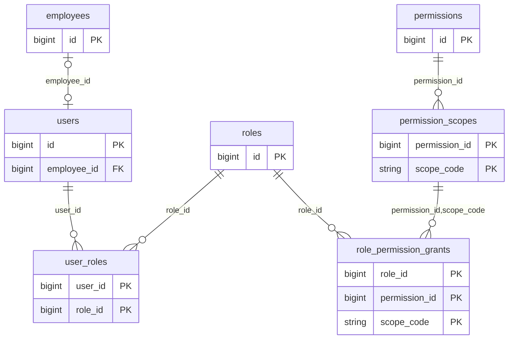
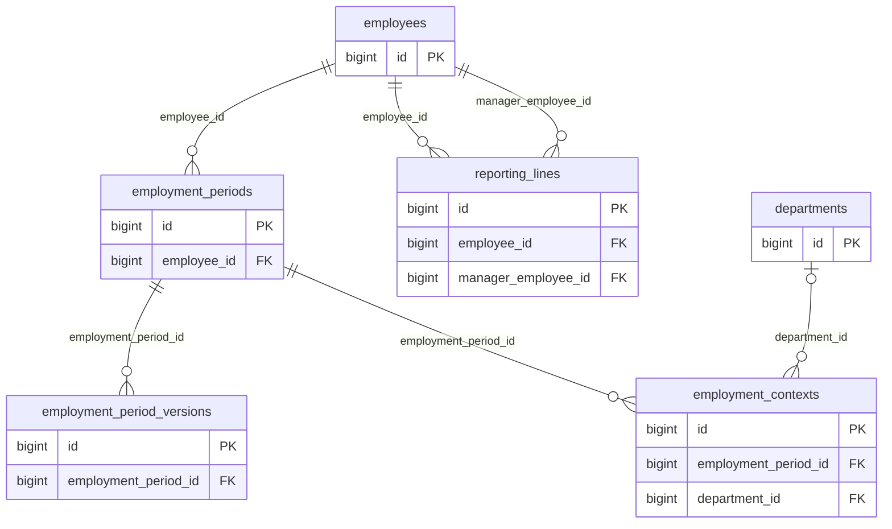
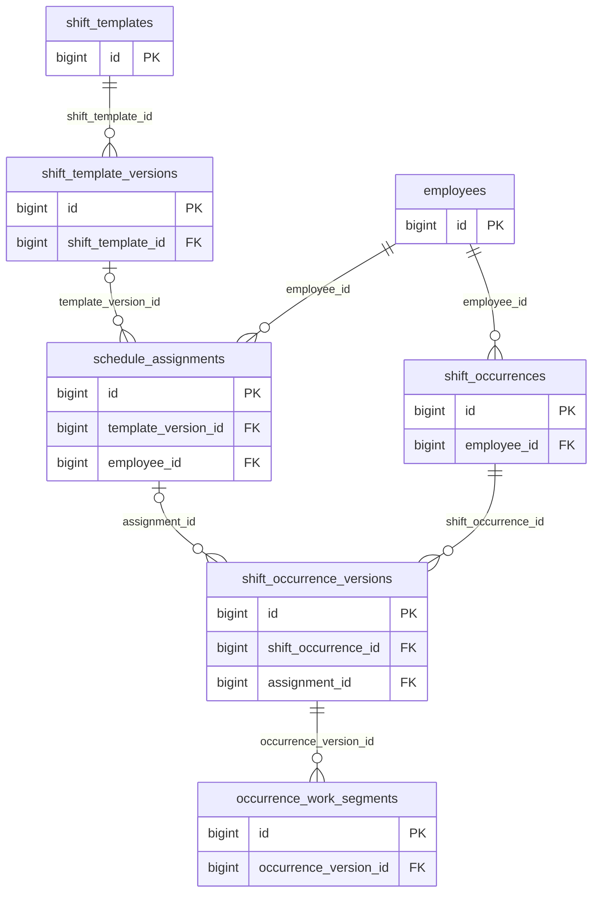
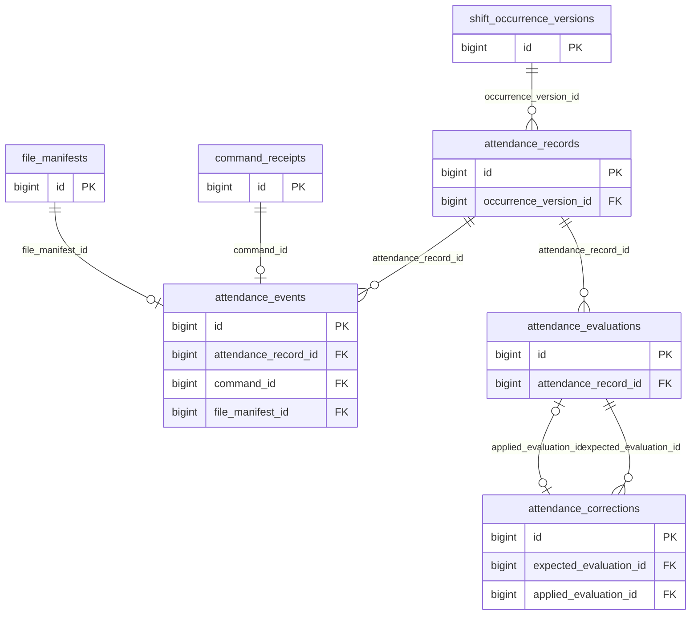
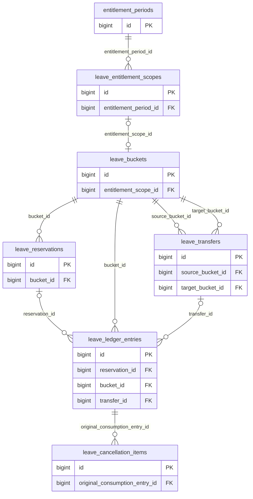
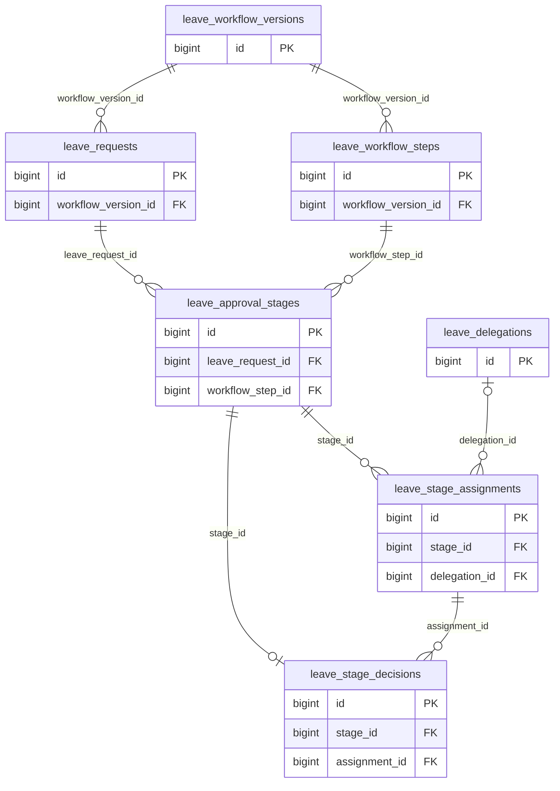
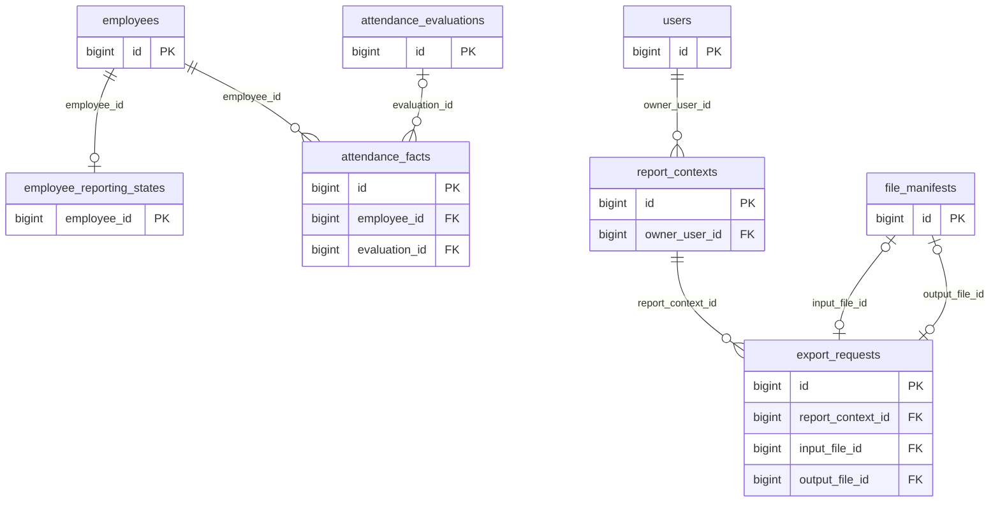
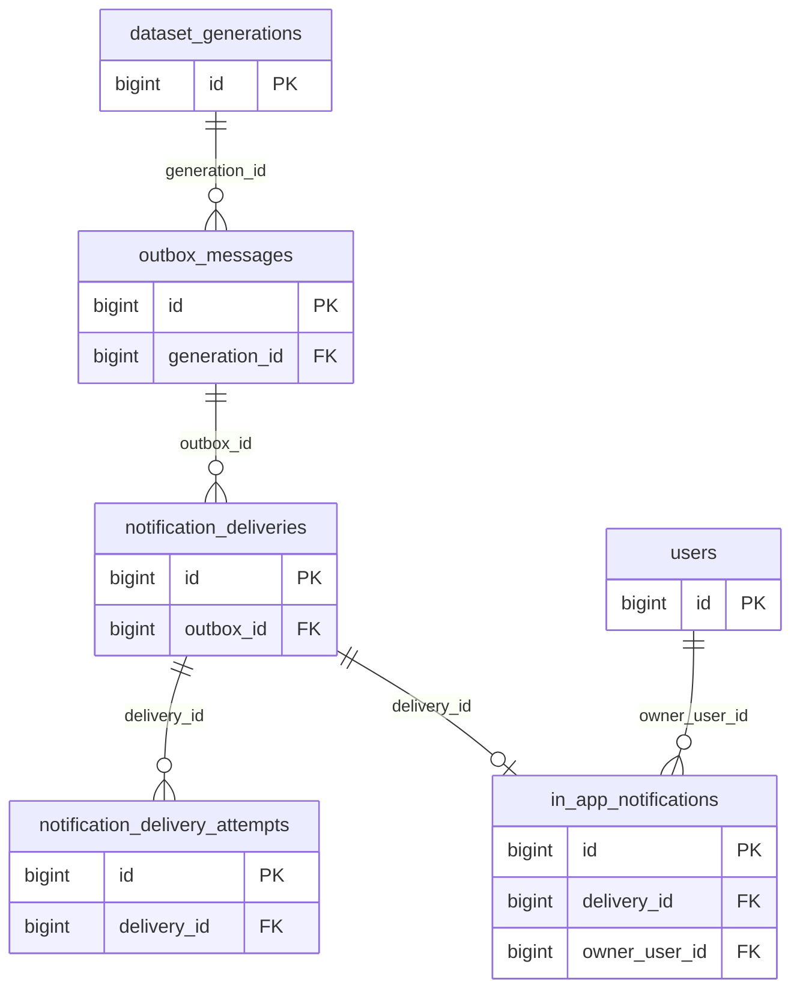

# Professional HRIS — Phase 1 Database Schema

## 1. Document Information

| Attribute | Value |
| --- | --- |
| Product / scope | Professional HRIS — Phase 1 MVP |
| Canonical path | `docs/phase-1/DATABASE-SCHEMA.md` |
| Version | 1.0 — Approved Database Schema Baseline |
| Status | **Approved Database Schema Baseline** |
| Date | 23 October 2026 (Asia/Jakarta) |
| Database | MySQL 8.4 LTS; InnoDB; utf8mb4 |
| Intended use | Translate reviewed contracts into Laravel migrations, models, queries and persistence workflows |
| Approval | Approved by the project owner on 23 October 2026 (Asia/Jakarta); implementation validation remains subject to the checks in §27 and §31 |
| Deliverable | This Markdown file only; no executable migrations, SQL files, models, seeders or application changes |

The approved PRD defines behavior. The technical architecture defines module and transaction boundaries. This document fixes the relational representation, precision, keys, indexes, history and implementation obligations within those boundaries. A database constraint is distinguished from a transactional application guard throughout.

## 2. Sources and Verification

Both canonical source files were read completely before design. Authority order is PRD, architecture, verified engine/framework capabilities, then the database decisions in §28.

| Source | Verified baseline | Integrity fingerprint (SHA-256) |
| --- | --- | --- |
| [PRD.md](PRD.md) | v1.0 — Approved Requirements Baseline; BR-01–BR-28 retained; all OD-01–OD-21 APPROVED, including revised OD-03/08/12/14/16/20 | `aad0e06d15a7c8b92629a2ed04e174bfaac2b5acbc7a4bcac3678a14d03dc494` |
| [ARCHITECTURE.md](ARCHITECTURE.md) | v1.0 — Technical Architecture Baseline; ADR-001–ADR-015; six modules | `ba68da4e18de4e18e88eabe253596098c6a9558c8ef822ff40b3fda9c11c2b07` |

Actual PRD identifiers total **136 requirements**, **18 workflows** (WF-01–WF-18) and **48 acceptance criteria** (AC-01–AC-48). Requirement groups: AUTH8, EMP8, ORG4, SHIFT9, ATT13, LEAVE15, DASH9, RULE10, DATA10, NTF6, SEC12, NFR16, QA8 and REL8. No source contradiction requiring a changed product decision was identified. Neither baseline is edited by this deliverable.

Primary capability references, checked for this design on 23 October 2026:

| Ref | Primary documentation / use |
| --- | --- |
| M01 | [MySQL 8.4 foreign keys](https://dev.mysql.com/doc/refman/8.4/en/create-table-foreign-keys.html): compatible types, unique referenced keys and immediate InnoDB NO ACTION behavior |
| M02 | [MySQL 8.4 CHECK constraints](https://dev.mysql.com/doc/refman/8.4/en/create-table-check-constraints.html): deterministic same-row expressions, explicit NULL handling, no cross-row assertions |
| M03 | [Generated columns](https://dev.mysql.com/doc/refman/8.4/en/create-table-generated-columns.html) and [indexes on generated columns](https://dev.mysql.com/doc/refman/8.4/en/create-table-secondary-indexes.html): nullable generated-key uniqueness |
| L01 | [Laravel 13 official users/session/reset migration](https://github.com/laravel/laravel/blob/13.x/database/migrations/0001_01_01_000000_create_users_table.php) and [sessions](https://laravel.com/docs/13.x/session): native authentication-driver contracts |
| L02 | [Laravel queues](https://laravel.com/docs/13.x/queues) and [cache](https://laravel.com/docs/13.x/cache): native database drivers and atomic cache locks |

The dictionary is a specification reviewed against these documented capabilities, not proof from executing DDL. The pinned Laravel ^13.23 package must be checked against the native driver tables during migration implementation. No dependency resolution or database initialization was performed here.

## 3. Scope and Design Goals

Persist the six established modules: Identity, Workforce, Scheduling, Attendance, Leave and Analytics. Shared Infrastructure owns coordination, private manifests, outbox/delivery, audit, retention and operational driver records; it is not a seventh business module. The 90 selected tables include 7 native Laravel tables. Their separation follows real immutable revisions, ordered child intervals, economic lineage and independent delivery/control lifecycles; there is no one-table-per-screen or speculative extension framework.

Phase 2 payroll, recruitment, performance review, benefits, multi-tenancy and external attendance terminals have no tables. No database event-sourcing stream, trigger-driven rule engine, soft-delete-everything layer, permission package schema, Redis contract or microservice boundary is introduced. SQL examples below are illustrative fragments inside this specification, never executed migrations.

## 4. Locked Technical Alignment

| Established contract | Database realization |
| --- | --- |
| One modular monolith / one relational database | Owned tables below; cross-module FK reads do not authorize cross-module writes |
| RC command transactions | Stable company/principal/employee rows, deterministic ordered locks, optimistic versions and unique intent/effect keys |
| Read-only RR reports | Separate snapshot connection; current authorization on a fresh RC connection |
| Custom scoped RBAC | Allowed permission/scope pair catalog, triple-key grants, multiple user roles; no role inheritance |
| Effective relational history | Stable identities + recorded revision/assertion rows + effective intervals; no generic event replay |
| Hybrid schedule | Explicit patterns/assignments/calendar layers; stable occurrences with protected resolved revisions |
| Exact leave accounting | Signed `DECIMAL(14,4)` immutable ledger, period-specific buckets, active reservations and paired carry |
| Private evidence | Immutable disk keys + manifests/leases/receipts; SQL and filesystem failure boundaries remain explicit |
| Reliable subsequent work | Transactional outbox plus separate publication/completion states and owned effect deduplication |
| Native Laravel drivers | Database queue, cache, cache locks and sessions; no Horizon/Redis/broker |
| Analytics | Immutable occurrence facts, per-employee source revision/dirty marker, calculator and authorization fingerprints |
| Isolated synthetic demo | Deployment-bound generation token, server-only fixtures and reset drain/invalidation |
| Recovery / retention | Exact policy-version approval, holds, durable tombstones and common off-host backup/control manifests |

## 5. Global Schema Conventions

### 5.1 Naming, keys, ownership and defaults

Use lower_snake_case plural table names and lower_snake_case columns. Entity PKs are `BIGINT UNSIGNED AUTO_INCREMENT`; pivot PKs are explicit composites; 1:1 coordination/detail tables use the parent FK as PK. `companies.id=1` is a non-auto singleton. Laravel's native migrations repository uses its native `INT UNSIGNED` key; native session/cache/reset string keys are deliberate driver exceptions. An opaque ASCII binary `CHAR(26)` ULID is used only for external request/occurrence/file/report identities or immutable logical families/epochs. Sequential IDs do not confer authority.

All tables use InnoDB. Default collation is `utf8mb4_0900_as_ci` (case-insensitive, accent-sensitive); exact machine keys and ULIDs explicitly use ASCII `ascii_bin`. Canonicalize and validate codes/email before insert. Do not silently broaden email equivalence, trim a stored machine key, or build a unique key from a display label. Password hashes and secrets use application cryptography, never database collation semantics.

Names are `fk_<table-code>_<ordinal>`, `uq_<table-code>_<purpose>`, `ix_<table-code>_<purpose>` and `ck_<table-code>_<ordinal>`. The concrete names appear in every dictionary. Index columns are ordered ASC; InnoDB can scan a B-tree backward for a matching reversed order. No duplicate queue-only prefix index is selected where its composite already supports that prefix. Every FK has an explicitly named left-prefix support index or PK/unique index.

In dictionaries, **— means no database DEFAULT**: supply a validated value on INSERT. `NULL` means SQL DEFAULT NULL and nullable; `AUTO_INCREMENT` is the PK allocator; `GENERATED` means generated-always VIRTUAL with no caller-supplied value. JSON defaults are not implicit empty objects. DATETIME values and mutable `updated_at` are supplied explicitly in UTC by the command. JSON contracts must include `schema_version`; reject unknown security-sensitive fields rather than passing through arbitrary client objects. Unknown enum/state values fail an enforced CHECK; configurable types/roles/permissions use catalogs instead of SQL ENUM.

All FKs have **ON DELETE NO ACTION / ON UPDATE NO ACTION**, omitted in actual DDL so the engine default applies [M01]. There are no cascades. PKs never change. Physical deletion, when authorized, is an explicit child-before-parent workflow that rechecks holds/protection; an FK blocks an incomplete deletion plan. A nullable FK means a legitimate missing/not-applicable relationship, not permission to detach protected history. No universal `deleted_at`: retire reusable catalogs, close effective intervals, archive identities, or preserve purge tombstones as defined per table.

### 5.2 Time and exact numeric representation

All application instants are UTC `DATETIME(6)`; connection/session timezone is UTC. IANA `VARCHAR(64)` timezone snapshots and business-local DATE values preserve interpretation. Date-only changes mean local00:00 converted once to UTC. `effective_from` is inclusive, `effective_to` exclusive, NULL end is unbounded. `recorded_at` is when an assertion/economic fact was entered; it is distinct from business effective time, upload receipt, job processing and expiry. Native Laravel Unix-second/TIMESTAMP columns are explicitly marked exceptions.

Resolved shift/template/event inputs have microsecond precision. To preserve an exact half-day boundary when working duration has an odd number of microseconds, leave/evaluation segments use `starts_at`/`ends_at` as UTC floors plus `start_half_us`/`end_half_us` bits (0 or1). A duration tick is **0.5 microsecond**; `tick(t,b)=2×UnixMicroseconds(t)+b`. Facts retain unsigned integer W/L/R ticks, not rounded weights. Original event instants always have bit0. Convert civil times/DST before arithmetic; no NOW()/timezone lookup appears in a CHECK or generated expression. Reject nonexistent/ambiguous local times unless the selected offset is explicitly retained in the resolution snapshot.

Leave economic quantities use signed `DECIMAL(14,4)`; quantities/reservations are positive by CHECK and ledger sign depends on kind. The storage range is a technical bound, not a company entitlement cap. brick/math BigRational computes unrounded cumulative entitlement; round HALF_UP at scale4 only at the posted cumulative boundary, subtract prior signed scope postings, and serialize four decimals. UI scale2 never feeds economics. No FLOAT/DOUBLE balance or stored mutable available/current balance exists.

### 5.3 Integrity boundaries and historical mutation

Use CHECK for documented finite states, boolean/sign/interval relations on non-FK scalar columns. CHECK UNKNOWN passes in MySQL; required values are NOT NULL and optional cases explicitly use IS NULL. For conservative portability with FK referential-action restrictions [M02], no CHECK below references an FK column, AUTO_INCREMENT column, another table, variable, stored function, subquery or current time. Typed scope/selector/linkage shapes and self/cycle restrictions are therefore explicit transactional guards. Do not mistake these guards for DDL enforcement.

Nullable generated markers implement conditional uniqueness [M03]. They reference ordinary stored fields/parent FKs, never the row's AUTO_INCREMENT PK; no FK targets a virtual column. Indexed generated markers add write computation/index maintenance. There are no PostgreSQL partial indexes or exclusion constraints. Interval overlap, hierarchy cycles, cumulative balance, paired ledger entries and current authorization remain application checks under stable locks (§20/§22).

Historical business bodies are append-only. Closing `superseded_at` or changing `is_current` is system-time metadata, not historical body rewriting; append replacement rows atomically and preserve old FK targets. Current recorded revision is different from currently effective context. Mutable aggregate status/lease/checkpoint fields use expected `row_version` or locked state. A command's successful economic/event result, critical audit, dirty marker and outbox obligation commit together.

## 6. Complete Table Inventory

| Owner | Tables |
| --- | --- |
| Identity | 7 |
| Workforce | 13 |
| Scheduling | 12 |
| Attendance | 8 |
| Leave | 21 |
| Analytics | 4 |
| Shared | 25 |
| Total | 90 (83 application-owned + 7 native framework) |

Shared contains18 application-owned infrastructure tables and7 native Laravel tables. Each inventory relationship is an actual FK except native/technical exceptions explained in its dictionary. Authoritative = current business identity/state; historical = preserved assertions/effects; derived = rebuildable metrics; operational/framework = recovery/driver machinery.

### Identity

| Table | Owner / class | Purpose / main entity | Important FK parents | Trace |
| --- | --- | --- | --- | --- |
| `users` | Identity / authoritative | Laravel authentication account and stable principal coordination row. | `dataset_generations`, `employees` | AUTH-001–AUTH-008; SEC-002; OD-01–OD-04; ADR-003 |
| `invitations` | Identity / historical | Single-use hashed invitation and activation history. | `users` | AUTH-001, AUTH-007; OD-02 |
| `roles` | Identity / authoritative | Editable private role catalog; no role inheritance. | None | AUTH-002–AUTH-005; ADR-003 |
| `permissions` | Identity / authoritative | Frozen PRD §8 permission keys and resource class. | None | AUTH-002–AUTH-006; OD-01 |
| `permission_scopes` | Identity / authoritative | Allowed exact permission/scope pairs from PRD catalog. | `permissions` | AUTH-003–AUTH-006; OD-01 |
| `role_permission_grants` | Identity / authoritative | Any number of allowed scopes for each role and permission. | `roles`, `permission_scopes` | AUTH-002–AUTH-006; OD-01; ADR-003 |
| `user_roles` | Identity / authoritative | Multiple direct roles per account. | `users`, `roles` | AUTH-003; OD-01 |

### Workforce

| Table | Owner / class | Purpose / main entity | Important FK parents | Trace |
| --- | --- | --- | --- | --- |
| `companies` | Workforce / authoritative | One company and its business timezone. | None | ORG-004; OD-05; ADR-004 |
| `departments` | Workforce / authoritative | Stable department identity; separate temporal parent edges. | None | ORG-001; EMP-002; OD-04 |
| `positions` | Workforce / authoritative | Configurable position catalog. | None | ORG-001; EMP-002; OD-04 |
| `organizational_levels` | Workforce / authoritative | Configurable organization level catalog. | None | ORG-001; EMP-002; OD-04 |
| `employment_types` | Workforce / authoritative | Configurable employment type; distinct from lifecycle. | None | ORG-001; EMP-002; OD-04 |
| `work_locations` | Workforce / authoritative | Stable location and IANA timezone; policy coordinates live in Attendance. | None | ORG-003–ORG-004; OD-05 |
| `employees` | Workforce / authoritative | Stable employee identity shared by all employment periods. | `dataset_generations` | EMP-001–EMP-008; AUTH-007; ADR-004 |
| `employment_periods` | Workforce / authoritative | Stable identity of one continuous employment period. | `employees` | EMP-002–EMP-006; OD-03; ADR-004 |
| `employee_private_details` | Workforce / authoritative | Restricted employee contact details and private employment notes. | `employees` | EMP-007–EMP-008; SEC-003–SEC-004; OD-04 |
| `employment_period_versions` | Workforce / historical | Immutable revised start/end boundaries of a period. | `employment_periods`, `users` | EMP-002–EMP-006; OD-03–OD-05; ADR-004 |
| `employment_contexts` | Workforce / historical | Complete effective-dated organizational/lifecycle assertion within a period. | `employment_periods`, `departments`, `positions`, `organizational_levels`, `work_locations`, `employment_types`, `employment_contexts`, `users` | EMP-002–EMP-006; ORG-001–ORG-004; OD-03–OD-05; ADR-004 |
| `department_edges` | Workforce / historical | Effective department parent graph independent of reporting graph. | `departments`, `department_edges`, `users` | ORG-001–ORG-002; OD-03; ADR-004 |
| `reporting_lines` | Workforce / historical | Effective employee → direct-manager graph. | `employees`, `reporting_lines`, `users` | ORG-002; EMP-005; AUTH-006; OD-03, OD-14; ADR-004 |

### Scheduling

| Table | Owner / class | Purpose / main entity | Important FK parents | Trace |
| --- | --- | --- | --- | --- |
| `shift_templates` | Scheduling / authoritative | Stable named shift template identity. | None | SHIFT-001; OD-05; ADR-005 |
| `shift_template_versions` | Scheduling / historical | Immutable local-time template revision. | `shift_templates`, `users` | SHIFT-001, SHIFT-007; OD-05 |
| `shift_template_breaks` | Scheduling / historical | Ordered nonworking intervals in one immutable template revision. | `shift_template_versions` | SHIFT-001; LEAVE-004; OD-05 |
| `schedule_patterns` | Scheduling / authoritative | Stable weekly/anchored rotation pattern identity. | None | SHIFT-002; ADR-005 |
| `schedule_pattern_versions` | Scheduling / historical | Immutable pattern kind and cycle revision. | `schedule_patterns`, `users` | SHIFT-002; OD-06 |
| `schedule_pattern_days` | Scheduling / historical | Explicit working/nonworking pattern slots; more than one nonoverlapping slot allowed. | `schedule_pattern_versions`, `shift_template_versions`, `work_locations` | SHIFT-002; RULE-002 |
| `schedule_assignments` | Scheduling / historical | Effective weekly/rotation/dated assignment assertions with retained revisions. | `employees`, `schedule_pattern_versions`, `shift_template_versions`, `work_locations`, `schedule_assignments`, `users` | SHIFT-002–SHIFT-004, SHIFT-008–SHIFT-009; OD-06 |
| `calendar_entries` | Scheduling / historical | Revised company holiday, location exception or employee special override. | `companies`, `work_locations`, `employees`, `shift_template_versions`, `calendar_entries`, `users` | SHIFT-003, SHIFT-005–SHIFT-009; OD-06 |
| `shift_occurrences` | Scheduling / authoritative | Stable occurrence identity reused by all modules. | `employees` | SHIFT-004, SHIFT-007, SHIFT-009; ATT-002; RULE-002, RULE-009; ADR-005 |
| `shift_occurrence_versions` | Scheduling / historical | Resolved immutable occurrence context, interval and source fingerprint. | `shift_occurrences`, `schedule_assignments`, `calendar_entries`, `shift_template_versions`, `work_locations`, `employment_period_versions`, `employment_contexts`, `reporting_lines` | SHIFT-006–SHIFT-007; EMP-002; LEAVE-012; ADR-004–ADR-005 |
| `occurrence_work_segments` | Scheduling / historical | Immutable positive work intervals after resolved breaks. | `shift_occurrence_versions` | SHIFT-001; LEAVE-004; OD-05, OD-11 |
| `schedule_materialization_states` | Scheduling / operational | Per-employee resumable hybrid materialization checkpoint. | `employees` | SHIFT-009; OD-06; ADR-005 |

### Attendance

| Table | Owner / class | Purpose / main entity | Important FK parents | Trace |
| --- | --- | --- | --- | --- |
| `attendance_policy_versions` | Attendance / historical | Effective per-field policy at company/location/shift layer. | `companies`, `work_locations`, `shift_templates`, `users` | ATT-004–ATT-007; OD-07–OD-08; ADR-009 |
| `attendance_policy_resolutions` | Attendance / historical | Immutable fully resolved values used by one or more evaluations/events. | `attendance_policy_versions` | ATT-004–ATT-007; OD-07–OD-08 |
| `attendance_records` | Attendance / authoritative | One attendance aggregate/session per stable occurrence. | `shift_occurrences`, `employees`, `employment_periods`, `shift_occurrence_versions` | ATT-001–ATT-011; OD-03, OD-07, OD-10, OD-17; ADR-009 |
| `attendance_events` | Attendance / historical | Immutable ordinary clock-in/out and original private evidence. | `attendance_records`, `command_receipts`, `file_manifests`, `attendance_policy_resolutions` | ATT-001–ATT-005, ATT-012–ATT-013; DATA-009; OD-08–OD-09, OD-20 |
| `attendance_evaluations` | Attendance / historical | Versioned interpretation of original and independently reviewed attendance. | `attendance_records`, `attendance_policy_resolutions` | ATT-007–ATT-010; DASH-004–DASH-006; OD-03, OD-10, OD-17; ADR-011 |
| `attendance_evaluation_segments` | Attendance / historical | Reviewed required/excused/established-work intervals supporting evaluation. | `attendance_evaluations`, `occurrence_work_segments`, `leave_request_segments` | ATT-006–ATT-011; LEAVE-004, LEAVE-013; OD-03, OD-11 |
| `attendance_corrections` | Attendance / authoritative | Independent pending correction and its applied evaluation link. | `attendance_records`, `employees`, `users`, `attendance_evaluations` | ATT-008–ATT-009; AUTH-008; OD-03, OD-10 |
| `attendance_exceptions` | Attendance / authoritative | Owned unresolved attendance/offboarding conflict, including no-account employees. | `employees`, `employment_period_versions`, `shift_occurrences`, `users`, `attendance_corrections` | EMP-003–EMP-006; ATT-007–ATT-011; OD-03 |

### Leave

| Table | Owner / class | Purpose / main entity | Important FK parents | Trace |
| --- | --- | --- | --- | --- |
| `leave_types` | Leave / authoritative | Configurable leave type, including annual-entitlement classification. | None | LEAVE-001; LEAVE-014; OD-11–OD-12 |
| `leave_workflow_versions` | Leave / historical | Immutable ordered workflow definition revision and explicit independence exception. | `users` | LEAVE-006–LEAVE-007, LEAVE-011; AUTH-008; OD-14; ADR-010 |
| `leave_workflow_steps` | Leave / historical | Typed ordered selector and explicit same-stage fallback. | `leave_workflow_versions`, `users`, `roles` | LEAVE-006–LEAVE-007, LEAVE-011; OD-14; ADR-010 |
| `leave_policy_versions` | Leave / historical | Effective type-specific employee/location/company policy. | `leave_types`, `companies`, `work_locations`, `employees`, `leave_workflow_versions`, `users` | LEAVE-001–LEAVE-003; OD-11–OD-13; ADR-010 |
| `leave_policy_eligibility_types` | Leave / historical | Optional configured employment-type eligibility of policy revision. | `leave_policy_versions`, `employment_types` | LEAVE-001; OD-11 |
| `entitlement_periods` | Leave / authoritative | Company calendar-year entitlement identity. | `companies` | LEAVE-002, LEAVE-005; OD-12 |
| `leave_entitlement_scopes` | Leave / authoritative | Stable cumulative calculation scope and processed-through checkpoint. | `employees`, `leave_types`, `entitlement_periods`, `leave_policy_versions` | LEAVE-002–LEAVE-003; OD-12; ADR-010 |
| `leave_buckets` | Leave / authoritative | Employee/type/year-specific posted entitlement with validity and immutable lineage. | `employees`, `leave_types`, `entitlement_periods`, `leave_policy_versions`, `leave_entitlement_scopes`, `leave_buckets` | LEAVE-002–LEAVE-006, LEAVE-008, LEAVE-010; OD-12–OD-13; ADR-010 |
| `leave_transfers` | Leave / historical | One retained carry operation with paired source debit/receiving credit. | `leave_buckets`, `command_receipts` | LEAVE-002–LEAVE-003, LEAVE-010; OD-12 |
| `leave_requests` | Leave / authoritative | Stable leave request and snapshotted workflow contract. | `dataset_generations`, `employees`, `users`, `leave_types`, `leave_workflow_versions` | LEAVE-004–LEAVE-010, LEAVE-012–LEAVE-015; OD-11–OD-14 |
| `leave_calculation_versions` | Leave / historical | Immutable shift-aware request calculation accepted by requester. | `leave_requests`, `users` | LEAVE-004–LEAVE-005, LEAVE-012; OD-11–OD-12 |
| `leave_request_items` | Leave / historical | Per-shift-start-date included/excluded item and entitlement attribution. | `leave_calculation_versions`, `shift_occurrences`, `shift_occurrence_versions`, `employment_contexts`, `leave_policy_versions`, `entitlement_periods` | LEAVE-004–LEAVE-005, LEAVE-012; OD-11–OD-12 |
| `leave_request_segments` | Leave / historical | Exact covered work intervals excluding breaks. | `leave_request_items`, `occurrence_work_segments` | LEAVE-004; ATT-006; OD-11 |
| `leave_reservations` | Leave / authoritative | Immutable allocation identity with active/consumed/released lifecycle. | `leave_request_items`, `leave_buckets`, `leave_reservations`, `command_receipts` | LEAVE-005–LEAVE-010; DATA-002; OD-12 |
| `leave_cancellation_requests` | Leave / authoritative | Independent approval for whole-future cancellation or historical HR resolution. | `leave_requests`, `users` | LEAVE-010, LEAVE-013; OD-12–OD-13 |
| `leave_ledger_entries` | Leave / historical | Immutable signed posted leave economics; sole source of posted balance. | `leave_buckets`, `leave_entitlement_scopes`, `leave_reservations`, `leave_request_items`, `leave_transfers`, `leave_ledger_entries`, `leave_cancellation_requests`, `command_receipts`, `users` | LEAVE-002–LEAVE-003, LEAVE-008, LEAVE-010, LEAVE-014; DATA-001–DATA-004; OD-12–OD-13; ADR-010 |
| `leave_cancellation_items` | Leave / historical | Explicit debit/unit mapping for approved whole or partial reversal. | `leave_cancellation_requests`, `leave_ledger_entries` | LEAVE-010; OD-12–OD-13 |
| `leave_approval_stages` | Leave / authoritative | Submitted sequential stage instance and due-work checkpoint. | `leave_requests`, `leave_workflow_steps` | LEAVE-006–LEAVE-011; NTF-004; OD-14–OD-15 |
| `leave_delegations` | Leave / authoritative | Dated existing-authority delegation; no authority grant. | `users` | LEAVE-011; AUTH-008; OD-14 |
| `leave_stage_assignments` | Leave / historical | Resolved candidate membership and retained delegation/reassignment lineage. | `leave_approval_stages`, `users`, `leave_delegations` | LEAVE-007, LEAVE-011; OD-14 |
| `leave_stage_decisions` | Leave / historical | Immutable one decision per stage and actual actor history. | `leave_approval_stages`, `leave_requests`, `leave_stage_assignments`, `users`, `command_receipts` | AUTH-008; LEAVE-007–LEAVE-008, LEAVE-011; OD-14; ADR-010 |

### Analytics

| Table | Owner / class | Purpose / main entity | Important FK parents | Trace |
| --- | --- | --- | --- | --- |
| `employee_reporting_states` | Analytics / operational | Per-employee source revision and durable dirty-range marker. | `employees` | DASH-004–DASH-006; NFR-008; ADR-011 |
| `attendance_facts` | Analytics / derived | Immutable occurrence metric inputs and retained historical grouping context. | `employees`, `shift_occurrences`, `shift_occurrence_versions`, `attendance_evaluations`, `employment_contexts`, `departments`, `work_locations` | DASH-001–DASH-009; ATT-010; OD-17, OD-19; ADR-011 |
| `report_contexts` | Analytics / operational | Report/drill token context with reproducible query and source metadata. | `dataset_generations`, `users` | DASH-002–DASH-008; DATA-010; OD-17, OD-19; ADR-011 |
| `export_requests` | Analytics / operational | Queued owner-bound snapshot-to-private-CSV lifecycle. | `dataset_generations`, `users`, `command_receipts`, `report_contexts`, `file_manifests` | DASH-007–DASH-009; DATA-010; OD-16, OD-19; ADR-008, ADR-011–ADR-012 |

### Shared

| Table | Owner / class | Purpose / main entity | Important FK parents | Trace |
| --- | --- | --- | --- | --- |
| `dataset_generations` | Shared / operational | Dataset identity and reset epoch; not a tenant. | None | SEC-011; NFR-014–NFR-016; ADR-013 |
| `company_command_fences` | Shared / operational | Always-existing company security/configuration/reset lock. | `companies` | DATA-001–DATA-003; ADR-006 |
| `employee_coordination` | Shared / operational | Stable serialization row even when business child rows do not exist. | `employees` | DATA-002–DATA-003; ADR-006 |
| `command_receipts` | Shared / operational | Durable idempotent command intent and recoverable result. | `dataset_generations`, `users`, `employees` | ATT-013; DATA-004, DATA-009; RULE-010; ADR-006, ADR-009 |
| `file_manifests` | Shared / operational | Private immutable-file lifecycle, leases, integrity and purge tombstone. | `dataset_generations`, `employees`, `users`, `command_receipts` | ATT-012; DATA-009; SEC-003, SEC-007–SEC-008; ADR-009, ADR-015 |
| `audit_events` | Shared / historical | Durable critical mutation evidence in the business commit. | `dataset_generations`, `users`, `command_receipts` | SEC-005–SEC-006, SEC-012; DATA-001; ADR-006–ADR-007 |
| `outbox_messages` | Shared / operational | Durable per-consumer publication AND completion obligation. | `dataset_generations`, `command_receipts` | NTF-001–NTF-006; DATA-001, DATA-004; NFR-015; ADR-007–ADR-008 |
| `notification_deliveries` | Shared / operational | One durable recipient/channel delivery with bounded retry/uncertain state. | `dataset_generations`, `outbox_messages`, `users` | NTF-001–NTF-006; OD-02, OD-15; ADR-007 |
| `notification_delivery_attempts` | Shared / historical | Observed provider/channel attempt and ACK uncertainty. | `notification_deliveries` | NTF-003, NTF-006; OD-15 |
| `in_app_notifications` | Shared / authoritative | Owner-only notification center and unread/read marker. | `users`, `notification_deliveries` | NTF-002, NTF-005; AUTH-006; OD-01, OD-15 |
| `retention_categories` | Shared / authoritative | Bounded data-category catalog, separate candidate durations from authority. | None | SEC-007–SEC-008; OD-16, OD-21; ADR-015 |
| `retention_policy_versions` | Shared / historical | Exact versioned cleanup policy and approval projection. | `retention_categories`, `users` | SEC-007; OD-16, OD-21; ADR-015 |
| `retention_policy_actions` | Shared / historical | Append validation/approval/withdrawal action history. | `retention_policy_versions`, `users` | SEC-007; OD-16, OD-21 |
| `retention_holds` | Shared / authoritative | Current dispute/legal/operational hold at category, employee or individual-file scope. | `retention_categories`, `employees`, `file_manifests`, `users` | SEC-007–SEC-008; DATA-006; OD-16; ADR-015 |
| `cleanup_runs` | Shared / operational | Category/version-bound preview and execution lifecycle. | `dataset_generations`, `retention_policy_versions`, `users` | SEC-007; DATA-006; OD-16; ADR-015 |
| `cleanup_items` | Shared / operational | Candidate, execution state and durable deletion tombstone in one bounded table. | `cleanup_runs`, `dataset_generations` | SEC-007–SEC-008; DATA-006, DATA-009; OD-16, OD-18; ADR-015 |
| `operational_checkpoints` | Shared / operational | Durable due/health/lease marker for named scheduled maintenance tasks. | `dataset_generations` | NTF-004–NTF-006; NFR-011–NFR-012, NFR-015–NFR-016; ADR-008, ADR-013, ADR-015 |
| `operational_runs` | Shared / operational | Observed maintenance/backup/restore/reset attempt and verification manifest reference. | `operational_checkpoints` | SEC-008; NFR-012, NFR-015–NFR-016; OD-18, OD-20; ADR-013, ADR-015 |
| `migrations` | Shared / framework | Laravel migration repository, separate from business history. | None | ADR-001; §23 |
| `sessions` | Shared / framework | Native database session driver records. | None | AUTH-001, AUTH-006; OD-02; ADR-008 |
| `password_reset_tokens` | Shared / framework | Native hashed reset-broker token. | None | AUTH-001; SEC-002; OD-02 |
| `jobs` | Shared / framework | Native Laravel database queue; payload is generation-aware IDs. | None | NTF-001–NTF-006; NFR-015; ADR-008 |
| `failed_jobs` | Shared / framework | Native terminal worker failure diagnostics with minimized payloads. | None | NTF-006; NFR-012; ADR-008 |
| `cache` | Shared / framework | Native Laravel database cache, never balance/authority source. | None | NFR-008; DASH-008; ADR-008 |
| `cache_locks` | Shared / framework | Native Laravel atomic cache locks for overlap optimization. | None | NFR-015; ADR-008 |

## 7. Identity Schema

Read grants as `user_roles → role_permission_grants → permission_scopes → permissions`. A role can have both team and self for one permission because each scope is a distinct triple-key row. Union only grants for the exact requested permission. Intersect the resulting employee sets for every required base/action/sensitive-field permission. Global capabilities G and owner-only O are separate catalog pairs; they cannot enlarge employee sets. Current team is the recursive current reporting tree excluding the actor's own employee unless self is granted. No employee link means empty team/self.

Seed the exact permission keys, allowed scopes and default persona grants from PRD §8; do not recreate the whole matrix in another authority. `permissions.resource_class` and allowed pairs constrain administration. The composite grant FK rejects an unlisted permission/scope pair. Every role/account/link/security/hierarchy mutation uses company X fence and authorization revision invalidation. A session stores the user's security revision and generation token; current employment/grants/effective graph are rechecked on every request, file read, notification target and export phase. Cache validity ends at the next effective relationship boundary even if the scheduler has not run.

Invitation issuance can reserve `users.employee_id` while status remains invited; this gives SQL one-link protection without treating the invitation as activation. WF-01 still activates only after valid single-use token/password and eligibility checks. Resend revokes prior issuance. Reset tokens remain in the native broker table (§16). Minimum password12, invitation48h, reset60m, idle30m, absolute8h, reauthentication15m and account/IP5 attempts/minute are application rules, not adjustable database defaults. No remember-me column/behavior is selected.

### 7.1 `users`

**Owner:** Identity. **Class:** authoritative. Laravel authentication account and stable principal coordination row.

**Mutation:** Owner commands update with expected row_version under the specified locks.

**Retention:** Structured-HR candidate: five years after employment end where applicable, subject to exact category approval and closure of every FK/hold/economic/evidence dependency. Catalog identities are retired; no automatic deletion.

**Trace:** AUTH-001–AUTH-008; SEC-002; OD-01–OD-04; ADR-003.

| Column | Exact MySQL type | NULL | DB default | Contract |
| --- | --- | --- | --- | --- |
| `id` | `BIGINT UNSIGNED` | NO | `AUTO_INCREMENT` | Internal clustered identity. |
| `generation_id` | `BIGINT UNSIGNED` | NO | — | Parent identity; ownership/context checked in the command. |
| `employee_id` | `BIGINT UNSIGNED` | YES | `NULL` | Optional reserved one-to-one employee link; invitation claim is not active access. |
| `name` | `VARCHAR(160)` | NO | — | Persisted name; exact type/null/default contract shown here. |
| `email` | `VARCHAR(254)` | NO | — | Canonical case-folded login email; utf8mb4_0900_as_ci uniqueness. |
| `password` | `VARCHAR(255)` | YES | `NULL` | Laravel secure password hash; NULL only before activation. |
| `email_verified_at` | `DATETIME(6)` | YES | `NULL` | UTC instant. |
| `status` | `VARCHAR(32) CHARACTER SET ascii COLLATE ascii_bin` | NO | `'invited'` | Allowed: invited, active, disabled |
| `security_revision` | `BIGINT UNSIGNED` | NO | `1` | Session/export invalidation; bump disable/reset/link or grant-affecting change. |
| `row_version` | `BIGINT UNSIGNED` | NO | `1` | Monotonic optimistic concurrency token; update with expected version predicate. |
| `disabled_at` | `DATETIME(6)` | YES | `NULL` | UTC instant. |
| `created_at` | `DATETIME(6)` | NO | — | UTC instant. |
| `updated_at` | `DATETIME(6)` | NO | — | Last mutable projection update; UTC. |

**Keys and indexes** (column order is left to right, ASC unless explicitly stated):

| Name | Kind / ordered columns | Purpose / cost |
| --- | --- | --- |
| PRIMARY | PK (`id`) | Clustered row identity; all secondary entries carry this key. |
| uq_usr_email | UNIQUE (`email`) | Unique login identity. |
| uq_usr_employee | UNIQUE (`employee_id`) | NULL permits unlinked accounts; at most one account per employee. |
| ix_usr_state | INDEX (`status`, `id`) | Active-administrator guard after small role expansion; low cardinality prefix alone is not sufficient. |
| ix_usr_fk1 | INDEX (`generation_id`) | FK support/equality parent join only; no additional selectivity claim. Retain while FK exists. |

**Foreign keys:**

| Constraint | Child → referenced unique key | Delete / update |
| --- | --- | --- |
| fk_usr_01 | (`generation_id`) → `dataset_generations` (`id`) | NO ACTION / NO ACTION |
| fk_usr_02 | (`employee_id`) → `employees` (`id`) | NO ACTION / NO ACTION |

**Enforced CHECK constraints:**

| Name | SQL expression |
| --- | --- |
| ck_usr_01 | `status IN ('invited','active','disabled')` |

**Transactional guards:** Lock existing users IDs ascending. Account active requires password and effective work eligibility where linked. No remember_token; remember-me disabled. Last active security administrator/self-escalation checked under company X fence.

### 7.2 `invitations`

**Owner:** Identity. **Class:** historical. Single-use hashed invitation and activation history.

**Mutation:** Issuance/token identity immutable; one-way accepted/revoked/current metadata transitions under the principal lock.

**Retention:** Operational-log candidate30d only where applicable and independently approved; unfinished receipt/outbox/delivery/recovery obligations remain protected. No age-only source purge.

**Trace:** AUTH-001, AUTH-007; OD-02.

| Column | Exact MySQL type | NULL | DB default | Contract |
| --- | --- | --- | --- | --- |
| `id` | `BIGINT UNSIGNED` | NO | `AUTO_INCREMENT` | Internal clustered identity. |
| `user_id` | `BIGINT UNSIGNED` | NO | — | Parent identity; ownership/context checked in the command. |
| `issued_by_user_id` | `BIGINT UNSIGNED` | NO | — | Parent identity; ownership/context checked in the command. |
| `token_hash` | `BINARY(32)` | NO | — | SHA-256 digest of high-entropy invitation token, never plaintext. |
| `expires_at` | `DATETIME(6)` | NO | — | Issued +48h UTC. |
| `accepted_at` | `DATETIME(6)` | YES | `NULL` | UTC instant. |
| `revoked_at` | `DATETIME(6)` | YES | `NULL` | UTC instant. |
| `is_current` | `TINYINT UNSIGNED` | NO | `1` | Boolean 0 or 1. |
| `current_marker` | `TINYINT UNSIGNED` | YES | `GENERATED` | One non-revoked current issuance, including expired until replaced. Expression: `CASE WHEN is_current = 1 THEN 1 ELSE NULL END`; VIRTUAL, application read-only. |
| `recorded_at` | `DATETIME(6)` | NO | — | UTC time this version/effect was recorded; not business-effective time. |

**Keys and indexes** (column order is left to right, ASC unless explicitly stated):

| Name | Kind / ordered columns | Purpose / cost |
| --- | --- | --- |
| PRIMARY | PK (`id`) | Clustered row identity; all secondary entries carry this key. |
| uq_inv_token | UNIQUE (`token_hash`) | Token lookup without disclosure. |
| uq_inv_current | UNIQUE (`user_id`, `current_marker`) | Resend retires old issuance atomically. |
| ix_inv_fk2 | INDEX (`issued_by_user_id`) | FK support/equality parent join only; no additional selectivity claim. Retain while FK exists. |

**Foreign keys:**

| Constraint | Child → referenced unique key | Delete / update |
| --- | --- | --- |
| fk_inv_01 | (`user_id`) → `users` (`id`) | NO ACTION / NO ACTION |
| fk_inv_02 | (`issued_by_user_id`) → `users` (`id`) | NO ACTION / NO ACTION |

**Enforced CHECK constraints:**

| Name | SQL expression |
| --- | --- |
| ck_inv_01 | `accepted_at IS NULL OR revoked_at IS NULL` |
| ck_inv_02 | `is_current IN (0,1)` |

**Transactional guards:** Expires_at > receipt time and current/not accepted/not revoked rechecked under user/employee locks; activate once. Resend revokes old token.

### 7.3 `roles`

**Owner:** Identity. **Class:** authoritative. Editable private role catalog; no role inheritance.

**Mutation:** Owner commands update with expected row_version under the specified locks.

**Retention:** Structured-HR candidate: five years after employment end where applicable, subject to exact category approval and closure of every FK/hold/economic/evidence dependency. Catalog identities are retired; no automatic deletion.

**Trace:** AUTH-002–AUTH-005; ADR-003.

| Column | Exact MySQL type | NULL | DB default | Contract |
| --- | --- | --- | --- | --- |
| `id` | `BIGINT UNSIGNED` | NO | `AUTO_INCREMENT` | Internal clustered identity. |
| `key` | `VARCHAR(64) CHARACTER SET ascii COLLATE ascii_bin` | NO | — | Persisted key; exact type/null/default contract shown here. |
| `name` | `VARCHAR(160)` | NO | — | Persisted name; exact type/null/default contract shown here. |
| `description` | `VARCHAR(500)` | YES | `NULL` | Persisted description; exact type/null/default contract shown here. |
| `row_version` | `BIGINT UNSIGNED` | NO | `1` | Monotonic optimistic concurrency token; update with expected version predicate. |
| `retired_at` | `DATETIME(6)` | YES | `NULL` | UTC instant. |
| `created_at` | `DATETIME(6)` | NO | — | UTC instant. |
| `updated_at` | `DATETIME(6)` | NO | — | Last mutable projection update; UTC. |

**Keys and indexes** (column order is left to right, ASC unless explicitly stated):

| Name | Kind / ordered columns | Purpose / cost |
| --- | --- | --- |
| PRIMARY | PK (`id`) | Clustered row identity; all secondary entries carry this key. |
| uq_rol_key | UNIQUE (`key`) | Exact role lookup. |

**Foreign keys:** none; any intentional native/technical reference exception is explained above.

**Enforced CHECK constraints:** none beyond type, NULL, key and FK constraints.

**Transactional guards:** Role names never bypass permission/assignment rules; demo privileged mutations denied.

### 7.4 `permissions`

**Owner:** Identity. **Class:** authoritative. Frozen PRD §8 permission keys and resource class.

**Mutation:** Seed only exact approved catalog; changes require source change control.

**Retention:** Structured-HR candidate: five years after employment end where applicable, subject to exact category approval and closure of every FK/hold/economic/evidence dependency. Catalog identities are retired; no automatic deletion.

**Trace:** AUTH-002–AUTH-006; OD-01.

| Column | Exact MySQL type | NULL | DB default | Contract |
| --- | --- | --- | --- | --- |
| `id` | `BIGINT UNSIGNED` | NO | `AUTO_INCREMENT` | Internal clustered identity. |
| `key` | `VARCHAR(96) CHARACTER SET ascii COLLATE ascii_bin` | NO | — | Exact approved permission string. |
| `resource_class` | `VARCHAR(32) CHARACTER SET ascii COLLATE ascii_bin` | NO | — | Allowed: employee, global, owner |
| `description` | `VARCHAR(255)` | NO | — | Persisted description; exact type/null/default contract shown here. |

**Keys and indexes** (column order is left to right, ASC unless explicitly stated):

| Name | Kind / ordered columns | Purpose / cost |
| --- | --- | --- |
| PRIMARY | PK (`id`) | Clustered row identity; all secondary entries carry this key. |
| uq_per_key | UNIQUE (`key`) | Exact catalog key lookup. |

**Foreign keys:** none; any intentional native/technical reference exception is explained above.

**Enforced CHECK constraints:**

| Name | SQL expression |
| --- | --- |
| ck_per_01 | `resource_class IN ('employee','global','owner')` |

**Transactional guards:** Validate current permission, expected version and active generation; apply owner workflow under the locks in §22. A referenced retired catalog row remains readable for history but cannot be selected for new work.

### 7.5 `permission_scopes`

**Owner:** Identity. **Class:** authoritative. Allowed exact permission/scope pairs from PRD catalog.

**Mutation:** Seed catalog pairs only; global/owner permissions never acquire employee scope.

**Retention:** Structured-HR candidate: five years after employment end where applicable, subject to exact category approval and closure of every FK/hold/economic/evidence dependency. Catalog identities are retired; no automatic deletion.

**Trace:** AUTH-003–AUTH-006; OD-01.

| Column | Exact MySQL type | NULL | DB default | Contract |
| --- | --- | --- | --- | --- |
| `permission_id` | `BIGINT UNSIGNED` | NO | — | Parent identity; ownership/context checked in the command. |
| `scope_code` | `VARCHAR(32) CHARACTER SET ascii COLLATE ascii_bin` | NO | — | Allowed: all, team, self, global, owner |

**Keys and indexes** (column order is left to right, ASC unless explicitly stated):

| Name | Kind / ordered columns | Purpose / cost |
| --- | --- | --- |
| PRIMARY | PK (`permission_id`, `scope_code`) | Clustered row identity; all secondary entries carry this key. |

**Foreign keys:**

| Constraint | Child → referenced unique key | Delete / update |
| --- | --- | --- |
| fk_ps_01 | (`permission_id`) → `permissions` (`id`) | NO ACTION / NO ACTION |

**Enforced CHECK constraints:**

| Name | SQL expression |
| --- | --- |
| ck_ps_01 | `scope_code IN ('all','team','self','global','owner')` |

**Transactional guards:** Validate current permission, expected version and active generation; apply owner workflow under the locks in §22. A referenced retired catalog row remains readable for history but cannot be selected for new work.

### 7.6 `role_permission_grants`

**Owner:** Identity. **Class:** authoritative. Any number of allowed scopes for each role and permission.

**Mutation:** Owner commands update with expected row_version under the specified locks.

**Retention:** Structured-HR candidate: five years after employment end where applicable, subject to exact category approval and closure of every FK/hold/economic/evidence dependency. Catalog identities are retired; no automatic deletion.

**Trace:** AUTH-002–AUTH-006; OD-01; ADR-003.

| Column | Exact MySQL type | NULL | DB default | Contract |
| --- | --- | --- | --- | --- |
| `role_id` | `BIGINT UNSIGNED` | NO | — | Parent identity; ownership/context checked in the command. |
| `permission_id` | `BIGINT UNSIGNED` | NO | — | Parent identity; ownership/context checked in the command. |
| `scope_code` | `VARCHAR(32) CHARACTER SET ascii COLLATE ascii_bin` | NO | — | Allowed: all, team, self, global, owner |
| `created_at` | `DATETIME(6)` | NO | — | UTC instant. |

**Keys and indexes** (column order is left to right, ASC unless explicitly stated):

| Name | Kind / ordered columns | Purpose / cost |
| --- | --- | --- |
| PRIMARY | PK (`role_id`, `permission_id`, `scope_code`) | Clustered row identity; all secondary entries carry this key. |
| ix_rpg_fk2 | INDEX (`permission_id`, `scope_code`) | FK support/equality parent join only; no additional selectivity claim. Retain while FK exists. |

**Foreign keys:**

| Constraint | Child → referenced unique key | Delete / update |
| --- | --- | --- |
| fk_rpg_01 | (`role_id`) → `roles` (`id`) | NO ACTION / NO ACTION |
| fk_rpg_02 | (`permission_id`, `scope_code`) → `permission_scopes` (`permission_id`, `scope_code`) | NO ACTION / NO ACTION |

**Enforced CHECK constraints:** none beyond type, NULL, key and FK constraints.

**Transactional guards:** Composite FK (permission_id,scope_code) to permission_scopes. Union only the same permission; required permissions intersect. Company X fence and bump authorization_revision.

### 7.7 `user_roles`

**Owner:** Identity. **Class:** authoritative. Multiple direct roles per account.

**Mutation:** Owner commands update with expected row_version under the specified locks.

**Retention:** Structured-HR candidate: five years after employment end where applicable, subject to exact category approval and closure of every FK/hold/economic/evidence dependency. Catalog identities are retired; no automatic deletion.

**Trace:** AUTH-003; OD-01.

| Column | Exact MySQL type | NULL | DB default | Contract |
| --- | --- | --- | --- | --- |
| `user_id` | `BIGINT UNSIGNED` | NO | — | Parent identity; ownership/context checked in the command. |
| `role_id` | `BIGINT UNSIGNED` | NO | — | Parent identity; ownership/context checked in the command. |
| `created_at` | `DATETIME(6)` | NO | — | UTC instant. |

**Keys and indexes** (column order is left to right, ASC unless explicitly stated):

| Name | Kind / ordered columns | Purpose / cost |
| --- | --- | --- |
| PRIMARY | PK (`user_id`, `role_id`) | Clustered row identity; all secondary entries carry this key. |
| ix_ur_role | INDEX (`role_id`, `user_id`) | Resolve users affected by role changes; low membership count per user. |

**Foreign keys:**

| Constraint | Child → referenced unique key | Delete / update |
| --- | --- | --- |
| fk_ur_01 | (`user_id`) → `users` (`id`) | NO ACTION / NO ACTION |
| fk_ur_02 | (`role_id`) → `roles` (`id`) | NO ACTION / NO ACTION |

**Enforced CHECK constraints:** none beyond type, NULL, key and FK constraints.

**Transactional guards:** Company X fence/principal locks; bump revisions; no cascading inheritance.

## 8. Workforce and Organization Schema

For an as-of instant, choose the current recorded period-boundary revision, apply its half-open interval, then the non-superseded context assertion covering that instant. Before start/while configured planned, status is planned; probation/active contexts are work-eligible within the period; at/after end, lifecycle is ended regardless of a retained earlier context's active label. Employment type is independent of lifecycle and authentication status. Rehire creates a new period ordinal on the same employee. No balance, unresolved session or old period FK is reset.

Promotion, transfer, renewal and history correction split current assertions and append replacements with actor/reason; the superseded row remains available to protected occurrence/leave/fact references. IDs preserve identity while immutable resolution snapshots retain labels/timezone where a later catalog rename would change interpretation. Historical rows are grouped by their preserved context, after filtering by today's authorization.

Department parent edges and employee reporting lines are separate adjacency graphs. No stored transitive closure duplicates the graph. Under company X fence validate self-parenting, interval overlap, employment consistency and cycles at every affected current/future effective breakpoint, not only today. Recursive queries use visited-path/cycle detection, deduplicate descendants, and never turn a corrupt graph into broader access.

Offboarding previews and immediately rechecks overnight/open sessions, future shifts, pending reserves/leave and assigned approvals. HR can explicitly revise the boundary or plan independent factual correction. At an unchanged end access ends exactly then: no clock-out grace, automatic extension or guessed close. `attendance_exceptions` gives HR ownership even without an account. Review post-end work expectations before reconciliation; no inferred absence/early penalty after ending. A factual correction does not reactivate the account or change period boundaries.

### 8.1 `companies`

**Owner:** Workforce. **Class:** authoritative. One company and its business timezone.

**Mutation:** Owner commands update with expected row_version under the specified locks.

**Retention:** Structured-HR candidate: five years after employment end where applicable, subject to exact category approval and closure of every FK/hold/economic/evidence dependency. Catalog identities are retired; no automatic deletion.

**Trace:** ORG-004; OD-05; ADR-004.

| Column | Exact MySQL type | NULL | DB default | Contract |
| --- | --- | --- | --- | --- |
| `id` | `BIGINT UNSIGNED` | NO | `1` | Singleton non-auto-increment key. |
| `name` | `VARCHAR(160)` | NO | — | Persisted name; exact type/null/default contract shown here. |
| `timezone` | `VARCHAR(64)` | NO | — | IANA company timezone; change requires temporal impact review. |
| `row_version` | `BIGINT UNSIGNED` | NO | `1` | Monotonic optimistic concurrency token; update with expected version predicate. |
| `created_at` | `DATETIME(6)` | NO | — | UTC instant. |
| `updated_at` | `DATETIME(6)` | NO | — | Last mutable projection update; UTC. |

**Keys and indexes** (column order is left to right, ASC unless explicitly stated):

| Name | Kind / ordered columns | Purpose / cost |
| --- | --- | --- |
| PRIMARY | PK (`id`) | Clustered row identity; all secondary entries carry this key. |

**Foreign keys:** none; any intentional native/technical reference exception is explained above.

**Enforced CHECK constraints:**

| Name | SQL expression |
| --- | --- |
| ck_co_01 | `id = 1` |

**Transactional guards:** This definition replaces the standard auto ID column; one company only.

### 8.2 `departments`

**Owner:** Workforce. **Class:** authoritative. Stable department identity; separate temporal parent edges.

**Mutation:** Owner commands update with expected row_version under the specified locks.

**Retention:** Structured-HR candidate: five years after employment end where applicable, subject to exact category approval and closure of every FK/hold/economic/evidence dependency. Catalog identities are retired; no automatic deletion.

**Trace:** ORG-001; EMP-002; OD-04.

| Column | Exact MySQL type | NULL | DB default | Contract |
| --- | --- | --- | --- | --- |
| `id` | `BIGINT UNSIGNED` | NO | `AUTO_INCREMENT` | Internal clustered identity. |
| `code` | `VARCHAR(48)` | NO | — | Canonical immutable business code. |
| `name` | `VARCHAR(160)` | NO | — | Persisted name; exact type/null/default contract shown here. |
| `retired_at` | `DATETIME(6)` | YES | `NULL` | UTC instant. |
| `created_at` | `DATETIME(6)` | NO | — | UTC instant. |
| `updated_at` | `DATETIME(6)` | NO | — | Last mutable projection update; UTC. |

**Keys and indexes** (column order is left to right, ASC unless explicitly stated):

| Name | Kind / ordered columns | Purpose / cost |
| --- | --- | --- |
| PRIMARY | PK (`id`) | Clustered row identity; all secondary entries carry this key. |
| uq_dep_code | UNIQUE (`code`) | Prevent duplicate catalog codes; tiny catalog equality lookup. |

**Foreign keys:** none; any intentional native/technical reference exception is explained above.

**Enforced CHECK constraints:** none beyond type, NULL, key and FK constraints.

**Transactional guards:** Retirement disallows new use; does not erase history or introduce role hierarchy.

### 8.3 `positions`

**Owner:** Workforce. **Class:** authoritative. Configurable position catalog.

**Mutation:** Owner commands update with expected row_version under the specified locks.

**Retention:** Structured-HR candidate: five years after employment end where applicable, subject to exact category approval and closure of every FK/hold/economic/evidence dependency. Catalog identities are retired; no automatic deletion.

**Trace:** ORG-001; EMP-002; OD-04.

| Column | Exact MySQL type | NULL | DB default | Contract |
| --- | --- | --- | --- | --- |
| `id` | `BIGINT UNSIGNED` | NO | `AUTO_INCREMENT` | Internal clustered identity. |
| `code` | `VARCHAR(48)` | NO | — | Canonical immutable business code. |
| `name` | `VARCHAR(160)` | NO | — | Persisted name; exact type/null/default contract shown here. |
| `retired_at` | `DATETIME(6)` | YES | `NULL` | UTC instant. |
| `created_at` | `DATETIME(6)` | NO | — | UTC instant. |
| `updated_at` | `DATETIME(6)` | NO | — | Last mutable projection update; UTC. |

**Keys and indexes** (column order is left to right, ASC unless explicitly stated):

| Name | Kind / ordered columns | Purpose / cost |
| --- | --- | --- |
| PRIMARY | PK (`id`) | Clustered row identity; all secondary entries carry this key. |
| uq_pos_code | UNIQUE (`code`) | Prevent duplicate catalog codes; tiny catalog equality lookup. |

**Foreign keys:** none; any intentional native/technical reference exception is explained above.

**Enforced CHECK constraints:** none beyond type, NULL, key and FK constraints.

**Transactional guards:** Retirement disallows new use; does not erase history or introduce role hierarchy.

### 8.4 `organizational_levels`

**Owner:** Workforce. **Class:** authoritative. Configurable organization level catalog.

**Mutation:** Owner commands update with expected row_version under the specified locks.

**Retention:** Structured-HR candidate: five years after employment end where applicable, subject to exact category approval and closure of every FK/hold/economic/evidence dependency. Catalog identities are retired; no automatic deletion.

**Trace:** ORG-001; EMP-002; OD-04.

| Column | Exact MySQL type | NULL | DB default | Contract |
| --- | --- | --- | --- | --- |
| `id` | `BIGINT UNSIGNED` | NO | `AUTO_INCREMENT` | Internal clustered identity. |
| `code` | `VARCHAR(48)` | NO | — | Canonical immutable business code. |
| `name` | `VARCHAR(160)` | NO | — | Persisted name; exact type/null/default contract shown here. |
| `retired_at` | `DATETIME(6)` | YES | `NULL` | UTC instant. |
| `created_at` | `DATETIME(6)` | NO | — | UTC instant. |
| `updated_at` | `DATETIME(6)` | NO | — | Last mutable projection update; UTC. |

**Keys and indexes** (column order is left to right, ASC unless explicitly stated):

| Name | Kind / ordered columns | Purpose / cost |
| --- | --- | --- |
| PRIMARY | PK (`id`) | Clustered row identity; all secondary entries carry this key. |
| uq_lvl_code | UNIQUE (`code`) | Prevent duplicate catalog codes; tiny catalog equality lookup. |

**Foreign keys:** none; any intentional native/technical reference exception is explained above.

**Enforced CHECK constraints:** none beyond type, NULL, key and FK constraints.

**Transactional guards:** Retirement disallows new use; does not erase history or introduce role hierarchy.

### 8.5 `employment_types`

**Owner:** Workforce. **Class:** authoritative. Configurable employment type; distinct from lifecycle.

**Mutation:** Owner commands update with expected row_version under the specified locks.

**Retention:** Structured-HR candidate: five years after employment end where applicable, subject to exact category approval and closure of every FK/hold/economic/evidence dependency. Catalog identities are retired; no automatic deletion.

**Trace:** ORG-001; EMP-002; OD-04.

| Column | Exact MySQL type | NULL | DB default | Contract |
| --- | --- | --- | --- | --- |
| `id` | `BIGINT UNSIGNED` | NO | `AUTO_INCREMENT` | Internal clustered identity. |
| `code` | `VARCHAR(48)` | NO | — | Canonical immutable business code. |
| `name` | `VARCHAR(160)` | NO | — | Persisted name; exact type/null/default contract shown here. |
| `retired_at` | `DATETIME(6)` | YES | `NULL` | UTC instant. |
| `created_at` | `DATETIME(6)` | NO | — | UTC instant. |
| `updated_at` | `DATETIME(6)` | NO | — | Last mutable projection update; UTC. |

**Keys and indexes** (column order is left to right, ASC unless explicitly stated):

| Name | Kind / ordered columns | Purpose / cost |
| --- | --- | --- |
| PRIMARY | PK (`id`) | Clustered row identity; all secondary entries carry this key. |
| uq_et_code | UNIQUE (`code`) | Prevent duplicate catalog codes; tiny catalog equality lookup. |

**Foreign keys:** none; any intentional native/technical reference exception is explained above.

**Enforced CHECK constraints:** none beyond type, NULL, key and FK constraints.

**Transactional guards:** Retirement disallows new use; does not erase history or introduce role hierarchy.

### 8.6 `work_locations`

**Owner:** Workforce. **Class:** authoritative. Stable location and IANA timezone; policy coordinates live in Attendance.

**Mutation:** Owner commands update with expected row_version under the specified locks.

**Retention:** Structured-HR candidate: five years after employment end where applicable, subject to exact category approval and closure of every FK/hold/economic/evidence dependency. Catalog identities are retired; no automatic deletion.

**Trace:** ORG-003–ORG-004; OD-05.

| Column | Exact MySQL type | NULL | DB default | Contract |
| --- | --- | --- | --- | --- |
| `id` | `BIGINT UNSIGNED` | NO | `AUTO_INCREMENT` | Internal clustered identity. |
| `code` | `VARCHAR(48)` | NO | — | Persisted code; exact type/null/default contract shown here. |
| `name` | `VARCHAR(160)` | NO | — | Persisted name; exact type/null/default contract shown here. |
| `timezone` | `VARCHAR(64)` | NO | — | IANA timezone for new occurrence resolution; immutable snapshots retain older values. |
| `retired_at` | `DATETIME(6)` | YES | `NULL` | UTC instant. |
| `created_at` | `DATETIME(6)` | NO | — | UTC instant. |
| `updated_at` | `DATETIME(6)` | NO | — | Last mutable projection update; UTC. |

**Keys and indexes** (column order is left to right, ASC unless explicitly stated):

| Name | Kind / ordered columns | Purpose / cost |
| --- | --- | --- |
| PRIMARY | PK (`id`) | Clustered row identity; all secondary entries carry this key. |
| uq_loc_code | UNIQUE (`code`) | Catalog lookup; unique code. |

**Foreign keys:** none; any intentional native/technical reference exception is explained above.

**Enforced CHECK constraints:** none beyond type, NULL, key and FK constraints.

**Transactional guards:** Validate current permission, expected version and active generation; apply owner workflow under the locks in §22. A referenced retired catalog row remains readable for history but cannot be selected for new work.

### 8.7 `employees`

**Owner:** Workforce. **Class:** authoritative. Stable employee identity shared by all employment periods.

**Mutation:** Owner commands update with expected row_version under the specified locks.

**Retention:** Structured-HR candidate: five years after employment end where applicable, subject to exact category approval and closure of every FK/hold/economic/evidence dependency. Catalog identities are retired; no automatic deletion.

**Trace:** EMP-001–EMP-008; AUTH-007; ADR-004.

| Column | Exact MySQL type | NULL | DB default | Contract |
| --- | --- | --- | --- | --- |
| `id` | `BIGINT UNSIGNED` | NO | `AUTO_INCREMENT` | Internal clustered identity. |
| `generation_id` | `BIGINT UNSIGNED` | NO | — | Parent identity; ownership/context checked in the command. |
| `employee_code` | `VARCHAR(48)` | NO | — | Immutable canonical unique employee code; rehire reuses this row. |
| `full_name` | `VARCHAR(160)` | NO | — | Persisted full name; exact type/null/default contract shown here. |
| `row_version` | `BIGINT UNSIGNED` | NO | `1` | Monotonic optimistic concurrency token; update with expected version predicate. |
| `archived_at` | `DATETIME(6)` | YES | `NULL` | UTC instant. |
| `created_at` | `DATETIME(6)` | NO | — | UTC instant. |
| `updated_at` | `DATETIME(6)` | NO | — | Last mutable projection update; UTC. |

**Keys and indexes** (column order is left to right, ASC unless explicitly stated):

| Name | Kind / ordered columns | Purpose / cost |
| --- | --- | --- |
| PRIMARY | PK (`id`) | Clustered row identity; all secondary entries carry this key. |
| uq_emp_code | UNIQUE (`employee_code`) | Prevent duplicate employee identities. |
| ix_emp_name | INDEX (`full_name`, `id`) | Prefix name search and stable keyset pagination; no leading-wildcard assumption. |
| ix_emp_fk1 | INDEX (`generation_id`) | FK support/equality parent join only; no additional selectivity claim. Retain while FK exists. |

**Foreign keys:**

| Constraint | Child → referenced unique key | Delete / update |
| --- | --- | --- |
| fk_emp_01 | (`generation_id`) → `dataset_generations` (`id`) | NO ACTION / NO ACTION |

**Enforced CHECK constraints:** none beyond type, NULL, key and FK constraints.

**Transactional guards:** Archiving does not terminate employment, disable access or authorize deletion. Create employee_coordination and employee_reporting_states in this transaction.

### 8.8 `employment_periods`

**Owner:** Workforce. **Class:** authoritative. Stable identity of one continuous employment period.

**Mutation:** Owner commands update with expected row_version under the specified locks.

**Retention:** Structured-HR candidate: five years after employment end where applicable, subject to exact category approval and closure of every FK/hold/economic/evidence dependency. Catalog identities are retired; no automatic deletion.

**Trace:** EMP-002–EMP-006; OD-03; ADR-004.

| Column | Exact MySQL type | NULL | DB default | Contract |
| --- | --- | --- | --- | --- |
| `id` | `BIGINT UNSIGNED` | NO | `AUTO_INCREMENT` | Internal clustered identity. |
| `employee_id` | `BIGINT UNSIGNED` | NO | — | Parent identity; ownership/context checked in the command. |
| `period_no` | `INT UNSIGNED` | NO | — | Monotonic ordinal; rehire creates next period. |
| `recorded_at` | `DATETIME(6)` | NO | — | UTC time this version/effect was recorded; not business-effective time. |

**Keys and indexes** (column order is left to right, ASC unless explicitly stated):

| Name | Kind / ordered columns | Purpose / cost |
| --- | --- | --- |
| PRIMARY | PK (`id`) | Clustered row identity; all secondary entries carry this key. |
| uq_ep_period | UNIQUE (`employee_id`, `period_no`) | Period identity and employee period history. |

**Foreign keys:**

| Constraint | Child → referenced unique key | Delete / update |
| --- | --- | --- |
| fk_ep_01 | (`employee_id`) → `employees` (`id`) | NO ACTION / NO ACTION |

**Enforced CHECK constraints:**

| Name | SQL expression |
| --- | --- |
| ck_ep_01 | `period_no > 0` |

**Transactional guards:** Period boundaries are in period versions; do not reset earlier attendance/buckets on rehire.

### 8.9 `employee_private_details`

**Owner:** Workforce. **Class:** authoritative. Restricted employee contact details and private employment notes.

**Mutation:** Owner commands update with expected row_version under the specified locks.

**Retention:** Structured-HR candidate: five years after employment end where applicable, subject to exact category approval and closure of every FK/hold/economic/evidence dependency. Catalog identities are retired; no automatic deletion.

**Trace:** EMP-007–EMP-008; SEC-003–SEC-004; OD-04.

| Column | Exact MySQL type | NULL | DB default | Contract |
| --- | --- | --- | --- | --- |
| `employee_id` | `BIGINT UNSIGNED` | NO | — | Parent identity; ownership/context checked in the command. |
| `contact_ciphertext` | `TEXT` | YES | `NULL` | Laravel application-encrypted contact JSON (phone/address/emergency contact); no DB search. |
| `employment_notes_ciphertext` | `TEXT` | YES | `NULL` | Restricted employment notes; no salary/bank/national-ID/medical fields. |
| `row_version` | `BIGINT UNSIGNED` | NO | `1` | Monotonic optimistic concurrency token; update with expected version predicate. |
| `created_at` | `DATETIME(6)` | NO | — | UTC instant. |
| `updated_at` | `DATETIME(6)` | NO | — | Last mutable projection update; UTC. |

**Keys and indexes** (column order is left to right, ASC unless explicitly stated):

| Name | Kind / ordered columns | Purpose / cost |
| --- | --- | --- |
| PRIMARY | PK (`employee_id`) | Clustered row identity; all secondary entries carry this key. |

**Foreign keys:**

| Constraint | Child → referenced unique key | Delete / update |
| --- | --- | --- |
| fk_priv_01 | (`employee_id`) → `employees` (`id`) | NO ACTION / NO ACTION |

**Enforced CHECK constraints:** none beyond type, NULL, key and FK constraints.

**Transactional guards:** Base employee read plus sensitive permission and target-set intersection; no self profile mutation added.

### 8.10 `employment_period_versions`

**Owner:** Workforce. **Class:** historical. Immutable revised start/end boundaries of a period.

**Mutation:** Append history; only supersession/current markers may change.

**Retention:** Structured-HR candidate: five years after employment end where applicable, subject to exact category approval and closure of every FK/hold/economic/evidence dependency. Catalog identities are retired; no automatic deletion.

**Trace:** EMP-002–EMP-006; OD-03–OD-05; ADR-004.

| Column | Exact MySQL type | NULL | DB default | Contract |
| --- | --- | --- | --- | --- |
| `id` | `BIGINT UNSIGNED` | NO | `AUTO_INCREMENT` | Internal clustered identity. |
| `employment_period_id` | `BIGINT UNSIGNED` | NO | — | Parent identity; ownership/context checked in the command. |
| `revision_no` | `INT UNSIGNED` | NO | — | Monotonic revision within parent. |
| `is_current` | `TINYINT UNSIGNED` | NO | `1` | Current recorded revision, not necessarily effective today. |
| `current_marker` | `TINYINT UNSIGNED` | YES | `GENERATED` | At most one current recorded revision per parent. Expression: `CASE WHEN is_current = 1 THEN 1 ELSE NULL END`; VIRTUAL, application read-only. |
| `start_local_date` | `DATE` | NO | — | Business-local date; see row timezone. |
| `end_local_date` | `DATE` | YES | `NULL` | Exclusive local termination date boundary. |
| `timezone` | `VARCHAR(64)` | NO | — | Persisted timezone; exact type/null/default contract shown here. |
| `starts_at` | `DATETIME(6)` | NO | — | UTC instant. |
| `ends_at` | `DATETIME(6)` | YES | `NULL` | UTC instant. |
| `recorded_by_user_id` | `BIGINT UNSIGNED` | NO | — | Parent identity; ownership/context checked in the command. |
| `reason` | `VARCHAR(1000)` | NO | — | Persisted reason; exact type/null/default contract shown here. |
| `recorded_at` | `DATETIME(6)` | NO | — | UTC time this version/effect was recorded; not business-effective time. |

**Keys and indexes** (column order is left to right, ASC unless explicitly stated):

| Name | Kind / ordered columns | Purpose / cost |
| --- | --- | --- |
| PRIMARY | PK (`id`) | Clustered row identity; all secondary entries carry this key. |
| uq_epv_rev | UNIQUE (`employment_period_id`, `revision_no`) | Historical revision identity; equality lookup. |
| uq_epv_current | UNIQUE (`employment_period_id`, `current_marker`) | Nullable generated marker permits many superseded versions and one current version. |
| ix_epv_fk2 | INDEX (`recorded_by_user_id`) | FK support/equality parent join only; no additional selectivity claim. Retain while FK exists. |

**Foreign keys:**

| Constraint | Child → referenced unique key | Delete / update |
| --- | --- | --- |
| fk_epv_01 | (`employment_period_id`) → `employment_periods` (`id`) | NO ACTION / NO ACTION |
| fk_epv_02 | (`recorded_by_user_id`) → `users` (`id`) | NO ACTION / NO ACTION |

**Enforced CHECK constraints:**

| Name | SQL expression |
| --- | --- |
| ck_epv_01 | `ends_at IS NULL OR starts_at < ends_at` |
| ck_epv_02 | `end_local_date IS NULL OR start_local_date < end_local_date` |
| ck_epv_03 | `revision_no > 0` |
| ck_epv_04 | `is_current IN (0,1)` |

**Transactional guards:** Under employee anchor prohibit current-recorded period overlap; HR termination preview and recheck against open attendance/leave/approvals. Changing boundary requires a new reasoned revision, never original overwrite.

### 8.11 `employment_contexts`

**Owner:** Workforce. **Class:** historical. Complete effective-dated organizational/lifecycle assertion within a period.

**Mutation:** Append history; only supersession/current markers may change.

**Retention:** Structured-HR candidate: five years after employment end where applicable, subject to exact category approval and closure of every FK/hold/economic/evidence dependency. Catalog identities are retired; no automatic deletion.

**Trace:** EMP-002–EMP-006; ORG-001–ORG-004; OD-03–OD-05; ADR-004.

| Column | Exact MySQL type | NULL | DB default | Contract |
| --- | --- | --- | --- | --- |
| `id` | `BIGINT UNSIGNED` | NO | `AUTO_INCREMENT` | Internal clustered identity. |
| `employment_period_id` | `BIGINT UNSIGNED` | NO | — | Parent identity; ownership/context checked in the command. |
| `department_id` | `BIGINT UNSIGNED` | YES | `NULL` | Parent identity; ownership/context checked in the command. |
| `position_id` | `BIGINT UNSIGNED` | YES | `NULL` | Parent identity; ownership/context checked in the command. |
| `organizational_level_id` | `BIGINT UNSIGNED` | YES | `NULL` | Parent identity; ownership/context checked in the command. |
| `work_location_id` | `BIGINT UNSIGNED` | YES | `NULL` | Parent identity; ownership/context checked in the command. |
| `employment_type_id` | `BIGINT UNSIGNED` | NO | — | Parent identity; ownership/context checked in the command. |
| `lifecycle_status` | `VARCHAR(32) CHARACTER SET ascii COLLATE ascii_bin` | NO | — | Allowed: planned, probation, active |
| `effective_from` | `DATETIME(6)` | NO | — | Inclusive UTC business boundary. |
| `effective_to` | `DATETIME(6)` | YES | `NULL` | Exclusive UTC boundary; NULL means unbounded. |
| `superseded_at` | `DATETIME(6)` | YES | `NULL` | System-time retirement of this assertion; its body remains immutable. |
| `supersedes_context_id` | `BIGINT UNSIGNED` | YES | `NULL` | Parent identity; ownership/context checked in the command. |
| `recorded_by_user_id` | `BIGINT UNSIGNED` | NO | — | Parent identity; ownership/context checked in the command. |
| `reason` | `VARCHAR(1000)` | NO | — | Persisted reason; exact type/null/default contract shown here. |
| `recorded_at` | `DATETIME(6)` | NO | — | UTC time this version/effect was recorded; not business-effective time. |

**Keys and indexes** (column order is left to right, ASC unless explicitly stated):

| Name | Kind / ordered columns | Purpose / cost |
| --- | --- | --- |
| PRIMARY | PK (`id`) | Clustered row identity; all secondary entries carry this key. |
| ix_ect_asof | INDEX (`employment_period_id`, `superseded_at`, `effective_from`, `effective_to`) | As-of context within one employee period; residual end filter. |
| ix_ect_fk2 | INDEX (`department_id`) | FK support/equality parent join only; no additional selectivity claim. Retain while FK exists. |
| ix_ect_fk3 | INDEX (`position_id`) | FK support/equality parent join only; no additional selectivity claim. Retain while FK exists. |
| ix_ect_fk4 | INDEX (`organizational_level_id`) | FK support/equality parent join only; no additional selectivity claim. Retain while FK exists. |
| ix_ect_fk5 | INDEX (`work_location_id`) | FK support/equality parent join only; no additional selectivity claim. Retain while FK exists. |
| ix_ect_fk6 | INDEX (`employment_type_id`) | FK support/equality parent join only; no additional selectivity claim. Retain while FK exists. |
| ix_ect_fk7 | INDEX (`supersedes_context_id`) | FK support/equality parent join only; no additional selectivity claim. Retain while FK exists. |
| ix_ect_fk8 | INDEX (`recorded_by_user_id`) | FK support/equality parent join only; no additional selectivity claim. Retain while FK exists. |

**Foreign keys:**

| Constraint | Child → referenced unique key | Delete / update |
| --- | --- | --- |
| fk_ect_01 | (`employment_period_id`) → `employment_periods` (`id`) | NO ACTION / NO ACTION |
| fk_ect_02 | (`department_id`) → `departments` (`id`) | NO ACTION / NO ACTION |
| fk_ect_03 | (`position_id`) → `positions` (`id`) | NO ACTION / NO ACTION |
| fk_ect_04 | (`organizational_level_id`) → `organizational_levels` (`id`) | NO ACTION / NO ACTION |
| fk_ect_05 | (`work_location_id`) → `work_locations` (`id`) | NO ACTION / NO ACTION |
| fk_ect_06 | (`employment_type_id`) → `employment_types` (`id`) | NO ACTION / NO ACTION |
| fk_ect_07 | (`supersedes_context_id`) → `employment_contexts` (`id`) | NO ACTION / NO ACTION |
| fk_ect_08 | (`recorded_by_user_id`) → `users` (`id`) | NO ACTION / NO ACTION |

**Enforced CHECK constraints:**

| Name | SQL expression |
| --- | --- |
| ck_ect_01 | `effective_to IS NULL OR effective_from < effective_to` |
| ck_ect_02 | `lifecycle_status IN ('planned','probation','active')` |

**Transactional guards:** Split/replace assertions atomically; no current-recorded overlapping intervals per period. Activation requires all organization/location fields. Ended lifecycle is derived at current period end; employment type is never lifecycle. Facts retain exact context IDs.

### 8.12 `department_edges`

**Owner:** Workforce. **Class:** historical. Effective department parent graph independent of reporting graph.

**Mutation:** Append history; only supersession/current markers may change.

**Retention:** Structured-HR candidate: five years after employment end where applicable, subject to exact category approval and closure of every FK/hold/economic/evidence dependency. Catalog identities are retired; no automatic deletion.

**Trace:** ORG-001–ORG-002; OD-03; ADR-004.

| Column | Exact MySQL type | NULL | DB default | Contract |
| --- | --- | --- | --- | --- |
| `id` | `BIGINT UNSIGNED` | NO | `AUTO_INCREMENT` | Internal clustered identity. |
| `child_department_id` | `BIGINT UNSIGNED` | NO | — | Parent identity; ownership/context checked in the command. |
| `parent_department_id` | `BIGINT UNSIGNED` | NO | — | Parent identity; ownership/context checked in the command. |
| `effective_from` | `DATETIME(6)` | NO | — | Inclusive UTC business boundary. |
| `effective_to` | `DATETIME(6)` | YES | `NULL` | Exclusive UTC boundary; NULL means unbounded. |
| `superseded_at` | `DATETIME(6)` | YES | `NULL` | System-time retirement of this assertion; its body remains immutable. |
| `supersedes_edge_id` | `BIGINT UNSIGNED` | YES | `NULL` | Parent identity; ownership/context checked in the command. |
| `recorded_by_user_id` | `BIGINT UNSIGNED` | NO | — | Parent identity; ownership/context checked in the command. |
| `reason` | `VARCHAR(1000)` | NO | — | Persisted reason; exact type/null/default contract shown here. |
| `recorded_at` | `DATETIME(6)` | NO | — | UTC time this version/effect was recorded; not business-effective time. |

**Keys and indexes** (column order is left to right, ASC unless explicitly stated):

| Name | Kind / ordered columns | Purpose / cost |
| --- | --- | --- |
| PRIMARY | PK (`id`) | Clustered row identity; all secondary entries carry this key. |
| ix_de_child | INDEX (`child_department_id`, `superseded_at`, `effective_from`, `effective_to`) | One-parent-as-of validation. |
| ix_de_parent | INDEX (`parent_department_id`, `superseded_at`, `effective_from`, `effective_to`, `child_department_id`) | Recursive department descendants. |
| ix_de_fk3 | INDEX (`supersedes_edge_id`) | FK support/equality parent join only; no additional selectivity claim. Retain while FK exists. |
| ix_de_fk4 | INDEX (`recorded_by_user_id`) | FK support/equality parent join only; no additional selectivity claim. Retain while FK exists. |

**Foreign keys:**

| Constraint | Child → referenced unique key | Delete / update |
| --- | --- | --- |
| fk_de_01 | (`child_department_id`) → `departments` (`id`) | NO ACTION / NO ACTION |
| fk_de_02 | (`parent_department_id`) → `departments` (`id`) | NO ACTION / NO ACTION |
| fk_de_03 | (`supersedes_edge_id`) → `department_edges` (`id`) | NO ACTION / NO ACTION |
| fk_de_04 | (`recorded_by_user_id`) → `users` (`id`) | NO ACTION / NO ACTION |

**Enforced CHECK constraints:**

| Name | SQL expression |
| --- | --- |
| ck_de_01 | `effective_to IS NULL OR effective_from < effective_to` |

**Transactional guards:** Root has no edge. Company X fence validates no self-parent, no overlap and no cycle at every current/future breakpoint; FK is not cycle prevention.

### 8.13 `reporting_lines`

**Owner:** Workforce. **Class:** historical. Effective employee → direct-manager graph.

**Mutation:** Append history; only supersession/current markers may change.

**Retention:** Structured-HR candidate: five years after employment end where applicable, subject to exact category approval and closure of every FK/hold/economic/evidence dependency. Catalog identities are retired; no automatic deletion.

**Trace:** ORG-002; EMP-005; AUTH-006; OD-03, OD-14; ADR-004.

| Column | Exact MySQL type | NULL | DB default | Contract |
| --- | --- | --- | --- | --- |
| `id` | `BIGINT UNSIGNED` | NO | `AUTO_INCREMENT` | Internal clustered identity. |
| `employee_id` | `BIGINT UNSIGNED` | NO | — | Parent identity; ownership/context checked in the command. |
| `manager_employee_id` | `BIGINT UNSIGNED` | NO | — | Parent identity; ownership/context checked in the command. |
| `effective_from` | `DATETIME(6)` | NO | — | Inclusive UTC business boundary. |
| `effective_to` | `DATETIME(6)` | YES | `NULL` | Exclusive UTC boundary; NULL means unbounded. |
| `superseded_at` | `DATETIME(6)` | YES | `NULL` | System-time retirement of this assertion; its body remains immutable. |
| `supersedes_line_id` | `BIGINT UNSIGNED` | YES | `NULL` | Parent identity; ownership/context checked in the command. |
| `recorded_by_user_id` | `BIGINT UNSIGNED` | NO | — | Parent identity; ownership/context checked in the command. |
| `reason` | `VARCHAR(1000)` | NO | — | Persisted reason; exact type/null/default contract shown here. |
| `recorded_at` | `DATETIME(6)` | NO | — | UTC time this version/effect was recorded; not business-effective time. |

**Keys and indexes** (column order is left to right, ASC unless explicitly stated):

| Name | Kind / ordered columns | Purpose / cost |
| --- | --- | --- |
| PRIMARY | PK (`id`) | Clustered row identity; all secondary entries carry this key. |
| ix_rl_employee | INDEX (`employee_id`, `superseded_at`, `effective_from`, `effective_to`) | Resolve direct manager as-of; validate no overlapping current assertions. |
| ix_rl_manager | INDEX (`manager_employee_id`, `superseded_at`, `effective_from`, `effective_to`, `employee_id`) | Recursive current team CTE; direct and indirect descendants. |
| ix_rl_fk3 | INDEX (`supersedes_line_id`) | FK support/equality parent join only; no additional selectivity claim. Retain while FK exists. |
| ix_rl_fk4 | INDEX (`recorded_by_user_id`) | FK support/equality parent join only; no additional selectivity claim. Retain while FK exists. |

**Foreign keys:**

| Constraint | Child → referenced unique key | Delete / update |
| --- | --- | --- |
| fk_rl_01 | (`employee_id`) → `employees` (`id`) | NO ACTION / NO ACTION |
| fk_rl_02 | (`manager_employee_id`) → `employees` (`id`) | NO ACTION / NO ACTION |
| fk_rl_03 | (`supersedes_line_id`) → `reporting_lines` (`id`) | NO ACTION / NO ACTION |
| fk_rl_04 | (`recorded_by_user_id`) → `users` (`id`) | NO ACTION / NO ACTION |

**Enforced CHECK constraints:**

| Name | SQL expression |
| --- | --- |
| ck_rl_01 | `effective_to IS NULL OR effective_from < effective_to` |

**Transactional guards:** Company X fence validates all affected future breakpoints; self/cycle forbidden. Current authorization uses current instant and active generation, not historical fact manager. Root has no manager edge.

## 9. Stable Coordination and Idempotency

Company fence exists before traffic. Users are their own principal anchors. Employee coordination and Analytics reporting state are created in the employee transaction before any child business query. Ordinary commands share the company fence; changes to security, graphs, global configuration, retention holds or generation take it exclusively. An empty overlap query is never the serialization primitive.

For example, two first-time leave submissions both lock the existing employee anchor before reading the empty request/reservation set. The first reserves and commits; the second then sees the updated posted-minus-reserved amount. The same rule serializes first schedule publication, clock-in versus final leave approval and offboarding. Technical receipt creation can race on its unique intent key; the business transaction still follows stable lock order and returns an existing matching result rather than holding a nonexistent-row gap lock.

### 9.1 `company_command_fences`

**Owner:** Shared. **Class:** operational. Always-existing company security/configuration/reset lock.

**Mutation:** Owner commands update with expected row_version under the specified locks.

**Retention:** Operational-log candidate30d only where applicable and independently approved; unfinished receipt/outbox/delivery/recovery obligations remain protected. No age-only source purge.

**Trace:** DATA-001–DATA-003; ADR-006.

| Column | Exact MySQL type | NULL | DB default | Contract |
| --- | --- | --- | --- | --- |
| `company_id` | `BIGINT UNSIGNED` | NO | — | Parent identity; ownership/context checked in the command. |
| `authorization_revision` | `BIGINT UNSIGNED` | NO | `1` | Bump on role/hierarchy/account changes; not ordinary clock writes. |
| `configuration_revision` | `BIGINT UNSIGNED` | NO | `1` | Persisted configuration revision; exact type/null/default contract shown here. |
| `updated_at` | `DATETIME(6)` | NO | — | UTC instant. |

**Keys and indexes** (column order is left to right, ASC unless explicitly stated):

| Name | Kind / ordered columns | Purpose / cost |
| --- | --- | --- |
| PRIMARY | PK (`company_id`) | Clustered row identity; all secondary entries carry this key. |

**Foreign keys:**

| Constraint | Child → referenced unique key | Delete / update |
| --- | --- | --- |
| fk_cf_01 | (`company_id`) → `companies` (`id`) | NO ACTION / NO ACTION |

**Enforced CHECK constraints:** none beyond type, NULL, key and FK constraints.

**Transactional guards:** Created with company before traffic; ordinary commands FOR SHARE, security/graph/config/retention/reset FOR UPDATE; choose before transaction, never upgrade.

### 9.2 `employee_coordination`

**Owner:** Shared. **Class:** operational. Stable serialization row even when business child rows do not exist.

**Mutation:** Owner commands update with expected row_version under the specified locks.

**Retention:** Operational-log candidate30d only where applicable and independently approved; unfinished receipt/outbox/delivery/recovery obligations remain protected. No age-only source purge.

**Trace:** DATA-002–DATA-003; ADR-006.

| Column | Exact MySQL type | NULL | DB default | Contract |
| --- | --- | --- | --- | --- |
| `employee_id` | `BIGINT UNSIGNED` | NO | — | Parent identity; ownership/context checked in the command. |
| `created_at` | `DATETIME(6)` | NO | — | UTC instant. |

**Keys and indexes** (column order is left to right, ASC unless explicitly stated):

| Name | Kind / ordered columns | Purpose / cost |
| --- | --- | --- |
| PRIMARY | PK (`employee_id`) | Clustered row identity; all secondary entries carry this key. |

**Foreign keys:**

| Constraint | Child → referenced unique key | Delete / update |
| --- | --- | --- |
| fk_ec_01 | (`employee_id`) → `employees` (`id`) | NO ACTION / NO ACTION |

**Enforced CHECK constraints:** none beyond type, NULL, key and FK constraints.

**Transactional guards:** Create with employee, retain while employee/history exists; FOR UPDATE employee IDs ascending before any overlap or balance query.

### 9.3 `command_receipts`

**Owner:** Shared. **Class:** operational. Durable idempotent command intent and recoverable result.

**Mutation:** Owner commands update with expected row_version under the specified locks.

**Retention:** Operational-log candidate30d only where applicable and independently approved; unfinished receipt/outbox/delivery/recovery obligations remain protected. No age-only source purge.

**Trace:** ATT-013; DATA-004, DATA-009; RULE-010; ADR-006, ADR-009.

| Column | Exact MySQL type | NULL | DB default | Contract |
| --- | --- | --- | --- | --- |
| `id` | `BIGINT UNSIGNED` | NO | `AUTO_INCREMENT` | Internal clustered identity. |
| `public_id` | `CHAR(26) CHARACTER SET ascii COLLATE ascii_bin` | NO | — | Server-generated ULID; opaque lookup identifier, never authority. |
| `generation_id` | `BIGINT UNSIGNED` | NO | — | Parent identity; ownership/context checked in the command. |
| `actor_user_id` | `BIGINT UNSIGNED` | YES | `NULL` | Parent identity; ownership/context checked in the command. |
| `system_actor_key` | `VARCHAR(64) CHARACTER SET ascii COLLATE ascii_bin` | YES | `NULL` | Persisted system actor key; exact type/null/default contract shown here. |
| `actor_key` | `BINARY(32)` | NO | — | Canonical user:<id> or system:<key> digest; NULL actor cannot defeat uniqueness. |
| `command_kind` | `VARCHAR(64) CHARACTER SET ascii COLLATE ascii_bin` | NO | — | Persisted command kind; exact type/null/default contract shown here. |
| `idempotency_key_hash` | `BINARY(32)` | NO | — | Hash of client/server intent key, scoped to actor, kind and generation. |
| `payload_hmac` | `BINARY(32)` | NO | — | Keyed canonical payload digest; no reconstructible raw GPS. |
| `employee_id` | `BIGINT UNSIGNED` | YES | `NULL` | Parent identity; ownership/context checked in the command. |
| `target_key` | `VARCHAR(160)` | NO | — | Opaque target descriptor, not a polymorphic authorization mechanism. |
| `first_received_at` | `DATETIME(6)` | NO | — | First complete body receipt at trusted ingress; reuse on matching retries. |
| `status` | `VARCHAR(32) CHARACTER SET ascii COLLATE ascii_bin` | NO | `'received'` | Allowed: received, processing, committed, rejected, abandoned |
| `lease_owner` | `VARCHAR(64)` | YES | `NULL` | Persisted lease owner; exact type/null/default contract shown here. |
| `lease_until` | `DATETIME(6)` | YES | `NULL` | UTC instant. |
| `attempt_count` | `INT UNSIGNED` | NO | `0` | Persisted attempt count; exact type/null/default contract shown here. |
| `result_code` | `VARCHAR(64) CHARACTER SET ascii COLLATE ascii_bin` | YES | `NULL` | Persisted result code; exact type/null/default contract shown here. |
| `result` | `JSON` | YES | `NULL` | schema_version, safe result IDs/status; no private bytes or coordinates. |
| `committed_at` | `DATETIME(6)` | YES | `NULL` | UTC instant. |
| `created_at` | `DATETIME(6)` | NO | — | UTC instant. |
| `updated_at` | `DATETIME(6)` | NO | — | Last mutable projection update; UTC. |

**Keys and indexes** (column order is left to right, ASC unless explicitly stated):

| Name | Kind / ordered columns | Purpose / cost |
| --- | --- | --- |
| PRIMARY | PK (`id`) | Clustered row identity; all secondary entries carry this key. |
| uq_cmd_public | UNIQUE (`public_id`) | Opaque polling/recovery ID. |
| uq_cmd_intent | UNIQUE (`generation_id`, `actor_key`, `command_kind`, `idempotency_key_hash`) | One durable intent per actor/kind/epoch. |
| ix_cmd_recovery | INDEX (`status`, `lease_until`, `id`) | Expired technical receipt discovery; bounded polling. |
| ix_cmd_fk2 | INDEX (`actor_user_id`) | FK support/equality parent join only; no additional selectivity claim. Retain while FK exists. |
| ix_cmd_fk3 | INDEX (`employee_id`) | FK support/equality parent join only; no additional selectivity claim. Retain while FK exists. |

**Foreign keys:**

| Constraint | Child → referenced unique key | Delete / update |
| --- | --- | --- |
| fk_cmd_01 | (`generation_id`) → `dataset_generations` (`id`) | NO ACTION / NO ACTION |
| fk_cmd_02 | (`actor_user_id`) → `users` (`id`) | NO ACTION / NO ACTION |
| fk_cmd_03 | (`employee_id`) → `employees` (`id`) | NO ACTION / NO ACTION |

**Enforced CHECK constraints:**

| Name | SQL expression |
| --- | --- |
| ck_cmd_01 | `status IN ('received','processing','committed','rejected','abandoned')` |

**Transactional guards:** Intent is persisted separately after valid evidence is ready; success/result/audit/outbox update together in main transaction. Actor XOR system identity checked. Same key/different HMAC = conflict. A resume requiring GPS must receive the matching payload and rerun validation; no raw GPS retained. Technical receipt alone proves no attendance success.

## 10. Scheduling Schema

Resolve special employee override > location calendar > company calendar > regular; regular dated > anchored rotation > weekly. Equal-priority conflicts reject. Explicit nonworking differs from missing/unassigned configuration, and Saturday/Sunday has no inherent nonworking status. `calendar_entries.slot_no` and pattern slots support more than one nonoverlapping applicable assignment; one occurrence is created per applicable assignment/slot, never one employee/date globally.

Occurrence identity is `(employee_id, origin_kind, origin_key, local_start_date, slot_no)`. For an existing assignment slot, origin_key remains that logical assignment family across pattern/template/calendar revisions. A calendar-only slot uses its calendar family. Two materializers computing the same identity converge on one unique parent. A replacement assignment family may retire only unreferenced prospective parents; a protected overlap requires explicit resolution. Revision FK sources must match the logical origin, and employee anchors serialize overlaps across different origins.

Revisions retain UTC interval, local start date/IANA zone, work location, original period/context/manager, holiday-work marker, source IDs/fingerprint and selected DST offsets. Working segments exclude resolved breaks and preserve exact duration. Actual elapsed shift must be >0 and <24h, break intervals valid/nonoverlapping, remaining work positive, adjacent intervals allowed. UTC overlap uses `old_start < new_end AND old_end > new_start` including overnight neighbors.

Hybrid materialization initially covers90 days plus on-demand dates. Publishing finite changes validates their entire affected interval and every already-materialized future interval beyond the horizon. Infinite recurrences require future-pattern conflict validation over repeating phases and concrete calendar/effective breakpoints, plus validation whenever new dates materialize. Do not claim that checking90 days proves an unbounded recurrence safe. Batch publication is all-or-nothing. Attendance/approved-leave/finalized-report references set `protected_at` before commit; pending calculations are synchronously marked stale, never silently changed.

### 10.1 `shift_templates`

**Owner:** Scheduling. **Class:** authoritative. Stable named shift template identity.

**Mutation:** Owner commands update with expected row_version under the specified locks.

**Retention:** Structured-HR candidate: five years after employment end where applicable, subject to exact category approval and closure of every FK/hold/economic/evidence dependency. Catalog identities are retired; no automatic deletion.

**Trace:** SHIFT-001; OD-05; ADR-005.

| Column | Exact MySQL type | NULL | DB default | Contract |
| --- | --- | --- | --- | --- |
| `id` | `BIGINT UNSIGNED` | NO | `AUTO_INCREMENT` | Internal clustered identity. |
| `code` | `VARCHAR(48)` | NO | — | Persisted code; exact type/null/default contract shown here. |
| `name` | `VARCHAR(160)` | NO | — | Persisted name; exact type/null/default contract shown here. |
| `retired_at` | `DATETIME(6)` | YES | `NULL` | UTC instant. |
| `created_at` | `DATETIME(6)` | NO | — | UTC instant. |
| `updated_at` | `DATETIME(6)` | NO | — | Last mutable projection update; UTC. |

**Keys and indexes** (column order is left to right, ASC unless explicitly stated):

| Name | Kind / ordered columns | Purpose / cost |
| --- | --- | --- |
| PRIMARY | PK (`id`) | Clustered row identity; all secondary entries carry this key. |
| uq_st_code | UNIQUE (`code`) | Exact catalog lookup. |

**Foreign keys:** none; any intentional native/technical reference exception is explained above.

**Enforced CHECK constraints:** none beyond type, NULL, key and FK constraints.

**Transactional guards:** Validate current permission, expected version and active generation; apply owner workflow under the locks in §22. A referenced retired catalog row remains readable for history but cannot be selected for new work.

### 10.2 `shift_template_versions`

**Owner:** Scheduling. **Class:** historical. Immutable local-time template revision.

**Mutation:** Append history; only supersession/current markers may change.

**Retention:** Structured-HR candidate: five years after employment end where applicable, subject to exact category approval and closure of every FK/hold/economic/evidence dependency. Catalog identities are retired; no automatic deletion.

**Trace:** SHIFT-001, SHIFT-007; OD-05.

| Column | Exact MySQL type | NULL | DB default | Contract |
| --- | --- | --- | --- | --- |
| `id` | `BIGINT UNSIGNED` | NO | `AUTO_INCREMENT` | Internal clustered identity. |
| `shift_template_id` | `BIGINT UNSIGNED` | NO | — | Parent identity; ownership/context checked in the command. |
| `revision_no` | `INT UNSIGNED` | NO | — | Monotonic revision within parent. |
| `is_current` | `TINYINT UNSIGNED` | NO | `1` | Current recorded revision, not necessarily effective today. |
| `current_marker` | `TINYINT UNSIGNED` | YES | `GENERATED` | At most one current recorded revision per parent. Expression: `CASE WHEN is_current = 1 THEN 1 ELSE NULL END`; VIRTUAL, application read-only. |
| `start_local_time` | `TIME(6)` | NO | — | Wall-clock start, 00:00 ≤ time <24:00. |
| `end_local_time` | `TIME(6)` | NO | — | Wall-clock end. |
| `end_day_offset` | `TINYINT UNSIGNED` | NO | — | 0=same local day, 1=next local day. |
| `recorded_by_user_id` | `BIGINT UNSIGNED` | NO | — | Parent identity; ownership/context checked in the command. |
| `reason` | `VARCHAR(1000)` | NO | — | Persisted reason; exact type/null/default contract shown here. |
| `recorded_at` | `DATETIME(6)` | NO | — | UTC time this version/effect was recorded; not business-effective time. |

**Keys and indexes** (column order is left to right, ASC unless explicitly stated):

| Name | Kind / ordered columns | Purpose / cost |
| --- | --- | --- |
| PRIMARY | PK (`id`) | Clustered row identity; all secondary entries carry this key. |
| uq_stv_rev | UNIQUE (`shift_template_id`, `revision_no`) | Historical revision identity; equality lookup. |
| uq_stv_current | UNIQUE (`shift_template_id`, `current_marker`) | Nullable generated marker permits many superseded versions and one current version. |
| ix_stv_fk2 | INDEX (`recorded_by_user_id`) | FK support/equality parent join only; no additional selectivity claim. Retain while FK exists. |

**Foreign keys:**

| Constraint | Child → referenced unique key | Delete / update |
| --- | --- | --- |
| fk_stv_01 | (`shift_template_id`) → `shift_templates` (`id`) | NO ACTION / NO ACTION |
| fk_stv_02 | (`recorded_by_user_id`) → `users` (`id`) | NO ACTION / NO ACTION |

**Enforced CHECK constraints:**

| Name | SQL expression |
| --- | --- |
| ck_stv_01 | `start_local_time >= '00:00:00' AND start_local_time < '24:00:00'` |
| ck_stv_02 | `end_local_time >= '00:00:00' AND end_local_time < '24:00:00'` |
| ck_stv_03 | `end_day_offset IN (0,1)` |
| ck_stv_04 | `revision_no > 0` |
| ck_stv_05 | `is_current IN (0,1)` |

**Transactional guards:** At concrete timezone/date require elapsed UTC duration >0 and <24h and positive remaining work; reject ambiguous/nonexistent DST wall times unless explicit selected offsets are retained.

### 10.3 `shift_template_breaks`

**Owner:** Scheduling. **Class:** historical. Ordered nonworking intervals in one immutable template revision.

**Mutation:** Append history; only supersession/current markers may change.

**Retention:** Structured-HR candidate: five years after employment end where applicable, subject to exact category approval and closure of every FK/hold/economic/evidence dependency. Catalog identities are retired; no automatic deletion.

**Trace:** SHIFT-001; LEAVE-004; OD-05.

| Column | Exact MySQL type | NULL | DB default | Contract |
| --- | --- | --- | --- | --- |
| `id` | `BIGINT UNSIGNED` | NO | `AUTO_INCREMENT` | Internal clustered identity. |
| `template_version_id` | `BIGINT UNSIGNED` | NO | — | Parent identity; ownership/context checked in the command. |
| `sequence_no` | `SMALLINT UNSIGNED` | NO | — | Positive ordered segment/break ordinal. |
| `start_offset_us` | `BIGINT UNSIGNED` | NO | — | Wall-clock microseconds from template start; resolved in occurrence timezone. |
| `end_offset_us` | `BIGINT UNSIGNED` | NO | — | Exclusive wall-clock microsecond offset from template start. |
| `recorded_at` | `DATETIME(6)` | NO | — | UTC time this version/effect was recorded; not business-effective time. |

**Keys and indexes** (column order is left to right, ASC unless explicitly stated):

| Name | Kind / ordered columns | Purpose / cost |
| --- | --- | --- |
| PRIMARY | PK (`id`) | Clustered row identity; all secondary entries carry this key. |
| uq_stb_seq | UNIQUE (`template_version_id`, `sequence_no`) | Ordered breaks per revision. |

**Foreign keys:**

| Constraint | Child → referenced unique key | Delete / update |
| --- | --- | --- |
| fk_stb_01 | (`template_version_id`) → `shift_template_versions` (`id`) | NO ACTION / NO ACTION |

**Enforced CHECK constraints:**

| Name | SQL expression |
| --- | --- |
| ck_stb_01 | `start_offset_us < end_offset_us` |
| ck_stb_02 | `end_offset_us < 86400000000` |
| ck_stb_03 | `sequence_no > 0` |

**Transactional guards:** Validate nonoverlap and inclusion within template; actual resolved breaks and working segments must remain valid across DST.

### 10.4 `schedule_patterns`

**Owner:** Scheduling. **Class:** authoritative. Stable weekly/anchored rotation pattern identity.

**Mutation:** Owner commands update with expected row_version under the specified locks.

**Retention:** Structured-HR candidate: five years after employment end where applicable, subject to exact category approval and closure of every FK/hold/economic/evidence dependency. Catalog identities are retired; no automatic deletion.

**Trace:** SHIFT-002; ADR-005.

| Column | Exact MySQL type | NULL | DB default | Contract |
| --- | --- | --- | --- | --- |
| `id` | `BIGINT UNSIGNED` | NO | `AUTO_INCREMENT` | Internal clustered identity. |
| `code` | `VARCHAR(48)` | NO | — | Persisted code; exact type/null/default contract shown here. |
| `name` | `VARCHAR(160)` | NO | — | Persisted name; exact type/null/default contract shown here. |
| `retired_at` | `DATETIME(6)` | YES | `NULL` | UTC instant. |
| `created_at` | `DATETIME(6)` | NO | — | UTC instant. |
| `updated_at` | `DATETIME(6)` | NO | — | Last mutable projection update; UTC. |

**Keys and indexes** (column order is left to right, ASC unless explicitly stated):

| Name | Kind / ordered columns | Purpose / cost |
| --- | --- | --- |
| PRIMARY | PK (`id`) | Clustered row identity; all secondary entries carry this key. |
| uq_sp_code | UNIQUE (`code`) | Pattern lookup. |

**Foreign keys:** none; any intentional native/technical reference exception is explained above.

**Enforced CHECK constraints:** none beyond type, NULL, key and FK constraints.

**Transactional guards:** Validate current permission, expected version and active generation; apply owner workflow under the locks in §22. A referenced retired catalog row remains readable for history but cannot be selected for new work.

### 10.5 `schedule_pattern_versions`

**Owner:** Scheduling. **Class:** historical. Immutable pattern kind and cycle revision.

**Mutation:** Append history; only supersession/current markers may change.

**Retention:** Structured-HR candidate: five years after employment end where applicable, subject to exact category approval and closure of every FK/hold/economic/evidence dependency. Catalog identities are retired; no automatic deletion.

**Trace:** SHIFT-002; OD-06.

| Column | Exact MySQL type | NULL | DB default | Contract |
| --- | --- | --- | --- | --- |
| `id` | `BIGINT UNSIGNED` | NO | `AUTO_INCREMENT` | Internal clustered identity. |
| `schedule_pattern_id` | `BIGINT UNSIGNED` | NO | — | Parent identity; ownership/context checked in the command. |
| `revision_no` | `INT UNSIGNED` | NO | — | Monotonic revision within parent. |
| `is_current` | `TINYINT UNSIGNED` | NO | `1` | Current recorded revision, not necessarily effective today. |
| `current_marker` | `TINYINT UNSIGNED` | YES | `GENERATED` | At most one current recorded revision per parent. Expression: `CASE WHEN is_current = 1 THEN 1 ELSE NULL END`; VIRTUAL, application read-only. |
| `pattern_kind` | `VARCHAR(32) CHARACTER SET ascii COLLATE ascii_bin` | NO | — | Allowed: weekly, rotation |
| `cycle_days` | `SMALLINT UNSIGNED` | NO | — | 7 for weekly; positive configured cycle for rotation, not an invented business cap. |
| `recorded_by_user_id` | `BIGINT UNSIGNED` | NO | — | Parent identity; ownership/context checked in the command. |
| `reason` | `VARCHAR(1000)` | NO | — | Persisted reason; exact type/null/default contract shown here. |
| `recorded_at` | `DATETIME(6)` | NO | — | UTC time this version/effect was recorded; not business-effective time. |

**Keys and indexes** (column order is left to right, ASC unless explicitly stated):

| Name | Kind / ordered columns | Purpose / cost |
| --- | --- | --- |
| PRIMARY | PK (`id`) | Clustered row identity; all secondary entries carry this key. |
| uq_spv_rev | UNIQUE (`schedule_pattern_id`, `revision_no`) | Historical revision identity; equality lookup. |
| uq_spv_current | UNIQUE (`schedule_pattern_id`, `current_marker`) | Nullable generated marker permits many superseded versions and one current version. |
| ix_spv_fk2 | INDEX (`recorded_by_user_id`) | FK support/equality parent join only; no additional selectivity claim. Retain while FK exists. |

**Foreign keys:**

| Constraint | Child → referenced unique key | Delete / update |
| --- | --- | --- |
| fk_spv_01 | (`schedule_pattern_id`) → `schedule_patterns` (`id`) | NO ACTION / NO ACTION |
| fk_spv_02 | (`recorded_by_user_id`) → `users` (`id`) | NO ACTION / NO ACTION |

**Enforced CHECK constraints:**

| Name | SQL expression |
| --- | --- |
| ck_spv_01 | `cycle_days > 0` |
| ck_spv_02 | `pattern_kind <> 'weekly' OR cycle_days = 7` |
| ck_spv_03 | `pattern_kind IN ('weekly','rotation')` |
| ck_spv_04 | `revision_no > 0` |
| ck_spv_05 | `is_current IN (0,1)` |

**Transactional guards:** Validate current permission, expected version and active generation; apply owner workflow under the locks in §22. A referenced retired catalog row remains readable for history but cannot be selected for new work.

### 10.6 `schedule_pattern_days`

**Owner:** Scheduling. **Class:** historical. Explicit working/nonworking pattern slots; more than one nonoverlapping slot allowed.

**Mutation:** Append history; only supersession/current markers may change.

**Retention:** Structured-HR candidate: five years after employment end where applicable, subject to exact category approval and closure of every FK/hold/economic/evidence dependency. Catalog identities are retired; no automatic deletion.

**Trace:** SHIFT-002; RULE-002.

| Column | Exact MySQL type | NULL | DB default | Contract |
| --- | --- | --- | --- | --- |
| `id` | `BIGINT UNSIGNED` | NO | `AUTO_INCREMENT` | Internal clustered identity. |
| `pattern_version_id` | `BIGINT UNSIGNED` | NO | — | Parent identity; ownership/context checked in the command. |
| `day_index` | `SMALLINT UNSIGNED` | NO | — | 0-based cycle day; weekly 0=Monday. |
| `slot_no` | `SMALLINT UNSIGNED` | NO | `1` | Stable slot within the day. |
| `day_kind` | `VARCHAR(32) CHARACTER SET ascii COLLATE ascii_bin` | NO | — | Allowed: working, nonworking |
| `template_version_id` | `BIGINT UNSIGNED` | YES | `NULL` | Parent identity; ownership/context checked in the command. |
| `work_location_id` | `BIGINT UNSIGNED` | YES | `NULL` | Parent identity; ownership/context checked in the command. |

**Keys and indexes** (column order is left to right, ASC unless explicitly stated):

| Name | Kind / ordered columns | Purpose / cost |
| --- | --- | --- |
| PRIMARY | PK (`id`) | Clustered row identity; all secondary entries carry this key. |
| uq_spd_slot | UNIQUE (`pattern_version_id`, `day_index`, `slot_no`) | One definition per cycle day/slot. |
| ix_spd_fk2 | INDEX (`template_version_id`) | FK support/equality parent join only; no additional selectivity claim. Retain while FK exists. |
| ix_spd_fk3 | INDEX (`work_location_id`) | FK support/equality parent join only; no additional selectivity claim. Retain while FK exists. |

**Foreign keys:**

| Constraint | Child → referenced unique key | Delete / update |
| --- | --- | --- |
| fk_spd_01 | (`pattern_version_id`) → `schedule_pattern_versions` (`id`) | NO ACTION / NO ACTION |
| fk_spd_02 | (`template_version_id`) → `shift_template_versions` (`id`) | NO ACTION / NO ACTION |
| fk_spd_03 | (`work_location_id`) → `work_locations` (`id`) | NO ACTION / NO ACTION |

**Enforced CHECK constraints:**

| Name | SQL expression |
| --- | --- |
| ck_spd_01 | `slot_no > 0` |
| ck_spd_02 | `day_kind IN ('working','nonworking')` |

**Transactional guards:** day_index < cycle_days and working iff template present; a nonworking day slot cannot coexist with working slots at that same precedence. No universal weekend-off assumption.

### 10.7 `schedule_assignments`

**Owner:** Scheduling. **Class:** historical. Effective weekly/rotation/dated assignment assertions with retained revisions.

**Mutation:** Append history; only supersession/current markers may change.

**Retention:** Structured-HR candidate: five years after employment end where applicable, subject to exact category approval and closure of every FK/hold/economic/evidence dependency. Catalog identities are retired; no automatic deletion.

**Trace:** SHIFT-002–SHIFT-004, SHIFT-008–SHIFT-009; OD-06.

| Column | Exact MySQL type | NULL | DB default | Contract |
| --- | --- | --- | --- | --- |
| `id` | `BIGINT UNSIGNED` | NO | `AUTO_INCREMENT` | Internal clustered identity. |
| `assignment_key` | `CHAR(26) CHARACTER SET ascii COLLATE ascii_bin` | NO | — | Server-generated ULID; opaque lookup identifier, never authority. |
| `revision_no` | `INT UNSIGNED` | NO | — | Positive immutable revision number within the documented parent/scope. |
| `employee_id` | `BIGINT UNSIGNED` | NO | — | Parent identity; ownership/context checked in the command. |
| `assignment_kind` | `VARCHAR(32) CHARACTER SET ascii COLLATE ascii_bin` | NO | — | Allowed: weekly, rotation, dated |
| `pattern_version_id` | `BIGINT UNSIGNED` | YES | `NULL` | Parent identity; ownership/context checked in the command. |
| `template_version_id` | `BIGINT UNSIGNED` | YES | `NULL` | Parent identity; ownership/context checked in the command. |
| `work_location_id` | `BIGINT UNSIGNED` | YES | `NULL` | Parent identity; ownership/context checked in the command. |
| `anchor_local_date` | `DATE` | NO | — | Rotation phase anchor; weekly reference Monday; dated start. |
| `valid_from` | `DATE` | NO | — | Business-local date; see row timezone. |
| `valid_to` | `DATE` | YES | `NULL` | Exclusive; NULL unbounded. |
| `superseded_at` | `DATETIME(6)` | YES | `NULL` | UTC instant. |
| `supersedes_assignment_id` | `BIGINT UNSIGNED` | YES | `NULL` | Parent identity; ownership/context checked in the command. |
| `recorded_by_user_id` | `BIGINT UNSIGNED` | NO | — | Parent identity; ownership/context checked in the command. |
| `reason` | `VARCHAR(1000)` | NO | — | Persisted reason; exact type/null/default contract shown here. |
| `recorded_at` | `DATETIME(6)` | NO | — | UTC time this version/effect was recorded; not business-effective time. |

**Keys and indexes** (column order is left to right, ASC unless explicitly stated):

| Name | Kind / ordered columns | Purpose / cost |
| --- | --- | --- |
| PRIMARY | PK (`id`) | Clustered row identity; all secondary entries carry this key. |
| uq_sa_rev | UNIQUE (`assignment_key`, `revision_no`) | Immutable logical assignment family + revision. |
| ix_sa_employee | INDEX (`employee_id`, `superseded_at`, `valid_from`, `valid_to`) | Affected employee/date discovery; end is residual. |
| ix_sa_fk2 | INDEX (`pattern_version_id`) | FK support/equality parent join only; no additional selectivity claim. Retain while FK exists. |
| ix_sa_fk3 | INDEX (`template_version_id`) | FK support/equality parent join only; no additional selectivity claim. Retain while FK exists. |
| ix_sa_fk4 | INDEX (`work_location_id`) | FK support/equality parent join only; no additional selectivity claim. Retain while FK exists. |
| ix_sa_fk5 | INDEX (`supersedes_assignment_id`) | FK support/equality parent join only; no additional selectivity claim. Retain while FK exists. |
| ix_sa_fk6 | INDEX (`recorded_by_user_id`) | FK support/equality parent join only; no additional selectivity claim. Retain while FK exists. |

**Foreign keys:**

| Constraint | Child → referenced unique key | Delete / update |
| --- | --- | --- |
| fk_sa_01 | (`employee_id`) → `employees` (`id`) | NO ACTION / NO ACTION |
| fk_sa_02 | (`pattern_version_id`) → `schedule_pattern_versions` (`id`) | NO ACTION / NO ACTION |
| fk_sa_03 | (`template_version_id`) → `shift_template_versions` (`id`) | NO ACTION / NO ACTION |
| fk_sa_04 | (`work_location_id`) → `work_locations` (`id`) | NO ACTION / NO ACTION |
| fk_sa_05 | (`supersedes_assignment_id`) → `schedule_assignments` (`id`) | NO ACTION / NO ACTION |
| fk_sa_06 | (`recorded_by_user_id`) → `users` (`id`) | NO ACTION / NO ACTION |

**Enforced CHECK constraints:**

| Name | SQL expression |
| --- | --- |
| ck_sa_01 | `valid_to IS NULL OR valid_from < valid_to` |
| ck_sa_02 | `revision_no > 0` |
| ck_sa_03 | `assignment_kind IN ('weekly','rotation','dated')` |

**Transactional guards:** Typed source must match kind; dated assignment has one explicit local date and template; other kinds use pattern. Resolve all affected finite dates and already materialized future intervals under employee anchors; equal-priority/UTC overlaps rejected atomically.

### 10.8 `calendar_entries`

**Owner:** Scheduling. **Class:** historical. Revised company holiday, location exception or employee special override.

**Mutation:** Append history; only supersession/current markers may change.

**Retention:** Structured-HR candidate: five years after employment end where applicable, subject to exact category approval and closure of every FK/hold/economic/evidence dependency. Catalog identities are retired; no automatic deletion.

**Trace:** SHIFT-003, SHIFT-005–SHIFT-009; OD-06.

| Column | Exact MySQL type | NULL | DB default | Contract |
| --- | --- | --- | --- | --- |
| `id` | `BIGINT UNSIGNED` | NO | `AUTO_INCREMENT` | Internal clustered identity. |
| `calendar_key` | `CHAR(26) CHARACTER SET ascii COLLATE ascii_bin` | NO | — | Server-generated ULID; opaque lookup identifier, never authority. |
| `revision_no` | `INT UNSIGNED` | NO | — | Positive immutable revision number within the documented parent/scope. |
| `company_id` | `BIGINT UNSIGNED` | NO | — | Parent identity; ownership/context checked in the command. |
| `layer` | `VARCHAR(32) CHARACTER SET ascii COLLATE ascii_bin` | NO | — | Allowed: company, location, special |
| `work_location_id` | `BIGINT UNSIGNED` | YES | `NULL` | Parent identity; ownership/context checked in the command. |
| `employee_id` | `BIGINT UNSIGNED` | YES | `NULL` | Parent identity; ownership/context checked in the command. |
| `local_date` | `DATE` | NO | — | Business-local date; see row timezone. |
| `slot_no` | `SMALLINT UNSIGNED` | NO | `1` | Persisted slot no; exact type/null/default contract shown here. |
| `day_kind` | `VARCHAR(32) CHARACTER SET ascii COLLATE ascii_bin` | NO | — | Allowed: working, nonworking |
| `template_version_id` | `BIGINT UNSIGNED` | YES | `NULL` | Parent identity; ownership/context checked in the command. |
| `holiday_work_marker` | `TINYINT UNSIGNED` | NO | `0` | Retain explicit work on a holiday in resolved output. |
| `superseded_at` | `DATETIME(6)` | YES | `NULL` | UTC instant. |
| `supersedes_entry_id` | `BIGINT UNSIGNED` | YES | `NULL` | Parent identity; ownership/context checked in the command. |
| `recorded_by_user_id` | `BIGINT UNSIGNED` | NO | — | Parent identity; ownership/context checked in the command. |
| `reason` | `VARCHAR(1000)` | NO | — | Persisted reason; exact type/null/default contract shown here. |
| `recorded_at` | `DATETIME(6)` | NO | — | UTC time this version/effect was recorded; not business-effective time. |

**Keys and indexes** (column order is left to right, ASC unless explicitly stated):

| Name | Kind / ordered columns | Purpose / cost |
| --- | --- | --- |
| PRIMARY | PK (`id`) | Clustered row identity; all secondary entries carry this key. |
| uq_cal_rev | UNIQUE (`calendar_key`, `revision_no`) | Calendar family/revision identity. |
| ix_cal_company_date | INDEX (`company_id`, `local_date`, `layer`, `superseded_at`) | Company and horizon calendar resolution. |
| ix_cal_location_date | INDEX (`work_location_id`, `local_date`, `superseded_at`) | Location override resolution. |
| ix_cal_employee_date | INDEX (`employee_id`, `local_date`, `superseded_at`) | Special employee override. |
| ix_cal_fk4 | INDEX (`template_version_id`) | FK support/equality parent join only; no additional selectivity claim. Retain while FK exists. |
| ix_cal_fk5 | INDEX (`supersedes_entry_id`) | FK support/equality parent join only; no additional selectivity claim. Retain while FK exists. |
| ix_cal_fk6 | INDEX (`recorded_by_user_id`) | FK support/equality parent join only; no additional selectivity claim. Retain while FK exists. |

**Foreign keys:**

| Constraint | Child → referenced unique key | Delete / update |
| --- | --- | --- |
| fk_cal_01 | (`company_id`) → `companies` (`id`) | NO ACTION / NO ACTION |
| fk_cal_02 | (`work_location_id`) → `work_locations` (`id`) | NO ACTION / NO ACTION |
| fk_cal_03 | (`employee_id`) → `employees` (`id`) | NO ACTION / NO ACTION |
| fk_cal_04 | (`template_version_id`) → `shift_template_versions` (`id`) | NO ACTION / NO ACTION |
| fk_cal_05 | (`supersedes_entry_id`) → `calendar_entries` (`id`) | NO ACTION / NO ACTION |
| fk_cal_06 | (`recorded_by_user_id`) → `users` (`id`) | NO ACTION / NO ACTION |

**Enforced CHECK constraints:**

| Name | SQL expression |
| --- | --- |
| ck_cal_01 | `slot_no > 0` |
| ck_cal_02 | `layer IN ('company','location','special')` |
| ck_cal_03 | `day_kind IN ('working','nonworking')` |
| ck_cal_04 | `revision_no > 0` |
| ck_cal_05 | `holiday_work_marker IN (0,1)` |

**Transactional guards:** Company layer: no target; location layer: location only; special layer: employee (optional explicit location). Working requires template. Special > location > company > regular; regular dated > rotation > weekly. Same-priority conflicting entries rejected, not last-writer wins.

### 10.9 `shift_occurrences`

**Owner:** Scheduling. **Class:** authoritative. Stable occurrence identity reused by all modules.

**Mutation:** Owner commands update with expected row_version under the specified locks.

**Retention:** Structured-HR candidate: five years after employment end where applicable, subject to exact category approval and closure of every FK/hold/economic/evidence dependency. Catalog identities are retired; no automatic deletion.

**Trace:** SHIFT-004, SHIFT-007, SHIFT-009; ATT-002; RULE-002, RULE-009; ADR-005.

| Column | Exact MySQL type | NULL | DB default | Contract |
| --- | --- | --- | --- | --- |
| `id` | `BIGINT UNSIGNED` | NO | `AUTO_INCREMENT` | Internal clustered identity. |
| `public_id` | `CHAR(26) CHARACTER SET ascii COLLATE ascii_bin` | NO | — | Server-generated ULID; opaque lookup identifier, never authority. |
| `employee_id` | `BIGINT UNSIGNED` | NO | — | Parent identity; ownership/context checked in the command. |
| `origin_kind` | `VARCHAR(32) CHARACTER SET ascii COLLATE ascii_bin` | NO | — | Allowed: assignment, calendar |
| `origin_key` | `CHAR(26) CHARACTER SET ascii COLLATE ascii_bin` | NO | — | Server-generated ULID; opaque lookup identifier, never authority. |
| `local_start_date` | `DATE` | NO | — | Reporting and entitlement attribution anchor even for overnight sessions. |
| `slot_no` | `SMALLINT UNSIGNED` | NO | `1` | Persisted slot no; exact type/null/default contract shown here. |
| `is_active_projection` | `TINYINT UNSIGNED` | NO | `1` | Prospective parent may be retired only if no protected references. |
| `row_version` | `BIGINT UNSIGNED` | NO | `1` | Monotonic optimistic concurrency token; update with expected version predicate. |
| `created_at` | `DATETIME(6)` | NO | — | UTC instant. |
| `updated_at` | `DATETIME(6)` | NO | — | Last mutable projection update; UTC. |

**Keys and indexes** (column order is left to right, ASC unless explicitly stated):

| Name | Kind / ordered columns | Purpose / cost |
| --- | --- | --- |
| PRIMARY | PK (`id`) | Clustered row identity; all secondary entries carry this key. |
| uq_occ_public | UNIQUE (`public_id`) | Opaque route identity. |
| uq_occ_identity | UNIQUE (`employee_id`, `origin_kind`, `origin_key`, `local_start_date`, `slot_no`) | Deduplicate concurrent/on-demand materialization; intentionally not employee/date alone. |
| ix_occ_employee_date | INDEX (`employee_id`, `local_start_date`, `id`) | Clock candidates and date history; include adjacent prior date for overnight. |

**Foreign keys:**

| Constraint | Child → referenced unique key | Delete / update |
| --- | --- | --- |
| fk_occ_01 | (`employee_id`) → `employees` (`id`) | NO ACTION / NO ACTION |

**Enforced CHECK constraints:**

| Name | SQL expression |
| --- | --- |
| ck_occ_01 | `slot_no > 0` |
| ck_occ_02 | `origin_kind IN ('assignment','calendar')` |
| ck_occ_03 | `is_active_projection IN (0,1)` |

**Transactional guards:** origin_key is the immutable logical assignment/calendar family, verified against the selected source revision. Existing assigned slots retain assignment origin through calendar overrides. A calendar-only slot uses calendar family. Distinct nonoverlapping assignment slots are legal; overlap validation still spans all parents.

### 10.10 `shift_occurrence_versions`

**Owner:** Scheduling. **Class:** historical. Resolved immutable occurrence context, interval and source fingerprint.

**Mutation:** Append history; only supersession/current markers may change.

**Retention:** Structured-HR candidate: five years after employment end where applicable, subject to exact category approval and closure of every FK/hold/economic/evidence dependency. Catalog identities are retired; no automatic deletion.

**Trace:** SHIFT-006–SHIFT-007; EMP-002; LEAVE-012; ADR-004–ADR-005.

| Column | Exact MySQL type | NULL | DB default | Contract |
| --- | --- | --- | --- | --- |
| `id` | `BIGINT UNSIGNED` | NO | `AUTO_INCREMENT` | Internal clustered identity. |
| `shift_occurrence_id` | `BIGINT UNSIGNED` | NO | — | Parent identity; ownership/context checked in the command. |
| `revision_no` | `INT UNSIGNED` | NO | — | Monotonic revision within parent. |
| `is_current` | `TINYINT UNSIGNED` | NO | `1` | Current recorded revision, not necessarily effective today. |
| `current_marker` | `TINYINT UNSIGNED` | YES | `GENERATED` | At most one current recorded revision per parent. Expression: `CASE WHEN is_current = 1 THEN 1 ELSE NULL END`; VIRTUAL, application read-only. |
| `resolution_kind` | `VARCHAR(32) CHARACTER SET ascii COLLATE ascii_bin` | NO | — | Allowed: working, nonworking, unassigned |
| `assignment_id` | `BIGINT UNSIGNED` | YES | `NULL` | Parent identity; ownership/context checked in the command. |
| `calendar_entry_id` | `BIGINT UNSIGNED` | YES | `NULL` | Parent identity; ownership/context checked in the command. |
| `template_version_id` | `BIGINT UNSIGNED` | YES | `NULL` | Parent identity; ownership/context checked in the command. |
| `work_location_id` | `BIGINT UNSIGNED` | YES | `NULL` | Parent identity; ownership/context checked in the command. |
| `employment_period_version_id` | `BIGINT UNSIGNED` | YES | `NULL` | Parent identity; ownership/context checked in the command. |
| `employment_context_id` | `BIGINT UNSIGNED` | YES | `NULL` | Parent identity; ownership/context checked in the command. |
| `reporting_line_id` | `BIGINT UNSIGNED` | YES | `NULL` | Parent identity; ownership/context checked in the command. |
| `timezone` | `VARCHAR(64)` | NO | — | Persisted timezone; exact type/null/default contract shown here. |
| `starts_at` | `DATETIME(6)` | YES | `NULL` | UTC instant. |
| `ends_at` | `DATETIME(6)` | YES | `NULL` | UTC instant. |
| `work_us` | `BIGINT UNSIGNED` | NO | `0` | Sum of resolved work segments, excluding breaks. |
| `holiday_work_marker` | `TINYINT UNSIGNED` | NO | `0` | Boolean 0 or 1. |
| `source_fingerprint` | `BINARY(32)` | NO | — | SHA-256/HMAC digest of canonical versioned input. |
| `resolution_snapshot` | `JSON` | NO | — | schema_version, source keys/revisions, label snapshots and explicit DST offsets; no live authorization. |
| `protected_at` | `DATETIME(6)` | YES | `NULL` | Monotonic protection after attendance/approved leave/finalized report references. |
| `recorded_at` | `DATETIME(6)` | NO | — | UTC time this version/effect was recorded; not business-effective time. |

**Keys and indexes** (column order is left to right, ASC unless explicitly stated):

| Name | Kind / ordered columns | Purpose / cost |
| --- | --- | --- |
| PRIMARY | PK (`id`) | Clustered row identity; all secondary entries carry this key. |
| uq_ocv_rev | UNIQUE (`shift_occurrence_id`, `revision_no`) | Historical revision identity; equality lookup. |
| uq_ocv_current | UNIQUE (`shift_occurrence_id`, `current_marker`) | Nullable generated marker permits many superseded versions and one current version. |
| ix_ocv_interval | INDEX (`starts_at`, `ends_at`) | Bounded operational interval discovery; employee-first path starts from parent. |
| ix_ocv_fk2 | INDEX (`assignment_id`) | FK support/equality parent join only; no additional selectivity claim. Retain while FK exists. |
| ix_ocv_fk3 | INDEX (`calendar_entry_id`) | FK support/equality parent join only; no additional selectivity claim. Retain while FK exists. |
| ix_ocv_fk4 | INDEX (`template_version_id`) | FK support/equality parent join only; no additional selectivity claim. Retain while FK exists. |
| ix_ocv_fk5 | INDEX (`work_location_id`) | FK support/equality parent join only; no additional selectivity claim. Retain while FK exists. |
| ix_ocv_fk6 | INDEX (`employment_period_version_id`) | FK support/equality parent join only; no additional selectivity claim. Retain while FK exists. |
| ix_ocv_fk7 | INDEX (`employment_context_id`) | FK support/equality parent join only; no additional selectivity claim. Retain while FK exists. |
| ix_ocv_fk8 | INDEX (`reporting_line_id`) | FK support/equality parent join only; no additional selectivity claim. Retain while FK exists. |

**Foreign keys:**

| Constraint | Child → referenced unique key | Delete / update |
| --- | --- | --- |
| fk_ocv_01 | (`shift_occurrence_id`) → `shift_occurrences` (`id`) | NO ACTION / NO ACTION |
| fk_ocv_02 | (`assignment_id`) → `schedule_assignments` (`id`) | NO ACTION / NO ACTION |
| fk_ocv_03 | (`calendar_entry_id`) → `calendar_entries` (`id`) | NO ACTION / NO ACTION |
| fk_ocv_04 | (`template_version_id`) → `shift_template_versions` (`id`) | NO ACTION / NO ACTION |
| fk_ocv_05 | (`work_location_id`) → `work_locations` (`id`) | NO ACTION / NO ACTION |
| fk_ocv_06 | (`employment_period_version_id`) → `employment_period_versions` (`id`) | NO ACTION / NO ACTION |
| fk_ocv_07 | (`employment_context_id`) → `employment_contexts` (`id`) | NO ACTION / NO ACTION |
| fk_ocv_08 | (`reporting_line_id`) → `reporting_lines` (`id`) | NO ACTION / NO ACTION |

**Enforced CHECK constraints:**

| Name | SQL expression |
| --- | --- |
| ck_ocv_01 | `ends_at IS NULL OR starts_at < ends_at` |
| ck_ocv_02 | `work_us < 86400000000` |
| ck_ocv_03 | `resolution_kind IN ('working','nonworking','unassigned')` |
| ck_ocv_04 | `revision_no > 0` |
| ck_ocv_05 | `is_current IN (0,1)` |
| ck_ocv_06 | `holiday_work_marker IN (0,1)` |

**Transactional guards:** Working requires both bounds, valid period/context/template and positive work; nonworking/unassigned has no fabricated work. Resolve UTC elapsed <24h. Once protected, never replace its business meaning; prospective new revisions require synchronous stale leave marking and explicit handling of any conflicting protected revision.

### 10.11 `occurrence_work_segments`

**Owner:** Scheduling. **Class:** historical. Immutable positive work intervals after resolved breaks.

**Mutation:** Append history; only supersession/current markers may change.

**Retention:** Structured-HR candidate: five years after employment end where applicable, subject to exact category approval and closure of every FK/hold/economic/evidence dependency. Catalog identities are retired; no automatic deletion.

**Trace:** SHIFT-001; LEAVE-004; OD-05, OD-11.

| Column | Exact MySQL type | NULL | DB default | Contract |
| --- | --- | --- | --- | --- |
| `id` | `BIGINT UNSIGNED` | NO | `AUTO_INCREMENT` | Internal clustered identity. |
| `occurrence_version_id` | `BIGINT UNSIGNED` | NO | — | Parent identity; ownership/context checked in the command. |
| `sequence_no` | `SMALLINT UNSIGNED` | NO | — | Positive ordered segment/break ordinal. |
| `starts_at` | `DATETIME(6)` | NO | — | UTC instant. |
| `ends_at` | `DATETIME(6)` | NO | — | UTC instant. |

**Keys and indexes** (column order is left to right, ASC unless explicitly stated):

| Name | Kind / ordered columns | Purpose / cost |
| --- | --- | --- |
| PRIMARY | PK (`id`) | Clustered row identity; all secondary entries carry this key. |
| uq_ows_seq | UNIQUE (`occurrence_version_id`, `sequence_no`) | Ordered interval lookup; small number of segments per occurrence. |

**Foreign keys:**

| Constraint | Child → referenced unique key | Delete / update |
| --- | --- | --- |
| fk_ows_01 | (`occurrence_version_id`) → `shift_occurrence_versions` (`id`) | NO ACTION / NO ACTION |

**Enforced CHECK constraints:**

| Name | SQL expression |
| --- | --- |
| ck_ows_01 | `starts_at < ends_at` |
| ck_ows_02 | `sequence_no > 0` |

**Transactional guards:** Segments nonoverlapping, contained in resolved occurrence and sum to work_us; adjacent endpoints permitted.

### 10.12 `schedule_materialization_states`

**Owner:** Scheduling. **Class:** operational. Per-employee resumable hybrid materialization checkpoint.

**Mutation:** Owner commands update with expected row_version under the specified locks.

**Retention:** Structured-HR candidate: five years after employment end where applicable, subject to exact category approval and closure of every FK/hold/economic/evidence dependency. Catalog identities are retired; no automatic deletion.

**Trace:** SHIFT-009; OD-06; ADR-005.

| Column | Exact MySQL type | NULL | DB default | Contract |
| --- | --- | --- | --- | --- |
| `employee_id` | `BIGINT UNSIGNED` | NO | — | Parent identity; ownership/context checked in the command. |
| `materialized_through` | `DATE` | NO | — | Inclusive completed local date. |
| `source_fingerprint` | `BINARY(32)` | NO | — | SHA-256/HMAC digest of canonical versioned input. |
| `last_success_at` | `DATETIME(6)` | YES | `NULL` | UTC instant. |
| `lease_until` | `DATETIME(6)` | YES | `NULL` | UTC instant. |
| `lease_owner` | `VARCHAR(64)` | YES | `NULL` | Persisted lease owner; exact type/null/default contract shown here. |
| `progress` | `JSON` | NO | — | Cursor/version only; never a substitute for source validation. |
| `created_at` | `DATETIME(6)` | NO | — | UTC instant. |
| `updated_at` | `DATETIME(6)` | NO | — | Last mutable projection update; UTC. |

**Keys and indexes** (column order is left to right, ASC unless explicitly stated):

| Name | Kind / ordered columns | Purpose / cost |
| --- | --- | --- |
| PRIMARY | PK (`employee_id`) | Clustered row identity; all secondary entries carry this key. |

**Foreign keys:**

| Constraint | Child → referenced unique key | Delete / update |
| --- | --- | --- |
| fk_sms_01 | (`employee_id`) → `employees` (`id`) | NO ACTION / NO ACTION |

**Enforced CHECK constraints:** none beyond type, NULL, key and FK constraints.

**Transactional guards:** Initial horizon 90 days plus on-demand beyond. Horizon is a performance boundary, not a validation boundary; later dates receive the same overlap/protection checks.

## 11. Attendance Schema

Policy inheritance is per field: shift > location > company > approved baseline. NULL means inherit, an explicit disabled value or zero has its stated operational meaning. Hard invariants (one session, independent correction, genuine evidence outside isolated demo, out>in) are not disabled by a policy. Immutable fully resolved policy rows preserve the exact values used. The default latest clock-in is strictly before remaining-work end; clock-out is >in and ≤expected end+4h; early default60m; lateness classification uses5m grace but late duration is measured from expected arrival without subtracting grace.

Use one ordinary event per action per aggregate, with immutable server receipt, evidence and policy. Event photo files are separate for in/out. Correction proposals reference the original and expected current evaluation; an approved correction appends an interpretation, never a forged original event/photo. Known factual corrected closure can close the effective session; unknown closure leaves missing evidence and an owned reviewed exception.

Reconcilers run at15-minute intervals after latest permitted out+15m and a nightly sweep. Discovery covers BOTH existing due attendance rows and completed resolved working occurrences with no attendance row, using a resumable occurrence-start checkpoint/dirty range and the permitted <24h neighbor band. For the latter, lock the employee anchor and occurrence, recheck for a racing event, then create a not_started aggregate/evaluation with absent/missing_in only when expectation is known and evaluable; this records no clock event or guessed timestamp. Unknown/unassigned/ongoing/review-required coverage never becomes automatic absence. Present-with-missing-out is present/incomplete, not absent and not fabricated complete. Evaluation dimensions are independent. Leave-covered segments affect required arrival/end, but a clock-out just beyond second-half leave boundary is not evidence of working throughout that leave. Uncertain open sessions block conflicting final approval until reviewed. All clock/approval/correction/offboard paths share employee coordination. A no-event correction can first establish its current not_started evaluation under the same anchor; it still requires independent reviewed factual evidence, never a synthetic original event.

### 11.1 `attendance_policy_versions`

**Owner:** Attendance. **Class:** historical. Effective per-field policy at company/location/shift layer.

**Mutation:** Append history; only supersession/current markers may change.

**Retention:** Structured-HR candidate: five years after employment end where applicable, subject to exact category approval and closure of every FK/hold/economic/evidence dependency. Catalog identities are retired; no automatic deletion.

**Trace:** ATT-004–ATT-007; OD-07–OD-08; ADR-009.

| Column | Exact MySQL type | NULL | DB default | Contract |
| --- | --- | --- | --- | --- |
| `id` | `BIGINT UNSIGNED` | NO | `AUTO_INCREMENT` | Internal clustered identity. |
| `scope_kind` | `VARCHAR(32) CHARACTER SET ascii COLLATE ascii_bin` | NO | — | Allowed: company, location, shift |
| `company_id` | `BIGINT UNSIGNED` | NO | — | Parent identity; ownership/context checked in the command. |
| `work_location_id` | `BIGINT UNSIGNED` | YES | `NULL` | Parent identity; ownership/context checked in the command. |
| `shift_template_id` | `BIGINT UNSIGNED` | YES | `NULL` | Parent identity; ownership/context checked in the command. |
| `scope_key` | `VARCHAR(80) CHARACTER SET ascii COLLATE ascii_bin` | YES | `GENERATED` | Validated typed scope encoded for version uniqueness. Expression: `CASE scope_kind WHEN 'company' THEN 'company' WHEN 'location' THEN CONCAT('location:',work_location_id) WHEN 'shift' THEN CONCAT('shift:',shift_template_id) ELSE NULL END`; VIRTUAL, application read-only. |
| `revision_no` | `INT UNSIGNED` | NO | — | Positive immutable revision number within the documented parent/scope. |
| `effective_from` | `DATETIME(6)` | NO | — | Inclusive UTC business boundary. |
| `effective_to` | `DATETIME(6)` | YES | `NULL` | Exclusive UTC boundary; NULL means unbounded. |
| `superseded_at` | `DATETIME(6)` | YES | `NULL` | System-time retirement of this assertion; its body remains immutable. |
| `early_seconds` | `INT UNSIGNED` | YES | `NULL` | NULL inherits; 0 permits no early arrival. |
| `late_grace_seconds` | `INT UNSIGNED` | YES | `NULL` | NULL inherits; lateness measured from expected arrival, not grace subtraction. |
| `latest_in_before_end_seconds` | `INT UNSIGNED` | YES | `NULL` | NULL inherits; 0 still means strictly before remaining-work end. |
| `out_extension_seconds` | `INT UNSIGNED` | YES | `NULL` | NULL inherits; 0 means no after-end extension. |
| `reconcile_delay_seconds` | `INT UNSIGNED` | YES | `NULL` | NULL inherits; resolved default 900 after latest out. |
| `gps_requirement` | `VARCHAR(32) CHARACTER SET ascii COLLATE ascii_bin` | YES | `NULL` | Allowed: disabled, optional, required |
| `geofence_mode` | `VARCHAR(32) CHARACTER SET ascii COLLATE ascii_bin` | YES | `NULL` | Allowed: standard, strict |
| `radius_m` | `DECIMAL(12,4)` | YES | `NULL` | Configured radius, not client coordinate. |
| `accuracy_limit_m` | `DECIMAL(12,4)` | YES | `NULL` | Maximum permitted client accuracy measurement. |
| `center_latitude` | `DECIMAL(10,7)` | YES | `NULL` | Configured workplace latitude; NULL inherits with longitude. |
| `center_longitude` | `DECIMAL(10,7)` | YES | `NULL` | Configured workplace longitude. |
| `recorded_by_user_id` | `BIGINT UNSIGNED` | NO | — | Parent identity; ownership/context checked in the command. |
| `reason` | `VARCHAR(1000)` | NO | — | Persisted reason; exact type/null/default contract shown here. |
| `recorded_at` | `DATETIME(6)` | NO | — | UTC time this version/effect was recorded; not business-effective time. |

**Keys and indexes** (column order is left to right, ASC unless explicitly stated):

| Name | Kind / ordered columns | Purpose / cost |
| --- | --- | --- |
| PRIMARY | PK (`id`) | Clustered row identity; all secondary entries carry this key. |
| uq_apv_scope_rev | UNIQUE (`scope_key`, `revision_no`) | Unique revision per typed scope. |
| ix_apv_resolve | INDEX (`scope_key`, `superseded_at`, `effective_from`, `effective_to`) | Resolve layers as-of, with residual end filter. |
| ix_apv_fk1 | INDEX (`company_id`) | FK support/equality parent join only; no additional selectivity claim. Retain while FK exists. |
| ix_apv_fk2 | INDEX (`work_location_id`) | FK support/equality parent join only; no additional selectivity claim. Retain while FK exists. |
| ix_apv_fk3 | INDEX (`shift_template_id`) | FK support/equality parent join only; no additional selectivity claim. Retain while FK exists. |
| ix_apv_fk4 | INDEX (`recorded_by_user_id`) | FK support/equality parent join only; no additional selectivity claim. Retain while FK exists. |

**Foreign keys:**

| Constraint | Child → referenced unique key | Delete / update |
| --- | --- | --- |
| fk_apv_01 | (`company_id`) → `companies` (`id`) | NO ACTION / NO ACTION |
| fk_apv_02 | (`work_location_id`) → `work_locations` (`id`) | NO ACTION / NO ACTION |
| fk_apv_03 | (`shift_template_id`) → `shift_templates` (`id`) | NO ACTION / NO ACTION |
| fk_apv_04 | (`recorded_by_user_id`) → `users` (`id`) | NO ACTION / NO ACTION |

**Enforced CHECK constraints:**

| Name | SQL expression |
| --- | --- |
| ck_apv_01 | `effective_to IS NULL OR effective_from < effective_to` |
| ck_apv_02 | `radius_m IS NULL OR radius_m > 0` |
| ck_apv_03 | `accuracy_limit_m IS NULL OR accuracy_limit_m >= 0` |
| ck_apv_04 | `center_latitude IS NULL OR center_latitude BETWEEN -90 AND 90` |
| ck_apv_05 | `center_longitude IS NULL OR center_longitude BETWEEN -180 AND 180` |
| ck_apv_06 | `scope_kind IN ('company','location','shift')` |
| ck_apv_07 | `gps_requirement IN ('disabled','optional','required') OR gps_requirement IS NULL` |
| ck_apv_08 | `geofence_mode IN ('standard','strict') OR geofence_mode IS NULL` |
| ck_apv_09 | `revision_no > 0` |

**Transactional guards:** Validate scope-target shape, nonoverlap, coordinate pair and required geofence completeness under company X fence/affected employees. NULL is inheritance, disabled is explicit. Resolve each field shift > location > company; no department policy.

### 11.2 `attendance_policy_resolutions`

**Owner:** Attendance. **Class:** historical. Immutable fully resolved values used by one or more evaluations/events.

**Mutation:** Append history; only supersession/current markers may change.

**Retention:** Structured-HR candidate: five years after employment end where applicable, subject to exact category approval and closure of every FK/hold/economic/evidence dependency. Catalog identities are retired; no automatic deletion.

**Trace:** ATT-004–ATT-007; OD-07–OD-08.

| Column | Exact MySQL type | NULL | DB default | Contract |
| --- | --- | --- | --- | --- |
| `id` | `BIGINT UNSIGNED` | NO | `AUTO_INCREMENT` | Internal clustered identity. |
| `company_policy_version_id` | `BIGINT UNSIGNED` | YES | `NULL` | Parent identity; ownership/context checked in the command. |
| `location_policy_version_id` | `BIGINT UNSIGNED` | YES | `NULL` | Parent identity; ownership/context checked in the command. |
| `shift_policy_version_id` | `BIGINT UNSIGNED` | YES | `NULL` | Parent identity; ownership/context checked in the command. |
| `early_seconds` | `INT UNSIGNED` | NO | `3600` | Persisted early seconds; exact type/null/default contract shown here. |
| `late_grace_seconds` | `INT UNSIGNED` | NO | `300` | Persisted late grace seconds; exact type/null/default contract shown here. |
| `latest_in_before_end_seconds` | `INT UNSIGNED` | NO | `0` | Persisted latest in before end seconds; exact type/null/default contract shown here. |
| `out_extension_seconds` | `INT UNSIGNED` | NO | `14400` | Persisted out extension seconds; exact type/null/default contract shown here. |
| `reconcile_delay_seconds` | `INT UNSIGNED` | NO | `900` | Persisted reconcile delay seconds; exact type/null/default contract shown here. |
| `gps_requirement` | `VARCHAR(32) CHARACTER SET ascii COLLATE ascii_bin` | NO | `'disabled'` | Allowed: disabled, optional, required |
| `geofence_mode` | `VARCHAR(32) CHARACTER SET ascii COLLATE ascii_bin` | NO | `'standard'` | Allowed: standard, strict |
| `radius_m` | `DECIMAL(12,4)` | NO | `200.0000` | Persisted radius m; exact type/null/default contract shown here. |
| `accuracy_limit_m` | `DECIMAL(12,4)` | NO | `100.0000` | Persisted accuracy limit m; exact type/null/default contract shown here. |
| `center_latitude` | `DECIMAL(10,7)` | YES | `NULL` | Configuration snapshot; no captured visitor coordinate. |
| `center_longitude` | `DECIMAL(10,7)` | YES | `NULL` | Configuration snapshot. |
| `source_fingerprint` | `BINARY(32)` | NO | — | SHA-256/HMAC digest of canonical versioned input. |
| `field_sources` | `JSON` | NO | — | schema_version plus source policy ID or baseline for each field. |
| `recorded_at` | `DATETIME(6)` | NO | — | UTC time this version/effect was recorded; not business-effective time. |

**Keys and indexes** (column order is left to right, ASC unless explicitly stated):

| Name | Kind / ordered columns | Purpose / cost |
| --- | --- | --- |
| PRIMARY | PK (`id`) | Clustered row identity; all secondary entries carry this key. |
| uq_apr_source | UNIQUE (`source_fingerprint`) | Deduplicate identical fully resolved source/value snapshots. |
| ix_apr_fk1 | INDEX (`company_policy_version_id`) | FK support/equality parent join only; no additional selectivity claim. Retain while FK exists. |
| ix_apr_fk2 | INDEX (`location_policy_version_id`) | FK support/equality parent join only; no additional selectivity claim. Retain while FK exists. |
| ix_apr_fk3 | INDEX (`shift_policy_version_id`) | FK support/equality parent join only; no additional selectivity claim. Retain while FK exists. |

**Foreign keys:**

| Constraint | Child → referenced unique key | Delete / update |
| --- | --- | --- |
| fk_apr_01 | (`company_policy_version_id`) → `attendance_policy_versions` (`id`) | NO ACTION / NO ACTION |
| fk_apr_02 | (`location_policy_version_id`) → `attendance_policy_versions` (`id`) | NO ACTION / NO ACTION |
| fk_apr_03 | (`shift_policy_version_id`) → `attendance_policy_versions` (`id`) | NO ACTION / NO ACTION |

**Enforced CHECK constraints:**

| Name | SQL expression |
| --- | --- |
| ck_apr_01 | `radius_m > 0` |
| ck_apr_02 | `accuracy_limit_m >= 0` |
| ck_apr_03 | `center_latitude IS NULL OR center_latitude BETWEEN -90 AND 90` |
| ck_apr_04 | `center_longitude IS NULL OR center_longitude BETWEEN -180 AND 180` |
| ck_apr_05 | `gps_requirement IN ('disabled','optional','required')` |
| ck_apr_06 | `geofence_mode IN ('standard','strict')` |

**Transactional guards:** Required GPS/geofence cannot become active without configured center. Standard d≤r and a≤amax; Strict d+a≤r and a≤amax, unrounded with server Haversine R=6371008.8m. No client mode override.

### 11.3 `attendance_records`

**Owner:** Attendance. **Class:** authoritative. One attendance aggregate/session per stable occurrence.

**Mutation:** Owner commands update with expected row_version under the specified locks.

**Retention:** Structured-HR candidate: five years after employment end where applicable, subject to exact category approval and closure of every FK/hold/economic/evidence dependency. Catalog identities are retired; no automatic deletion.

**Trace:** ATT-001–ATT-011; OD-03, OD-07, OD-10, OD-17; ADR-009.

| Column | Exact MySQL type | NULL | DB default | Contract |
| --- | --- | --- | --- | --- |
| `id` | `BIGINT UNSIGNED` | NO | `AUTO_INCREMENT` | Internal clustered identity. |
| `shift_occurrence_id` | `BIGINT UNSIGNED` | NO | — | Parent identity; ownership/context checked in the command. |
| `employee_id` | `BIGINT UNSIGNED` | NO | — | Parent identity; ownership/context checked in the command. |
| `employment_period_id` | `BIGINT UNSIGNED` | NO | — | Parent identity; ownership/context checked in the command. |
| `occurrence_version_id` | `BIGINT UNSIGNED` | NO | — | Parent identity; ownership/context checked in the command. |
| `session_state` | `VARCHAR(32) CHARACTER SET ascii COLLATE ascii_bin` | NO | `'not_started'` | Allowed: not_started, open, closed |
| `row_version` | `BIGINT UNSIGNED` | NO | `1` | Monotonic optimistic concurrency token; update with expected version predicate. |
| `reconciliation_state` | `VARCHAR(32) CHARACTER SET ascii COLLATE ascii_bin` | NO | `'provisional'` | Allowed: provisional, reconciled, pending_reconciliation |
| `reconcile_due_at` | `DATETIME(6)` | YES | `NULL` | UTC instant. |
| `last_reconciled_at` | `DATETIME(6)` | YES | `NULL` | UTC instant. |
| `created_at` | `DATETIME(6)` | NO | — | UTC instant. |
| `updated_at` | `DATETIME(6)` | NO | — | Last mutable projection update; UTC. |

**Keys and indexes** (column order is left to right, ASC unless explicitly stated):

| Name | Kind / ordered columns | Purpose / cost |
| --- | --- | --- |
| PRIMARY | PK (`id`) | Clustered row identity; all secondary entries carry this key. |
| uq_ar_occurrence | UNIQUE (`shift_occurrence_id`) | One continuous session per occurrence. |
| ix_ar_due | INDEX (`reconciliation_state`, `reconcile_due_at`, `id`) | 15-minute/nightly reconciliation discovery. |
| ix_ar_open | INDEX (`employee_id`, `session_state`, `id`) | Find original open occurrence across midnight/rehire without scanning all employee history; date history starts from occurrences. |
| ix_ar_fk3 | INDEX (`employment_period_id`) | FK support/equality parent join only; no additional selectivity claim. Retain while FK exists. |
| ix_ar_fk4 | INDEX (`occurrence_version_id`) | FK support/equality parent join only; no additional selectivity claim. Retain while FK exists. |

**Foreign keys:**

| Constraint | Child → referenced unique key | Delete / update |
| --- | --- | --- |
| fk_ar_01 | (`shift_occurrence_id`) → `shift_occurrences` (`id`) | NO ACTION / NO ACTION |
| fk_ar_02 | (`employee_id`) → `employees` (`id`) | NO ACTION / NO ACTION |
| fk_ar_03 | (`employment_period_id`) → `employment_periods` (`id`) | NO ACTION / NO ACTION |
| fk_ar_04 | (`occurrence_version_id`) → `shift_occurrence_versions` (`id`) | NO ACTION / NO ACTION |

**Enforced CHECK constraints:**

| Name | SQL expression |
| --- | --- |
| ck_ar_01 | `session_state IN ('not_started','open','closed')` |
| ck_ar_02 | `reconciliation_state IN ('provisional','reconciled','pending_reconciliation')` |

**Transactional guards:** Employee/period/revision must match occurrence. Lock employee anchor before first aggregate insert; a missing attendance row is not a lock. Employment ending never closes this state automatically.

### 11.4 `attendance_events`

**Owner:** Attendance. **Class:** historical. Immutable ordinary clock-in/out and original private evidence.

**Mutation:** Append history; only supersession/current markers may change.

**Retention:** Structured-HR candidate: five years after employment end where applicable, subject to exact category approval and closure of every FK/hold/economic/evidence dependency. Catalog identities are retired; no automatic deletion.

**Trace:** ATT-001–ATT-005, ATT-012–ATT-013; DATA-009; OD-08–OD-09, OD-20.

| Column | Exact MySQL type | NULL | DB default | Contract |
| --- | --- | --- | --- | --- |
| `id` | `BIGINT UNSIGNED` | NO | `AUTO_INCREMENT` | Internal clustered identity. |
| `attendance_record_id` | `BIGINT UNSIGNED` | NO | — | Parent identity; ownership/context checked in the command. |
| `event_kind` | `VARCHAR(32) CHARACTER SET ascii COLLATE ascii_bin` | NO | — | Allowed: clock_in, clock_out |
| `command_id` | `BIGINT UNSIGNED` | NO | — | Parent identity; ownership/context checked in the command. |
| `file_manifest_id` | `BIGINT UNSIGNED` | NO | — | Parent identity; ownership/context checked in the command. |
| `policy_resolution_id` | `BIGINT UNSIGNED` | NO | — | Parent identity; ownership/context checked in the command. |
| `occurred_at` | `DATETIME(6)` | NO | — | Authoritative first complete trusted receipt instant, not client/device time. |
| `evidence_mode` | `VARCHAR(32) CHARACTER SET ascii COLLATE ascii_bin` | NO | — | Allowed: genuine, synthetic |
| `gps_result` | `VARCHAR(32) CHARACTER SET ascii COLLATE ascii_bin` | NO | — | Allowed: disabled, not_required, passed |
| `validation_summary` | `JSON` | NO | — | schema_version, server-selected mode, nonprecise outcome and normalized image checks; no raw GPS/EXIF/secret/path. |
| `recorded_at` | `DATETIME(6)` | NO | — | UTC time this version/effect was recorded; not business-effective time. |

**Keys and indexes** (column order is left to right, ASC unless explicitly stated):

| Name | Kind / ordered columns | Purpose / cost |
| --- | --- | --- |
| PRIMARY | PK (`id`) | Clustered row identity; all secondary entries carry this key. |
| uq_aev_action | UNIQUE (`attendance_record_id`, `event_kind`) | At most one ordinary event of each action per occurrence. |
| uq_aev_command | UNIQUE (`command_id`) | One successful business event per durable clock intent. |
| uq_aev_file | UNIQUE (`file_manifest_id`) | Fresh immutable evidence manifest for each ordinary event. |
| ix_aev_fk4 | INDEX (`policy_resolution_id`) | FK support/equality parent join only; no additional selectivity claim. Retain while FK exists. |

**Foreign keys:**

| Constraint | Child → referenced unique key | Delete / update |
| --- | --- | --- |
| fk_aev_01 | (`attendance_record_id`) → `attendance_records` (`id`) | NO ACTION / NO ACTION |
| fk_aev_02 | (`command_id`) → `command_receipts` (`id`) | NO ACTION / NO ACTION |
| fk_aev_03 | (`file_manifest_id`) → `file_manifests` (`id`) | NO ACTION / NO ACTION |
| fk_aev_04 | (`policy_resolution_id`) → `attendance_policy_resolutions` (`id`) | NO ACTION / NO ACTION |

**Enforced CHECK constraints:**

| Name | SQL expression |
| --- | --- |
| ck_aev_01 | `event_kind IN ('clock_in','clock_out')` |
| ck_aev_02 | `evidence_mode IN ('genuine','synthetic')` |
| ck_aev_03 | `gps_result IN ('disabled','not_required','passed')` |

**Transactional guards:** Main transaction rechecks current access/eligibility/window/leave and attaches ready manifest. Clock-out > clock-in and ≤ expected end+resolved extension. No synthetic mode without BOTH deployment and isolated synthetic generation guards. Events are not rewritten by corrections. Verify command kind/action, actor/employee, generation, first receipt and payload match this record; manifest must be attendance_photo for the same employee/generation/intent, ready and unused. Reject a foreign or already attached manifest.

### 11.5 `attendance_evaluations`

**Owner:** Attendance. **Class:** historical. Versioned interpretation of original and independently reviewed attendance.

**Mutation:** Append history; only supersession/current markers may change.

**Retention:** Structured-HR candidate: five years after employment end where applicable, subject to exact category approval and closure of every FK/hold/economic/evidence dependency. Catalog identities are retired; no automatic deletion.

**Trace:** ATT-007–ATT-010; DASH-004–DASH-006; OD-03, OD-10, OD-17; ADR-011.

| Column | Exact MySQL type | NULL | DB default | Contract |
| --- | --- | --- | --- | --- |
| `id` | `BIGINT UNSIGNED` | NO | `AUTO_INCREMENT` | Internal clustered identity. |
| `attendance_record_id` | `BIGINT UNSIGNED` | NO | — | Parent identity; ownership/context checked in the command. |
| `revision_no` | `INT UNSIGNED` | NO | — | Monotonic revision within parent. |
| `is_current` | `TINYINT UNSIGNED` | NO | `1` | Current recorded revision, not necessarily effective today. |
| `current_marker` | `TINYINT UNSIGNED` | YES | `GENERATED` | At most one current recorded revision per parent. Expression: `CASE WHEN is_current = 1 THEN 1 ELSE NULL END`; VIRTUAL, application read-only. |
| `policy_resolution_id` | `BIGINT UNSIGNED` | NO | — | Parent identity; ownership/context checked in the command. |
| `expectation` | `VARCHAR(32) CHARACTER SET ascii COLLATE ascii_bin` | NO | — | Allowed: required, excused, nonworking, unassigned, review_required |
| `presence` | `VARCHAR(32) CHARACTER SET ascii COLLATE ascii_bin` | NO | — | Allowed: present, absent, unknown |
| `punctuality` | `VARCHAR(32) CHARACTER SET ascii COLLATE ascii_bin` | NO | — | Allowed: on_time, late, not_applicable, unknown |
| `completeness` | `VARCHAR(32) CHARACTER SET ascii COLLATE ascii_bin` | NO | — | Allowed: complete, missing_in, missing_out, not_applicable, unknown |
| `exception_state` | `VARCHAR(32) CHARACTER SET ascii COLLATE ascii_bin` | NO | — | Allowed: none, conflict, termination_review, reviewed_unresolved |
| `reconciliation_state` | `VARCHAR(32) CHARACTER SET ascii COLLATE ascii_bin` | NO | — | Allowed: provisional, reconciled, pending_reconciliation |
| `effective_in_at` | `DATETIME(6)` | YES | `NULL` | UTC instant. |
| `effective_out_at` | `DATETIME(6)` | YES | `NULL` | UTC instant. |
| `source_fingerprint` | `BINARY(32)` | NO | — | SHA-256/HMAC digest of canonical versioned input. |
| `calculation_version` | `VARCHAR(40) CHARACTER SET ascii COLLATE ascii_bin` | NO | — | Persisted calculation version; exact type/null/default contract shown here. |
| `recorded_at` | `DATETIME(6)` | NO | — | UTC time this version/effect was recorded; not business-effective time. |

**Keys and indexes** (column order is left to right, ASC unless explicitly stated):

| Name | Kind / ordered columns | Purpose / cost |
| --- | --- | --- |
| PRIMARY | PK (`id`) | Clustered row identity; all secondary entries carry this key. |
| uq_ae_rev | UNIQUE (`attendance_record_id`, `revision_no`) | Historical revision identity; equality lookup. |
| uq_ae_current | UNIQUE (`attendance_record_id`, `current_marker`) | Nullable generated marker permits many superseded versions and one current version. |
| ix_ae_fk2 | INDEX (`policy_resolution_id`) | FK support/equality parent join only; no additional selectivity claim. Retain while FK exists. |

**Foreign keys:**

| Constraint | Child → referenced unique key | Delete / update |
| --- | --- | --- |
| fk_ae_01 | (`attendance_record_id`) → `attendance_records` (`id`) | NO ACTION / NO ACTION |
| fk_ae_02 | (`policy_resolution_id`) → `attendance_policy_resolutions` (`id`) | NO ACTION / NO ACTION |

**Enforced CHECK constraints:**

| Name | SQL expression |
| --- | --- |
| ck_ae_01 | `effective_out_at IS NULL OR effective_in_at IS NULL OR effective_out_at > effective_in_at` |
| ck_ae_02 | `expectation IN ('required','excused','nonworking','unassigned','review_required')` |
| ck_ae_03 | `presence IN ('present','absent','unknown')` |
| ck_ae_04 | `punctuality IN ('on_time','late','not_applicable','unknown')` |
| ck_ae_05 | `completeness IN ('complete','missing_in','missing_out','not_applicable','unknown')` |
| ck_ae_06 | `exception_state IN ('none','conflict','termination_review','reviewed_unresolved')` |
| ck_ae_07 | `reconciliation_state IN ('provisional','reconciled','pending_reconciliation')` |
| ck_ae_08 | `revision_no > 0` |
| ck_ae_09 | `is_current IN (0,1)` |

**Transactional guards:** Presence remains present for valid missing-out; completeness is separate. Reviewed unknown factual end stays NULL. Late measured against required arrival after leave, exact seconds before display rounding. Append revision then mark old current_marker NULL within same transaction.

### 11.6 `attendance_evaluation_segments`

**Owner:** Attendance. **Class:** historical. Reviewed required/excused/established-work intervals supporting evaluation.

**Mutation:** Append history; only supersession/current markers may change.

**Retention:** Structured-HR candidate: five years after employment end where applicable, subject to exact category approval and closure of every FK/hold/economic/evidence dependency. Catalog identities are retired; no automatic deletion.

**Trace:** ATT-006–ATT-011; LEAVE-004, LEAVE-013; OD-03, OD-11.

| Column | Exact MySQL type | NULL | DB default | Contract |
| --- | --- | --- | --- | --- |
| `id` | `BIGINT UNSIGNED` | NO | `AUTO_INCREMENT` | Internal clustered identity. |
| `evaluation_id` | `BIGINT UNSIGNED` | NO | — | Parent identity; ownership/context checked in the command. |
| `sequence_no` | `SMALLINT UNSIGNED` | NO | — | Positive ordered segment/break ordinal. |
| `segment_kind` | `VARCHAR(32) CHARACTER SET ascii COLLATE ascii_bin` | NO | — | Allowed: required, excused, established_work, not_applicable |
| `starts_at` | `DATETIME(6)` | NO | — | UTC instant. |
| `ends_at` | `DATETIME(6)` | NO | — | UTC instant. |
| `source_work_segment_id` | `BIGINT UNSIGNED` | YES | `NULL` | Parent identity; ownership/context checked in the command. |
| `source_leave_segment_id` | `BIGINT UNSIGNED` | YES | `NULL` | Parent identity; ownership/context checked in the command. |
| `resolution_basis` | `VARCHAR(255)` | NO | — | Explicit reviewed basis; raw late clock-out does not establish worked leave interval. |
| `start_half_us` | `TINYINT UNSIGNED` | NO | `0` | 0 or 1 half-microsecond beyond starts_at floor. |
| `end_half_us` | `TINYINT UNSIGNED` | NO | `0` | 0 or 1 half-microsecond beyond ends_at floor. |

**Keys and indexes** (column order is left to right, ASC unless explicitly stated):

| Name | Kind / ordered columns | Purpose / cost |
| --- | --- | --- |
| PRIMARY | PK (`id`) | Clustered row identity; all secondary entries carry this key. |
| uq_aes_seq | UNIQUE (`evaluation_id`, `sequence_no`) | Ordered segment evidence for one evaluation. |
| ix_aes_fk2 | INDEX (`source_work_segment_id`) | FK support/equality parent join only; no additional selectivity claim. Retain while FK exists. |
| ix_aes_fk3 | INDEX (`source_leave_segment_id`) | FK support/equality parent join only; no additional selectivity claim. Retain while FK exists. |

**Foreign keys:**

| Constraint | Child → referenced unique key | Delete / update |
| --- | --- | --- |
| fk_aes_01 | (`evaluation_id`) → `attendance_evaluations` (`id`) | NO ACTION / NO ACTION |
| fk_aes_02 | (`source_work_segment_id`) → `occurrence_work_segments` (`id`) | NO ACTION / NO ACTION |
| fk_aes_03 | (`source_leave_segment_id`) → `leave_request_segments` (`id`) | NO ACTION / NO ACTION |

**Enforced CHECK constraints:**

| Name | SQL expression |
| --- | --- |
| ck_aes_01 | `segment_kind IN ('required','excused','established_work','not_applicable')` |
| ck_aes_02 | `sequence_no > 0` |
| ck_aes_03 | `start_half_us IN (0,1)` |
| ck_aes_04 | `end_half_us IN (0,1)` |
| ck_aes_05 | `starts_at < ends_at OR (starts_at = ends_at AND start_half_us < end_half_us)` |

**Transactional guards:** Within each segment kind prevent overlap; excused/established-work overlap cannot commit. Post-termination expectation requires explicit reviewed resolution; no automatic absence/early penalty beyond end.

### 11.7 `attendance_corrections`

**Owner:** Attendance. **Class:** authoritative. Independent pending correction and its applied evaluation link.

**Mutation:** Owner commands update with expected row_version under the specified locks.

**Retention:** Structured-HR candidate: five years after employment end where applicable, subject to exact category approval and closure of every FK/hold/economic/evidence dependency. Catalog identities are retired; no automatic deletion.

**Trace:** ATT-008–ATT-009; AUTH-008; OD-03, OD-10.

| Column | Exact MySQL type | NULL | DB default | Contract |
| --- | --- | --- | --- | --- |
| `id` | `BIGINT UNSIGNED` | NO | `AUTO_INCREMENT` | Internal clustered identity. |
| `attendance_record_id` | `BIGINT UNSIGNED` | NO | — | Parent identity; ownership/context checked in the command. |
| `affected_employee_id` | `BIGINT UNSIGNED` | NO | — | Parent identity; ownership/context checked in the command. |
| `submitted_by_user_id` | `BIGINT UNSIGNED` | NO | — | Parent identity; ownership/context checked in the command. |
| `expected_evaluation_id` | `BIGINT UNSIGNED` | NO | — | Parent identity; ownership/context checked in the command. |
| `expected_record_version` | `BIGINT UNSIGNED` | NO | — | Persisted expected record version; exact type/null/default contract shown here. |
| `original_values` | `JSON` | NO | — | schema_version, original dates/effective values and source IDs. |
| `proposed_values` | `JSON` | NO | — | schema_version, proposed effective bounds/segments or explicit unknown-end resolution; no synthetic photo. |
| `reason_ciphertext` | `TEXT` | NO | — | Encrypted mandatory reason; restricted projection. |
| `status` | `VARCHAR(32) CHARACTER SET ascii COLLATE ascii_bin` | NO | `'pending'` | Allowed: pending, approved, rejected |
| `reviewed_by_user_id` | `BIGINT UNSIGNED` | YES | `NULL` | Parent identity; ownership/context checked in the command. |
| `decision_reason_ciphertext` | `TEXT` | YES | `NULL` | Independent review reasoning. |
| `decided_at` | `DATETIME(6)` | YES | `NULL` | UTC instant. |
| `applied_evaluation_id` | `BIGINT UNSIGNED` | YES | `NULL` | Parent identity; ownership/context checked in the command. |
| `pending_marker` | `BIGINT UNSIGNED` | YES | `GENERATED` | One pending correction per aggregate/occurrence. Expression: `CASE WHEN status = 'pending' THEN attendance_record_id ELSE NULL END`; VIRTUAL, application read-only. |
| `row_version` | `BIGINT UNSIGNED` | NO | `1` | Monotonic optimistic concurrency token; update with expected version predicate. |
| `created_at` | `DATETIME(6)` | NO | — | UTC instant. |
| `updated_at` | `DATETIME(6)` | NO | — | Last mutable projection update; UTC. |

**Keys and indexes** (column order is left to right, ASC unless explicitly stated):

| Name | Kind / ordered columns | Purpose / cost |
| --- | --- | --- |
| PRIMARY | PK (`id`) | Clustered row identity; all secondary entries carry this key. |
| uq_ac_pending | UNIQUE (`pending_marker`) | MySQL active-only uniqueness. |
| uq_ac_applied | UNIQUE (`applied_evaluation_id`) | A resulting revision belongs to at most one correction. |
| ix_ac_review | INDEX (`status`, `id`) | Bounded review queue after current target scope filtering. |
| ix_ac_fk1 | INDEX (`attendance_record_id`) | FK support/equality parent join only; no additional selectivity claim. Retain while FK exists. |
| ix_ac_fk2 | INDEX (`affected_employee_id`) | FK support/equality parent join only; no additional selectivity claim. Retain while FK exists. |
| ix_ac_fk3 | INDEX (`submitted_by_user_id`) | FK support/equality parent join only; no additional selectivity claim. Retain while FK exists. |
| ix_ac_fk4 | INDEX (`expected_evaluation_id`) | FK support/equality parent join only; no additional selectivity claim. Retain while FK exists. |
| ix_ac_fk5 | INDEX (`reviewed_by_user_id`) | FK support/equality parent join only; no additional selectivity claim. Retain while FK exists. |

**Foreign keys:**

| Constraint | Child → referenced unique key | Delete / update |
| --- | --- | --- |
| fk_ac_01 | (`attendance_record_id`) → `attendance_records` (`id`) | NO ACTION / NO ACTION |
| fk_ac_02 | (`affected_employee_id`) → `employees` (`id`) | NO ACTION / NO ACTION |
| fk_ac_03 | (`submitted_by_user_id`) → `users` (`id`) | NO ACTION / NO ACTION |
| fk_ac_04 | (`expected_evaluation_id`) → `attendance_evaluations` (`id`) | NO ACTION / NO ACTION |
| fk_ac_05 | (`reviewed_by_user_id`) → `users` (`id`) | NO ACTION / NO ACTION |
| fk_ac_06 | (`applied_evaluation_id`) → `attendance_evaluations` (`id`) | NO ACTION / NO ACTION |

**Enforced CHECK constraints:**

| Name | SQL expression |
| --- | --- |
| ck_ac_01 | `status IN ('pending','approved','rejected')` |

**Transactional guards:** Reviewer differs from submitter AND reviewer.employee_id differs from affected employee; role never bypasses. Validate expected evaluation and aggregate version; stale request needs fresh reviewed validation. HR attendance.resolve can initiate for no-account/offboarded employee without reactivation.

### 11.8 `attendance_exceptions`

**Owner:** Attendance. **Class:** authoritative. Owned unresolved attendance/offboarding conflict, including no-account employees.

**Mutation:** Owner commands update with expected row_version under the specified locks.

**Retention:** Structured-HR candidate: five years after employment end where applicable, subject to exact category approval and closure of every FK/hold/economic/evidence dependency. Catalog identities are retired; no automatic deletion.

**Trace:** EMP-003–EMP-006; ATT-007–ATT-011; OD-03.

| Column | Exact MySQL type | NULL | DB default | Contract |
| --- | --- | --- | --- | --- |
| `id` | `BIGINT UNSIGNED` | NO | `AUTO_INCREMENT` | Internal clustered identity. |
| `employee_id` | `BIGINT UNSIGNED` | NO | — | Parent identity; ownership/context checked in the command. |
| `employment_period_version_id` | `BIGINT UNSIGNED` | NO | — | Parent identity; ownership/context checked in the command. |
| `shift_occurrence_id` | `BIGINT UNSIGNED` | YES | `NULL` | Parent identity; ownership/context checked in the command. |
| `exception_kind` | `VARCHAR(32) CHARACTER SET ascii COLLATE ascii_bin` | NO | — | Allowed: termination_intersection, missing_evidence, work_leave_conflict, schedule_conflict |
| `status` | `VARCHAR(32) CHARACTER SET ascii COLLATE ascii_bin` | NO | `'open'` | Allowed: open, in_review, resolved |
| `owner_pool` | `VARCHAR(48) CHARACTER SET ascii COLLATE ascii_bin` | NO | `'hr_operations'` | HR operations responsibility always exists. |
| `assigned_user_id` | `BIGINT UNSIGNED` | YES | `NULL` | Parent identity; ownership/context checked in the command. |
| `resolution_correction_id` | `BIGINT UNSIGNED` | YES | `NULL` | Parent identity; ownership/context checked in the command. |
| `context` | `JSON` | NO | — | schema_version, original/revised boundary IDs, affected intervals and resolution state; minimized. |
| `resolution_reason` | `VARCHAR(1000)` | YES | `NULL` | Persisted resolution reason; exact type/null/default contract shown here. |
| `row_version` | `BIGINT UNSIGNED` | NO | `1` | Monotonic optimistic concurrency token; update with expected version predicate. |
| `created_at` | `DATETIME(6)` | NO | — | UTC instant. |
| `updated_at` | `DATETIME(6)` | NO | — | Last mutable projection update; UTC. |

**Keys and indexes** (column order is left to right, ASC unless explicitly stated):

| Name | Kind / ordered columns | Purpose / cost |
| --- | --- | --- |
| PRIMARY | PK (`id`) | Clustered row identity; all secondary entries carry this key. |
| ix_ax_owned | INDEX (`status`, `assigned_user_id`, `id`) | HR-owned exception queue. |
| ix_ax_employee | INDEX (`employee_id`, `status`, `id`) | Offboarding recheck and rehire history. |
| ix_ax_fk2 | INDEX (`employment_period_version_id`) | FK support/equality parent join only; no additional selectivity claim. Retain while FK exists. |
| ix_ax_fk3 | INDEX (`shift_occurrence_id`) | FK support/equality parent join only; no additional selectivity claim. Retain while FK exists. |
| ix_ax_fk4 | INDEX (`assigned_user_id`) | FK support/equality parent join only; no additional selectivity claim. Retain while FK exists. |
| ix_ax_fk5 | INDEX (`resolution_correction_id`) | FK support/equality parent join only; no additional selectivity claim. Retain while FK exists. |

**Foreign keys:**

| Constraint | Child → referenced unique key | Delete / update |
| --- | --- | --- |
| fk_ax_01 | (`employee_id`) → `employees` (`id`) | NO ACTION / NO ACTION |
| fk_ax_02 | (`employment_period_version_id`) → `employment_period_versions` (`id`) | NO ACTION / NO ACTION |
| fk_ax_03 | (`shift_occurrence_id`) → `shift_occurrences` (`id`) | NO ACTION / NO ACTION |
| fk_ax_04 | (`assigned_user_id`) → `users` (`id`) | NO ACTION / NO ACTION |
| fk_ax_05 | (`resolution_correction_id`) → `attendance_corrections` (`id`) | NO ACTION / NO ACTION |

**Enforced CHECK constraints:**

| Name | SQL expression |
| --- | --- |
| ck_ax_01 | `exception_kind IN ('termination_intersection','missing_evidence','work_leave_conflict','schedule_conflict')` |
| ck_ax_02 | `status IN ('open','in_review','resolved')` |

**Transactional guards:** Always owned by HR pool even if no user can be assigned. Resolve explicitly with independent correction/boundary revision; unknown evidence remains visible. Do not fabricate close, extend period or penalize post-end automatically.

## 12. Evidence and Private File Contract

Stage a manifest lease before expensive decode. Its unique owner/action/key/generation staging identity, canonical payload HMAC and first_received_at are persisted immediately after the complete trusted body receipt, so a crash before the later command receipt cannot lose the original timestamp. Matching retry reuses the manifest/time and mismatched payload rejects; it cannot overwrite the first receipt. Validate genuine JPEG/PNG/WebP≤5MiB, short side≥480px and long side≤4096px; orient and strip EXIF using the selected Imagick policy. Persist private immutable normalized bytes, content hash/type/dimensions and ready state. No public URL, public storage symlink, EXIF, photo BLOB or captured raw GPS is stored. Distinct server GPS validation failures are returned without a successful attendance event; successful persistence keeps only server mode/nonprecise result.

The authoritative time is the first completely received upload body at the trusted post-body ingress handoff before FPM queue/decode; it is retained through matching retries. Request-start/client capture/post-decode time cannot replace it. A durable technical intent is written separately once evidence is ready; main transaction attaches the ready manifest with event/evaluation, audit, dirty marker, outbox and result. Losing the response is recoverable. Losing the main transaction leaves a visible technical receipt/orphan ready file, never a false success. Uncommitted GPS-dependent resumes need the matching payload and revalidation; coordinates are not retained for recovery.

No SQL/filesystem atomicity is claimed. A cleanup worker must not attach/delete concurrently: leases and final manifest row lock forbid attachment to deleting/deleted/missing state. Orphans are preferable to committed references to missing files. A periodic integrity scanner compares committed manifests to actual bytes/hash, raises an incident for unexplained loss and uses backup/explicit recovery. Public demo creates server-selected validated fixture manifests and labels synthetic mode; deployment AND synthetic dataset guards must both pass, and the browser never captures visitor camera/GPS evidence.

### 12.1 `file_manifests`

**Owner:** Shared. **Class:** operational. Private immutable-file lifecycle, leases, integrity and purge tombstone.

**Mutation:** Owner commands update with expected row_version under the specified locks.

**Retention:** Photo bytes: 90-day candidate; temporary export bytes: 24-hour candidate, each requiring its own approved category/version and current protection checks. Preserve necessary manifest/tombstone/control evidence after authorized byte deletion.

**Trace:** ATT-012; DATA-009; SEC-003, SEC-007–SEC-008; ADR-009, ADR-015.

| Column | Exact MySQL type | NULL | DB default | Contract |
| --- | --- | --- | --- | --- |
| `id` | `BIGINT UNSIGNED` | NO | `AUTO_INCREMENT` | Internal clustered identity. |
| `public_id` | `CHAR(26) CHARACTER SET ascii COLLATE ascii_bin` | NO | — | Server-generated ULID; opaque lookup identifier, never authority. |
| `generation_id` | `BIGINT UNSIGNED` | NO | — | Parent identity; ownership/context checked in the command. |
| `employee_id` | `BIGINT UNSIGNED` | YES | `NULL` | Parent identity; ownership/context checked in the command. |
| `owner_user_id` | `BIGINT UNSIGNED` | NO | — | Stable authenticated initiator/export owner; every selected file kind has an owner. |
| `command_id` | `BIGINT UNSIGNED` | YES | `NULL` | Nullable during staging; bind once technical intent exists. |
| `file_kind` | `VARCHAR(32) CHARACTER SET ascii COLLATE ascii_bin` | NO | — | Allowed: attendance_photo, export_input, export_csv |
| `disk_key` | `VARCHAR(32) CHARACTER SET ascii COLLATE ascii_bin` | NO | — | Configured private disk name; never user-selected. |
| `storage_key` | `VARCHAR(255) CHARACTER SET ascii COLLATE ascii_bin` | NO | — | Server random immutable path within private disk; never URL. |
| `content_sha256` | `BINARY(32)` | YES | `NULL` | SHA-256/HMAC digest of canonical versioned input. |
| `byte_count` | `BIGINT UNSIGNED` | YES | `NULL` | Normalized bytes; known at ready. |
| `media_type` | `VARCHAR(80)` | YES | `NULL` | Persisted media type; exact type/null/default contract shown here. |
| `width_px` | `INT UNSIGNED` | YES | `NULL` | Normalized image width, otherwise NULL. |
| `height_px` | `INT UNSIGNED` | YES | `NULL` | Normalized image height, otherwise NULL. |
| `state` | `VARCHAR(32) CHARACTER SET ascii COLLATE ascii_bin` | NO | `'staging'` | Allowed: staging, ready, attached, deleting, deleted, missing |
| `lease_owner` | `VARCHAR(64)` | YES | `NULL` | Persisted lease owner; exact type/null/default contract shown here. |
| `lease_until` | `DATETIME(6)` | YES | `NULL` | UTC instant. |
| `ready_at` | `DATETIME(6)` | YES | `NULL` | UTC instant. |
| `attached_at` | `DATETIME(6)` | YES | `NULL` | UTC instant. |
| `eligible_after` | `DATETIME(6)` | YES | `NULL` | Candidate timestamp only; not purge authority. |
| `last_verified_at` | `DATETIME(6)` | YES | `NULL` | UTC instant. |
| `deleted_at` | `DATETIME(6)` | YES | `NULL` | UTC instant. |
| `failure_code` | `VARCHAR(64) CHARACTER SET ascii COLLATE ascii_bin` | YES | `NULL` | Persisted failure code; exact type/null/default contract shown here. |
| `row_version` | `BIGINT UNSIGNED` | NO | `1` | Monotonic optimistic concurrency token; update with expected version predicate. |
| `created_at` | `DATETIME(6)` | NO | — | UTC instant. |
| `updated_at` | `DATETIME(6)` | NO | — | Last mutable projection update; UTC. |
| `staging_command_kind` | `VARCHAR(32) CHARACTER SET ascii COLLATE ascii_bin` | YES | `NULL` | Allowed: clock_in, clock_out |
| `staging_key_hash` | `BINARY(32)` | YES | `NULL` | Same caller-key digest as eventual receipt, scoped by owner/action/generation; NULL for export files. |
| `staging_payload_hmac` | `BINARY(32)` | YES | `NULL` | Canonical payload HMAC before decode, including transient GPS input without retaining it. |
| `first_received_at` | `DATETIME(6)` | YES | `NULL` | First complete trusted body receipt persisted BEFORE decode/intent; never overwritten by a matching retry. |

**Keys and indexes** (column order is left to right, ASC unless explicitly stated):

| Name | Kind / ordered columns | Purpose / cost |
| --- | --- | --- |
| PRIMARY | PK (`id`) | Clustered row identity; all secondary entries carry this key. |
| uq_fm_public | UNIQUE (`public_id`) | Authorized opaque download lookup. |
| uq_fm_path | UNIQUE (`disk_key`, `storage_key`) | Prevent private-file overwrite/key reuse. |
| ix_fm_cleanup | INDEX (`state`, `lease_until`, `id`) | Orphan/expired-lease scan; combine with hold/policy checks. |
| ix_fm_expiry | INDEX (`file_kind`, `eligible_after`, `id`) | Export artifact candidates; not source-HR deletion permission. |
| uq_fm_staging_intent | UNIQUE (`generation_id`, `owner_user_id`, `staging_command_kind`, `staging_key_hash`) | One staged file per clock intent even if process dies before command_receipts insertion; NULL staging fields permit many export artifacts. |
| ix_fm_fk2 | INDEX (`employee_id`) | FK support/equality parent join only; no additional selectivity claim. Retain while FK exists. |
| ix_fm_fk3 | INDEX (`owner_user_id`) | FK support/equality parent join only; no additional selectivity claim. Retain while FK exists. |
| ix_fm_fk4 | INDEX (`command_id`) | FK support/equality parent join only; no additional selectivity claim. Retain while FK exists. |

**Foreign keys:**

| Constraint | Child → referenced unique key | Delete / update |
| --- | --- | --- |
| fk_fm_01 | (`generation_id`) → `dataset_generations` (`id`) | NO ACTION / NO ACTION |
| fk_fm_02 | (`employee_id`) → `employees` (`id`) | NO ACTION / NO ACTION |
| fk_fm_03 | (`owner_user_id`) → `users` (`id`) | NO ACTION / NO ACTION |
| fk_fm_04 | (`command_id`) → `command_receipts` (`id`) | NO ACTION / NO ACTION |

**Enforced CHECK constraints:**

| Name | SQL expression |
| --- | --- |
| ck_fm_01 | `byte_count IS NULL OR byte_count > 0` |
| ck_fm_02 | `file_kind IN ('attendance_photo','export_input','export_csv')` |
| ck_fm_03 | `state IN ('staging','ready','attached','deleting','deleted','missing')` |
| ck_fm_04 | `staging_command_kind IS NULL OR staging_command_kind IN ('clock_in','clock_out')` |

**Transactional guards:** File bytes and SQL are not atomic. Stage lease → validate/EXIF-strip/orient → immutable private ready file → intent → transaction attach. Recheck ready/nondeleting under manifest lock. Scanner treats a missing committed file as an integrity incident, never as a successful upload. Hash may repeat; synthetic fixture bytes may be reused in separate manifests. Attendance staging requires owner, action, key digest, payload HMAC and first_received_at before decode; matching retries reuse this timestamp/manifest, different HMAC rejects. Event/receipt use that retained timestamp. Ready/staging recovery lease protects the intent gap; terminal abandoned/deleted staging does not manufacture a successful result.

## 13. Leave Economics and Approval Schema

### 13.1 Authority, buckets and cumulative entitlement

Resolve policy per employee/type/date: employee > location > company. Entitlement year is Jan1 through Dec31 in company timezone. Each item is attributed by the preserved local shift-start date, including Dec31 overnight. Across-year requests allocate each item to its own period/buckets; one period's surplus cannot fund another. A non-balance leave type still has calculated day units/segments and workflow but creates no fictional reservation/ledger balance.

`posted(bucket)=SUM(leave_ledger_entries.units_signed)`; `reserved(bucket)=SUM(active reservation units)`; `available(bucket)=posted−reserved`. Sum only actually posted valid employee/type/period/date buckets, then allocate earliest expiry first, NULL expiry last, then valid_from and immutable bucket ID. No projection/cache/forecast is posted credit. Full eligible day1.0000 and half0.5000 are independent of shift length. Zero included working days, unresolved schedules, known attendance conflicts, overlapping segments or forbidden self-service backdates fail before reserve.

Annual grant and monthly accrual are explicit alternatives. Annual new-hire grant uses eligible remaining calendar days/year days. Monthly accrual is A/12×eligible calendar days/month days, month-end in arrears. Recompute the authoritative unrounded rational cumulative sum across all due closed months; HALF_UP4 the cumulative target, subtract relevant signed already-posted entitlement. A 1-day annual amount over12 fully eligible months posts1.0000, not twelve individually rounded .0833 credits. Older/duplicate jobs do nothing; no future/unclosed-month credit is inserted. Policy changes compare prior component scopes and do not create a second annual grant. A reasoned authorized policy reconciliation uses adjustment entries for a changed already-granted base component, rather than colliding/regranting the original allocation identity. Negative historical deltas require explicit compensating adjustment after reservation checks.

### 13.2 Exact segment and immutable economic links

Concatenate working segments excluding breaks, split exact duration in half and map covered intervals back across breaks. `W_us=5` yields10 ticks and each half5 ticks=2.5µs. Store floor DATETIME(6)+fraction bit; compare interval endpoints as ticks. For any segment, positive duration is `(end_at,end_half_us)>(start_at,start_half_us)`. This database representation preserves the architecture's rational boundary without changing .5-day economics. Browser display rounding is presentation only.

Every ledger entry has one stable effect_key and immutable calculation context. Required typed links are:

| Entry kind | Sign | Required source/link | Retry identity |
| --- | --- | --- | --- |
| allocation | + | base entitlement scope; employee/type/year stable grant component | `allocation:<employee>:<type>:<period>:<base-component>` (not policy revision alone) |
| accrual | + | cumulative scope/due closed month and exact inputs | `accrual:<scope>:<due-YYYYMM>`; checkpoint prevents older reversal |
| carry_out / carry_in | − / + | same transfer ID, source/receiving buckets | `carry:<transfer-effect>:out/in`; pair in one transaction |
| consumption | − | reservation + included item | `consume:<reservation-id>` and generated unique reservation key |
| expiry | − | bucket cutoff or released expired reservation / returned reversal | `expire:<bucket>:<cutoff>` or `expire-release:<reservation>` or `expire-return:<reversal-entry>` |
| adjustment | signed nonzero | explicit authorized reasoned command intent | `adjust:<command-public-id>:<component>` |
| consumption_reversal | + | original debit + cancellation + same retained bucket | `reverse:<original-debit>:<cancellation>` plus unique source/cancel/kind |

Ledger sign checks are DDL; required linkage shape, employee/type/period agreement, due eligibility, signed SUM capacity, original-entry kind and paired equal magnitude are application guards under the employee/scope/bucket locks. `original_entry_id` is not globally unique: authorized historical partial resolutions can reverse different portions of one debit in different cancellation decisions, while cumulative approved reversals cannot exceed the original debit. `leave_cancellation_items` records exact portions and resulting entry IDs.

Carry transfers only unreserved eligible source units under configured cap/expiry. The original root (NULL means self) and immediate parent are retained; descendants reference the same original root. Source debit and receiving credit commit together, so funds never exist in both years. Active reservations are protected after nominal expiry. Consuming such a valid reservation is allowed; releasing it or reversing already-expired units posts linked expiry in the same transaction, leaving no spendable expired restoration. Historical entries/lineage are never rewritten or deleted to fix totals.

### 13.3 Workflow/state transaction contract

Request submission snapshots the configured ordered definition, selector/fallback triggers and explicit repeat-actor exception settings. Per-item policy/source versions remain distinct from that submission workflow snapshot. The default configured route is direct manager then eligible HR pool, as architecture §16.4; workflow configuration remains authorized business input rather than a database hardcoded number of stages. Resolve eligible candidate accounts when a stage opens and revalidate current account/read/approve scope/assignment/delegation and actor history at decision.

Root missing-manager uses an explicitly configured eligible independent fallback in the same stage. Other failure triggers use fallback only if configured; otherwise HR reassigns with reason. Invalid first stage rolls back request/reservations; later route failure is visibly blocked and retains reserves. Prior actual approvers are excluded by default; only the authorized reasoned snapshotted exception permits repeat actors, audited at configuration/use. Requester/affected employee self-approval, skipping and cascade remain forbidden. Multiple roles or Super Admin never imply an exception.

Final approval reruns schedule/stale/attendance/allocation checks then inserts consumption debits, consumes reservations, closes stages, updates request, invalidates facts and inserts audit/outbox/result atomically. Intermediate approval keeps reserves. Rejection/pending cancellation releases once without consumption reversal. Approved whole-future cancellation is independent HR review before first covered segment; while pending, original approved leave remains effective. Historical partial resolution requires explicit portions and linked compensation. Delegation inclusive dates are interpreted as `[start00:00, day-after-end00:00)` in company timezone; it grants no new permissions and cannot chain/self-delegate. Remind at24h, escalate at48h, at most once per24h per stage; due reminders/reassignment never decide.

### 13.1 `leave_types`

**Owner:** Leave. **Class:** authoritative. Configurable leave type, including annual-entitlement classification.

**Mutation:** Owner commands update with expected row_version under the specified locks.

**Retention:** Structured-HR candidate: five years after employment end where applicable, subject to exact category approval and closure of every FK/hold/economic/evidence dependency. Catalog identities are retired; no automatic deletion.

**Trace:** LEAVE-001; LEAVE-014; OD-11–OD-12.

| Column | Exact MySQL type | NULL | DB default | Contract |
| --- | --- | --- | --- | --- |
| `id` | `BIGINT UNSIGNED` | NO | `AUTO_INCREMENT` | Internal clustered identity. |
| `code` | `VARCHAR(48)` | NO | — | Persisted code; exact type/null/default contract shown here. |
| `name` | `VARCHAR(160)` | NO | — | Persisted name; exact type/null/default contract shown here. |
| `uses_balance` | `TINYINT UNSIGNED` | NO | `1` | Boolean 0 or 1. |
| `is_annual_entitlement` | `TINYINT UNSIGNED` | NO | `0` | Boolean 0 or 1. |
| `retired_at` | `DATETIME(6)` | YES | `NULL` | UTC instant. |
| `created_at` | `DATETIME(6)` | NO | — | UTC instant. |
| `updated_at` | `DATETIME(6)` | NO | — | Last mutable projection update; UTC. |

**Keys and indexes** (column order is left to right, ASC unless explicitly stated):

| Name | Kind / ordered columns | Purpose / cost |
| --- | --- | --- |
| PRIMARY | PK (`id`) | Clustered row identity; all secondary entries carry this key. |
| uq_lt_code | UNIQUE (`code`) | Unique configured type code. |

**Foreign keys:** none; any intentional native/technical reference exception is explained above.

**Enforced CHECK constraints:**

| Name | SQL expression |
| --- | --- |
| ck_lt_01 | `uses_balance IN (0,1)` |
| ck_lt_02 | `is_annual_entitlement IN (0,1)` |

**Transactional guards:** Classification changes affecting economics need a new effective policy and reviewed reconciliation; no retroactive denominator rewrite.

### 13.2 `leave_workflow_versions`

**Owner:** Leave. **Class:** historical. Immutable ordered workflow definition revision and explicit independence exception.

**Mutation:** Append history; only supersession/current markers may change.

**Retention:** Structured-HR candidate: five years after employment end where applicable, subject to exact category approval and closure of every FK/hold/economic/evidence dependency. Catalog identities are retired; no automatic deletion.

**Trace:** LEAVE-006–LEAVE-007, LEAVE-011; AUTH-008; OD-14; ADR-010.

| Column | Exact MySQL type | NULL | DB default | Contract |
| --- | --- | --- | --- | --- |
| `id` | `BIGINT UNSIGNED` | NO | `AUTO_INCREMENT` | Internal clustered identity. |
| `workflow_key` | `CHAR(26) CHARACTER SET ascii COLLATE ascii_bin` | NO | — | Server-generated ULID; opaque lookup identifier, never authority. |
| `revision_no` | `INT UNSIGNED` | NO | — | Positive immutable revision number within the documented parent/scope. |
| `is_current` | `TINYINT UNSIGNED` | NO | `1` | Boolean 0 or 1. |
| `current_marker` | `TINYINT UNSIGNED` | YES | `GENERATED` | One current recorded workflow revision per family. Expression: `CASE WHEN is_current = 1 THEN 1 ELSE NULL END`; VIRTUAL, application read-only. |
| `name` | `VARCHAR(160)` | NO | — | Persisted name; exact type/null/default contract shown here. |
| `allow_repeat_actor` | `TINYINT UNSIGNED` | NO | `0` | Boolean 0 or 1. |
| `repeat_actor_reason` | `VARCHAR(1000)` | YES | `NULL` | Persisted repeat actor reason; exact type/null/default contract shown here. |
| `configured_by_user_id` | `BIGINT UNSIGNED` | NO | — | Parent identity; ownership/context checked in the command. |
| `recorded_at` | `DATETIME(6)` | NO | — | UTC time this version/effect was recorded; not business-effective time. |

**Keys and indexes** (column order is left to right, ASC unless explicitly stated):

| Name | Kind / ordered columns | Purpose / cost |
| --- | --- | --- |
| PRIMARY | PK (`id`) | Clustered row identity; all secondary entries carry this key. |
| uq_lwv_rev | UNIQUE (`workflow_key`, `revision_no`) | Stable family revision. |
| uq_lwv_current | UNIQUE (`workflow_key`, `current_marker`) | At most one current definition. |
| ix_lwv_fk1 | INDEX (`configured_by_user_id`) | FK support/equality parent join only; no additional selectivity claim. Retain while FK exists. |

**Foreign keys:**

| Constraint | Child → referenced unique key | Delete / update |
| --- | --- | --- |
| fk_lwv_01 | (`configured_by_user_id`) → `users` (`id`) | NO ACTION / NO ACTION |

**Enforced CHECK constraints:**

| Name | SQL expression |
| --- | --- |
| ck_lwv_01 | `allow_repeat_actor = 0 OR repeat_actor_reason IS NOT NULL` |
| ck_lwv_02 | `revision_no > 0` |
| ck_lwv_03 | `is_current IN (0,1)` |
| ck_lwv_04 | `allow_repeat_actor IN (0,1)` |

**Transactional guards:** Repeat-actor exception requires leave.workflow.manage, mandatory reason, configuration audit and copied submission snapshot. Never permits requester self-approval or cascade; default false.

### 13.3 `leave_workflow_steps`

**Owner:** Leave. **Class:** historical. Typed ordered selector and explicit same-stage fallback.

**Mutation:** Append history; only supersession/current markers may change.

**Retention:** Structured-HR candidate: five years after employment end where applicable, subject to exact category approval and closure of every FK/hold/economic/evidence dependency. Catalog identities are retired; no automatic deletion.

**Trace:** LEAVE-006–LEAVE-007, LEAVE-011; OD-14; ADR-010.

| Column | Exact MySQL type | NULL | DB default | Contract |
| --- | --- | --- | --- | --- |
| `id` | `BIGINT UNSIGNED` | NO | `AUTO_INCREMENT` | Internal clustered identity. |
| `workflow_version_id` | `BIGINT UNSIGNED` | NO | — | Parent identity; ownership/context checked in the command. |
| `stage_no` | `SMALLINT UNSIGNED` | NO | — | Positive sequential stage ordinal. |
| `selector_kind` | `VARCHAR(32) CHARACTER SET ascii COLLATE ascii_bin` | NO | — | Allowed: direct_manager, named_user, role_pool |
| `selector_user_id` | `BIGINT UNSIGNED` | YES | `NULL` | Parent identity; ownership/context checked in the command. |
| `selector_role_id` | `BIGINT UNSIGNED` | YES | `NULL` | Parent identity; ownership/context checked in the command. |
| `fallback_kind` | `VARCHAR(32) CHARACTER SET ascii COLLATE ascii_bin` | NO | `'none'` | Allowed: none, named_user, role_pool |
| `fallback_user_id` | `BIGINT UNSIGNED` | YES | `NULL` | Parent identity; ownership/context checked in the command. |
| `fallback_role_id` | `BIGINT UNSIGNED` | YES | `NULL` | Parent identity; ownership/context checked in the command. |
| `fallback_triggers` | `JSON` | NO | — | schema_version plus explicit subset: missing_manager, disabled, out_of_scope, independence_conflict, no_candidate; missing-manager root is supported only if configured. |
| `recorded_at` | `DATETIME(6)` | NO | — | UTC time this version/effect was recorded; not business-effective time. |

**Keys and indexes** (column order is left to right, ASC unless explicitly stated):

| Name | Kind / ordered columns | Purpose / cost |
| --- | --- | --- |
| PRIMARY | PK (`id`) | Clustered row identity; all secondary entries carry this key. |
| uq_lws_order | UNIQUE (`workflow_version_id`, `stage_no`) | One selector per ordered stage. |
| ix_lws_fk2 | INDEX (`selector_user_id`) | FK support/equality parent join only; no additional selectivity claim. Retain while FK exists. |
| ix_lws_fk3 | INDEX (`selector_role_id`) | FK support/equality parent join only; no additional selectivity claim. Retain while FK exists. |
| ix_lws_fk4 | INDEX (`fallback_user_id`) | FK support/equality parent join only; no additional selectivity claim. Retain while FK exists. |
| ix_lws_fk5 | INDEX (`fallback_role_id`) | FK support/equality parent join only; no additional selectivity claim. Retain while FK exists. |

**Foreign keys:**

| Constraint | Child → referenced unique key | Delete / update |
| --- | --- | --- |
| fk_lws_01 | (`workflow_version_id`) → `leave_workflow_versions` (`id`) | NO ACTION / NO ACTION |
| fk_lws_02 | (`selector_user_id`) → `users` (`id`) | NO ACTION / NO ACTION |
| fk_lws_03 | (`selector_role_id`) → `roles` (`id`) | NO ACTION / NO ACTION |
| fk_lws_04 | (`fallback_user_id`) → `users` (`id`) | NO ACTION / NO ACTION |
| fk_lws_05 | (`fallback_role_id`) → `roles` (`id`) | NO ACTION / NO ACTION |

**Enforced CHECK constraints:**

| Name | SQL expression |
| --- | --- |
| ck_lws_01 | `stage_no > 0` |
| ck_lws_02 | `selector_kind IN ('direct_manager','named_user','role_pool')` |
| ck_lws_03 | `fallback_kind IN ('none','named_user','role_pool')` |

**Transactional guards:** Typed selector/fallback FK shape is validated; require ≥1 ordered step without gaps before definition publication. Candidate must already have current source read+leave.approve and target scope. No arbitrary expression engine.

### 13.4 `leave_policy_versions`

**Owner:** Leave. **Class:** historical. Effective type-specific employee/location/company policy.

**Mutation:** Append history; only supersession/current markers may change.

**Retention:** Structured-HR candidate: five years after employment end where applicable, subject to exact category approval and closure of every FK/hold/economic/evidence dependency. Catalog identities are retired; no automatic deletion.

**Trace:** LEAVE-001–LEAVE-003; OD-11–OD-13; ADR-010.

| Column | Exact MySQL type | NULL | DB default | Contract |
| --- | --- | --- | --- | --- |
| `id` | `BIGINT UNSIGNED` | NO | `AUTO_INCREMENT` | Internal clustered identity. |
| `leave_type_id` | `BIGINT UNSIGNED` | NO | — | Parent identity; ownership/context checked in the command. |
| `company_id` | `BIGINT UNSIGNED` | NO | — | Parent identity; ownership/context checked in the command. |
| `scope_kind` | `VARCHAR(32) CHARACTER SET ascii COLLATE ascii_bin` | NO | — | Allowed: company, location, employee |
| `work_location_id` | `BIGINT UNSIGNED` | YES | `NULL` | Parent identity; ownership/context checked in the command. |
| `employee_id` | `BIGINT UNSIGNED` | YES | `NULL` | Parent identity; ownership/context checked in the command. |
| `scope_key` | `VARCHAR(80) CHARACTER SET ascii COLLATE ascii_bin` | YES | `GENERATED` | Typed scope key; shape validated by owner. Expression: `CASE scope_kind WHEN 'company' THEN 'company' WHEN 'location' THEN CONCAT('location:',work_location_id) WHEN 'employee' THEN CONCAT('employee:',employee_id) ELSE NULL END`; VIRTUAL, application read-only. |
| `revision_no` | `INT UNSIGNED` | NO | — | Positive immutable revision number within the documented parent/scope. |
| `valid_from` | `DATE` | NO | — | Business-local date; see row timezone. |
| `valid_to` | `DATE` | YES | `NULL` | Exclusive business-date bound. |
| `superseded_at` | `DATETIME(6)` | YES | `NULL` | UTC instant. |
| `entitlement_method` | `VARCHAR(32) CHARACTER SET ascii COLLATE ascii_bin` | NO | — | Allowed: none, annual_grant, monthly_accrual |
| `annual_units` | `DECIMAL(14,4)` | NO | — | Exact day units; four decimal places. |
| `proration_rule` | `VARCHAR(32) CHARACTER SET ascii COLLATE ascii_bin` | NO | `'calendar_remaining'` | Allowed: none, calendar_remaining |
| `all_employment_types` | `TINYINT UNSIGNED` | NO | `1` | Boolean 0 or 1. |
| `carry_enabled` | `TINYINT UNSIGNED` | NO | `0` | Boolean 0 or 1. |
| `carry_cap` | `DECIMAL(14,4)` | YES | `NULL` | Exact day units; four decimal places. |
| `carry_expiry_month` | `TINYINT UNSIGNED` | YES | `NULL` | Receiving-year month; requires explicit configuration when carry enabled. |
| `carry_expiry_day` | `TINYINT UNSIGNED` | YES | `NULL` | Exclusive expiry local date day; validate actual calendar date. |
| `workflow_version_id` | `BIGINT UNSIGNED` | NO | — | Parent identity; ownership/context checked in the command. |
| `recorded_by_user_id` | `BIGINT UNSIGNED` | NO | — | Parent identity; ownership/context checked in the command. |
| `reason` | `VARCHAR(1000)` | NO | — | Persisted reason; exact type/null/default contract shown here. |
| `recorded_at` | `DATETIME(6)` | NO | — | UTC time this version/effect was recorded; not business-effective time. |

**Keys and indexes** (column order is left to right, ASC unless explicitly stated):

| Name | Kind / ordered columns | Purpose / cost |
| --- | --- | --- |
| PRIMARY | PK (`id`) | Clustered row identity; all secondary entries carry this key. |
| uq_lpv_rev | UNIQUE (`leave_type_id`, `scope_key`, `revision_no`) | Unique policy revision for type/scope. |
| ix_lpv_resolve | INDEX (`leave_type_id`, `scope_key`, `superseded_at`, `valid_from`, `valid_to`) | Employee > location > company policy lookup. |
| ix_lpv_fk2 | INDEX (`company_id`) | FK support/equality parent join only; no additional selectivity claim. Retain while FK exists. |
| ix_lpv_fk3 | INDEX (`work_location_id`) | FK support/equality parent join only; no additional selectivity claim. Retain while FK exists. |
| ix_lpv_fk4 | INDEX (`employee_id`) | FK support/equality parent join only; no additional selectivity claim. Retain while FK exists. |
| ix_lpv_fk5 | INDEX (`workflow_version_id`) | FK support/equality parent join only; no additional selectivity claim. Retain while FK exists. |
| ix_lpv_fk6 | INDEX (`recorded_by_user_id`) | FK support/equality parent join only; no additional selectivity claim. Retain while FK exists. |

**Foreign keys:**

| Constraint | Child → referenced unique key | Delete / update |
| --- | --- | --- |
| fk_lpv_01 | (`leave_type_id`) → `leave_types` (`id`) | NO ACTION / NO ACTION |
| fk_lpv_02 | (`company_id`) → `companies` (`id`) | NO ACTION / NO ACTION |
| fk_lpv_03 | (`work_location_id`) → `work_locations` (`id`) | NO ACTION / NO ACTION |
| fk_lpv_04 | (`employee_id`) → `employees` (`id`) | NO ACTION / NO ACTION |
| fk_lpv_05 | (`workflow_version_id`) → `leave_workflow_versions` (`id`) | NO ACTION / NO ACTION |
| fk_lpv_06 | (`recorded_by_user_id`) → `users` (`id`) | NO ACTION / NO ACTION |

**Enforced CHECK constraints:**

| Name | SQL expression |
| --- | --- |
| ck_lpv_01 | `valid_to IS NULL OR valid_from < valid_to` |
| ck_lpv_02 | `annual_units >= 0` |
| ck_lpv_03 | `carry_cap IS NULL OR carry_cap >= 0` |
| ck_lpv_04 | `carry_expiry_month IS NULL OR carry_expiry_month BETWEEN 1 AND 12` |
| ck_lpv_05 | `carry_expiry_day IS NULL OR carry_expiry_day BETWEEN 1 AND 31` |
| ck_lpv_06 | `scope_kind IN ('company','location','employee')` |
| ck_lpv_07 | `entitlement_method IN ('none','annual_grant','monthly_accrual')` |
| ck_lpv_08 | `proration_rule IN ('none','calendar_remaining')` |
| ck_lpv_09 | `revision_no > 0` |
| ck_lpv_10 | `all_employment_types IN (0,1)` |
| ck_lpv_11 | `carry_enabled IN (0,1)` |

**Transactional guards:** No department precedence. Validate nonoverlap and scope shape; annual grant OR monthly, never both. Carry disabled until cap AND actual expiry are explicitly configured; no implied unlimited or default expiry. Work-eligible probation/active states follow approved policy; employment-type pivot expresses optional narrower eligibility.

### 13.5 `leave_policy_eligibility_types`

**Owner:** Leave. **Class:** historical. Optional configured employment-type eligibility of policy revision.

**Mutation:** Append history; only supersession/current markers may change.

**Retention:** Structured-HR candidate: five years after employment end where applicable, subject to exact category approval and closure of every FK/hold/economic/evidence dependency. Catalog identities are retired; no automatic deletion.

**Trace:** LEAVE-001; OD-11.

| Column | Exact MySQL type | NULL | DB default | Contract |
| --- | --- | --- | --- | --- |
| `policy_version_id` | `BIGINT UNSIGNED` | NO | — | Parent identity; ownership/context checked in the command. |
| `employment_type_id` | `BIGINT UNSIGNED` | NO | — | Parent identity; ownership/context checked in the command. |

**Keys and indexes** (column order is left to right, ASC unless explicitly stated):

| Name | Kind / ordered columns | Purpose / cost |
| --- | --- | --- |
| PRIMARY | PK (`policy_version_id`, `employment_type_id`) | Clustered row identity; all secondary entries carry this key. |
| ix_lpe_fk2 | INDEX (`employment_type_id`) | FK support/equality parent join only; no additional selectivity claim. Retain while FK exists. |

**Foreign keys:**

| Constraint | Child → referenced unique key | Delete / update |
| --- | --- | --- |
| fk_lpe_01 | (`policy_version_id`) → `leave_policy_versions` (`id`) | NO ACTION / NO ACTION |
| fk_lpe_02 | (`employment_type_id`) → `employment_types` (`id`) | NO ACTION / NO ACTION |

**Enforced CHECK constraints:** none beyond type, NULL, key and FK constraints.

**Transactional guards:** No rows means all only when all_employment_types=1. If false, explicit nonempty allowed set required; empty must not accidentally grant all.

### 13.6 `entitlement_periods`

**Owner:** Leave. **Class:** authoritative. Company calendar-year entitlement identity.

**Mutation:** Owner commands update with expected row_version under the specified locks.

**Retention:** Structured-HR candidate: five years after employment end where applicable, subject to exact category approval and closure of every FK/hold/economic/evidence dependency. Catalog identities are retired; no automatic deletion.

**Trace:** LEAVE-002, LEAVE-005; OD-12.

| Column | Exact MySQL type | NULL | DB default | Contract |
| --- | --- | --- | --- | --- |
| `id` | `BIGINT UNSIGNED` | NO | `AUTO_INCREMENT` | Internal clustered identity. |
| `company_id` | `BIGINT UNSIGNED` | NO | — | Parent identity; ownership/context checked in the command. |
| `period_year` | `SMALLINT UNSIGNED` | NO | — | Company entitlement calendar year. |
| `starts_on` | `DATE` | NO | — | Inclusive Jan 1. |
| `ends_on` | `DATE` | NO | — | Exclusive Jan 1 of next year. |
| `timezone` | `VARCHAR(64)` | NO | — | Company IANA timezone snapshot. |
| `recorded_at` | `DATETIME(6)` | NO | — | UTC time this version/effect was recorded; not business-effective time. |

**Keys and indexes** (column order is left to right, ASC unless explicitly stated):

| Name | Kind / ordered columns | Purpose / cost |
| --- | --- | --- |
| PRIMARY | PK (`id`) | Clustered row identity; all secondary entries carry this key. |
| uq_elp_year | UNIQUE (`company_id`, `period_year`) | Single entitlement year per company. |

**Foreign keys:**

| Constraint | Child → referenced unique key | Delete / update |
| --- | --- | --- |
| fk_elp_01 | (`company_id`) → `companies` (`id`) | NO ACTION / NO ACTION |

**Enforced CHECK constraints:**

| Name | SQL expression |
| --- | --- |
| ck_elp_01 | `starts_on < ends_on` |

**Transactional guards:** Validate exact Jan1–Jan1 boundaries and year/date agreement. Occurrence local start date chooses period; overnight end does not move consumption to next year.

### 13.7 `leave_entitlement_scopes`

**Owner:** Leave. **Class:** authoritative. Stable cumulative calculation scope and processed-through checkpoint.

**Mutation:** Owner commands update with expected row_version under the specified locks.

**Retention:** Structured-HR candidate: five years after employment end where applicable, subject to exact category approval and closure of every FK/hold/economic/evidence dependency. Catalog identities are retired; no automatic deletion.

**Trace:** LEAVE-002–LEAVE-003; OD-12; ADR-010.

| Column | Exact MySQL type | NULL | DB default | Contract |
| --- | --- | --- | --- | --- |
| `id` | `BIGINT UNSIGNED` | NO | `AUTO_INCREMENT` | Internal clustered identity. |
| `employee_id` | `BIGINT UNSIGNED` | NO | — | Parent identity; ownership/context checked in the command. |
| `leave_type_id` | `BIGINT UNSIGNED` | NO | — | Parent identity; ownership/context checked in the command. |
| `entitlement_period_id` | `BIGINT UNSIGNED` | NO | — | Parent identity; ownership/context checked in the command. |
| `policy_version_id` | `BIGINT UNSIGNED` | NO | — | Parent identity; ownership/context checked in the command. |
| `method` | `VARCHAR(32) CHARACTER SET ascii COLLATE ascii_bin` | NO | — | Allowed: none, annual_grant, monthly_accrual |
| `processed_through` | `DATE` | YES | `NULL` | Last fully closed processed month/end-date; NULL before first posting. |
| `input_fingerprint` | `BINARY(32)` | YES | `NULL` | SHA-256/HMAC digest of canonical versioned input. |
| `row_version` | `BIGINT UNSIGNED` | NO | `1` | Monotonic optimistic concurrency token; update with expected version predicate. |
| `created_at` | `DATETIME(6)` | NO | — | UTC instant. |
| `updated_at` | `DATETIME(6)` | NO | — | Last mutable projection update; UTC. |

**Keys and indexes** (column order is left to right, ASC unless explicitly stated):

| Name | Kind / ordered columns | Purpose / cost |
| --- | --- | --- |
| PRIMARY | PK (`id`) | Clustered row identity; all secondary entries carry this key. |
| uq_les_scope | UNIQUE (`employee_id`, `leave_type_id`, `entitlement_period_id`, `policy_version_id`) | Version-specific cumulative calculation identity. |
| ix_les_due | INDEX (`method`, `processed_through`, `id`) | Due scope discovery; employee batching avoids whole-population locks. |
| ix_les_fk2 | INDEX (`leave_type_id`) | FK support/equality parent join only; no additional selectivity claim. Retain while FK exists. |
| ix_les_fk3 | INDEX (`entitlement_period_id`) | FK support/equality parent join only; no additional selectivity claim. Retain while FK exists. |
| ix_les_fk4 | INDEX (`policy_version_id`) | FK support/equality parent join only; no additional selectivity claim. Retain while FK exists. |

**Foreign keys:**

| Constraint | Child → referenced unique key | Delete / update |
| --- | --- | --- |
| fk_les_01 | (`employee_id`) → `employees` (`id`) | NO ACTION / NO ACTION |
| fk_les_02 | (`leave_type_id`) → `leave_types` (`id`) | NO ACTION / NO ACTION |
| fk_les_03 | (`entitlement_period_id`) → `entitlement_periods` (`id`) | NO ACTION / NO ACTION |
| fk_les_04 | (`policy_version_id`) → `leave_policy_versions` (`id`) | NO ACTION / NO ACTION |

**Enforced CHECK constraints:**

| Name | SQL expression |
| --- | --- |
| ck_les_01 | `method IN ('none','annual_grant','monthly_accrual')` |

**Transactional guards:** No current balance column. Checkpoint is advisory; signed immutable entries remain authority. Cumulative comparison includes relevant prior policy scopes and adjustments so a policy revision cannot regrant the annual amount. Older jobs are no-op; negative historical difference uses explicit compensating adjustment respecting reservations.

### 13.8 `leave_buckets`

**Owner:** Leave. **Class:** authoritative. Employee/type/year-specific posted entitlement with validity and immutable lineage.

**Mutation:** Owner commands update with expected row_version under the specified locks.

**Retention:** Structured-HR candidate: five years after employment end where applicable, subject to exact category approval and closure of every FK/hold/economic/evidence dependency. Catalog identities are retired; no automatic deletion.

**Trace:** LEAVE-002–LEAVE-006, LEAVE-008, LEAVE-010; OD-12–OD-13; ADR-010.

| Column | Exact MySQL type | NULL | DB default | Contract |
| --- | --- | --- | --- | --- |
| `id` | `BIGINT UNSIGNED` | NO | `AUTO_INCREMENT` | Internal clustered identity. |
| `employee_id` | `BIGINT UNSIGNED` | NO | — | Parent identity; ownership/context checked in the command. |
| `leave_type_id` | `BIGINT UNSIGNED` | NO | — | Parent identity; ownership/context checked in the command. |
| `entitlement_period_id` | `BIGINT UNSIGNED` | NO | — | Parent identity; ownership/context checked in the command. |
| `policy_version_id` | `BIGINT UNSIGNED` | NO | — | Parent identity; ownership/context checked in the command. |
| `entitlement_scope_id` | `BIGINT UNSIGNED` | YES | `NULL` | Parent identity; ownership/context checked in the command. |
| `source_kind` | `VARCHAR(32) CHARACTER SET ascii COLLATE ascii_bin` | NO | — | Allowed: grant, accrual, carry, adjustment |
| `source_key` | `VARCHAR(160) CHARACTER SET ascii COLLATE ascii_bin` | NO | — | Stable economic component key; not a future forecast. |
| `valid_from` | `DATE` | NO | — | Business-local date; see row timezone. |
| `expires_on` | `DATE` | YES | `NULL` | Exclusive entitlement-use expiry date; NULL nonexpiring. |
| `root_origin_bucket_id` | `BIGINT UNSIGNED` | YES | `NULL` | NULL for original root=self; descendants reference original root explicitly. |
| `parent_bucket_id` | `BIGINT UNSIGNED` | YES | `NULL` | Immediate source bucket of carry lineage; original bucket NULL. |
| `recorded_at` | `DATETIME(6)` | NO | — | UTC time this version/effect was recorded; not business-effective time. |

**Keys and indexes** (column order is left to right, ASC unless explicitly stated):

| Name | Kind / ordered columns | Purpose / cost |
| --- | --- | --- |
| PRIMARY | PK (`id`) | Clustered row identity; all secondary entries carry this key. |
| uq_lb_source | UNIQUE (`employee_id`, `leave_type_id`, `entitlement_period_id`, `source_key`) | One bucket per stable economic component. |
| uq_lb_scope | UNIQUE (`entitlement_scope_id`) | At most one base posting bucket per calculation scope; multiple NULL carry/adjustment buckets allowed. |
| ix_lb_eligible | INDEX (`employee_id`, `leave_type_id`, `entitlement_period_id`, `expires_on`, `valid_from`, `id`) | Eligible bucket scan; deterministic expiry ordering needs explicit NULL-last order. |
| ix_lb_expiry | INDEX (`expires_on`, `id`) | Discover due finite expiry buckets globally; active reservation protection is still rechecked under locks. |
| ix_lb_fk2 | INDEX (`leave_type_id`) | FK support/equality parent join only; no additional selectivity claim. Retain while FK exists. |
| ix_lb_fk3 | INDEX (`entitlement_period_id`) | FK support/equality parent join only; no additional selectivity claim. Retain while FK exists. |
| ix_lb_fk4 | INDEX (`policy_version_id`) | FK support/equality parent join only; no additional selectivity claim. Retain while FK exists. |
| ix_lb_fk6 | INDEX (`root_origin_bucket_id`) | FK support/equality parent join only; no additional selectivity claim. Retain while FK exists. |
| ix_lb_fk7 | INDEX (`parent_bucket_id`) | FK support/equality parent join only; no additional selectivity claim. Retain while FK exists. |

**Foreign keys:**

| Constraint | Child → referenced unique key | Delete / update |
| --- | --- | --- |
| fk_lb_01 | (`employee_id`) → `employees` (`id`) | NO ACTION / NO ACTION |
| fk_lb_02 | (`leave_type_id`) → `leave_types` (`id`) | NO ACTION / NO ACTION |
| fk_lb_03 | (`entitlement_period_id`) → `entitlement_periods` (`id`) | NO ACTION / NO ACTION |
| fk_lb_04 | (`policy_version_id`) → `leave_policy_versions` (`id`) | NO ACTION / NO ACTION |
| fk_lb_05 | (`entitlement_scope_id`) → `leave_entitlement_scopes` (`id`) | NO ACTION / NO ACTION |
| fk_lb_06 | (`root_origin_bucket_id`) → `leave_buckets` (`id`) | NO ACTION / NO ACTION |
| fk_lb_07 | (`parent_bucket_id`) → `leave_buckets` (`id`) | NO ACTION / NO ACTION |

**Enforced CHECK constraints:**

| Name | SQL expression |
| --- | --- |
| ck_lb_01 | `expires_on IS NULL OR valid_from < expires_on` |
| ck_lb_02 | `source_kind IN ('grant','accrual','carry','adjustment')` |

**Transactional guards:** No mutable balance. Parent/root must be same employee/type, acyclic, root consistent and receiving period explicit. Available per bucket = signed posted − active reservations. Expiry/carry never spend active reservations. Root NULL is self, not lost lineage.

### 13.9 `leave_transfers`

**Owner:** Leave. **Class:** historical. One retained carry operation with paired source debit/receiving credit.

**Mutation:** Append history; only supersession/current markers may change.

**Retention:** Structured-HR candidate: five years after employment end where applicable, subject to exact category approval and closure of every FK/hold/economic/evidence dependency. Catalog identities are retired; no automatic deletion.

**Trace:** LEAVE-002–LEAVE-003, LEAVE-010; OD-12.

| Column | Exact MySQL type | NULL | DB default | Contract |
| --- | --- | --- | --- | --- |
| `id` | `BIGINT UNSIGNED` | NO | `AUTO_INCREMENT` | Internal clustered identity. |
| `source_bucket_id` | `BIGINT UNSIGNED` | NO | — | Parent identity; ownership/context checked in the command. |
| `target_bucket_id` | `BIGINT UNSIGNED` | NO | — | Parent identity; ownership/context checked in the command. |
| `units` | `DECIMAL(14,4)` | NO | — | Exact day units; four decimal places. |
| `effect_key` | `VARCHAR(191) CHARACTER SET ascii COLLATE ascii_bin` | NO | — | Carry source/receiving-year/intent identity. |
| `command_id` | `BIGINT UNSIGNED` | NO | — | Parent identity; ownership/context checked in the command. |
| `recorded_at` | `DATETIME(6)` | NO | — | UTC time this version/effect was recorded; not business-effective time. |

**Keys and indexes** (column order is left to right, ASC unless explicitly stated):

| Name | Kind / ordered columns | Purpose / cost |
| --- | --- | --- |
| PRIMARY | PK (`id`) | Clustered row identity; all secondary entries carry this key. |
| uq_ltr_effect | UNIQUE (`effect_key`) | Retry-safe carry operation identity. |
| ix_ltr_fk1 | INDEX (`source_bucket_id`) | FK support/equality parent join only; no additional selectivity claim. Retain while FK exists. |
| ix_ltr_fk2 | INDEX (`target_bucket_id`) | FK support/equality parent join only; no additional selectivity claim. Retain while FK exists. |
| ix_ltr_fk3 | INDEX (`command_id`) | FK support/equality parent join only; no additional selectivity claim. Retain while FK exists. |

**Foreign keys:**

| Constraint | Child → referenced unique key | Delete / update |
| --- | --- | --- |
| fk_ltr_01 | (`source_bucket_id`) → `leave_buckets` (`id`) | NO ACTION / NO ACTION |
| fk_ltr_02 | (`target_bucket_id`) → `leave_buckets` (`id`) | NO ACTION / NO ACTION |
| fk_ltr_03 | (`command_id`) → `command_receipts` (`id`) | NO ACTION / NO ACTION |

**Enforced CHECK constraints:**

| Name | SQL expression |
| --- | --- |
| ck_ltr_01 | `units > 0` |

**Transactional guards:** Under source+target bucket locks require same employee/type, receiving-year lineage, configured cap/expiry and unreserved source amount. Insert one carry_out and one carry_in with equal magnitude in the same transaction. No intermediate double availability. Carry cap is cumulative across all source buckets/transfers for the same employee/type/source-year/receiving-year policy scope; splitting buckets or retry intents cannot multiply the cap.

### 13.10 `leave_requests`

**Owner:** Leave. **Class:** authoritative. Stable leave request and snapshotted workflow contract.

**Mutation:** Owner commands update with expected row_version under the specified locks.

**Retention:** Structured-HR candidate: five years after employment end where applicable, subject to exact category approval and closure of every FK/hold/economic/evidence dependency. Catalog identities are retired; no automatic deletion.

**Trace:** LEAVE-004–LEAVE-010, LEAVE-012–LEAVE-015; OD-11–OD-14.

| Column | Exact MySQL type | NULL | DB default | Contract |
| --- | --- | --- | --- | --- |
| `id` | `BIGINT UNSIGNED` | NO | `AUTO_INCREMENT` | Internal clustered identity. |
| `public_id` | `CHAR(26) CHARACTER SET ascii COLLATE ascii_bin` | NO | — | Server-generated ULID; opaque lookup identifier, never authority. |
| `generation_id` | `BIGINT UNSIGNED` | NO | — | Parent identity; ownership/context checked in the command. |
| `employee_id` | `BIGINT UNSIGNED` | NO | — | Parent identity; ownership/context checked in the command. |
| `requester_user_id` | `BIGINT UNSIGNED` | NO | — | Parent identity; ownership/context checked in the command. |
| `leave_type_id` | `BIGINT UNSIGNED` | NO | — | Parent identity; ownership/context checked in the command. |
| `workflow_version_id` | `BIGINT UNSIGNED` | NO | — | Parent identity; ownership/context checked in the command. |
| `workflow_snapshot` | `JSON` | NO | — | schema_version, workflow revision/ordered typed selectors/fallback triggers, repeat-actor flag/reason/configurer; immutable after submit. |
| `reason_ciphertext` | `TEXT` | YES | `NULL` | Restricted leave reason; no medical attachment schema. |
| `status` | `VARCHAR(32) CHARACTER SET ascii COLLATE ascii_bin` | NO | `'draft'` | Allowed: draft, pending, approved, rejected, cancelled |
| `calculation_stale` | `TINYINT UNSIGNED` | NO | `0` | Boolean 0 or 1. |
| `attendance_conflict` | `TINYINT UNSIGNED` | NO | `0` | Boolean 0 or 1. |
| `row_version` | `BIGINT UNSIGNED` | NO | `1` | Monotonic optimistic concurrency token; update with expected version predicate. |
| `submitted_at` | `DATETIME(6)` | YES | `NULL` | UTC instant. |
| `approved_at` | `DATETIME(6)` | YES | `NULL` | UTC instant. |
| `closed_at` | `DATETIME(6)` | YES | `NULL` | UTC instant. |
| `created_at` | `DATETIME(6)` | NO | — | UTC instant. |
| `updated_at` | `DATETIME(6)` | NO | — | Last mutable projection update; UTC. |

**Keys and indexes** (column order is left to right, ASC unless explicitly stated):

| Name | Kind / ordered columns | Purpose / cost |
| --- | --- | --- |
| PRIMARY | PK (`id`) | Clustered row identity; all secondary entries carry this key. |
| uq_lr_public | UNIQUE (`public_id`) | Opaque request route. |
| ix_lr_employee_status | INDEX (`employee_id`, `status`, `id`) | Employee overlap/current request discovery. |
| ix_lr_inbox | INDEX (`status`, `submitted_at`, `id`) | Administrative bounded queue after assignment/scope predicate. |
| ix_lr_fk1 | INDEX (`generation_id`) | FK support/equality parent join only; no additional selectivity claim. Retain while FK exists. |
| ix_lr_fk3 | INDEX (`requester_user_id`) | FK support/equality parent join only; no additional selectivity claim. Retain while FK exists. |
| ix_lr_fk4 | INDEX (`leave_type_id`) | FK support/equality parent join only; no additional selectivity claim. Retain while FK exists. |
| ix_lr_fk5 | INDEX (`workflow_version_id`) | FK support/equality parent join only; no additional selectivity claim. Retain while FK exists. |

**Foreign keys:**

| Constraint | Child → referenced unique key | Delete / update |
| --- | --- | --- |
| fk_lr_01 | (`generation_id`) → `dataset_generations` (`id`) | NO ACTION / NO ACTION |
| fk_lr_02 | (`employee_id`) → `employees` (`id`) | NO ACTION / NO ACTION |
| fk_lr_03 | (`requester_user_id`) → `users` (`id`) | NO ACTION / NO ACTION |
| fk_lr_04 | (`leave_type_id`) → `leave_types` (`id`) | NO ACTION / NO ACTION |
| fk_lr_05 | (`workflow_version_id`) → `leave_workflow_versions` (`id`) | NO ACTION / NO ACTION |

**Enforced CHECK constraints:**

| Name | SQL expression |
| --- | --- |
| ck_lr_01 | `status IN ('draft','pending','approved','rejected','cancelled')` |
| ck_lr_02 | `calculation_stale IN (0,1)` |
| ck_lr_03 | `attendance_conflict IN (0,1)` |

**Transactional guards:** draft no reserves; pending approval encoded pending; approved consumes; approved remains approved while cancellation request pending. Submission creates valid first route AND full reserves atomically. Requester remains excluded from decision even if roles change.

### 13.11 `leave_calculation_versions`

**Owner:** Leave. **Class:** historical. Immutable shift-aware request calculation accepted by requester.

**Mutation:** Append history; only supersession/current markers may change.

**Retention:** Structured-HR candidate: five years after employment end where applicable, subject to exact category approval and closure of every FK/hold/economic/evidence dependency. Catalog identities are retired; no automatic deletion.

**Trace:** LEAVE-004–LEAVE-005, LEAVE-012; OD-11–OD-12.

| Column | Exact MySQL type | NULL | DB default | Contract |
| --- | --- | --- | --- | --- |
| `id` | `BIGINT UNSIGNED` | NO | `AUTO_INCREMENT` | Internal clustered identity. |
| `leave_request_id` | `BIGINT UNSIGNED` | NO | — | Parent identity; ownership/context checked in the command. |
| `revision_no` | `INT UNSIGNED` | NO | — | Monotonic revision within parent. |
| `is_current` | `TINYINT UNSIGNED` | NO | `1` | Current recorded revision, not necessarily effective today. |
| `current_marker` | `TINYINT UNSIGNED` | YES | `GENERATED` | At most one current recorded revision per parent. Expression: `CASE WHEN is_current = 1 THEN 1 ELSE NULL END`; VIRTUAL, application read-only. |
| `source_fingerprint` | `BINARY(32)` | NO | — | SHA-256/HMAC digest of canonical versioned input. |
| `total_units` | `DECIMAL(14,4)` | NO | — | Exact day units; four decimal places. |
| `calculation_state` | `VARCHAR(32) CHARACTER SET ascii COLLATE ascii_bin` | NO | — | Allowed: preview, accepted, stale |
| `accepted_by_user_id` | `BIGINT UNSIGNED` | YES | `NULL` | Parent identity; ownership/context checked in the command. |
| `accepted_at` | `DATETIME(6)` | YES | `NULL` | UTC instant. |
| `recorded_at` | `DATETIME(6)` | NO | — | UTC time this version/effect was recorded; not business-effective time. |

**Keys and indexes** (column order is left to right, ASC unless explicitly stated):

| Name | Kind / ordered columns | Purpose / cost |
| --- | --- | --- |
| PRIMARY | PK (`id`) | Clustered row identity; all secondary entries carry this key. |
| uq_lcv_rev | UNIQUE (`leave_request_id`, `revision_no`) | Historical revision identity; equality lookup. |
| uq_lcv_current | UNIQUE (`leave_request_id`, `current_marker`) | Nullable generated marker permits many superseded versions and one current version. |
| ix_lcv_fk2 | INDEX (`accepted_by_user_id`) | FK support/equality parent join only; no additional selectivity claim. Retain while FK exists. |

**Foreign keys:**

| Constraint | Child → referenced unique key | Delete / update |
| --- | --- | --- |
| fk_lcv_01 | (`leave_request_id`) → `leave_requests` (`id`) | NO ACTION / NO ACTION |
| fk_lcv_02 | (`accepted_by_user_id`) → `users` (`id`) | NO ACTION / NO ACTION |

**Enforced CHECK constraints:**

| Name | SQL expression |
| --- | --- |
| ck_lcv_01 | `total_units >= 0` |
| ck_lcv_02 | `calculation_state IN ('preview','accepted','stale')` |
| ck_lcv_03 | `revision_no > 0` |
| ck_lcv_04 | `is_current IN (0,1)` |

**Transactional guards:** Schedule change marks request/calculation stale synchronously, never silently reprices. Requester accepts/resubmits new calculation; reallocate all reserves atomically or preserve old reservation and stale state. Approved calculation is protected.

### 13.12 `leave_request_items`

**Owner:** Leave. **Class:** historical. Per-shift-start-date included/excluded item and entitlement attribution.

**Mutation:** Append history; only supersession/current markers may change.

**Retention:** Structured-HR candidate: five years after employment end where applicable, subject to exact category approval and closure of every FK/hold/economic/evidence dependency. Catalog identities are retired; no automatic deletion.

**Trace:** LEAVE-004–LEAVE-005, LEAVE-012; OD-11–OD-12.

| Column | Exact MySQL type | NULL | DB default | Contract |
| --- | --- | --- | --- | --- |
| `id` | `BIGINT UNSIGNED` | NO | `AUTO_INCREMENT` | Internal clustered identity. |
| `calculation_version_id` | `BIGINT UNSIGNED` | NO | — | Parent identity; ownership/context checked in the command. |
| `item_no` | `SMALLINT UNSIGNED` | NO | — | Positive request calculation item ordinal. |
| `local_start_date` | `DATE` | NO | — | Business-local date; see row timezone. |
| `shift_occurrence_id` | `BIGINT UNSIGNED` | YES | `NULL` | Parent identity; ownership/context checked in the command. |
| `occurrence_version_id` | `BIGINT UNSIGNED` | YES | `NULL` | Parent identity; ownership/context checked in the command. |
| `employment_context_id` | `BIGINT UNSIGNED` | YES | `NULL` | Parent identity; ownership/context checked in the command. |
| `policy_version_id` | `BIGINT UNSIGNED` | YES | `NULL` | Parent identity; ownership/context checked in the command. |
| `entitlement_period_id` | `BIGINT UNSIGNED` | YES | `NULL` | Parent identity; ownership/context checked in the command. |
| `selection` | `VARCHAR(32) CHARACTER SET ascii COLLATE ascii_bin` | NO | — | Allowed: full, first_half, second_half |
| `classification` | `VARCHAR(32) CHARACTER SET ascii COLLATE ascii_bin` | NO | — | Allowed: included, excluded_nonworking, unresolved |
| `units` | `DECIMAL(14,4)` | NO | — | Exact day units; four decimal places. |
| `exclusion_reason` | `VARCHAR(255)` | YES | `NULL` | Persisted exclusion reason; exact type/null/default contract shown here. |

**Keys and indexes** (column order is left to right, ASC unless explicitly stated):

| Name | Kind / ordered columns | Purpose / cost |
| --- | --- | --- |
| PRIMARY | PK (`id`) | Clustered row identity; all secondary entries carry this key. |
| uq_lri_item | UNIQUE (`calculation_version_id`, `item_no`) | Ordered requested item. |
| ix_lri_occurrence | INDEX (`shift_occurrence_id`, `calculation_version_id`) | Affected pending/approved leave discovery. |
| ix_lri_fk3 | INDEX (`occurrence_version_id`) | FK support/equality parent join only; no additional selectivity claim. Retain while FK exists. |
| ix_lri_fk4 | INDEX (`employment_context_id`) | FK support/equality parent join only; no additional selectivity claim. Retain while FK exists. |
| ix_lri_fk5 | INDEX (`policy_version_id`) | FK support/equality parent join only; no additional selectivity claim. Retain while FK exists. |
| ix_lri_fk6 | INDEX (`entitlement_period_id`) | FK support/equality parent join only; no additional selectivity claim. Retain while FK exists. |

**Foreign keys:**

| Constraint | Child → referenced unique key | Delete / update |
| --- | --- | --- |
| fk_lri_01 | (`calculation_version_id`) → `leave_calculation_versions` (`id`) | NO ACTION / NO ACTION |
| fk_lri_02 | (`shift_occurrence_id`) → `shift_occurrences` (`id`) | NO ACTION / NO ACTION |
| fk_lri_03 | (`occurrence_version_id`) → `shift_occurrence_versions` (`id`) | NO ACTION / NO ACTION |
| fk_lri_04 | (`employment_context_id`) → `employment_contexts` (`id`) | NO ACTION / NO ACTION |
| fk_lri_05 | (`policy_version_id`) → `leave_policy_versions` (`id`) | NO ACTION / NO ACTION |
| fk_lri_06 | (`entitlement_period_id`) → `entitlement_periods` (`id`) | NO ACTION / NO ACTION |

**Enforced CHECK constraints:**

| Name | SQL expression |
| --- | --- |
| ck_lri_01 | `units IN (0.0000,0.5000,1.0000)` |
| ck_lri_02 | `(classification = 'included' AND units IN (0.5000,1.0000)) OR (classification <> 'included' AND units = 0.0000)` |
| ck_lri_03 | `selection IN ('full','first_half','second_half')` |
| ck_lri_04 | `classification IN ('included','excluded_nonworking','unresolved')` |
| ck_lri_05 | `item_no > 0` |

**Transactional guards:** Included item has concrete working occurrence, context/policy and start-date period. Full=1, half=.5 irrespective length; known nonworking excluded, unresolved blocks submission. Current calculation can include disjoint halves; overlapping segments forbidden under employee anchor.

### 13.13 `leave_request_segments`

**Owner:** Leave. **Class:** historical. Exact covered work intervals excluding breaks.

**Mutation:** Append history; only supersession/current markers may change.

**Retention:** Structured-HR candidate: five years after employment end where applicable, subject to exact category approval and closure of every FK/hold/economic/evidence dependency. Catalog identities are retired; no automatic deletion.

**Trace:** LEAVE-004; ATT-006; OD-11.

| Column | Exact MySQL type | NULL | DB default | Contract |
| --- | --- | --- | --- | --- |
| `id` | `BIGINT UNSIGNED` | NO | `AUTO_INCREMENT` | Internal clustered identity. |
| `leave_request_item_id` | `BIGINT UNSIGNED` | NO | — | Parent identity; ownership/context checked in the command. |
| `sequence_no` | `SMALLINT UNSIGNED` | NO | — | Positive ordered segment/break ordinal. |
| `source_work_segment_id` | `BIGINT UNSIGNED` | NO | — | Parent identity; ownership/context checked in the command. |
| `starts_at` | `DATETIME(6)` | NO | — | UTC instant. |
| `ends_at` | `DATETIME(6)` | NO | — | UTC instant. |
| `start_half_us` | `TINYINT UNSIGNED` | NO | `0` | 0 or 1 half-microsecond beyond starts_at floor. |
| `end_half_us` | `TINYINT UNSIGNED` | NO | `0` | 0 or 1 half-microsecond beyond ends_at floor. |

**Keys and indexes** (column order is left to right, ASC unless explicitly stated):

| Name | Kind / ordered columns | Purpose / cost |
| --- | --- | --- |
| PRIMARY | PK (`id`) | Clustered row identity; all secondary entries carry this key. |
| uq_lrs_seq | UNIQUE (`leave_request_item_id`, `sequence_no`) | Ordered leave-covered intervals. |
| ix_lrs_fk2 | INDEX (`source_work_segment_id`) | FK support/equality parent join only; no additional selectivity claim. Retain while FK exists. |

**Foreign keys:**

| Constraint | Child → referenced unique key | Delete / update |
| --- | --- | --- |
| fk_lrs_01 | (`leave_request_item_id`) → `leave_request_items` (`id`) | NO ACTION / NO ACTION |
| fk_lrs_02 | (`source_work_segment_id`) → `occurrence_work_segments` (`id`) | NO ACTION / NO ACTION |

**Enforced CHECK constraints:**

| Name | SQL expression |
| --- | --- |
| ck_lrs_01 | `sequence_no > 0` |
| ck_lrs_02 | `start_half_us IN (0,1)` |
| ck_lrs_03 | `end_half_us IN (0,1)` |
| ck_lrs_04 | `starts_at < ends_at OR (starts_at = ends_at AND start_half_us < end_half_us)` |

**Transactional guards:** Split concatenated work (breaks excluded) using integer half-microsecond ticks: work_us×2, half length=work_us ticks. Store each exact boundary as DATETIME(6) floor plus half_us bit; no rounding, minute approximation or invented work through a break. See §13.2.

### 13.14 `leave_reservations`

**Owner:** Leave. **Class:** authoritative. Immutable allocation identity with active/consumed/released lifecycle.

**Mutation:** Owner commands update with expected row_version under the specified locks.

**Retention:** Structured-HR candidate: five years after employment end where applicable, subject to exact category approval and closure of every FK/hold/economic/evidence dependency. Catalog identities are retired; no automatic deletion.

**Trace:** LEAVE-005–LEAVE-010; DATA-002; OD-12.

| Column | Exact MySQL type | NULL | DB default | Contract |
| --- | --- | --- | --- | --- |
| `id` | `BIGINT UNSIGNED` | NO | `AUTO_INCREMENT` | Internal clustered identity. |
| `leave_request_item_id` | `BIGINT UNSIGNED` | NO | — | Parent identity; ownership/context checked in the command. |
| `bucket_id` | `BIGINT UNSIGNED` | NO | — | Parent identity; ownership/context checked in the command. |
| `allocation_no` | `SMALLINT UNSIGNED` | NO | — | Positive monotonically allocated ordinal within request item. |
| `units` | `DECIMAL(14,4)` | NO | — | Exact day units; four decimal places. |
| `status` | `VARCHAR(32) CHARACTER SET ascii COLLATE ascii_bin` | NO | `'active'` | Allowed: active, consumed, released |
| `supersedes_reservation_id` | `BIGINT UNSIGNED` | YES | `NULL` | Parent identity; ownership/context checked in the command. |
| `command_id` | `BIGINT UNSIGNED` | NO | — | Parent identity; ownership/context checked in the command. |
| `consumed_at` | `DATETIME(6)` | YES | `NULL` | UTC instant. |
| `released_at` | `DATETIME(6)` | YES | `NULL` | UTC instant. |
| `created_at` | `DATETIME(6)` | NO | — | UTC instant. |
| `updated_at` | `DATETIME(6)` | NO | — | Last mutable projection update; UTC. |

**Keys and indexes** (column order is left to right, ASC unless explicitly stated):

| Name | Kind / ordered columns | Purpose / cost |
| --- | --- | --- |
| PRIMARY | PK (`id`) | Clustered row identity; all secondary entries carry this key. |
| uq_lres_allocation | UNIQUE (`leave_request_item_id`, `allocation_no`) | Deterministic allocation identity; reallocation appends higher ordinals. |
| ix_lres_bucket | INDEX (`bucket_id`, `status`, `id`) | Locked bucket active reservation SUM. |
| ix_lres_item | INDEX (`leave_request_item_id`, `status`, `id`) | Request transition allocations. |
| ix_lres_fk3 | INDEX (`supersedes_reservation_id`) | FK support/equality parent join only; no additional selectivity claim. Retain while FK exists. |
| ix_lres_fk4 | INDEX (`command_id`) | FK support/equality parent join only; no additional selectivity claim. Retain while FK exists. |

**Foreign keys:**

| Constraint | Child → referenced unique key | Delete / update |
| --- | --- | --- |
| fk_lres_01 | (`leave_request_item_id`) → `leave_request_items` (`id`) | NO ACTION / NO ACTION |
| fk_lres_02 | (`bucket_id`) → `leave_buckets` (`id`) | NO ACTION / NO ACTION |
| fk_lres_03 | (`supersedes_reservation_id`) → `leave_reservations` (`id`) | NO ACTION / NO ACTION |
| fk_lres_04 | (`command_id`) → `command_receipts` (`id`) | NO ACTION / NO ACTION |

**Enforced CHECK constraints:**

| Name | SQL expression |
| --- | --- |
| ck_lres_01 | `units > 0` |
| ck_lres_02 | `status IN ('active','consumed','released')` |
| ck_lres_03 | `allocation_no > 0` |

**Transactional guards:** Bucket employee/type/period/date must match item; eligible posted units only. Final approve adds one consumption/reservation and atomically consumes. Rejection/pending cancel releases, no reversal. Active units survive nominal expiry; later release/expired reversal posts linked expiry in same transaction.

### 13.15 `leave_cancellation_requests`

**Owner:** Leave. **Class:** authoritative. Independent approval for whole-future cancellation or historical HR resolution.

**Mutation:** Owner commands update with expected row_version under the specified locks.

**Retention:** Structured-HR candidate: five years after employment end where applicable, subject to exact category approval and closure of every FK/hold/economic/evidence dependency. Catalog identities are retired; no automatic deletion.

**Trace:** LEAVE-010, LEAVE-013; OD-12–OD-13.

| Column | Exact MySQL type | NULL | DB default | Contract |
| --- | --- | --- | --- | --- |
| `id` | `BIGINT UNSIGNED` | NO | `AUTO_INCREMENT` | Internal clustered identity. |
| `public_id` | `CHAR(26) CHARACTER SET ascii COLLATE ascii_bin` | NO | — | Server-generated ULID; opaque lookup identifier, never authority. |
| `leave_request_id` | `BIGINT UNSIGNED` | NO | — | Parent identity; ownership/context checked in the command. |
| `initiated_by_user_id` | `BIGINT UNSIGNED` | NO | — | Parent identity; ownership/context checked in the command. |
| `cancellation_kind` | `VARCHAR(32) CHARACTER SET ascii COLLATE ascii_bin` | NO | — | Allowed: future_whole, historical_resolution |
| `status` | `VARCHAR(32) CHARACTER SET ascii COLLATE ascii_bin` | NO | `'pending'` | Allowed: pending, approved, rejected |
| `expected_request_version` | `BIGINT UNSIGNED` | NO | — | Persisted expected request version; exact type/null/default contract shown here. |
| `reason_ciphertext` | `TEXT` | NO | — | Persisted reason ciphertext; exact type/null/default contract shown here. |
| `reviewed_by_user_id` | `BIGINT UNSIGNED` | YES | `NULL` | Parent identity; ownership/context checked in the command. |
| `decision_reason` | `VARCHAR(1000)` | YES | `NULL` | Persisted decision reason; exact type/null/default contract shown here. |
| `decided_at` | `DATETIME(6)` | YES | `NULL` | UTC instant. |
| `pending_marker` | `BIGINT UNSIGNED` | YES | `GENERATED` | One undecided cancellation per request. Expression: `CASE WHEN status = 'pending' THEN leave_request_id ELSE NULL END`; VIRTUAL, application read-only. |
| `created_at` | `DATETIME(6)` | NO | — | UTC instant. |
| `updated_at` | `DATETIME(6)` | NO | — | Last mutable projection update; UTC. |

**Keys and indexes** (column order is left to right, ASC unless explicitly stated):

| Name | Kind / ordered columns | Purpose / cost |
| --- | --- | --- |
| PRIMARY | PK (`id`) | Clustered row identity; all secondary entries carry this key. |
| uq_lcr_public | UNIQUE (`public_id`) | Opaque cancellation route. |
| uq_lcr_pending | UNIQUE (`pending_marker`) | Prevent simultaneous conflicting cancellation proposals. |
| ix_lcr_fk1 | INDEX (`leave_request_id`) | FK support/equality parent join only; no additional selectivity claim. Retain while FK exists. |
| ix_lcr_fk2 | INDEX (`initiated_by_user_id`) | FK support/equality parent join only; no additional selectivity claim. Retain while FK exists. |
| ix_lcr_fk3 | INDEX (`reviewed_by_user_id`) | FK support/equality parent join only; no additional selectivity claim. Retain while FK exists. |

**Foreign keys:**

| Constraint | Child → referenced unique key | Delete / update |
| --- | --- | --- |
| fk_lcr_01 | (`leave_request_id`) → `leave_requests` (`id`) | NO ACTION / NO ACTION |
| fk_lcr_02 | (`initiated_by_user_id`) → `users` (`id`) | NO ACTION / NO ACTION |
| fk_lcr_03 | (`reviewed_by_user_id`) → `users` (`id`) | NO ACTION / NO ACTION |

**Enforced CHECK constraints:**

| Name | SQL expression |
| --- | --- |
| ck_lcr_01 | `cancellation_kind IN ('future_whole','historical_resolution')` |
| ck_lcr_02 | `status IN ('pending','approved','rejected')` |

**Transactional guards:** Future whole only before first covered segment; independent authorized HR decision, no self-review. Historical partial resolution requires explicit item/unit decisions and evidence check. Pending cancellation never releases approved leave or changes denominators.

### 13.16 `leave_ledger_entries`

**Owner:** Leave. **Class:** historical. Immutable signed posted leave economics; sole source of posted balance.

**Mutation:** INSERT-only immutable economic body; corrections use linked compensating INSERTs. No UPDATE or DELETE of posted economics.

**Retention:** Structured-HR candidate: five years after employment end where applicable, subject to exact category approval and closure of every FK/hold/economic/evidence dependency. Catalog identities are retired; no automatic deletion.

**Trace:** LEAVE-002–LEAVE-003, LEAVE-008, LEAVE-010, LEAVE-014; DATA-001–DATA-004; OD-12–OD-13; ADR-010.

| Column | Exact MySQL type | NULL | DB default | Contract |
| --- | --- | --- | --- | --- |
| `id` | `BIGINT UNSIGNED` | NO | `AUTO_INCREMENT` | Internal clustered identity. |
| `bucket_id` | `BIGINT UNSIGNED` | NO | — | Parent identity; ownership/context checked in the command. |
| `entry_kind` | `VARCHAR(32) CHARACTER SET ascii COLLATE ascii_bin` | NO | — | Allowed: allocation, accrual, carry_in, carry_out, consumption, expiry, adjustment, consumption_reversal |
| `units_signed` | `DECIMAL(14,4)` | NO | — | Exact day units; four decimal places. |
| `effect_key` | `VARCHAR(191) CHARACTER SET ascii COLLATE ascii_bin` | NO | — | Canonical stable economic effect, unique across retries. |
| `entitlement_scope_id` | `BIGINT UNSIGNED` | YES | `NULL` | Parent identity; ownership/context checked in the command. |
| `reservation_id` | `BIGINT UNSIGNED` | YES | `NULL` | Parent identity; ownership/context checked in the command. |
| `leave_request_item_id` | `BIGINT UNSIGNED` | YES | `NULL` | Parent identity; ownership/context checked in the command. |
| `transfer_id` | `BIGINT UNSIGNED` | YES | `NULL` | Parent identity; ownership/context checked in the command. |
| `original_entry_id` | `BIGINT UNSIGNED` | YES | `NULL` | Reversal/linked expiry source; original consumption retained. |
| `cancellation_request_id` | `BIGINT UNSIGNED` | YES | `NULL` | Parent identity; ownership/context checked in the command. |
| `command_id` | `BIGINT UNSIGNED` | NO | — | Parent identity; ownership/context checked in the command. |
| `actor_user_id` | `BIGINT UNSIGNED` | YES | `NULL` | Parent identity; ownership/context checked in the command. |
| `system_actor_key` | `VARCHAR(64) CHARACTER SET ascii COLLATE ascii_bin` | YES | `NULL` | Persisted system actor key; exact type/null/default contract shown here. |
| `effective_on` | `DATE` | NO | — | Business economic date in receiving bucket/year context; not queue execution date. |
| `reason` | `VARCHAR(1000)` | NO | — | Persisted reason; exact type/null/default contract shown here. |
| `calculation_context` | `JSON` | NO | — | schema_version; policy inputs, eligibility day numerator/denominator, rational cumulative target, rounding=HALF_UP scale4, due cutoff and signed prior scope totals; no mutable balance. |
| `consumed_reservation_key` | `BIGINT UNSIGNED` | YES | `GENERATED` | One consumption debit per reservation. Expression: `CASE WHEN entry_kind = 'consumption' THEN reservation_id ELSE NULL END`; VIRTUAL, application read-only. |
| `expiry_reservation_key` | `BIGINT UNSIGNED` | YES | `GENERATED` | One expiry of a released expired reservation. Expression: `CASE WHEN entry_kind = 'expiry' THEN reservation_id ELSE NULL END`; VIRTUAL, application read-only. |
| `recorded_at` | `DATETIME(6)` | NO | — | UTC time this version/effect was recorded; not business-effective time. |

**Keys and indexes** (column order is left to right, ASC unless explicitly stated):

| Name | Kind / ordered columns | Purpose / cost |
| --- | --- | --- |
| PRIMARY | PK (`id`) | Clustered row identity; all secondary entries carry this key. |
| uq_lle_effect | UNIQUE (`effect_key`) | Canonical exactly-once economic intent. |
| uq_lle_consumption | UNIQUE (`consumed_reservation_key`) | At most one debit for final reservation consumption. |
| uq_lle_release_expiry | UNIQUE (`expiry_reservation_key`) | At most one linked expiry when releasing protected expired units. |
| uq_lle_reversal | UNIQUE (`original_entry_id`, `cancellation_request_id`, `entry_kind`) | At most one reversal per original debit/cancellation identity; multiple authorized partial cancellations allowed. |
| uq_lle_transfer | UNIQUE (`transfer_id`, `entry_kind`) | At most one source and target entry per carry operation. |
| ix_lle_bucket | INDEX (`bucket_id`, `effective_on`, `id`) | SUM signed posted entries and historical reconciliation. |
| ix_lle_scope | INDEX (`entitlement_scope_id`, `effective_on`, `id`) | Cumulative posted entitlement under lock; small yearly scope. |
| ix_lle_fk3 | INDEX (`reservation_id`) | FK support/equality parent join only; no additional selectivity claim. Retain while FK exists. |
| ix_lle_fk4 | INDEX (`leave_request_item_id`) | FK support/equality parent join only; no additional selectivity claim. Retain while FK exists. |
| ix_lle_fk7 | INDEX (`cancellation_request_id`) | FK support/equality parent join only; no additional selectivity claim. Retain while FK exists. |
| ix_lle_fk8 | INDEX (`command_id`) | FK support/equality parent join only; no additional selectivity claim. Retain while FK exists. |
| ix_lle_fk9 | INDEX (`actor_user_id`) | FK support/equality parent join only; no additional selectivity claim. Retain while FK exists. |

**Foreign keys:**

| Constraint | Child → referenced unique key | Delete / update |
| --- | --- | --- |
| fk_lle_01 | (`bucket_id`) → `leave_buckets` (`id`) | NO ACTION / NO ACTION |
| fk_lle_02 | (`entitlement_scope_id`) → `leave_entitlement_scopes` (`id`) | NO ACTION / NO ACTION |
| fk_lle_03 | (`reservation_id`) → `leave_reservations` (`id`) | NO ACTION / NO ACTION |
| fk_lle_04 | (`leave_request_item_id`) → `leave_request_items` (`id`) | NO ACTION / NO ACTION |
| fk_lle_05 | (`transfer_id`) → `leave_transfers` (`id`) | NO ACTION / NO ACTION |
| fk_lle_06 | (`original_entry_id`) → `leave_ledger_entries` (`id`) | NO ACTION / NO ACTION |
| fk_lle_07 | (`cancellation_request_id`) → `leave_cancellation_requests` (`id`) | NO ACTION / NO ACTION |
| fk_lle_08 | (`command_id`) → `command_receipts` (`id`) | NO ACTION / NO ACTION |
| fk_lle_09 | (`actor_user_id`) → `users` (`id`) | NO ACTION / NO ACTION |

**Enforced CHECK constraints:**

| Name | SQL expression |
| --- | --- |
| ck_lle_01 | `(entry_kind IN ('allocation','accrual','carry_in','consumption_reversal') AND units_signed > 0) OR (entry_kind IN ('carry_out','consumption','expiry') AND units_signed < 0) OR (entry_kind = 'adjustment' AND units_signed <> 0)` |
| ck_lle_02 | `entry_kind IN ('allocation','accrual','carry_in','carry_out','consumption','expiry','adjustment','consumption_reversal')` |

**Transactional guards:** Typed linkage requirements, actor XOR system, same bucket/period and cumulative sum guards are application invariants under employee/scope/bucket locks. No UPDATE/DELETE economic entries. Compensation only. Unique keys prevent duplicate effects, not negative balance by themselves; summed partial reversals ≤ original debit. Paired carry must commit together.

### 13.17 `leave_cancellation_items`

**Owner:** Leave. **Class:** historical. Explicit debit/unit mapping for approved whole or partial reversal.

**Mutation:** Proposal/source units retained; approved resolution fills reversed_units/reversal_entry_id once with the ledger commit, then immutable.

**Retention:** Structured-HR candidate: five years after employment end where applicable, subject to exact category approval and closure of every FK/hold/economic/evidence dependency. Catalog identities are retired; no automatic deletion.

**Trace:** LEAVE-010; OD-12–OD-13.

| Column | Exact MySQL type | NULL | DB default | Contract |
| --- | --- | --- | --- | --- |
| `id` | `BIGINT UNSIGNED` | NO | `AUTO_INCREMENT` | Internal clustered identity. |
| `cancellation_request_id` | `BIGINT UNSIGNED` | NO | — | Parent identity; ownership/context checked in the command. |
| `original_consumption_entry_id` | `BIGINT UNSIGNED` | NO | — | Parent identity; ownership/context checked in the command. |
| `requested_units` | `DECIMAL(14,4)` | NO | — | Exact day units; four decimal places. |
| `reversed_units` | `DECIMAL(14,4)` | NO | `0.0000` | Exact day units; four decimal places. |
| `reversal_entry_id` | `BIGINT UNSIGNED` | YES | `NULL` | Parent identity; ownership/context checked in the command. |
| `resolution_reason` | `VARCHAR(1000)` | NO | — | Persisted resolution reason; exact type/null/default contract shown here. |

**Keys and indexes** (column order is left to right, ASC unless explicitly stated):

| Name | Kind / ordered columns | Purpose / cost |
| --- | --- | --- |
| PRIMARY | PK (`id`) | Clustered row identity; all secondary entries carry this key. |
| uq_lci_source | UNIQUE (`cancellation_request_id`, `original_consumption_entry_id`) | One requested portion per original debit/cancellation. |
| uq_lci_effect | UNIQUE (`reversal_entry_id`) | One cancellation item owns a reversal effect. |
| ix_lci_fk2 | INDEX (`original_consumption_entry_id`) | FK support/equality parent join only; no additional selectivity claim. Retain while FK exists. |

**Foreign keys:**

| Constraint | Child → referenced unique key | Delete / update |
| --- | --- | --- |
| fk_lci_01 | (`cancellation_request_id`) → `leave_cancellation_requests` (`id`) | NO ACTION / NO ACTION |
| fk_lci_02 | (`original_consumption_entry_id`) → `leave_ledger_entries` (`id`) | NO ACTION / NO ACTION |
| fk_lci_03 | (`reversal_entry_id`) → `leave_ledger_entries` (`id`) | NO ACTION / NO ACTION |

**Enforced CHECK constraints:**

| Name | SQL expression |
| --- | --- |
| ck_lci_01 | `requested_units > 0` |
| ck_lci_02 | `reversed_units >= 0 AND reversed_units <= requested_units` |

**Transactional guards:** Original must be consumption for this request; resulting entry must be linked positive reversal to same retained bucket. Across approved items SUM reversed≤absolute original debit; expired amount immediately offset by linked expiry. Uniqueness is not used to forbid valid historical partial resolutions.

### 13.18 `leave_approval_stages`

**Owner:** Leave. **Class:** authoritative. Submitted sequential stage instance and due-work checkpoint.

**Mutation:** Owner commands update with expected row_version under the specified locks.

**Retention:** Structured-HR candidate: five years after employment end where applicable, subject to exact category approval and closure of every FK/hold/economic/evidence dependency. Catalog identities are retired; no automatic deletion.

**Trace:** LEAVE-006–LEAVE-011; NTF-004; OD-14–OD-15.

| Column | Exact MySQL type | NULL | DB default | Contract |
| --- | --- | --- | --- | --- |
| `id` | `BIGINT UNSIGNED` | NO | `AUTO_INCREMENT` | Internal clustered identity. |
| `leave_request_id` | `BIGINT UNSIGNED` | NO | — | Parent identity; ownership/context checked in the command. |
| `workflow_step_id` | `BIGINT UNSIGNED` | NO | — | Parent identity; ownership/context checked in the command. |
| `stage_no` | `SMALLINT UNSIGNED` | NO | — | Positive sequential stage ordinal. |
| `status` | `VARCHAR(32) CHARACTER SET ascii COLLATE ascii_bin` | NO | `'waiting'` | Allowed: waiting, pending, blocked, approved, rejected, closed |
| `opened_at` | `DATETIME(6)` | YES | `NULL` | UTC instant. |
| `reminder_due_at` | `DATETIME(6)` | YES | `NULL` | UTC instant. |
| `escalation_due_at` | `DATETIME(6)` | YES | `NULL` | UTC instant. |
| `last_reminded_at` | `DATETIME(6)` | YES | `NULL` | UTC instant. |
| `last_escalated_at` | `DATETIME(6)` | YES | `NULL` | UTC instant. |
| `blocked_reason` | `VARCHAR(255)` | YES | `NULL` | Persisted blocked reason; exact type/null/default contract shown here. |
| `current_request_key` | `BIGINT UNSIGNED` | YES | `GENERATED` | Blocked still occupies current stage. Expression: `CASE WHEN status IN ('pending','blocked') THEN leave_request_id ELSE NULL END`; VIRTUAL, application read-only. |
| `row_version` | `BIGINT UNSIGNED` | NO | `1` | Monotonic optimistic concurrency token; update with expected version predicate. |
| `created_at` | `DATETIME(6)` | NO | — | UTC instant. |
| `updated_at` | `DATETIME(6)` | NO | — | Last mutable projection update; UTC. |

**Keys and indexes** (column order is left to right, ASC unless explicitly stated):

| Name | Kind / ordered columns | Purpose / cost |
| --- | --- | --- |
| PRIMARY | PK (`id`) | Clustered row identity; all secondary entries carry this key. |
| uq_las_order | UNIQUE (`leave_request_id`, `stage_no`) | One submitted stage per ordinal. |
| uq_las_current | UNIQUE (`current_request_key`) | At most one current pending/blocked stage. |
| ix_las_remind | INDEX (`status`, `reminder_due_at`, `id`) | Due reminders with 24h spacing. |
| ix_las_escalate | INDEX (`status`, `escalation_due_at`, `id`) | 48h escalation and subsequent bounded repeats. |
| ix_las_fk2 | INDEX (`workflow_step_id`) | FK support/equality parent join only; no additional selectivity claim. Retain while FK exists. |

**Foreign keys:**

| Constraint | Child → referenced unique key | Delete / update |
| --- | --- | --- |
| fk_las_01 | (`leave_request_id`) → `leave_requests` (`id`) | NO ACTION / NO ACTION |
| fk_las_02 | (`workflow_step_id`) → `leave_workflow_steps` (`id`) | NO ACTION / NO ACTION |

**Enforced CHECK constraints:**

| Name | SQL expression |
| --- | --- |
| ck_las_01 | `status IN ('waiting','pending','blocked','approved','rejected','closed')` |
| ck_las_02 | `stage_no > 0` |

**Transactional guards:** blocked is unresolved pending routing, not approval. Invalid first route rolls back entire submission/no reserves; later invalid route blocked retains reserves and alerts HR. Prior approval must be committed before next stage opens; no cascade.

### 13.19 `leave_delegations`

**Owner:** Leave. **Class:** authoritative. Dated existing-authority delegation; no authority grant.

**Mutation:** Owner commands update with expected row_version under the specified locks.

**Retention:** Structured-HR candidate: five years after employment end where applicable, subject to exact category approval and closure of every FK/hold/economic/evidence dependency. Catalog identities are retired; no automatic deletion.

**Trace:** LEAVE-011; AUTH-008; OD-14.

| Column | Exact MySQL type | NULL | DB default | Contract |
| --- | --- | --- | --- | --- |
| `id` | `BIGINT UNSIGNED` | NO | `AUTO_INCREMENT` | Internal clustered identity. |
| `delegator_user_id` | `BIGINT UNSIGNED` | NO | — | Parent identity; ownership/context checked in the command. |
| `delegate_user_id` | `BIGINT UNSIGNED` | NO | — | Parent identity; ownership/context checked in the command. |
| `starts_on` | `DATE` | NO | — | Business-local date; see row timezone. |
| `ends_on` | `DATE` | NO | — | Inclusive user-facing end date. |
| `timezone` | `VARCHAR(64)` | NO | — | Company timezone used to derive UTC validity. |
| `valid_from` | `DATETIME(6)` | NO | — | UTC instant. |
| `valid_to` | `DATETIME(6)` | NO | — | Exclusive midnight after ends_on. |
| `status` | `VARCHAR(32) CHARACTER SET ascii COLLATE ascii_bin` | NO | `'active'` | Allowed: active, revoked |
| `revoked_at` | `DATETIME(6)` | YES | `NULL` | UTC instant. |
| `reason` | `VARCHAR(1000)` | NO | — | Persisted reason; exact type/null/default contract shown here. |
| `row_version` | `BIGINT UNSIGNED` | NO | `1` | Monotonic optimistic concurrency token; update with expected version predicate. |
| `created_at` | `DATETIME(6)` | NO | — | UTC instant. |
| `updated_at` | `DATETIME(6)` | NO | — | Last mutable projection update; UTC. |

**Keys and indexes** (column order is left to right, ASC unless explicitly stated):

| Name | Kind / ordered columns | Purpose / cost |
| --- | --- | --- |
| PRIMARY | PK (`id`) | Clustered row identity; all secondary entries carry this key. |
| ix_ld_delegator | INDEX (`delegator_user_id`, `status`, `valid_from`, `valid_to`) | Eligible delegate selection at stage opening/decision. |
| ix_ld_delegate | INDEX (`delegate_user_id`, `status`, `valid_to`) | Current delegated inbox discovery. |

**Foreign keys:**

| Constraint | Child → referenced unique key | Delete / update |
| --- | --- | --- |
| fk_ld_01 | (`delegator_user_id`) → `users` (`id`) | NO ACTION / NO ACTION |
| fk_ld_02 | (`delegate_user_id`) → `users` (`id`) | NO ACTION / NO ACTION |

**Enforced CHECK constraints:**

| Name | SQL expression |
| --- | --- |
| ck_ld_01 | `starts_on <= ends_on` |
| ck_ld_02 | `valid_from < valid_to` |
| ck_ld_03 | `status IN ('active','revoked')` |

**Transactional guards:** No self, chain or additional permission grant. Delegate already has current read+approve/scope; no requester/earlier-actor bypass; expired/revoked delegation fails at decision.

### 13.20 `leave_stage_assignments`

**Owner:** Leave. **Class:** historical. Resolved candidate membership and retained delegation/reassignment lineage.

**Mutation:** Assignment body immutable; close ended_at/validity metadata then append replacement membership; decisions retain original assignment FK.

**Retention:** Structured-HR candidate: five years after employment end where applicable, subject to exact category approval and closure of every FK/hold/economic/evidence dependency. Catalog identities are retired; no automatic deletion.

**Trace:** LEAVE-007, LEAVE-011; OD-14.

| Column | Exact MySQL type | NULL | DB default | Contract |
| --- | --- | --- | --- | --- |
| `id` | `BIGINT UNSIGNED` | NO | `AUTO_INCREMENT` | Internal clustered identity. |
| `stage_id` | `BIGINT UNSIGNED` | NO | — | Parent identity; ownership/context checked in the command. |
| `user_id` | `BIGINT UNSIGNED` | NO | — | Parent identity; ownership/context checked in the command. |
| `assignment_kind` | `VARCHAR(32) CHARACTER SET ascii COLLATE ascii_bin` | NO | — | Allowed: direct, fallback, delegated, reassigned |
| `delegation_id` | `BIGINT UNSIGNED` | YES | `NULL` | Parent identity; ownership/context checked in the command. |
| `original_approver_user_id` | `BIGINT UNSIGNED` | YES | `NULL` | Parent identity; ownership/context checked in the command. |
| `assigned_by_user_id` | `BIGINT UNSIGNED` | YES | `NULL` | Parent identity; ownership/context checked in the command. |
| `reason` | `VARCHAR(1000)` | NO | — | Persisted reason; exact type/null/default contract shown here. |
| `valid_from` | `DATETIME(6)` | NO | — | UTC instant. |
| `valid_to` | `DATETIME(6)` | YES | `NULL` | UTC instant. |
| `ended_at` | `DATETIME(6)` | YES | `NULL` | UTC instant. |
| `active_marker` | `TINYINT UNSIGNED` | YES | `GENERATED` | Unique active membership per stage/user; pools can have many users. Expression: `CASE WHEN ended_at IS NULL THEN 1 ELSE NULL END`; VIRTUAL, application read-only. |
| `recorded_at` | `DATETIME(6)` | NO | — | UTC time this version/effect was recorded; not business-effective time. |

**Keys and indexes** (column order is left to right, ASC unless explicitly stated):

| Name | Kind / ordered columns | Purpose / cost |
| --- | --- | --- |
| PRIMARY | PK (`id`) | Clustered row identity; all secondary entries carry this key. |
| uq_lsa_member | UNIQUE (`stage_id`, `user_id`, `active_marker`) | No duplicate live pool membership. |
| ix_lsa_inbox | INDEX (`user_id`, `ended_at`, `stage_id`) | Current assigned inbox, then stage status and current scope. |
| ix_lsa_fk3 | INDEX (`delegation_id`) | FK support/equality parent join only; no additional selectivity claim. Retain while FK exists. |
| ix_lsa_fk4 | INDEX (`original_approver_user_id`) | FK support/equality parent join only; no additional selectivity claim. Retain while FK exists. |
| ix_lsa_fk5 | INDEX (`assigned_by_user_id`) | FK support/equality parent join only; no additional selectivity claim. Retain while FK exists. |

**Foreign keys:**

| Constraint | Child → referenced unique key | Delete / update |
| --- | --- | --- |
| fk_lsa_01 | (`stage_id`) → `leave_approval_stages` (`id`) | NO ACTION / NO ACTION |
| fk_lsa_02 | (`user_id`) → `users` (`id`) | NO ACTION / NO ACTION |
| fk_lsa_03 | (`delegation_id`) → `leave_delegations` (`id`) | NO ACTION / NO ACTION |
| fk_lsa_04 | (`original_approver_user_id`) → `users` (`id`) | NO ACTION / NO ACTION |
| fk_lsa_05 | (`assigned_by_user_id`) → `users` (`id`) | NO ACTION / NO ACTION |

**Enforced CHECK constraints:**

| Name | SQL expression |
| --- | --- |
| ck_lsa_01 | `valid_to IS NULL OR valid_from < valid_to` |
| ck_lsa_02 | `assignment_kind IN ('direct','fallback','delegated','reassigned')` |

**Transactional guards:** Resolve when stage opens; retain ended assignments for audit. Reassignment only undecided stage with reason and authorized HR. Candidate set is a snapshot, never proof of current eligibility at decision.

### 13.21 `leave_stage_decisions`

**Owner:** Leave. **Class:** historical. Immutable one decision per stage and actual actor history.

**Mutation:** Append history; only supersession/current markers may change.

**Retention:** Structured-HR candidate: five years after employment end where applicable, subject to exact category approval and closure of every FK/hold/economic/evidence dependency. Catalog identities are retired; no automatic deletion.

**Trace:** AUTH-008; LEAVE-007–LEAVE-008, LEAVE-011; OD-14; ADR-010.

| Column | Exact MySQL type | NULL | DB default | Contract |
| --- | --- | --- | --- | --- |
| `id` | `BIGINT UNSIGNED` | NO | `AUTO_INCREMENT` | Internal clustered identity. |
| `stage_id` | `BIGINT UNSIGNED` | NO | — | Parent identity; ownership/context checked in the command. |
| `leave_request_id` | `BIGINT UNSIGNED` | NO | — | Parent identity; ownership/context checked in the command. |
| `assignment_id` | `BIGINT UNSIGNED` | NO | — | Parent identity; ownership/context checked in the command. |
| `actual_actor_user_id` | `BIGINT UNSIGNED` | NO | — | Parent identity; ownership/context checked in the command. |
| `decision` | `VARCHAR(32) CHARACTER SET ascii COLLATE ascii_bin` | NO | — | Allowed: approved, rejected |
| `reason_ciphertext` | `TEXT` | YES | `NULL` | Restricted reviewer comment. |
| `repeat_exception_used` | `TINYINT UNSIGNED` | NO | `0` | Boolean 0 or 1. |
| `repeat_exception_reason` | `VARCHAR(1000)` | YES | `NULL` | Persisted repeat exception reason; exact type/null/default contract shown here. |
| `decided_at` | `DATETIME(6)` | NO | — | UTC instant. |
| `command_id` | `BIGINT UNSIGNED` | NO | — | Parent identity; ownership/context checked in the command. |

**Keys and indexes** (column order is left to right, ASC unless explicitly stated):

| Name | Kind / ordered columns | Purpose / cost |
| --- | --- | --- |
| PRIMARY | PK (`id`) | Clustered row identity; all secondary entries carry this key. |
| uq_lsd_stage | UNIQUE (`stage_id`) | Concurrent reviewers can commit only one stage decision. |
| uq_lsd_command | UNIQUE (`command_id`) | Idempotent stage command result. |
| ix_lsd_actors | INDEX (`leave_request_id`, `actual_actor_user_id`) | Check earlier actual actors before selecting/deciding later stage. |
| ix_lsd_fk3 | INDEX (`assignment_id`) | FK support/equality parent join only; no additional selectivity claim. Retain while FK exists. |
| ix_lsd_fk4 | INDEX (`actual_actor_user_id`) | FK support/equality parent join only; no additional selectivity claim. Retain while FK exists. |

**Foreign keys:**

| Constraint | Child → referenced unique key | Delete / update |
| --- | --- | --- |
| fk_lsd_01 | (`stage_id`) → `leave_approval_stages` (`id`) | NO ACTION / NO ACTION |
| fk_lsd_02 | (`leave_request_id`) → `leave_requests` (`id`) | NO ACTION / NO ACTION |
| fk_lsd_03 | (`assignment_id`) → `leave_stage_assignments` (`id`) | NO ACTION / NO ACTION |
| fk_lsd_04 | (`actual_actor_user_id`) → `users` (`id`) | NO ACTION / NO ACTION |
| fk_lsd_05 | (`command_id`) → `command_receipts` (`id`) | NO ACTION / NO ACTION |

**Enforced CHECK constraints:**

| Name | SQL expression |
| --- | --- |
| ck_lsd_01 | `repeat_exception_used = 0 OR repeat_exception_reason IS NOT NULL` |
| ck_lsd_02 | `decision IN ('approved','rejected')` |
| ck_lsd_03 | `repeat_exception_used IN (0,1)` |

**Transactional guards:** Request lock validates stage/assignment/request match, current permission and fresh scope, excludes requester/affected employee, and prior actual actor unless authorized snapshotted exception. No unconditional unique(request,actor): that would forbid the approved explicit exception. Audit exception at configuration and use.

## 14. Analytics, Facts and Exports

On each relevant source mutation increment `employee_reporting_states.source_revision` and widen dirty range in the committing transaction. A refresh captures that revision and exact source fingerprint, builds privately, then locks the employee anchor and compares again before replacing current markers. If source changed, discard/retry and retain the newer dirty marker. Immutable old facts support report context reproduction; facts never become source employment/attendance/leave authority. Global source changes bump configuration revision and mark affected employees; a signature includes both, so a missed background refresh cannot silently serve a matching report token.

Use historical context IDs for department/location groups, after today's scoped employee set and field mask. Ordinary W is resolved working time excluding breaks, L approved covered working time, R=W−L, r=R/W. For an explicitly reviewed termination exception, evaluation segments retain the reviewed applicability basis; do not automatically trim W or create post-end penalties. Attendance%=100Σ(rP)/Σr; absence%=100Σ(r(1−P))/Σr. Late%=100 late-present-count/present-count with R>0, unweighted. Full leave is excused, missing-out present/incomplete, unknown/ongoing/conflict excluded with visible coverage; zero denominator=N/A. Never clamp an accounting anomaly silently.

Facts store integer W/L/R and flags, not only percentages. Group by equal `(W,L,P,late,coverage,cohort)` in scoped SQL when useful, then combine exact BigRational weights with MetricsCalculator; do not SUM rounded percentages or binary-float weights. The same calculator/token/source metadata serves dashboard, drill-down and CSV. The approved fixture remains60% attendance,40% absence,50% late and1.5/20=7.5% leave utilization.

Annual leave utilization groups receiving entitlement year/type with cutoff=min(selected end,today). Numerator is net approved consumption for occurrences starting by cutoff, linked through items/reservations/original reversals. Denominator is allocation + actually posted accrual + inbound carry + signed entitlement adjustments effective by cutoff; no consumption/reversal/expiry/reservation in denominator. Expiry and future planned approved usage are separate disclosures. Do not sum ratios across incompatible years/types or use forecast credits. Workforce counts distinct probation/active employees as-of context under current access.

Report tokens retain query/timezone/as-of/cutoff/calculator/source/coverage/access metadata; mismatch is visible stale/rebuild. Initial cacheTTL60s, capped by next effective auth boundary; key includes actor, exact permission set, employee-set hash, fieldmask, auth revision, generation, canonical filters/timezone/as-of/cutoff/metric/source. Apply scope before caching/aggregation, not after a global count.

All CSV runs asynchronously. Default date range30d, page25/max100; >10,000 rows selects bulk lane. These are defaults/lane thresholds, not an invented maximum report business range or hard row cap. Start a separate read-only RR snapshot for authorized source input, with stable keyset order; current authority uses fresh RC checks at start/chunks/publication/download. Stream a private input file, close snapshot, then format a private partial CSV and atomically rename when complete. String cells starting with =,+,-,@ or leading whitespace/control variants are formula-neutralized, preserving typed negative numeric cells. Timeout/failure discards the whole attempt; no mixed-version CSV becomes ready. Temporary artifact24h is a candidate under a separately approved policy.

### 14.1 `employee_reporting_states`

**Owner:** Analytics. **Class:** operational. Per-employee source revision and durable dirty-range marker.

**Mutation:** Owner commands update with expected row_version under the specified locks.

**Retention:** Derived/temporary policy only; rebuild from retained authority. Export artifact candidate24h; report/fact cleanup cannot remove protected source history or a report-referenced version.

**Trace:** DASH-004–DASH-006; NFR-008; ADR-011.

| Column | Exact MySQL type | NULL | DB default | Contract |
| --- | --- | --- | --- | --- |
| `employee_id` | `BIGINT UNSIGNED` | NO | — | Parent identity; ownership/context checked in the command. |
| `source_revision` | `BIGINT UNSIGNED` | NO | `1` | Persisted source revision; exact type/null/default contract shown here. |
| `dirty_from` | `DATE` | YES | `NULL` | Business-local date; see row timezone. |
| `dirty_to` | `DATE` | YES | `NULL` | Inclusive dirty bound; NULL with dirty_from can mean onward. |
| `published_revision` | `BIGINT UNSIGNED` | NO | `0` | Checkpoint only; facts still carry their exact source revision. |
| `refresh_due_at` | `DATETIME(6)` | YES | `NULL` | UTC instant. |
| `lease_owner` | `VARCHAR(64)` | YES | `NULL` | Persisted lease owner; exact type/null/default contract shown here. |
| `lease_until` | `DATETIME(6)` | YES | `NULL` | UTC instant. |
| `created_at` | `DATETIME(6)` | NO | — | UTC instant. |
| `updated_at` | `DATETIME(6)` | NO | — | Last mutable projection update; UTC. |

**Keys and indexes** (column order is left to right, ASC unless explicitly stated):

| Name | Kind / ordered columns | Purpose / cost |
| --- | --- | --- |
| PRIMARY | PK (`employee_id`) | Clustered row identity; all secondary entries carry this key. |
| ix_ers_dirty | INDEX (`refresh_due_at`, `employee_id`) | Due bounded fact refresh; compare revisions on final publish. |

**Foreign keys:**

| Constraint | Child → referenced unique key | Delete / update |
| --- | --- | --- |
| fk_ers_01 | (`employee_id`) → `employees` (`id`) | NO ACTION / NO ACTION |

**Enforced CHECK constraints:** none beyond type, NULL, key and FK constraints.

**Transactional guards:** Create with employee. Critical source mutation increments source_revision and widens dirty range under employee anchor in same commit with audit/outbox. Job captures revision then may publish only if unchanged; stale job never marks newer dirty state clean.

### 14.2 `attendance_facts`

**Owner:** Analytics. **Class:** derived. Immutable occurrence metric inputs and retained historical grouping context.

**Mutation:** Owner commands update with expected row_version under the specified locks.

**Retention:** Derived/temporary policy only; rebuild from retained authority. Export artifact candidate24h; report/fact cleanup cannot remove protected source history or a report-referenced version.

**Trace:** DASH-001–DASH-009; ATT-010; OD-17, OD-19; ADR-011.

| Column | Exact MySQL type | NULL | DB default | Contract |
| --- | --- | --- | --- | --- |
| `id` | `BIGINT UNSIGNED` | NO | `AUTO_INCREMENT` | Internal clustered identity. |
| `employee_id` | `BIGINT UNSIGNED` | NO | — | Parent identity; ownership/context checked in the command. |
| `shift_occurrence_id` | `BIGINT UNSIGNED` | NO | — | Parent identity; ownership/context checked in the command. |
| `occurrence_version_id` | `BIGINT UNSIGNED` | NO | — | Parent identity; ownership/context checked in the command. |
| `evaluation_id` | `BIGINT UNSIGNED` | YES | `NULL` | Parent identity; ownership/context checked in the command. |
| `employment_context_id` | `BIGINT UNSIGNED` | YES | `NULL` | Parent identity; ownership/context checked in the command. |
| `department_id` | `BIGINT UNSIGNED` | YES | `NULL` | Parent identity; ownership/context checked in the command. |
| `work_location_id` | `BIGINT UNSIGNED` | YES | `NULL` | Parent identity; ownership/context checked in the command. |
| `local_start_date` | `DATE` | NO | — | Business-local date; see row timezone. |
| `timezone` | `VARCHAR(64)` | NO | — | Persisted timezone; exact type/null/default contract shown here. |
| `source_revision` | `BIGINT UNSIGNED` | NO | — | Persisted source revision; exact type/null/default contract shown here. |
| `source_fingerprint` | `BINARY(32)` | NO | — | SHA-256/HMAC digest of canonical versioned input. |
| `metric_version` | `VARCHAR(40) CHARACTER SET ascii COLLATE ascii_bin` | NO | — | Persisted metric version; exact type/null/default contract shown here. |
| `work_ticks` | `BIGINT UNSIGNED` | NO | — | W in half-microsecond ticks; ordinary case=2×occurrence work_us. Reviewed termination expectation uses explicit evaluation segment basis, never automatic truncation. |
| `leave_ticks` | `BIGINT UNSIGNED` | NO | — | L approved covered work ticks, exact even at odd microsecond half split. |
| `required_ticks` | `BIGINT UNSIGNED` | NO | — | R=W−L after explicit reviewed post-termination expectation. |
| `present_flag` | `TINYINT UNSIGNED` | YES | `NULL` | P 0/1 only when evaluated; NULL unknown/excluded. |
| `late_flag` | `TINYINT UNSIGNED` | YES | `NULL` | 0/1 for eligible present occurrence; NULL not applicable. |
| `coverage_state` | `VARCHAR(32) CHARACTER SET ascii COLLATE ascii_bin` | NO | — | Allowed: eligible, excused, nonworking, unassigned, ongoing, conflict, review_required |
| `reconciliation_state` | `VARCHAR(32) CHARACTER SET ascii COLLATE ascii_bin` | NO | — | Allowed: provisional, reconciled, pending_reconciliation |
| `is_current` | `TINYINT UNSIGNED` | NO | `1` | Boolean 0 or 1. |
| `current_marker` | `TINYINT UNSIGNED` | YES | `GENERATED` | At most one current metric-version projection for occurrence. Expression: `CASE WHEN is_current = 1 THEN 1 ELSE NULL END`; VIRTUAL, application read-only. |
| `recorded_at` | `DATETIME(6)` | NO | — | UTC time this version/effect was recorded; not business-effective time. |

**Keys and indexes** (column order is left to right, ASC unless explicitly stated):

| Name | Kind / ordered columns | Purpose / cost |
| --- | --- | --- |
| PRIMARY | PK (`id`) | Clustered row identity; all secondary entries carry this key. |
| uq_af_version | UNIQUE (`shift_occurrence_id`, `source_revision`, `metric_version`) | Idempotent fact build for exact source revision/calculator. |
| uq_af_current | UNIQUE (`shift_occurrence_id`, `current_marker`) | One current published occurrence fact; older versions retained. |
| ix_af_employee_date | INDEX (`employee_id`, `is_current`, `local_start_date`, `id`) | Authorized employee set then bounded date detail/aggregate. |
| ix_af_date | INDEX (`is_current`, `local_start_date`, `department_id`, `work_location_id`, `id`) | All-scope date/group reports; optional filters remain residual after date range. |
| ix_af_fk3 | INDEX (`occurrence_version_id`) | FK support/equality parent join only; no additional selectivity claim. Retain while FK exists. |
| ix_af_fk4 | INDEX (`evaluation_id`) | FK support/equality parent join only; no additional selectivity claim. Retain while FK exists. |
| ix_af_fk5 | INDEX (`employment_context_id`) | FK support/equality parent join only; no additional selectivity claim. Retain while FK exists. |
| ix_af_fk6 | INDEX (`department_id`) | FK support/equality parent join only; no additional selectivity claim. Retain while FK exists. |
| ix_af_fk7 | INDEX (`work_location_id`) | FK support/equality parent join only; no additional selectivity claim. Retain while FK exists. |

**Foreign keys:**

| Constraint | Child → referenced unique key | Delete / update |
| --- | --- | --- |
| fk_af_01 | (`employee_id`) → `employees` (`id`) | NO ACTION / NO ACTION |
| fk_af_02 | (`shift_occurrence_id`) → `shift_occurrences` (`id`) | NO ACTION / NO ACTION |
| fk_af_03 | (`occurrence_version_id`) → `shift_occurrence_versions` (`id`) | NO ACTION / NO ACTION |
| fk_af_04 | (`evaluation_id`) → `attendance_evaluations` (`id`) | NO ACTION / NO ACTION |
| fk_af_05 | (`employment_context_id`) → `employment_contexts` (`id`) | NO ACTION / NO ACTION |
| fk_af_06 | (`department_id`) → `departments` (`id`) | NO ACTION / NO ACTION |
| fk_af_07 | (`work_location_id`) → `work_locations` (`id`) | NO ACTION / NO ACTION |

**Enforced CHECK constraints:**

| Name | SQL expression |
| --- | --- |
| ck_af_01 | `leave_ticks <= work_ticks` |
| ck_af_02 | `required_ticks = work_ticks - leave_ticks` |
| ck_af_03 | `present_flag IS NULL OR present_flag IN (0,1)` |
| ck_af_04 | `late_flag IS NULL OR late_flag IN (0,1)` |
| ck_af_05 | `coverage_state IN ('eligible','excused','nonworking','unassigned','ongoing','conflict','review_required')` |
| ck_af_06 | `reconciliation_state IN ('provisional','reconciled','pending_reconciliation')` |
| ck_af_07 | `is_current IN (0,1)` |

**Transactional guards:** Publish under employee anchor only after source_revision/fingerprint still match; retire old current marker in same transaction. Current auth first, historical grouping second. Unknown/ongoing/conflict omitted from denominator but visible in authorized coverage; full leave excused, missing-out present/incomplete. Facts are rebuildable, not employment/ledger authority.

### 14.3 `report_contexts`

**Owner:** Analytics. **Class:** operational. Report/drill token context with reproducible query and source metadata.

**Mutation:** Owner commands update with expected row_version under the specified locks.

**Retention:** Derived/temporary policy only; rebuild from retained authority. Export artifact candidate24h; report/fact cleanup cannot remove protected source history or a report-referenced version.

**Trace:** DASH-002–DASH-008; DATA-010; OD-17, OD-19; ADR-011.

| Column | Exact MySQL type | NULL | DB default | Contract |
| --- | --- | --- | --- | --- |
| `id` | `BIGINT UNSIGNED` | NO | `AUTO_INCREMENT` | Internal clustered identity. |
| `public_id` | `CHAR(26) CHARACTER SET ascii COLLATE ascii_bin` | NO | — | Server-generated ULID; opaque lookup identifier, never authority. |
| `generation_id` | `BIGINT UNSIGNED` | NO | — | Parent identity; ownership/context checked in the command. |
| `owner_user_id` | `BIGINT UNSIGNED` | NO | — | Parent identity; ownership/context checked in the command. |
| `token_hash` | `BINARY(32)` | NO | — | Digest of opaque token returned to requester; ownership still required. |
| `canonical_filters` | `JSON` | NO | — | schema_version, allowed report kind/date/department/location filters and stable ordering. |
| `field_mask` | `JSON` | NO | — | Allowed field names and current permission basis; recheck before every use. |
| `access_fingerprint` | `BINARY(32)` | NO | — | SHA-256/HMAC digest of canonical versioned input. |
| `source_fingerprint` | `BINARY(32)` | NO | — | SHA-256/HMAC digest of canonical versioned input. |
| `source_manifest` | `JSON` | NO | — | schema_version, employee IDs+source revisions, global config revision, fact IDs/calculator revision; metadata only, not a grant. |
| `timezone` | `VARCHAR(64)` | NO | — | Persisted timezone; exact type/null/default contract shown here. |
| `as_of_at` | `DATETIME(6)` | NO | — | UTC instant. |
| `cutoff_on` | `DATE` | NO | — | Business-local date; see row timezone. |
| `metric_version` | `VARCHAR(40) CHARACTER SET ascii COLLATE ascii_bin` | NO | — | Persisted metric version; exact type/null/default contract shown here. |
| `coverage` | `JSON` | NO | — | Authorized counts by evaluated/provisional/unknown/conflict and N/A basis. |
| `expires_at` | `DATETIME(6)` | NO | — | UTC instant. |
| `created_at` | `DATETIME(6)` | NO | — | UTC instant. |

**Keys and indexes** (column order is left to right, ASC unless explicitly stated):

| Name | Kind / ordered columns | Purpose / cost |
| --- | --- | --- |
| PRIMARY | PK (`id`) | Clustered row identity; all secondary entries carry this key. |
| uq_rc_public | UNIQUE (`public_id`) | Report route identity. |
| uq_rc_token | UNIQUE (`token_hash`) | Opaque drill-context lookup. |
| ix_rc_owner | INDEX (`owner_user_id`, `created_at`, `id`) | Owner report history with stable pagination. |
| ix_rc_expiry | INDEX (`expires_at`, `id`) | Temporary metadata cleanup candidates. |
| ix_rc_fk1 | INDEX (`generation_id`) | FK support/equality parent join only; no additional selectivity claim. Retain while FK exists. |

**Foreign keys:**

| Constraint | Child → referenced unique key | Delete / update |
| --- | --- | --- |
| fk_rc_01 | (`generation_id`) → `dataset_generations` (`id`) | NO ACTION / NO ACTION |
| fk_rc_02 | (`owner_user_id`) → `users` (`id`) | NO ACTION / NO ACTION |

**Enforced CHECK constraints:** none beyond type, NULL, key and FK constraints.

**Transactional guards:** A matching token cannot freeze authority. Recompute current grants/team/field mask/generation and source signature. Mismatch returns visible stale/rebuild or access denied; never combine incompatible versions.

### 14.4 `export_requests`

**Owner:** Analytics. **Class:** operational. Queued owner-bound snapshot-to-private-CSV lifecycle.

**Mutation:** Owner commands update with expected row_version under the specified locks.

**Retention:** Derived/temporary policy only; rebuild from retained authority. Export artifact candidate24h; report/fact cleanup cannot remove protected source history or a report-referenced version.

**Trace:** DASH-007–DASH-009; DATA-010; OD-16, OD-19; ADR-008, ADR-011–ADR-012.

| Column | Exact MySQL type | NULL | DB default | Contract |
| --- | --- | --- | --- | --- |
| `id` | `BIGINT UNSIGNED` | NO | `AUTO_INCREMENT` | Internal clustered identity. |
| `public_id` | `CHAR(26) CHARACTER SET ascii COLLATE ascii_bin` | NO | — | Server-generated ULID; opaque lookup identifier, never authority. |
| `generation_id` | `BIGINT UNSIGNED` | NO | — | Parent identity; ownership/context checked in the command. |
| `owner_user_id` | `BIGINT UNSIGNED` | NO | — | Parent identity; ownership/context checked in the command. |
| `command_id` | `BIGINT UNSIGNED` | NO | — | Parent identity; ownership/context checked in the command. |
| `report_context_id` | `BIGINT UNSIGNED` | NO | — | Parent identity; ownership/context checked in the command. |
| `status` | `VARCHAR(32) CHARACTER SET ascii COLLATE ascii_bin` | NO | `'queued'` | Allowed: queued, processing, ready, failed, cancelled, expired |
| `requested_access_fingerprint` | `BINARY(32)` | NO | — | SHA-256/HMAC digest of canonical versioned input. |
| `final_access_fingerprint` | `BINARY(32)` | YES | `NULL` | SHA-256/HMAC digest of canonical versioned input. |
| `source_fingerprint` | `BINARY(32)` | YES | `NULL` | SHA-256/HMAC digest of canonical versioned input. |
| `lease_owner` | `VARCHAR(64)` | YES | `NULL` | Persisted lease owner; exact type/null/default contract shown here. |
| `lease_until` | `DATETIME(6)` | YES | `NULL` | UTC instant. |
| `attempt_count` | `INT UNSIGNED` | NO | `0` | Persisted attempt count; exact type/null/default contract shown here. |
| `input_file_id` | `BIGINT UNSIGNED` | YES | `NULL` | Parent identity; ownership/context checked in the command. |
| `output_file_id` | `BIGINT UNSIGNED` | YES | `NULL` | Parent identity; ownership/context checked in the command. |
| `row_count` | `BIGINT UNSIGNED` | YES | `NULL` | Filled only for completed coherent snapshot. |
| `snapshot_started_at` | `DATETIME(6)` | YES | `NULL` | UTC instant. |
| `snapshot_completed_at` | `DATETIME(6)` | YES | `NULL` | UTC instant. |
| `published_at` | `DATETIME(6)` | YES | `NULL` | UTC instant. |
| `expires_at` | `DATETIME(6)` | YES | `NULL` | UTC instant. |
| `failure_code` | `VARCHAR(64) CHARACTER SET ascii COLLATE ascii_bin` | YES | `NULL` | Persisted failure code; exact type/null/default contract shown here. |
| `row_version` | `BIGINT UNSIGNED` | NO | `1` | Monotonic optimistic concurrency token; update with expected version predicate. |
| `created_at` | `DATETIME(6)` | NO | — | UTC instant. |
| `updated_at` | `DATETIME(6)` | NO | — | Last mutable projection update; UTC. |

**Keys and indexes** (column order is left to right, ASC unless explicitly stated):

| Name | Kind / ordered columns | Purpose / cost |
| --- | --- | --- |
| PRIMARY | PK (`id`) | Clustered row identity; all secondary entries carry this key. |
| uq_ex_public | UNIQUE (`public_id`) | Opaque authorized export route. |
| uq_ex_command | UNIQUE (`command_id`) | Duplicate requests resolve same export. |
| uq_ex_input | UNIQUE (`input_file_id`) | Private input manifest owned by one export. |
| uq_ex_output | UNIQUE (`output_file_id`) | Private CSV manifest owned by one export. |
| ix_ex_owner | INDEX (`owner_user_id`, `created_at`, `id`) | Owner status list. |
| ix_ex_due | INDEX (`status`, `lease_until`, `id`) | Recovery/queue discovery. |
| ix_ex_expiry | INDEX (`status`, `expires_at`, `id`) | Ready temporary artifact expiry. |
| ix_ex_fk1 | INDEX (`generation_id`) | FK support/equality parent join only; no additional selectivity claim. Retain while FK exists. |
| ix_ex_fk4 | INDEX (`report_context_id`) | FK support/equality parent join only; no additional selectivity claim. Retain while FK exists. |

**Foreign keys:**

| Constraint | Child → referenced unique key | Delete / update |
| --- | --- | --- |
| fk_ex_01 | (`generation_id`) → `dataset_generations` (`id`) | NO ACTION / NO ACTION |
| fk_ex_02 | (`owner_user_id`) → `users` (`id`) | NO ACTION / NO ACTION |
| fk_ex_03 | (`command_id`) → `command_receipts` (`id`) | NO ACTION / NO ACTION |
| fk_ex_04 | (`report_context_id`) → `report_contexts` (`id`) | NO ACTION / NO ACTION |
| fk_ex_05 | (`input_file_id`) → `file_manifests` (`id`) | NO ACTION / NO ACTION |
| fk_ex_06 | (`output_file_id`) → `file_manifests` (`id`) | NO ACTION / NO ACTION |

**Enforced CHECK constraints:**

| Name | SQL expression |
| --- | --- |
| ck_ex_01 | `status IN ('queued','processing','ready','failed','cancelled','expired')` |

**Transactional guards:** All CSV queued. Read-only RR snapshot streams stable ordered authorized input; current auth on separate RC connection before start/chunks/publish/download. Close RR before CPU formatting; timeout fails whole attempt. Output is not downloadable until complete ready manifest and ready export. Same source metadata/calculator as detail; no mixed snapshots. Verify report owner/generation matches export; input manifest kind=export_input and output kind=export_csv with same owner/generation, so input/output cannot be the same file. Every fresh authorization check includes current field mask and source generation.

## 15. Audit, Outbox and Notifications

Critical audit is durable in the same MySQL commit as the business effect; its failure rolls back that effect. Remote operational logging can fail without rolling back a committed valid business result. Audit subjects are stable technical kind/key descriptors deliberately independent of source deletion; they are not a general-purpose polymorphic business relation. Summaries exclude secrets/raw GPS/private bytes and restrict reasons. Application append-only policy and DB privileges reduce tampering but do not claim cryptographic evidence immutability.

Outbox publication and consumer completion are separate. Relay claims due rows every10s using short leases and SKIP LOCKED only for work discovery. It commits claim before native enqueue. Publish-then-crash can create duplicates; consumers enforce their owned effect key and record completion with SQL effects. No afterCommit-only loss window is accepted. Published-but-incomplete/exhausted work remains observable and recoverable. Queue payloads carry outbox/aggregate IDs, immutable version, correlation and generation token, not PII or invitation token.

Deliveries are unique event/recipient/channel. Missing account/contact is not_applicable. Email attempts are bounded initial+1/5/15/60m (five total); uncertain provider ACK needs operator review because SMTP exactly-once delivery is not guaranteed. Invitation/reset transport secrets are encrypted and short-lived only in the dedicated delivery field, erased after use/expiry; database token tables hold hashes. In-app items are unique owner/event and expose owner-only unread/read state. Links always reauthorize today's target; broad/team roles cannot read another owner's center. Reminder discovery locks the stage, checks pending/blocked and last_reminded_at/last_escalated_at+24h, advances the corresponding due marker and inserts its stage/kind/interval effect key atomically. A unique interval key alone cannot replace the elapsed24h guard. A later closed stage cancels an obsolete reminder obligation before external send.

### 15.1 `audit_events`

**Owner:** Shared. **Class:** historical. Durable critical mutation evidence in the business commit.

**Mutation:** Append history; only supersession/current markers may change.

**Retention:** 365-day audit candidate, not approval; active dispute/lineage/restore controls override. No source cascade.

**Trace:** SEC-005–SEC-006, SEC-012; DATA-001; ADR-006–ADR-007.

| Column | Exact MySQL type | NULL | DB default | Contract |
| --- | --- | --- | --- | --- |
| `id` | `BIGINT UNSIGNED` | NO | `AUTO_INCREMENT` | Internal clustered identity. |
| `event_id` | `CHAR(26) CHARACTER SET ascii COLLATE ascii_bin` | NO | — | Server-generated ULID; opaque lookup identifier, never authority. |
| `generation_id` | `BIGINT UNSIGNED` | NO | — | Parent identity; ownership/context checked in the command. |
| `actor_user_id` | `BIGINT UNSIGNED` | YES | `NULL` | Parent identity; ownership/context checked in the command. |
| `system_actor_key` | `VARCHAR(64) CHARACTER SET ascii COLLATE ascii_bin` | YES | `NULL` | Persisted system actor key; exact type/null/default contract shown here. |
| `command_id` | `BIGINT UNSIGNED` | YES | `NULL` | Parent identity; ownership/context checked in the command. |
| `action_key` | `VARCHAR(96) CHARACTER SET ascii COLLATE ascii_bin` | NO | — | Persisted action key; exact type/null/default contract shown here. |
| `target_kind` | `VARCHAR(64) CHARACTER SET ascii COLLATE ascii_bin` | NO | — | Allowlisted audit subject class; no ORM morph or delete cascade. |
| `target_key` | `VARCHAR(160)` | NO | — | Immutable subject/business key survives authorized source purge. |
| `correlation_id` | `VARCHAR(64)` | NO | — | Persisted correlation id; exact type/null/default contract shown here. |
| `effect_hash` | `BINARY(32)` | NO | — | Digest of action+target+command/subeffect identity. |
| `before_summary` | `JSON` | NO | — | schema_version; safe allowlisted fields or encrypted/redacted restricted subset; no secrets/GPS/photo bytes. |
| `after_summary` | `JSON` | NO | — | Same schema/redaction as before. |
| `reason` | `VARCHAR(1000)` | YES | `NULL` | Sanitized operational reason or restricted case reference, never raw sensitive leave/medical detail or token. |
| `effective_at` | `DATETIME(6)` | YES | `NULL` | Business-effective instant if applicable. |
| `recorded_at` | `DATETIME(6)` | NO | — | UTC time this version/effect was recorded; not business-effective time. |

**Keys and indexes** (column order is left to right, ASC unless explicitly stated):

| Name | Kind / ordered columns | Purpose / cost |
| --- | --- | --- |
| PRIMARY | PK (`id`) | Clustered row identity; all secondary entries carry this key. |
| uq_au_event | UNIQUE (`event_id`) | Opaque audit event identity. |
| uq_au_effect | UNIQUE (`effect_hash`) | Deduplicate the same critical audit subeffect. |
| ix_au_target | INDEX (`target_kind`, `target_key`, `recorded_at`, `id`) | Subject history in recorded order. |
| ix_au_actor | INDEX (`actor_user_id`, `recorded_at`, `id`) | Authorized actor investigation. |
| ix_au_retention | INDEX (`recorded_at`, `id`) | Category-approved audit retention candidates. |
| ix_au_fk1 | INDEX (`generation_id`) | FK support/equality parent join only; no additional selectivity claim. Retain while FK exists. |
| ix_au_fk3 | INDEX (`command_id`) | FK support/equality parent join only; no additional selectivity claim. Retain while FK exists. |

**Foreign keys:**

| Constraint | Child → referenced unique key | Delete / update |
| --- | --- | --- |
| fk_au_01 | (`generation_id`) → `dataset_generations` (`id`) | NO ACTION / NO ACTION |
| fk_au_02 | (`actor_user_id`) → `users` (`id`) | NO ACTION / NO ACTION |
| fk_au_03 | (`command_id`) → `command_receipts` (`id`) | NO ACTION / NO ACTION |

**Enforced CHECK constraints:** none beyond type, NULL, key and FK constraints.

**Transactional guards:** Actor XOR system identity; audit INSERT failure aborts critical transaction. Remote logs are independent. Application immutability plus restricted DB role is not cryptographic tamper-proofing. target_kind/key deliberately have no source FK so tombstones/audit survive authorized deletion.

### 15.2 `outbox_messages`

**Owner:** Shared. **Class:** operational. Durable per-consumer publication AND completion obligation.

**Mutation:** Owner commands update with expected row_version under the specified locks.

**Retention:** Operational-log candidate30d only where applicable and independently approved; unfinished receipt/outbox/delivery/recovery obligations remain protected. No age-only source purge.

**Trace:** NTF-001–NTF-006; DATA-001, DATA-004; NFR-015; ADR-007–ADR-008.

| Column | Exact MySQL type | NULL | DB default | Contract |
| --- | --- | --- | --- | --- |
| `id` | `BIGINT UNSIGNED` | NO | `AUTO_INCREMENT` | Internal clustered identity. |
| `event_id` | `CHAR(26) CHARACTER SET ascii COLLATE ascii_bin` | NO | — | Server-generated ULID; opaque lookup identifier, never authority. |
| `generation_id` | `BIGINT UNSIGNED` | NO | — | Parent identity; ownership/context checked in the command. |
| `command_id` | `BIGINT UNSIGNED` | YES | `NULL` | Parent identity; ownership/context checked in the command. |
| `consumer_key` | `VARCHAR(64) CHARACTER SET ascii COLLATE ascii_bin` | NO | — | Persisted consumer key; exact type/null/default contract shown here. |
| `effect_key` | `VARCHAR(191) CHARACTER SET ascii COLLATE ascii_bin` | NO | — | Stable consumer business effect/delivery identity. |
| `aggregate_kind` | `VARCHAR(64) CHARACTER SET ascii COLLATE ascii_bin` | NO | — | Persisted aggregate kind; exact type/null/default contract shown here. |
| `aggregate_key` | `VARCHAR(160)` | NO | — | Persisted aggregate key; exact type/null/default contract shown here. |
| `aggregate_version` | `BIGINT UNSIGNED` | NO | — | Persisted aggregate version; exact type/null/default contract shown here. |
| `payload` | `JSON` | NO | — | schema_version plus minimal IDs, generation token, source version and correlation; no raw secrets/HR reasons/photos. |
| `publication_state` | `VARCHAR(32) CHARACTER SET ascii COLLATE ascii_bin` | NO | `'pending'` | Allowed: pending, leased, published |
| `completion_state` | `VARCHAR(32) CHARACTER SET ascii COLLATE ascii_bin` | NO | `'pending'` | Allowed: pending, running, completed, exhausted, cancelled |
| `available_at` | `DATETIME(6)` | NO | — | UTC instant. |
| `publication_lease_owner` | `VARCHAR(64)` | YES | `NULL` | Persisted publication lease owner; exact type/null/default contract shown here. |
| `publication_lease_until` | `DATETIME(6)` | YES | `NULL` | UTC instant. |
| `consumer_lease_owner` | `VARCHAR(64)` | YES | `NULL` | Persisted consumer lease owner; exact type/null/default contract shown here. |
| `consumer_lease_until` | `DATETIME(6)` | YES | `NULL` | UTC instant. |
| `publication_attempts` | `INT UNSIGNED` | NO | `0` | Persisted publication attempts; exact type/null/default contract shown here. |
| `consumer_attempts` | `INT UNSIGNED` | NO | `0` | Persisted consumer attempts; exact type/null/default contract shown here. |
| `published_at` | `DATETIME(6)` | YES | `NULL` | UTC instant. |
| `completed_at` | `DATETIME(6)` | YES | `NULL` | UTC instant. |
| `failure_code` | `VARCHAR(64) CHARACTER SET ascii COLLATE ascii_bin` | YES | `NULL` | Persisted failure code; exact type/null/default contract shown here. |
| `created_at` | `DATETIME(6)` | NO | — | UTC instant. |
| `updated_at` | `DATETIME(6)` | NO | — | Last mutable projection update; UTC. |

**Keys and indexes** (column order is left to right, ASC unless explicitly stated):

| Name | Kind / ordered columns | Purpose / cost |
| --- | --- | --- |
| PRIMARY | PK (`id`) | Clustered row identity; all secondary entries carry this key. |
| uq_ob_consumer | UNIQUE (`event_id`, `consumer_key`) | One obligation per event/consumer. |
| uq_ob_effect | UNIQUE (`consumer_key`, `effect_key`) | No duplicate economic/notification refresh obligation. |
| ix_ob_relay | INDEX (`publication_state`, `available_at`, `id`) | Due relay batch with SKIP LOCKED. |
| ix_ob_pub_lease | INDEX (`publication_state`, `publication_lease_until`, `id`) | Recover relay crash/lease expiration. |
| ix_ob_completion | INDEX (`completion_state`, `consumer_lease_until`, `id`) | Published but unfinished recovery visibility. |
| ix_ob_fk1 | INDEX (`generation_id`) | FK support/equality parent join only; no additional selectivity claim. Retain while FK exists. |
| ix_ob_fk2 | INDEX (`command_id`) | FK support/equality parent join only; no additional selectivity claim. Retain while FK exists. |

**Foreign keys:**

| Constraint | Child → referenced unique key | Delete / update |
| --- | --- | --- |
| fk_ob_01 | (`generation_id`) → `dataset_generations` (`id`) | NO ACTION / NO ACTION |
| fk_ob_02 | (`command_id`) → `command_receipts` (`id`) | NO ACTION / NO ACTION |

**Enforced CHECK constraints:**

| Name | SQL expression |
| --- | --- |
| ck_ob_01 | `publication_state IN ('pending','leased','published')` |
| ck_ob_02 | `completion_state IN ('pending','running','completed','exhausted','cancelled')` |

**Transactional guards:** Insert with mutation/audit. Relay every10s leases, commits then queues IDs; publication ACK is not consumer completion. Crash-after-publish may duplicate jobs; each consumer enforces effect_key in its owned business/delivery row and completes atomically with SQL effects when possible. External mail uses explicit uncertain state.

### 15.3 `notification_deliveries`

**Owner:** Shared. **Class:** operational. One durable recipient/channel delivery with bounded retry/uncertain state.

**Mutation:** Owner commands update with expected row_version under the specified locks.

**Retention:** Operational-log candidate30d only where applicable and independently approved; unfinished receipt/outbox/delivery/recovery obligations remain protected. No age-only source purge.

**Trace:** NTF-001–NTF-006; OD-02, OD-15; ADR-007.

| Column | Exact MySQL type | NULL | DB default | Contract |
| --- | --- | --- | --- | --- |
| `id` | `BIGINT UNSIGNED` | NO | `AUTO_INCREMENT` | Internal clustered identity. |
| `event_id` | `CHAR(26) CHARACTER SET ascii COLLATE ascii_bin` | NO | — | Server-generated ULID; opaque lookup identifier, never authority. |
| `generation_id` | `BIGINT UNSIGNED` | NO | — | Parent identity; ownership/context checked in the command. |
| `outbox_id` | `BIGINT UNSIGNED` | NO | — | Parent identity; ownership/context checked in the command. |
| `recipient_key` | `BINARY(32)` | NO | — | Canonical user ID or nonreversible intended-address HMAC, not raw address in index. |
| `recipient_user_id` | `BIGINT UNSIGNED` | YES | `NULL` | Parent identity; ownership/context checked in the command. |
| `email_ciphertext` | `TEXT` | YES | `NULL` | Encrypted intended email when channel=email. |
| `channel` | `VARCHAR(32) CHARACTER SET ascii COLLATE ascii_bin` | NO | — | Allowed: email, in_app |
| `safe_content` | `JSON` | NO | — | schema_version, allowlisted template key and target IDs; current authorization on opening link. |
| `secret_payload_ciphertext` | `TEXT` | YES | `NULL` | Only short-lived invitation/reset delivery secret when needed; encrypted, TTL bounded and erased after use/expiry. |
| `secret_expires_at` | `DATETIME(6)` | YES | `NULL` | UTC instant. |
| `status` | `VARCHAR(32) CHARACTER SET ascii COLLATE ascii_bin` | NO | `'pending'` | Allowed: pending, sending, sent, failed, uncertain, not_applicable, cancelled |
| `attempt_count` | `TINYINT UNSIGNED` | NO | `0` | Persisted attempt count; exact type/null/default contract shown here. |
| `next_attempt_at` | `DATETIME(6)` | NO | — | UTC instant. |
| `lease_owner` | `VARCHAR(64)` | YES | `NULL` | Persisted lease owner; exact type/null/default contract shown here. |
| `lease_until` | `DATETIME(6)` | YES | `NULL` | UTC instant. |
| `sent_at` | `DATETIME(6)` | YES | `NULL` | UTC instant. |
| `failure_code` | `VARCHAR(64) CHARACTER SET ascii COLLATE ascii_bin` | YES | `NULL` | Persisted failure code; exact type/null/default contract shown here. |
| `created_at` | `DATETIME(6)` | NO | — | UTC instant. |
| `updated_at` | `DATETIME(6)` | NO | — | Last mutable projection update; UTC. |

**Keys and indexes** (column order is left to right, ASC unless explicitly stated):

| Name | Kind / ordered columns | Purpose / cost |
| --- | --- | --- |
| PRIMARY | PK (`id`) | Clustered row identity; all secondary entries carry this key. |
| uq_nd_delivery | UNIQUE (`event_id`, `recipient_key`, `channel`) | Idempotent recipient/channel effect across duplicate jobs. |
| ix_nd_due | INDEX (`status`, `next_attempt_at`, `id`) | Pending email/in-app retry discovery. |
| ix_nd_recipient | INDEX (`recipient_user_id`, `created_at`, `id`) | Owner troubleshooting; no broad notification read permission. |
| ix_nd_fk1 | INDEX (`generation_id`) | FK support/equality parent join only; no additional selectivity claim. Retain while FK exists. |
| ix_nd_fk2 | INDEX (`outbox_id`) | FK support/equality parent join only; no additional selectivity claim. Retain while FK exists. |

**Foreign keys:**

| Constraint | Child → referenced unique key | Delete / update |
| --- | --- | --- |
| fk_nd_01 | (`generation_id`) → `dataset_generations` (`id`) | NO ACTION / NO ACTION |
| fk_nd_02 | (`outbox_id`) → `outbox_messages` (`id`) | NO ACTION / NO ACTION |
| fk_nd_03 | (`recipient_user_id`) → `users` (`id`) | NO ACTION / NO ACTION |

**Enforced CHECK constraints:**

| Name | SQL expression |
| --- | --- |
| ck_nd_01 | `attempt_count <= 5` |
| ck_nd_02 | `channel IN ('email','in_app')` |
| ck_nd_03 | `status IN ('pending','sending','sent','failed','uncertain','not_applicable','cancelled')` |

**Transactional guards:** No account/contact is not a transient provider failure; record not_applicable. Email max five attempts initial then1/5/15/60m; ambiguous provider ACK becomes uncertain for operator review, not claimed exactly-once. Never send from restored/retired generation; payloads/logs contain no plaintext token.

### 15.4 `notification_delivery_attempts`

**Owner:** Shared. **Class:** historical. Observed provider/channel attempt and ACK uncertainty.

**Mutation:** Record started attempt, then fill its terminal observation once under delivery lock; never overwrite a terminal ACK/error history.

**Retention:** Operational-log candidate30d only where applicable and independently approved; unfinished receipt/outbox/delivery/recovery obligations remain protected. No age-only source purge.

**Trace:** NTF-003, NTF-006; OD-15.

| Column | Exact MySQL type | NULL | DB default | Contract |
| --- | --- | --- | --- | --- |
| `id` | `BIGINT UNSIGNED` | NO | `AUTO_INCREMENT` | Internal clustered identity. |
| `delivery_id` | `BIGINT UNSIGNED` | NO | — | Parent identity; ownership/context checked in the command. |
| `attempt_no` | `TINYINT UNSIGNED` | NO | — | Positive observed attempt ordinal. |
| `started_at` | `DATETIME(6)` | NO | — | UTC instant. |
| `finished_at` | `DATETIME(6)` | YES | `NULL` | UTC instant. |
| `outcome` | `VARCHAR(32) CHARACTER SET ascii COLLATE ascii_bin` | NO | — | Allowed: started, acknowledged, failed, uncertain |
| `provider_message_id` | `VARCHAR(191)` | YES | `NULL` | Persisted provider message id; exact type/null/default contract shown here. |
| `failure_code` | `VARCHAR(64) CHARACTER SET ascii COLLATE ascii_bin` | YES | `NULL` | Persisted failure code; exact type/null/default contract shown here. |
| `correlation_id` | `VARCHAR(64)` | NO | — | Persisted correlation id; exact type/null/default contract shown here. |

**Keys and indexes** (column order is left to right, ASC unless explicitly stated):

| Name | Kind / ordered columns | Purpose / cost |
| --- | --- | --- |
| PRIMARY | PK (`id`) | Clustered row identity; all secondary entries carry this key. |
| uq_nda_attempt | UNIQUE (`delivery_id`, `attempt_no`) | One recorded attempt number per logical delivery. |

**Foreign keys:**

| Constraint | Child → referenced unique key | Delete / update |
| --- | --- | --- |
| fk_nda_01 | (`delivery_id`) → `notification_deliveries` (`id`) | NO ACTION / NO ACTION |

**Enforced CHECK constraints:**

| Name | SQL expression |
| --- | --- |
| ck_nda_01 | `attempt_no BETWEEN 1 AND 5` |
| ck_nda_02 | `outcome IN ('started','acknowledged','failed','uncertain')` |
| ck_nda_03 | `attempt_no > 0` |

**Transactional guards:** Append/update started→terminal observation only; no SMTP body, token, recipient contact or private reason in diagnostics.

### 15.5 `in_app_notifications`

**Owner:** Shared. **Class:** authoritative. Owner-only notification center and unread/read marker.

**Mutation:** Owner commands update with expected row_version under the specified locks.

**Retention:** Operational-log candidate30d only where applicable and independently approved; unfinished receipt/outbox/delivery/recovery obligations remain protected. No age-only source purge.

**Trace:** NTF-002, NTF-005; AUTH-006; OD-01, OD-15.

| Column | Exact MySQL type | NULL | DB default | Contract |
| --- | --- | --- | --- | --- |
| `id` | `BIGINT UNSIGNED` | NO | `AUTO_INCREMENT` | Internal clustered identity. |
| `owner_user_id` | `BIGINT UNSIGNED` | NO | — | Parent identity; ownership/context checked in the command. |
| `event_id` | `CHAR(26) CHARACTER SET ascii COLLATE ascii_bin` | NO | — | Server-generated ULID; opaque lookup identifier, never authority. |
| `delivery_id` | `BIGINT UNSIGNED` | NO | — | Parent identity; ownership/context checked in the command. |
| `safe_content` | `JSON` | NO | — | schema_version, safe template/title and target ID; link resolution reauthorizes current target. |
| `read_at` | `DATETIME(6)` | YES | `NULL` | UTC instant. |
| `created_at` | `DATETIME(6)` | NO | — | UTC instant. |

**Keys and indexes** (column order is left to right, ASC unless explicitly stated):

| Name | Kind / ordered columns | Purpose / cost |
| --- | --- | --- |
| PRIMARY | PK (`id`) | Clustered row identity; all secondary entries carry this key. |
| uq_ian_owner_event | UNIQUE (`owner_user_id`, `event_id`) | One center item per owner/event. |
| uq_ian_delivery | UNIQUE (`delivery_id`) | One in-app effect per delivery obligation. |
| ix_ian_unread | INDEX (`owner_user_id`, `read_at`, `id`) | Owner unread count/page; NULL range, stable ID pagination. |

**Foreign keys:**

| Constraint | Child → referenced unique key | Delete / update |
| --- | --- | --- |
| fk_ian_01 | (`owner_user_id`) → `users` (`id`) | NO ACTION / NO ACTION |
| fk_ian_02 | (`delivery_id`) → `notification_deliveries` (`id`) | NO ACTION / NO ACTION |

**Enforced CHECK constraints:** none beyond type, NULL, key and FK constraints.

**Transactional guards:** Only owner may list/count/read; global or team scope does not override owner-only capability. Hidden/revoked target never leaks private fields through content.

## 16. Native Laravel Infrastructure Tables

These seven tables are framework infrastructure, not additional business entities. Preserve the pinned driver's serialized formats and Unix-second conventions. `sessions.user_id` and reset email deliberately have no FK: the native driver owns transient cleanup, while middleware checks account existence/status/security revision/epoch on every request. Configure encrypted session storage. Regenerate IDs at login; delete/invalidate sessions after disable/reset and enforce idle/absolute expiry. Native driver lifecycle deletion (consumed jobs, expired cache/tokens/sessions) is not a bypass for source-HR retention.

No `job_batches`, `personal_access_tokens`, package RBAC, Redis/Horizon or duplicated native notification table is selected. Custom in-app notification rows implement the approved owner-only center. Baseline one fast worker and one bulk worker, one large export; normal timeout90s, export300s, retry_after360s. Queue retries still require epoch/current authority and owned idempotency; cache locks never replace company/employee anchors. The composite queue index is driver-compatible and must be checked against the actual OR predicate and backlog on MySQL.

### 16.1 `migrations`

**Owner:** Shared. **Class:** framework. Laravel migration repository, separate from business history.

**Mutation:** Laravel migration repository only; never an audit source.

**Retention:** Native transient lifecycle/expiry for sessions, tokens, queue and cache; redacted failed-job pruning requires its operational policy. migrations remains with release history. Driver cleanup never authorizes source-HR deletion.

**Trace:** ADR-001; §23.

| Column | Exact MySQL type | NULL | DB default | Contract |
| --- | --- | --- | --- | --- |
| `id` | `INT UNSIGNED` | NO | `AUTO_INCREMENT` | Native migration identity. |
| `migration` | `VARCHAR(255)` | NO | — | Persisted migration; exact type/null/default contract shown here. |
| `batch` | `INT` | NO | — | Laravel migration batch. |

**Keys and indexes** (column order is left to right, ASC unless explicitly stated):

| Name | Kind / ordered columns | Purpose / cost |
| --- | --- | --- |
| PRIMARY | PK (`id`) | Clustered row identity; all secondary entries carry this key. |

**Foreign keys:** none; any intentional native/technical reference exception is explained above.

**Enforced CHECK constraints:** none beyond type, NULL, key and FK constraints.

**Transactional guards:** Validate current permission, expected version and active generation; apply owner workflow under the locks in §22. A referenced retired catalog row remains readable for history but cannot be selected for new work.

### 16.2 `sessions`

**Owner:** Shared. **Class:** framework. Native database session driver records.

**Mutation:** Native driver upsert/delete; enforce absolute8h/idle30m and revision/generation on every request.

**Retention:** Native transient lifecycle/expiry for sessions, tokens, queue and cache; redacted failed-job pruning requires its operational policy. migrations remains with release history. Driver cleanup never authorizes source-HR deletion.

**Trace:** AUTH-001, AUTH-006; OD-02; ADR-008.

| Column | Exact MySQL type | NULL | DB default | Contract |
| --- | --- | --- | --- | --- |
| `id` | `VARCHAR(255)` | NO | — | Regenerated opaque session ID. |
| `user_id` | `BIGINT UNSIGNED` | YES | `NULL` | Native indexed principal ID; intentionally no FK for driver cleanup/lifecycle. |
| `ip_address` | `VARCHAR(45)` | YES | `NULL` | Security metadata; minimize/retain per approved category. |
| `user_agent` | `TEXT` | YES | `NULL` | Bounded/redacted security metadata. |
| `payload` | `LONGTEXT` | NO | — | Encrypted serialized session: security_revision, auth_started_at, last_seen_at, reauth_at, generation token; no raw photo/GPS. |
| `last_activity` | `INT` | NO | — | Native Unix seconds for idle expiry. |

**Keys and indexes** (column order is left to right, ASC unless explicitly stated):

| Name | Kind / ordered columns | Purpose / cost |
| --- | --- | --- |
| PRIMARY | PK (`id`) | Clustered row identity; all secondary entries carry this key. |
| ix_ses_user | INDEX (`user_id`) | Invalidate user sessions. |
| ix_ses_activity | INDEX (`last_activity`) | Expired session cleanup. |

**Foreign keys:** none; any intentional native/technical reference exception is explained above.

**Enforced CHECK constraints:** none beyond type, NULL, key and FK constraints.

**Transactional guards:** Validate current permission, expected version and active generation; apply owner workflow under the locks in §22. A referenced retired catalog row remains readable for history but cannot be selected for new work.

### 16.3 `password_reset_tokens`

**Owner:** Shared. **Class:** framework. Native hashed reset-broker token.

**Mutation:** Native broker replace/delete; invalidate sessions/security revision after reset; never reactivate disabled account.

**Retention:** Native transient lifecycle/expiry for sessions, tokens, queue and cache; redacted failed-job pruning requires its operational policy. migrations remains with release history. Driver cleanup never authorizes source-HR deletion.

**Trace:** AUTH-001; SEC-002; OD-02.

| Column | Exact MySQL type | NULL | DB default | Contract |
| --- | --- | --- | --- | --- |
| `email` | `VARCHAR(255)` | NO | — | Canonical login email; native PK, deliberately no FK. |
| `token` | `VARCHAR(255)` | NO | — | Framework one-way token hash; never plaintext. |
| `created_at` | `TIMESTAMP` | YES | `NULL` | Native UTC connection timestamp;60min TTL enforced by broker. |

**Keys and indexes** (column order is left to right, ASC unless explicitly stated):

| Name | Kind / ordered columns | Purpose / cost |
| --- | --- | --- |
| PRIMARY | PK (`email`) | Clustered row identity; all secondary entries carry this key. |

**Foreign keys:** none; any intentional native/technical reference exception is explained above.

**Enforced CHECK constraints:** none beyond type, NULL, key and FK constraints.

**Transactional guards:** Validate current permission, expected version and active generation; apply owner workflow under the locks in §22. A referenced retired catalog row remains readable for history but cannot be selected for new work.

### 16.4 `jobs`

**Owner:** Shared. **Class:** framework. Native Laravel database queue; payload is generation-aware IDs.

**Mutation:** Native enqueue/reserve/delete. Baseline worker timeouts90s/300s and retry_after360s; one fast+one bulk, one large export.

**Retention:** Native transient lifecycle/expiry for sessions, tokens, queue and cache; redacted failed-job pruning requires its operational policy. migrations remains with release history. Driver cleanup never authorizes source-HR deletion.

**Trace:** NTF-001–NTF-006; NFR-015; ADR-008.

| Column | Exact MySQL type | NULL | DB default | Contract |
| --- | --- | --- | --- | --- |
| `id` | `BIGINT UNSIGNED` | NO | `AUTO_INCREMENT` | Internal clustered identity. |
| `queue` | `VARCHAR(255)` | NO | — | fast or bulk lane. |
| `payload` | `LONGTEXT` | NO | — | Native serialized job envelope; only IDs, generation token, version/correlation; no raw private evidence/token. |
| `attempts` | `TINYINT UNSIGNED` | NO | — | Native attempt count; framework increments. |
| `reserved_at` | `INT UNSIGNED` | YES | `NULL` | Native Unix seconds. |
| `available_at` | `INT UNSIGNED` | NO | — | Native Unix seconds. |
| `created_at` | `INT UNSIGNED` | NO | — | Native Unix seconds. |

**Keys and indexes** (column order is left to right, ASC unless explicitly stated):

| Name | Kind / ordered columns | Purpose / cost |
| --- | --- | --- |
| PRIMARY | PK (`id`) | Clustered row identity; all secondary entries carry this key. |
| ix_job_ready | INDEX (`queue`, `reserved_at`, `available_at`, `id`) | Queue then reserved/available predicates; OR expired-lease branch can be residual. Verify native pop EXPLAIN/locks under real backlog; no duplicate queue-only prefix index. |

**Foreign keys:** none; any intentional native/technical reference exception is explained above.

**Enforced CHECK constraints:** none beyond type, NULL, key and FK constraints.

**Transactional guards:** Validate current permission, expected version and active generation; apply owner workflow under the locks in §22. A referenced retired catalog row remains readable for history but cannot be selected for new work.

### 16.5 `failed_jobs`

**Owner:** Shared. **Class:** framework. Native terminal worker failure diagnostics with minimized payloads.

**Mutation:** Native failure/retry/prune; retry still rechecks generation/current authority and owned effect key.

**Retention:** Native transient lifecycle/expiry for sessions, tokens, queue and cache; redacted failed-job pruning requires its operational policy. migrations remains with release history. Driver cleanup never authorizes source-HR deletion.

**Trace:** NTF-006; NFR-012; ADR-008.

| Column | Exact MySQL type | NULL | DB default | Contract |
| --- | --- | --- | --- | --- |
| `id` | `BIGINT UNSIGNED` | NO | `AUTO_INCREMENT` | Internal clustered identity. |
| `uuid` | `VARCHAR(255)` | NO | — | Persisted uuid; exact type/null/default contract shown here. |
| `connection` | `TEXT` | NO | — | Native queue connection name. |
| `queue` | `TEXT` | NO | — | Native lane name. |
| `payload` | `LONGTEXT` | NO | — | IDs-only job envelope. |
| `exception` | `LONGTEXT` | NO | — | Redacted trace; no token/private reason/photo/GPS. |
| `failed_at` | `TIMESTAMP` | NO | `CURRENT_TIMESTAMP` | Native UTC failure timestamp. |

**Keys and indexes** (column order is left to right, ASC unless explicitly stated):

| Name | Kind / ordered columns | Purpose / cost |
| --- | --- | --- |
| PRIMARY | PK (`id`) | Clustered row identity; all secondary entries carry this key. |
| uq_fj_uuid | UNIQUE (`uuid`) | Native failed-job UUID lookup. |

**Foreign keys:** none; any intentional native/technical reference exception is explained above.

**Enforced CHECK constraints:** none beyond type, NULL, key and FK constraints.

**Transactional guards:** Validate current permission, expected version and active generation; apply owner workflow under the locks in §22. A referenced retired catalog row remains readable for history but cannot be selected for new work.

### 16.6 `cache`

**Owner:** Shared. **Class:** framework. Native Laravel database cache, never balance/authority source.

**Mutation:** Native upsert/delete; report cache initialTTL60s, fingerprinted actor/grants/team/fieldmask/gen/filter/asof/cutoff/metric/source.

**Retention:** Native transient lifecycle/expiry for sessions, tokens, queue and cache; redacted failed-job pruning requires its operational policy. migrations remains with release history. Driver cleanup never authorizes source-HR deletion.

**Trace:** NFR-008; DASH-008; ADR-008.

| Column | Exact MySQL type | NULL | DB default | Contract |
| --- | --- | --- | --- | --- |
| `key` | `VARCHAR(255)` | NO | — | HMAC/hash of full namespaced cache contract, bounded to255. |
| `value` | `MEDIUMTEXT` | NO | — | Serialized cache value; authorized field mask only. |
| `expiration` | `INT` | NO | — | Native Unix seconds. |

**Keys and indexes** (column order is left to right, ASC unless explicitly stated):

| Name | Kind / ordered columns | Purpose / cost |
| --- | --- | --- |
| PRIMARY | PK (`key`) | Clustered row identity; all secondary entries carry this key. |

**Foreign keys:** none; any intentional native/technical reference exception is explained above.

**Enforced CHECK constraints:** none beyond type, NULL, key and FK constraints.

**Transactional guards:** Validate current permission, expected version and active generation; apply owner workflow under the locks in §22. A referenced retired catalog row remains readable for history but cannot be selected for new work.

### 16.7 `cache_locks`

**Owner:** Shared. **Class:** framework. Native Laravel atomic cache locks for overlap optimization.

**Mutation:** Native atomic acquire/release; expiry does not serialize business invariants. Stable SQL anchors remain mandatory.

**Retention:** Native transient lifecycle/expiry for sessions, tokens, queue and cache; redacted failed-job pruning requires its operational policy. migrations remains with release history. Driver cleanup never authorizes source-HR deletion.

**Trace:** NFR-015; ADR-008.

| Column | Exact MySQL type | NULL | DB default | Contract |
| --- | --- | --- | --- | --- |
| `key` | `VARCHAR(255)` | NO | — | Persisted key; exact type/null/default contract shown here. |
| `owner` | `VARCHAR(255)` | NO | — | Native random owner token. |
| `expiration` | `INT` | NO | — | Native Unix seconds. |

**Keys and indexes** (column order is left to right, ASC unless explicitly stated):

| Name | Kind / ordered columns | Purpose / cost |
| --- | --- | --- |
| PRIMARY | PK (`key`) | Clustered row identity; all secondary entries carry this key. |

**Foreign keys:** none; any intentional native/technical reference exception is explained above.

**Enforced CHECK constraints:** none beyond type, NULL, key and FK constraints.

**Transactional guards:** Validate current permission, expected version and active generation; apply owner workflow under the locks in §22. A referenced retired catalog row remains readable for history but cannot be selected for new work.

## 17. Retention, Recovery, Maintenance and Demo Generation

Candidate durations are photos90d, operational logs30d, temporary exports24h, audit365d, structured HR5years after employment end and backups30d. Seed their categories and unapproved versioned policies only. These are neither legal conclusions nor purge authority. Material policy edits create a new unapproved/pending-validation version; explicit validation/approval and append action history are required for that exact current category/version. No initial real-HR policy is implicitly approved. Archive and purge are different outcomes.

Holds/disputes, active reservations, economic lineage, pending decisions/corrections and required evidence block destruction. A preview freezes source fingerprints, not authority. At execution recheck current policy/version/approval, source version, whole dependency closure, holds and generation under company X fence and affected anchors. An approved temporary-export policy can remove only temporary bytes, not source HR.

Protective control changes must also survive a crash before the next database backup. Under the company maintenance gate, append a durable off-host write-ahead control intent before committing a hold/release/policy-validation/withdrawal action, bind its externally allocated nonreused control_revision to the SQL action, then acknowledge the committed control snapshot. The dataset row records the highest SQL-committed revision; the independent journal may contain a newer unresolved intent. A crash/rollback/publication ambiguity is conservatively protective and blocks purge/restore promotion until reconciled; an uncommitted release intent never releases a hold. Final execution and restore compare the independent journal head/ACK, not only an old backed-up SQL watermark. This is a recoverable protocol across two stores, not an atomic distributed commit or a new owner-approval step.

Use bounded two-phase file purge: mark candidate/tombstone under lock; durably acknowledge its deletion/hold control record in an independent off-host manifest; then reacquire company X fence + relevant manifest row, recheck all current guards/control revisions, perform the small bounded local unlink while that maintenance gate excludes hold/policy changes, mark completion and commit. A hold committed before final execution blocks deletion; a hold arriving after the final gate waits and cannot claim retroactive recovery. Expensive scanning/copy/upload stays outside business locks; only the small control-intent append/final unlink uses the bounded maintenance gate. If unlink succeeds then SQL fails, the durable tombstone/control manifest explains the missing file and recovery completes idempotently. Keep batches small and measure gate latency; never claim SQL rollback restores bytes. Structured purge follows the same control/guard discipline and explicit child-first dependency closure, without deleting balances/lineage still in use.

Daily backup captures a common database/private-file boundary, with checked encrypted off-host DB/file manifests and candidate30d history. Restores run isolated, suppress sessions/jobs/mail/exports, apply newer independent deletion/hold controls, sample ledger totals/history/evidence/authorization, then promote. Missing/newer control state means quarantine, not replay of old private bytes. TargetRPO24h/RTO4h requires measured pre-release and monthly restore exercise. `operational_runs` stores manifest references and observations, not backup BLOBs or encryption keys.

Each environment has a separately configured deployment key, dataset kind and nonreused generation token. The synthetic path requires deployment AND dataset guard; no request flag/header/fixtureID/role can activate it. Real datasets reject synthetic activation. Public demo seed is entirely synthetic, has no role/security/retention/operator mutation grants, and exposes only sanitized read-only permission comparison. At nightly Asia/Jakarta reset, stop/drain workers/external mail, take X fence, retire old generation/create new token, reseed within isolated database/files/keys and invalidate sessions/cache/jobs/export authority before reopening. Every old job/file/report/user/employee header is fenced by generation; payload compares the immutable token, never only recycled numeric IDs. Physical worker drain is necessary: a database token cannot unsend an already running external side effect.

### 17.1 `dataset_generations`

**Owner:** Shared. **Class:** operational. Dataset identity and reset epoch; not a tenant.

**Mutation:** Owner commands update with expected row_version under the specified locks.

**Retention:** Retain current and necessary historical controls/tombstones until all dependent records/backups and legal holds can be reconciled. No automatic candidate-age purge of control evidence.

**Trace:** SEC-011; NFR-014–NFR-016; ADR-013.

| Column | Exact MySQL type | NULL | DB default | Contract |
| --- | --- | --- | --- | --- |
| `id` | `BIGINT UNSIGNED` | NO | `AUTO_INCREMENT` | Internal clustered identity. |
| `generation_token` | `CHAR(26) CHARACTER SET ascii COLLATE ascii_bin` | NO | — | Server-generated ULID; opaque lookup identifier, never authority. |
| `deployment_key` | `VARCHAR(80) CHARACTER SET ascii COLLATE ascii_bin` | NO | — | Explicit deployment binding; compare configured mode, never a request header. |
| `dataset_kind` | `VARCHAR(32) CHARACTER SET ascii COLLATE ascii_bin` | NO | — | Allowed: real, synthetic |
| `is_active` | `TINYINT UNSIGNED` | NO | `1` | Boolean 0 or 1. |
| `active_marker` | `TINYINT UNSIGNED` | YES | `GENERATED` | At most one active generation. Expression: `CASE WHEN is_active = 1 THEN 1 ELSE NULL END`; VIRTUAL, application read-only. |
| `control_manifest_revision` | `BIGINT UNSIGNED` | NO | `0` | Highest committed SQL control revision; off-host journal may be newer/uncertain and must be reconciled before purge or restore promotion. |
| `created_at` | `DATETIME(6)` | NO | — | UTC instant. |
| `retired_at` | `DATETIME(6)` | YES | `NULL` | UTC instant. |

**Keys and indexes** (column order is left to right, ASC unless explicitly stated):

| Name | Kind / ordered columns | Purpose / cost |
| --- | --- | --- |
| PRIMARY | PK (`id`) | Clustered row identity; all secondary entries carry this key. |
| uq_dg_token | UNIQUE (`generation_token`) | Opaque epoch in all job/session/artifact contracts. |
| uq_dg_active | UNIQUE (`active_marker`) | Single active generation; exact-one bootstrap guard. |

**Foreign keys:** none; any intentional native/technical reference exception is explained above.

**Enforced CHECK constraints:**

| Name | SQL expression |
| --- | --- |
| ck_dg_01 | `dataset_kind IN ('real','synthetic')` |
| ck_dg_02 | `is_active IN (0,1)` |

**Transactional guards:** Exactly one active row after bootstrap. Reset under company X fence, stopped/drained workers, then invalidate sessions/cache/jobs. Never reuse generation tokens.

### 17.2 `retention_categories`

**Owner:** Shared. **Class:** authoritative. Bounded data-category catalog, separate candidate durations from authority.

**Mutation:** Seed only approved categories; no default destructive policy approval.

**Retention:** Retain current and necessary historical controls/tombstones until all dependent records/backups and legal holds can be reconciled. No automatic candidate-age purge of control evidence.

**Trace:** SEC-007–SEC-008; OD-16, OD-21; ADR-015.

| Column | Exact MySQL type | NULL | DB default | Contract |
| --- | --- | --- | --- | --- |
| `id` | `BIGINT UNSIGNED` | NO | `AUTO_INCREMENT` | Internal clustered identity. |
| `code` | `VARCHAR(64)` | NO | — | Persisted code; exact type/null/default contract shown here. |
| `name` | `VARCHAR(160)` | NO | — | Persisted name; exact type/null/default contract shown here. |
| `data_class` | `VARCHAR(32) CHARACTER SET ascii COLLATE ascii_bin` | NO | — | Allowed: source_hr, temporary_artifact, operational, backup |
| `protected_invariants` | `VARCHAR(1000)` | NO | — | Persisted protected invariants; exact type/null/default contract shown here. |

**Keys and indexes** (column order is left to right, ASC unless explicitly stated):

| Name | Kind / ordered columns | Purpose / cost |
| --- | --- | --- |
| PRIMARY | PK (`id`) | Clustered row identity; all secondary entries carry this key. |
| uq_rcat_code | UNIQUE (`code`) | Exact category resolution. |

**Foreign keys:** none; any intentional native/technical reference exception is explained above.

**Enforced CHECK constraints:**

| Name | SQL expression |
| --- | --- |
| ck_rcat_01 | `data_class IN ('source_hr','temporary_artifact','operational','backup')` |

**Transactional guards:** Validate current permission, expected version and active generation; apply owner workflow under the locks in §22. A referenced retired catalog row remains readable for history but cannot be selected for new work.

### 17.3 `retention_policy_versions`

**Owner:** Shared. **Class:** historical. Exact versioned cleanup policy and approval projection.

**Mutation:** Material policy body immutable; approval/current projection changes only with append policy action and critical audit under company X fence.

**Retention:** Retain current and necessary historical controls/tombstones until all dependent records/backups and legal holds can be reconciled. No automatic candidate-age purge of control evidence.

**Trace:** SEC-007; OD-16, OD-21; ADR-015.

| Column | Exact MySQL type | NULL | DB default | Contract |
| --- | --- | --- | --- | --- |
| `id` | `BIGINT UNSIGNED` | NO | `AUTO_INCREMENT` | Internal clustered identity. |
| `category_id` | `BIGINT UNSIGNED` | NO | — | Parent identity; ownership/context checked in the command. |
| `revision_no` | `INT UNSIGNED` | NO | — | Positive immutable revision number within the documented parent/scope. |
| `is_current` | `TINYINT UNSIGNED` | NO | `1` | Boolean 0 or 1. |
| `current_marker` | `TINYINT UNSIGNED` | YES | `GENERATED` | Current recorded category policy revision. Expression: `CASE WHEN is_current = 1 THEN 1 ELSE NULL END`; VIRTUAL, application read-only. |
| `duration_value` | `INT UNSIGNED` | NO | — | Persisted duration value; exact type/null/default contract shown here. |
| `duration_unit` | `VARCHAR(32) CHARACTER SET ascii COLLATE ascii_bin` | NO | — | Allowed: hours, days, years |
| `anchor_kind` | `VARCHAR(32) CHARACTER SET ascii COLLATE ascii_bin` | NO | — | Allowed: created, employment_end, artifact_ready, backup_created |
| `allowed_action` | `VARCHAR(32) CHARACTER SET ascii COLLATE ascii_bin` | NO | — | Allowed: archive, purge, archive_then_purge |
| `approval_state` | `VARCHAR(32) CHARACTER SET ascii COLLATE ascii_bin` | NO | `'unapproved'` | Allowed: unapproved, pending_validation, approved, suspended |
| `material_fingerprint` | `BINARY(32)` | NO | — | Hash of category/action/duration/anchor/guard policy; material change requires new validation. |
| `validation_reference` | `VARCHAR(500)` | YES | `NULL` | Persisted validation reference; exact type/null/default contract shown here. |
| `configured_by_user_id` | `BIGINT UNSIGNED` | NO | — | Parent identity; ownership/context checked in the command. |
| `recorded_at` | `DATETIME(6)` | NO | — | UTC time this version/effect was recorded; not business-effective time. |

**Keys and indexes** (column order is left to right, ASC unless explicitly stated):

| Name | Kind / ordered columns | Purpose / cost |
| --- | --- | --- |
| PRIMARY | PK (`id`) | Clustered row identity; all secondary entries carry this key. |
| uq_rpv_rev | UNIQUE (`category_id`, `revision_no`) | Exact immutable policy version. |
| uq_rpv_current | UNIQUE (`category_id`, `current_marker`) | One current version per category. |
| ix_rpv_fk2 | INDEX (`configured_by_user_id`) | FK support/equality parent join only; no additional selectivity claim. Retain while FK exists. |

**Foreign keys:**

| Constraint | Child → referenced unique key | Delete / update |
| --- | --- | --- |
| fk_rpv_01 | (`category_id`) → `retention_categories` (`id`) | NO ACTION / NO ACTION |
| fk_rpv_02 | (`configured_by_user_id`) → `users` (`id`) | NO ACTION / NO ACTION |

**Enforced CHECK constraints:**

| Name | SQL expression |
| --- | --- |
| ck_rpv_01 | `duration_value > 0` |
| ck_rpv_02 | `duration_unit IN ('hours','days','years')` |
| ck_rpv_03 | `anchor_kind IN ('created','employment_end','artifact_ready','backup_created')` |
| ck_rpv_04 | `allowed_action IN ('archive','purge','archive_then_purge')` |
| ck_rpv_05 | `approval_state IN ('unapproved','pending_validation','approved','suspended')` |
| ck_rpv_06 | `revision_no > 0` |
| ck_rpv_07 | `is_current IN (0,1)` |

**Transactional guards:** Material body immutable; approval_state/current projection changes only with append policy action+critical audit under company X fence. Candidate durations are NOT approval/legal claims. Temporary export policy can be approved separately without source-HR purge authority.

### 17.4 `retention_policy_actions`

**Owner:** Shared. **Class:** historical. Append validation/approval/withdrawal action history.

**Mutation:** Append history; only supersession/current markers may change.

**Retention:** Retain current and necessary historical controls/tombstones until all dependent records/backups and legal holds can be reconciled. No automatic candidate-age purge of control evidence.

**Trace:** SEC-007; OD-16, OD-21.

| Column | Exact MySQL type | NULL | DB default | Contract |
| --- | --- | --- | --- | --- |
| `id` | `BIGINT UNSIGNED` | NO | `AUTO_INCREMENT` | Internal clustered identity. |
| `policy_version_id` | `BIGINT UNSIGNED` | NO | — | Parent identity; ownership/context checked in the command. |
| `actor_user_id` | `BIGINT UNSIGNED` | NO | — | Parent identity; ownership/context checked in the command. |
| `action` | `VARCHAR(32) CHARACTER SET ascii COLLATE ascii_bin` | NO | — | Allowed: request_validation, approve, suspend, withdraw, supersede |
| `validation_reference` | `VARCHAR(500)` | YES | `NULL` | Persisted validation reference; exact type/null/default contract shown here. |
| `reason` | `VARCHAR(1000)` | NO | — | Persisted reason; exact type/null/default contract shown here. |
| `acted_at` | `DATETIME(6)` | NO | — | UTC instant. |
| `control_revision` | `BIGINT UNSIGNED` | NO | — | Off-host write-ahead control journal revision for this committed action; externally allocated, never reused. |
| `control_acknowledged_at` | `DATETIME(6)` | YES | `NULL` | Acknowledged committed control snapshot; NULL/uncertain blocks destructive execution and restore promotion. |

**Keys and indexes** (column order is left to right, ASC unless explicitly stated):

| Name | Kind / ordered columns | Purpose / cost |
| --- | --- | --- |
| PRIMARY | PK (`id`) | Clustered row identity; all secondary entries carry this key. |
| ix_rpa_policy | INDEX (`policy_version_id`, `acted_at`, `id`) | Approval history and exact-version execution review. |
| ix_rpa_fk2 | INDEX (`actor_user_id`) | FK support/equality parent join only; no additional selectivity claim. Retain while FK exists. |

**Foreign keys:**

| Constraint | Child → referenced unique key | Delete / update |
| --- | --- | --- |
| fk_rpa_01 | (`policy_version_id`) → `retention_policy_versions` (`id`) | NO ACTION / NO ACTION |
| fk_rpa_02 | (`actor_user_id`) → `users` (`id`) | NO ACTION / NO ACTION |

**Enforced CHECK constraints:**

| Name | SQL expression |
| --- | --- |
| ck_rpa_01 | `action IN ('request_validation','approve','suspend','withdraw','supersede')` |
| ck_rpa_02 | `control_revision > 0` |

**Transactional guards:** Approve only after required legal/policy validation; withdrawal/suspension immediately stops later execution checks. Policy authorizations do not bypass holds or evidence/reservation protection. Prepare durable off-host control intent before SQL commit, bind control_revision, then acknowledge committed snapshot; an orphan/unacknowledged intent is conservatively protective/quarantined, never permission to delete or release a hold.

### 17.5 `retention_holds`

**Owner:** Shared. **Class:** authoritative. Current dispute/legal/operational hold at category, employee or individual-file scope.

**Mutation:** Owner commands update with expected row_version under the specified locks.

**Retention:** Retain current and necessary historical controls/tombstones until all dependent records/backups and legal holds can be reconciled. No automatic candidate-age purge of control evidence.

**Trace:** SEC-007–SEC-008; DATA-006; OD-16; ADR-015.

| Column | Exact MySQL type | NULL | DB default | Contract |
| --- | --- | --- | --- | --- |
| `id` | `BIGINT UNSIGNED` | NO | `AUTO_INCREMENT` | Internal clustered identity. |
| `category_id` | `BIGINT UNSIGNED` | NO | — | Parent identity; ownership/context checked in the command. |
| `scope_kind` | `VARCHAR(32) CHARACTER SET ascii COLLATE ascii_bin` | NO | — | Allowed: category, employee, file |
| `employee_id` | `BIGINT UNSIGNED` | YES | `NULL` | Parent identity; ownership/context checked in the command. |
| `file_manifest_id` | `BIGINT UNSIGNED` | YES | `NULL` | Parent identity; ownership/context checked in the command. |
| `status` | `VARCHAR(32) CHARACTER SET ascii COLLATE ascii_bin` | NO | `'active'` | Allowed: active, released |
| `hold_kind` | `VARCHAR(48)` | NO | — | Dispute/legal/operational category; configured reason, not legal conclusion. |
| `reason` | `VARCHAR(1000)` | NO | — | Persisted reason; exact type/null/default contract shown here. |
| `created_by_user_id` | `BIGINT UNSIGNED` | NO | — | Parent identity; ownership/context checked in the command. |
| `released_at` | `DATETIME(6)` | YES | `NULL` | UTC instant. |
| `released_by_user_id` | `BIGINT UNSIGNED` | YES | `NULL` | Parent identity; ownership/context checked in the command. |
| `created_at` | `DATETIME(6)` | NO | — | UTC instant. |
| `updated_at` | `DATETIME(6)` | NO | — | Last mutable projection update; UTC. |
| `control_revision` | `BIGINT UNSIGNED` | NO | — | Off-host write-ahead control journal revision for this committed action; externally allocated, never reused. |
| `control_acknowledged_at` | `DATETIME(6)` | YES | `NULL` | Acknowledged committed control snapshot; NULL/uncertain blocks destructive execution and restore promotion. |

**Keys and indexes** (column order is left to right, ASC unless explicitly stated):

| Name | Kind / ordered columns | Purpose / cost |
| --- | --- | --- |
| PRIMARY | PK (`id`) | Clustered row identity; all secondary entries carry this key. |
| ix_rh_category | INDEX (`category_id`, `status`, `scope_kind`, `id`) | All-category active holds; generally tiny set. |
| ix_rh_employee | INDEX (`employee_id`, `status`, `category_id`) | Employee/category protection. |
| ix_rh_file | INDEX (`file_manifest_id`, `status`) | Individual-file execution guard. |
| ix_rh_fk4 | INDEX (`created_by_user_id`) | FK support/equality parent join only; no additional selectivity claim. Retain while FK exists. |
| ix_rh_fk5 | INDEX (`released_by_user_id`) | FK support/equality parent join only; no additional selectivity claim. Retain while FK exists. |

**Foreign keys:**

| Constraint | Child → referenced unique key | Delete / update |
| --- | --- | --- |
| fk_rh_01 | (`category_id`) → `retention_categories` (`id`) | NO ACTION / NO ACTION |
| fk_rh_02 | (`employee_id`) → `employees` (`id`) | NO ACTION / NO ACTION |
| fk_rh_03 | (`file_manifest_id`) → `file_manifests` (`id`) | NO ACTION / NO ACTION |
| fk_rh_04 | (`created_by_user_id`) → `users` (`id`) | NO ACTION / NO ACTION |
| fk_rh_05 | (`released_by_user_id`) → `users` (`id`) | NO ACTION / NO ACTION |

**Enforced CHECK constraints:**

| Name | SQL expression |
| --- | --- |
| ck_rh_01 | `scope_kind IN ('category','employee','file')` |
| ck_rh_02 | `status IN ('active','released')` |
| ck_rh_03 | `control_revision > 0` |

**Transactional guards:** Validate exactly scope target shape. Category hold can protect all structured/evidence lineage; employee hold protects connected records across periods. Create/release under company X fence, publish independent off-host control manifest before irreversible purge can proceed. Prepare durable off-host control intent before SQL commit, bind control_revision, then acknowledge committed snapshot; an orphan/unacknowledged intent is conservatively protective/quarantined, never permission to delete or release a hold.

### 17.6 `cleanup_runs`

**Owner:** Shared. **Class:** operational. Category/version-bound preview and execution lifecycle.

**Mutation:** Owner commands update with expected row_version under the specified locks.

**Retention:** Operational-log candidate30d only where applicable and independently approved; unfinished receipt/outbox/delivery/recovery obligations remain protected. No age-only source purge.

**Trace:** SEC-007; DATA-006; OD-16; ADR-015.

| Column | Exact MySQL type | NULL | DB default | Contract |
| --- | --- | --- | --- | --- |
| `id` | `BIGINT UNSIGNED` | NO | `AUTO_INCREMENT` | Internal clustered identity. |
| `generation_id` | `BIGINT UNSIGNED` | NO | — | Parent identity; ownership/context checked in the command. |
| `policy_version_id` | `BIGINT UNSIGNED` | NO | — | Parent identity; ownership/context checked in the command. |
| `requested_by_user_id` | `BIGINT UNSIGNED` | YES | `NULL` | Parent identity; ownership/context checked in the command. |
| `system_actor_key` | `VARCHAR(64) CHARACTER SET ascii COLLATE ascii_bin` | YES | `NULL` | Persisted system actor key; exact type/null/default contract shown here. |
| `mode` | `VARCHAR(32) CHARACTER SET ascii COLLATE ascii_bin` | NO | — | Allowed: archive, purge |
| `status` | `VARCHAR(32) CHARACTER SET ascii COLLATE ascii_bin` | NO | `'preview'` | Allowed: preview, queued, processing, completed, blocked, failed |
| `preview_fingerprint` | `BINARY(32)` | NO | — | SHA-256/HMAC digest of canonical versioned input. |
| `cutoff_at` | `DATETIME(6)` | NO | — | UTC instant. |
| `previewed_at` | `DATETIME(6)` | NO | — | UTC instant. |
| `started_at` | `DATETIME(6)` | YES | `NULL` | UTC instant. |
| `finished_at` | `DATETIME(6)` | YES | `NULL` | UTC instant. |
| `row_version` | `BIGINT UNSIGNED` | NO | `1` | Monotonic optimistic concurrency token; update with expected version predicate. |
| `failure_code` | `VARCHAR(64) CHARACTER SET ascii COLLATE ascii_bin` | YES | `NULL` | Persisted failure code; exact type/null/default contract shown here. |

**Keys and indexes** (column order is left to right, ASC unless explicitly stated):

| Name | Kind / ordered columns | Purpose / cost |
| --- | --- | --- |
| PRIMARY | PK (`id`) | Clustered row identity; all secondary entries carry this key. |
| ix_cr_policy | INDEX (`policy_version_id`, `previewed_at`, `id`) | Exact-version execution/audit history. |
| ix_cr_status | INDEX (`status`, `id`) | Recover unfinished cleanup. |
| ix_cr_fk1 | INDEX (`generation_id`) | FK support/equality parent join only; no additional selectivity claim. Retain while FK exists. |
| ix_cr_fk3 | INDEX (`requested_by_user_id`) | FK support/equality parent join only; no additional selectivity claim. Retain while FK exists. |

**Foreign keys:**

| Constraint | Child → referenced unique key | Delete / update |
| --- | --- | --- |
| fk_cr_01 | (`generation_id`) → `dataset_generations` (`id`) | NO ACTION / NO ACTION |
| fk_cr_02 | (`policy_version_id`) → `retention_policy_versions` (`id`) | NO ACTION / NO ACTION |
| fk_cr_03 | (`requested_by_user_id`) → `users` (`id`) | NO ACTION / NO ACTION |

**Enforced CHECK constraints:**

| Name | SQL expression |
| --- | --- |
| ck_cr_01 | `mode IN ('archive','purge')` |
| ck_cr_02 | `status IN ('preview','queued','processing','completed','blocked','failed')` |

**Transactional guards:** Preview is not permission to delete. Execute with current exact category/version validation/approval, current holds/dependencies and expected source versions; changed policy/hold/source blocks candidate, records reason and audits material action. Archive success is distinct from purge.

### 17.7 `cleanup_items`

**Owner:** Shared. **Class:** operational. Candidate, execution state and durable deletion tombstone in one bounded table.

**Mutation:** Owner commands update with expected row_version under the specified locks.

**Retention:** Retain current and necessary historical controls/tombstones until all dependent records/backups and legal holds can be reconciled. No automatic candidate-age purge of control evidence.

**Trace:** SEC-007–SEC-008; DATA-006, DATA-009; OD-16, OD-18; ADR-015.

| Column | Exact MySQL type | NULL | DB default | Contract |
| --- | --- | --- | --- | --- |
| `id` | `BIGINT UNSIGNED` | NO | `AUTO_INCREMENT` | Internal clustered identity. |
| `cleanup_run_id` | `BIGINT UNSIGNED` | NO | — | Parent identity; ownership/context checked in the command. |
| `generation_id` | `BIGINT UNSIGNED` | NO | — | Parent identity; ownership/context checked in the command. |
| `resource_kind` | `VARCHAR(64) CHARACTER SET ascii COLLATE ascii_bin` | NO | — | Allowlist: photo_manifest, export_manifest, audit_partition_range, employee_history_set, operational_range, backup_set; explicit adapters only. |
| `resource_key` | `VARCHAR(160)` | NO | — | Stable target identity; deliberately no target FK, survives deletion. |
| `subject_key` | `VARCHAR(160)` | NO | — | Opaque employee/evidence lineage key; minimized. |
| `preview_source_fingerprint` | `BINARY(32)` | NO | — | SHA-256/HMAC digest of canonical versioned input. |
| `status` | `VARCHAR(32) CHARACTER SET ascii COLLATE ascii_bin` | NO | `'candidate'` | Allowed: candidate, blocked, archived, marked, deleting, purged, failed |
| `control_manifest_revision` | `BIGINT UNSIGNED` | YES | `NULL` | Required acknowledged off-host deletion/hold control revision before irreversible delete. |
| `control_manifest_key` | `VARCHAR(255)` | YES | `NULL` | Persisted control manifest key; exact type/null/default contract shown here. |
| `control_manifest_sha256` | `BINARY(32)` | YES | `NULL` | SHA-256/HMAC digest of canonical versioned input. |
| `marked_at` | `DATETIME(6)` | YES | `NULL` | UTC instant. |
| `purged_at` | `DATETIME(6)` | YES | `NULL` | UTC instant. |
| `failure_code` | `VARCHAR(64) CHARACTER SET ascii COLLATE ascii_bin` | YES | `NULL` | Persisted failure code; exact type/null/default contract shown here. |
| `created_at` | `DATETIME(6)` | NO | — | UTC instant. |
| `updated_at` | `DATETIME(6)` | NO | — | Last mutable projection update; UTC. |

**Keys and indexes** (column order is left to right, ASC unless explicitly stated):

| Name | Kind / ordered columns | Purpose / cost |
| --- | --- | --- |
| PRIMARY | PK (`id`) | Clustered row identity; all secondary entries carry this key. |
| uq_ci_candidate | UNIQUE (`cleanup_run_id`, `resource_kind`, `resource_key`) | No duplicate candidate in preview/run. |
| ix_ci_resource | INDEX (`generation_id`, `resource_kind`, `resource_key`) | Latest tombstone protection on restore. |
| ix_ci_work | INDEX (`status`, `id`) | Resume two-phase purge safely. |

**Foreign keys:**

| Constraint | Child → referenced unique key | Delete / update |
| --- | --- | --- |
| fk_ci_01 | (`cleanup_run_id`) → `cleanup_runs` (`id`) | NO ACTION / NO ACTION |
| fk_ci_02 | (`generation_id`) → `dataset_generations` (`id`) | NO ACTION / NO ACTION |

**Enforced CHECK constraints:**

| Name | SQL expression |
| --- | --- |
| ck_ci_01 | `status IN ('candidate','blocked','archived','marked','deleting','purged','failed')` |

**Transactional guards:** No generic polymorphic business model: only retention adapter identifiers. SQL marks/tombstones then file/off-host deletion outside transaction, followed by verification. Hold/config X fence blocks new execution; in-flight external deletion must be drained/settled before acknowledging new hold. Never pretend external deletion is rolled back by SQL.

### 17.8 `operational_checkpoints`

**Owner:** Shared. **Class:** operational. Durable due/health/lease marker for named scheduled maintenance tasks.

**Mutation:** Owner commands update with expected row_version under the specified locks.

**Retention:** Operational-log candidate30d only where applicable and independently approved; unfinished receipt/outbox/delivery/recovery obligations remain protected. No age-only source purge.

**Trace:** NTF-004–NTF-006; NFR-011–NFR-012, NFR-015–NFR-016; ADR-008, ADR-013, ADR-015.

| Column | Exact MySQL type | NULL | DB default | Contract |
| --- | --- | --- | --- | --- |
| `id` | `BIGINT UNSIGNED` | NO | `AUTO_INCREMENT` | Internal clustered identity. |
| `generation_id` | `BIGINT UNSIGNED` | NO | — | Parent identity; ownership/context checked in the command. |
| `task_key` | `VARCHAR(64) CHARACTER SET ascii COLLATE ascii_bin` | NO | — | Allowlisted task: allocate, accrue, carry, expire, reconcile, relay, notification_retry, remind, materialize, fact_refresh, cleanup, file_scan, backup, restore_check, demo_reset. |
| `scope_key` | `VARCHAR(160) CHARACTER SET ascii COLLATE ascii_bin` | NO | — | Stable task scope, not a dynamic workflow definition. |
| `next_due_at` | `DATETIME(6)` | NO | — | UTC instant. |
| `last_started_at` | `DATETIME(6)` | YES | `NULL` | UTC instant. |
| `last_success_at` | `DATETIME(6)` | YES | `NULL` | UTC instant. |
| `lease_owner` | `VARCHAR(64)` | YES | `NULL` | Persisted lease owner; exact type/null/default contract shown here. |
| `lease_until` | `DATETIME(6)` | YES | `NULL` | UTC instant. |
| `progress` | `JSON` | NO | — | schema_version plus stable cursor, release and generation token; no secrets. |
| `failure_code` | `VARCHAR(64) CHARACTER SET ascii COLLATE ascii_bin` | YES | `NULL` | Persisted failure code; exact type/null/default contract shown here. |
| `created_at` | `DATETIME(6)` | NO | — | UTC instant. |
| `updated_at` | `DATETIME(6)` | NO | — | Last mutable projection update; UTC. |

**Keys and indexes** (column order is left to right, ASC unless explicitly stated):

| Name | Kind / ordered columns | Purpose / cost |
| --- | --- | --- |
| PRIMARY | PK (`id`) | Clustered row identity; all secondary entries carry this key. |
| uq_ocp_scope | UNIQUE (`generation_id`, `task_key`, `scope_key`) | One checkpoint per named task scope/epoch. |
| ix_ocp_due | INDEX (`next_due_at`, `id`) | Bounded scheduler dispatch. |
| ix_ocp_lease | INDEX (`lease_until`, `id`) | Expired run/heartbeat discovery. |

**Foreign keys:**

| Constraint | Child → referenced unique key | Delete / update |
| --- | --- | --- |
| fk_ocp_01 | (`generation_id`) → `dataset_generations` (`id`) | NO ACTION / NO ACTION |

**Enforced CHECK constraints:** none beyond type, NULL, key and FK constraints.

**Transactional guards:** Laravel overlap lock is optimization; effect keys/source recheck enforce correctness. Scheduler only discovers/claims/dispatches. Scoped workers revalidate active generation after leases and before effects.

### 17.9 `operational_runs`

**Owner:** Shared. **Class:** operational. Observed maintenance/backup/restore/reset attempt and verification manifest reference.

**Mutation:** Owner commands update with expected row_version under the specified locks.

**Retention:** Operational-log candidate30d only where applicable and independently approved; unfinished receipt/outbox/delivery/recovery obligations remain protected. No age-only source purge.

**Trace:** SEC-008; NFR-012, NFR-015–NFR-016; OD-18, OD-20; ADR-013, ADR-015.

| Column | Exact MySQL type | NULL | DB default | Contract |
| --- | --- | --- | --- | --- |
| `id` | `BIGINT UNSIGNED` | NO | `AUTO_INCREMENT` | Internal clustered identity. |
| `checkpoint_id` | `BIGINT UNSIGNED` | NO | — | Parent identity; ownership/context checked in the command. |
| `attempt_no` | `INT UNSIGNED` | NO | — | Positive observed attempt ordinal. |
| `status` | `VARCHAR(32) CHARACTER SET ascii COLLATE ascii_bin` | NO | — | Allowed: running, succeeded, failed, quarantined |
| `started_at` | `DATETIME(6)` | NO | — | UTC instant. |
| `finished_at` | `DATETIME(6)` | YES | `NULL` | UTC instant. |
| `release_sha` | `VARCHAR(64)` | NO | — | Persisted release sha; exact type/null/default contract shown here. |
| `schema_fingerprint` | `BINARY(32)` | NO | — | SHA-256/HMAC digest of canonical versioned input. |
| `manifest_key` | `VARCHAR(255)` | YES | `NULL` | Persisted manifest key; exact type/null/default contract shown here. |
| `manifest_sha256` | `BINARY(32)` | YES | `NULL` | SHA-256/HMAC digest of canonical versioned input. |
| `control_manifest_revision` | `BIGINT UNSIGNED` | YES | `NULL` | Latest independent controls applied/acknowledged by run. |
| `result` | `JSON` | NO | — | schema_version, task-specific safe metrics: common DB/file backup boundary, encryption key reference (not key), ledger/photo samples, RPO/RTO observations, epoch drain result. |
| `failure_code` | `VARCHAR(64) CHARACTER SET ascii COLLATE ascii_bin` | YES | `NULL` | Persisted failure code; exact type/null/default contract shown here. |

**Keys and indexes** (column order is left to right, ASC unless explicitly stated):

| Name | Kind / ordered columns | Purpose / cost |
| --- | --- | --- |
| PRIMARY | PK (`id`) | Clustered row identity; all secondary entries carry this key. |
| uq_orun_attempt | UNIQUE (`checkpoint_id`, `attempt_no`) | One observed run attempt. |
| ix_orun_status | INDEX (`status`, `started_at`, `id`) | Current operational health/incomplete recovery. |

**Foreign keys:**

| Constraint | Child → referenced unique key | Delete / update |
| --- | --- | --- |
| fk_orun_01 | (`checkpoint_id`) → `operational_checkpoints` (`id`) | NO ACTION / NO ACTION |

**Enforced CHECK constraints:**

| Name | SQL expression |
| --- | --- |
| ck_orun_01 | `status IN ('running','succeeded','failed','quarantined')` |
| ck_orun_02 | `attempt_no > 0` |

**Transactional guards:** Manifests and encrypted backups are off-host, not BLOB columns. Restore into isolated quarantine, apply newer deletion/hold controls, clear old outbound/session/export authority, validate samples then release. RPO24h/RTO4h are measured targets.

## 18. Segmented Entity Relationship Diagrams

These diagrams are selected FK projections for readability, not extra tables or a second schema. Only PKs and the displayed relationship columns are drawn; the dictionaries define all columns/FKs. Circle means optional; crow's foot means many. Every edge below corresponds to a declared FK. Self-revision/root-lineage links remain in the detailed dictionary to avoid cyclic diagram clutter.

### 18.1 Identity and optional employee account



### 18.2 Effective Workforce context



### 18.3 Scheduling identities and preserved intervals



### 18.4 Attendance, receipt and evidence



### 18.5 Leave ledger and reservation lineage



### 18.6 Leave sequential workflow



### 18.7 Analytics source and private reports



### 18.8 Shared completion and delivery



## 19. Cross-Module Foreign Key Matrix

The following is the complete cross-owner FK list, including audit/actor/configuration references. Cardinality reads child→parent; inverse is parent→children. All deletions/updates are NO ACTION (N/N). Historical dependencies stay readable after retirement, while application contracts prevent another module from mutating the referenced row directly. Same-owner FKs are exhaustively listed in each dictionary. Native no-FK driver references and technical audit/cleanup kind/key descriptors are intentional exceptions (§15–§17), never ordinary business relationship substitutes.

| FK | Source | Target | Cardinality / action | History effect | Workflow / invariant |
| --- | --- | --- | --- | --- | --- |
| fk_cf_01 | Shared: `company_command_fences` (`company_id`) | Workforce: `companies` (`id`) | 1; inverse 0..1; N/N | Retain referenced identity/version; explicit closure before purge. | WF-01–WF-18 / subsequent work; INV-23–INV-27 |
| fk_emp_01 | Workforce: `employees` (`generation_id`) | Shared: `dataset_generations` (`id`) | 1; inverse 0..N; N/N | Retain referenced identity/version; explicit closure before purge. | WF-04–WF-06; INV-04–INV-06 |
| fk_ec_01 | Shared: `employee_coordination` (`employee_id`) | Workforce: `employees` (`id`) | 1; inverse 0..1; N/N | Retain referenced identity/version; explicit closure before purge. | WF-01–WF-18 / subsequent work; INV-23–INV-27 |
| fk_usr_01 | Identity: `users` (`generation_id`) | Shared: `dataset_generations` (`id`) | 1; inverse 0..N; N/N | Retain referenced identity/version; explicit closure before purge. | WF-01–WF-03; INV-01–INV-03 |
| fk_usr_02 | Identity: `users` (`employee_id`) | Workforce: `employees` (`id`) | 0..1; inverse 0..1; N/N | Retain referenced identity/version; explicit closure before purge. | WF-01–WF-03; INV-01–INV-03 |
| fk_epv_02 | Workforce: `employment_period_versions` (`recorded_by_user_id`) | Identity: `users` (`id`) | 1; inverse 0..N; N/N | Retain referenced identity/version; explicit closure before purge. | WF-04–WF-06; INV-04–INV-06 |
| fk_ect_08 | Workforce: `employment_contexts` (`recorded_by_user_id`) | Identity: `users` (`id`) | 1; inverse 0..N; N/N | Retain referenced identity/version; explicit closure before purge. | WF-04–WF-06; INV-04–INV-06 |
| fk_de_04 | Workforce: `department_edges` (`recorded_by_user_id`) | Identity: `users` (`id`) | 1; inverse 0..N; N/N | Retain referenced identity/version; explicit closure before purge. | WF-04–WF-06; INV-04–INV-06 |
| fk_rl_04 | Workforce: `reporting_lines` (`recorded_by_user_id`) | Identity: `users` (`id`) | 1; inverse 0..N; N/N | Retain referenced identity/version; explicit closure before purge. | WF-04–WF-06; INV-04–INV-06 |
| fk_stv_02 | Scheduling: `shift_template_versions` (`recorded_by_user_id`) | Identity: `users` (`id`) | 1; inverse 0..N; N/N | Retain referenced identity/version; explicit closure before purge. | WF-07–WF-08; INV-07–INV-08 |
| fk_spv_02 | Scheduling: `schedule_pattern_versions` (`recorded_by_user_id`) | Identity: `users` (`id`) | 1; inverse 0..N; N/N | Retain referenced identity/version; explicit closure before purge. | WF-07–WF-08; INV-07–INV-08 |
| fk_spd_03 | Scheduling: `schedule_pattern_days` (`work_location_id`) | Workforce: `work_locations` (`id`) | 0..1; inverse 0..N; N/N | Retain referenced identity/version; explicit closure before purge. | WF-07–WF-08; INV-07–INV-08 |
| fk_sa_01 | Scheduling: `schedule_assignments` (`employee_id`) | Workforce: `employees` (`id`) | 1; inverse 0..N; N/N | Retain referenced identity/version; explicit closure before purge. | WF-07–WF-08; INV-07–INV-08 |
| fk_sa_04 | Scheduling: `schedule_assignments` (`work_location_id`) | Workforce: `work_locations` (`id`) | 0..1; inverse 0..N; N/N | Retain referenced identity/version; explicit closure before purge. | WF-07–WF-08; INV-07–INV-08 |
| fk_sa_06 | Scheduling: `schedule_assignments` (`recorded_by_user_id`) | Identity: `users` (`id`) | 1; inverse 0..N; N/N | Retain referenced identity/version; explicit closure before purge. | WF-07–WF-08; INV-07–INV-08 |
| fk_cal_01 | Scheduling: `calendar_entries` (`company_id`) | Workforce: `companies` (`id`) | 1; inverse 0..N; N/N | Retain referenced identity/version; explicit closure before purge. | WF-07–WF-08; INV-07–INV-08 |
| fk_cal_02 | Scheduling: `calendar_entries` (`work_location_id`) | Workforce: `work_locations` (`id`) | 0..1; inverse 0..N; N/N | Retain referenced identity/version; explicit closure before purge. | WF-07–WF-08; INV-07–INV-08 |
| fk_cal_03 | Scheduling: `calendar_entries` (`employee_id`) | Workforce: `employees` (`id`) | 0..1; inverse 0..N; N/N | Retain referenced identity/version; explicit closure before purge. | WF-07–WF-08; INV-07–INV-08 |
| fk_cal_06 | Scheduling: `calendar_entries` (`recorded_by_user_id`) | Identity: `users` (`id`) | 1; inverse 0..N; N/N | Retain referenced identity/version; explicit closure before purge. | WF-07–WF-08; INV-07–INV-08 |
| fk_occ_01 | Scheduling: `shift_occurrences` (`employee_id`) | Workforce: `employees` (`id`) | 1; inverse 0..N; N/N | Retain referenced identity/version; explicit closure before purge. | WF-07–WF-08; INV-07–INV-08 |
| fk_ocv_05 | Scheduling: `shift_occurrence_versions` (`work_location_id`) | Workforce: `work_locations` (`id`) | 0..1; inverse 0..N; N/N | Retain referenced identity/version; explicit closure before purge. | WF-07–WF-08; INV-07–INV-08 |
| fk_ocv_06 | Scheduling: `shift_occurrence_versions` (`employment_period_version_id`) | Workforce: `employment_period_versions` (`id`) | 0..1; inverse 0..N; N/N | Retain referenced identity/version; explicit closure before purge. | WF-07–WF-08; INV-07–INV-08 |
| fk_ocv_07 | Scheduling: `shift_occurrence_versions` (`employment_context_id`) | Workforce: `employment_contexts` (`id`) | 0..1; inverse 0..N; N/N | Retain referenced identity/version; explicit closure before purge. | WF-07–WF-08; INV-07–INV-08 |
| fk_ocv_08 | Scheduling: `shift_occurrence_versions` (`reporting_line_id`) | Workforce: `reporting_lines` (`id`) | 0..1; inverse 0..N; N/N | Retain referenced identity/version; explicit closure before purge. | WF-07–WF-08; INV-07–INV-08 |
| fk_sms_01 | Scheduling: `schedule_materialization_states` (`employee_id`) | Workforce: `employees` (`id`) | 1; inverse 0..1; N/N | Retain referenced identity/version; explicit closure before purge. | WF-07–WF-08; INV-07–INV-08 |
| fk_cmd_02 | Shared: `command_receipts` (`actor_user_id`) | Identity: `users` (`id`) | 0..1; inverse 0..N; N/N | Retain referenced identity/version; explicit closure before purge. | WF-01–WF-18 / subsequent work; INV-23–INV-27 |
| fk_cmd_03 | Shared: `command_receipts` (`employee_id`) | Workforce: `employees` (`id`) | 0..1; inverse 0..N; N/N | Retain referenced identity/version; explicit closure before purge. | WF-01–WF-18 / subsequent work; INV-23–INV-27 |
| fk_fm_02 | Shared: `file_manifests` (`employee_id`) | Workforce: `employees` (`id`) | 0..1; inverse 0..N; N/N | Retain referenced identity/version; explicit closure before purge. | WF-01–WF-18 / subsequent work; INV-23–INV-27 |
| fk_fm_03 | Shared: `file_manifests` (`owner_user_id`) | Identity: `users` (`id`) | 1; inverse 0..N; N/N | Retain referenced identity/version; explicit closure before purge. | WF-01–WF-18 / subsequent work; INV-23–INV-27 |
| fk_apv_01 | Attendance: `attendance_policy_versions` (`company_id`) | Workforce: `companies` (`id`) | 1; inverse 0..N; N/N | Retain referenced identity/version; explicit closure before purge. | WF-09–WF-11; INV-09–INV-12 |
| fk_apv_02 | Attendance: `attendance_policy_versions` (`work_location_id`) | Workforce: `work_locations` (`id`) | 0..1; inverse 0..N; N/N | Retain referenced identity/version; explicit closure before purge. | WF-09–WF-11; INV-09–INV-12 |
| fk_apv_03 | Attendance: `attendance_policy_versions` (`shift_template_id`) | Scheduling: `shift_templates` (`id`) | 0..1; inverse 0..N; N/N | Retain referenced identity/version; explicit closure before purge. | WF-09–WF-11; INV-09–INV-12 |
| fk_apv_04 | Attendance: `attendance_policy_versions` (`recorded_by_user_id`) | Identity: `users` (`id`) | 1; inverse 0..N; N/N | Retain referenced identity/version; explicit closure before purge. | WF-09–WF-11; INV-09–INV-12 |
| fk_ar_01 | Attendance: `attendance_records` (`shift_occurrence_id`) | Scheduling: `shift_occurrences` (`id`) | 1; inverse 0..1; N/N | Retain referenced identity/version; explicit closure before purge. | WF-09–WF-11; INV-09–INV-12 |
| fk_ar_02 | Attendance: `attendance_records` (`employee_id`) | Workforce: `employees` (`id`) | 1; inverse 0..N; N/N | Retain referenced identity/version; explicit closure before purge. | WF-09–WF-11; INV-09–INV-12 |
| fk_ar_03 | Attendance: `attendance_records` (`employment_period_id`) | Workforce: `employment_periods` (`id`) | 1; inverse 0..N; N/N | Retain referenced identity/version; explicit closure before purge. | WF-09–WF-11; INV-09–INV-12 |
| fk_ar_04 | Attendance: `attendance_records` (`occurrence_version_id`) | Scheduling: `shift_occurrence_versions` (`id`) | 1; inverse 0..N; N/N | Retain referenced identity/version; explicit closure before purge. | WF-09–WF-11; INV-09–INV-12 |
| fk_aev_02 | Attendance: `attendance_events` (`command_id`) | Shared: `command_receipts` (`id`) | 1; inverse 0..1; N/N | Retain referenced identity/version; explicit closure before purge. | WF-09–WF-11; INV-09–INV-12 |
| fk_aev_03 | Attendance: `attendance_events` (`file_manifest_id`) | Shared: `file_manifests` (`id`) | 1; inverse 0..1; N/N | Retain referenced identity/version; explicit closure before purge. | WF-09–WF-11; INV-09–INV-12 |
| fk_aes_02 | Attendance: `attendance_evaluation_segments` (`source_work_segment_id`) | Scheduling: `occurrence_work_segments` (`id`) | 0..1; inverse 0..N; N/N | Retain referenced identity/version; explicit closure before purge. | WF-09–WF-11; INV-09–INV-12 |
| fk_aes_03 | Attendance: `attendance_evaluation_segments` (`source_leave_segment_id`) | Leave: `leave_request_segments` (`id`) | 0..1; inverse 0..N; N/N | Retain referenced identity/version; explicit closure before purge. | WF-09–WF-11; INV-09–INV-12 |
| fk_ac_02 | Attendance: `attendance_corrections` (`affected_employee_id`) | Workforce: `employees` (`id`) | 1; inverse 0..N; N/N | Retain referenced identity/version; explicit closure before purge. | WF-09–WF-11; INV-09–INV-12 |
| fk_ac_03 | Attendance: `attendance_corrections` (`submitted_by_user_id`) | Identity: `users` (`id`) | 1; inverse 0..N; N/N | Retain referenced identity/version; explicit closure before purge. | WF-09–WF-11; INV-09–INV-12 |
| fk_ac_05 | Attendance: `attendance_corrections` (`reviewed_by_user_id`) | Identity: `users` (`id`) | 0..1; inverse 0..N; N/N | Retain referenced identity/version; explicit closure before purge. | WF-09–WF-11; INV-09–INV-12 |
| fk_ax_01 | Attendance: `attendance_exceptions` (`employee_id`) | Workforce: `employees` (`id`) | 1; inverse 0..N; N/N | Retain referenced identity/version; explicit closure before purge. | WF-09–WF-11; INV-09–INV-12 |
| fk_ax_02 | Attendance: `attendance_exceptions` (`employment_period_version_id`) | Workforce: `employment_period_versions` (`id`) | 1; inverse 0..N; N/N | Retain referenced identity/version; explicit closure before purge. | WF-09–WF-11; INV-09–INV-12 |
| fk_ax_03 | Attendance: `attendance_exceptions` (`shift_occurrence_id`) | Scheduling: `shift_occurrences` (`id`) | 0..1; inverse 0..N; N/N | Retain referenced identity/version; explicit closure before purge. | WF-09–WF-11; INV-09–INV-12 |
| fk_ax_04 | Attendance: `attendance_exceptions` (`assigned_user_id`) | Identity: `users` (`id`) | 0..1; inverse 0..N; N/N | Retain referenced identity/version; explicit closure before purge. | WF-09–WF-11; INV-09–INV-12 |
| fk_lwv_01 | Leave: `leave_workflow_versions` (`configured_by_user_id`) | Identity: `users` (`id`) | 1; inverse 0..N; N/N | Retain referenced identity/version; explicit closure before purge. | WF-12–WF-16; INV-13–INV-19 |
| fk_lws_02 | Leave: `leave_workflow_steps` (`selector_user_id`) | Identity: `users` (`id`) | 0..1; inverse 0..N; N/N | Retain referenced identity/version; explicit closure before purge. | WF-12–WF-16; INV-13–INV-19 |
| fk_lws_03 | Leave: `leave_workflow_steps` (`selector_role_id`) | Identity: `roles` (`id`) | 0..1; inverse 0..N; N/N | Retain referenced identity/version; explicit closure before purge. | WF-12–WF-16; INV-13–INV-19 |
| fk_lws_04 | Leave: `leave_workflow_steps` (`fallback_user_id`) | Identity: `users` (`id`) | 0..1; inverse 0..N; N/N | Retain referenced identity/version; explicit closure before purge. | WF-12–WF-16; INV-13–INV-19 |
| fk_lws_05 | Leave: `leave_workflow_steps` (`fallback_role_id`) | Identity: `roles` (`id`) | 0..1; inverse 0..N; N/N | Retain referenced identity/version; explicit closure before purge. | WF-12–WF-16; INV-13–INV-19 |
| fk_lpv_02 | Leave: `leave_policy_versions` (`company_id`) | Workforce: `companies` (`id`) | 1; inverse 0..N; N/N | Retain referenced identity/version; explicit closure before purge. | WF-12–WF-16; INV-13–INV-19 |
| fk_lpv_03 | Leave: `leave_policy_versions` (`work_location_id`) | Workforce: `work_locations` (`id`) | 0..1; inverse 0..N; N/N | Retain referenced identity/version; explicit closure before purge. | WF-12–WF-16; INV-13–INV-19 |
| fk_lpv_04 | Leave: `leave_policy_versions` (`employee_id`) | Workforce: `employees` (`id`) | 0..1; inverse 0..N; N/N | Retain referenced identity/version; explicit closure before purge. | WF-12–WF-16; INV-13–INV-19 |
| fk_lpv_06 | Leave: `leave_policy_versions` (`recorded_by_user_id`) | Identity: `users` (`id`) | 1; inverse 0..N; N/N | Retain referenced identity/version; explicit closure before purge. | WF-12–WF-16; INV-13–INV-19 |
| fk_lpe_02 | Leave: `leave_policy_eligibility_types` (`employment_type_id`) | Workforce: `employment_types` (`id`) | 1; inverse 0..N; N/N | Retain referenced identity/version; explicit closure before purge. | WF-12–WF-16; INV-13–INV-19 |
| fk_elp_01 | Leave: `entitlement_periods` (`company_id`) | Workforce: `companies` (`id`) | 1; inverse 0..N; N/N | Retain referenced identity/version; explicit closure before purge. | WF-12–WF-16; INV-13–INV-19 |
| fk_les_01 | Leave: `leave_entitlement_scopes` (`employee_id`) | Workforce: `employees` (`id`) | 1; inverse 0..N; N/N | Retain referenced identity/version; explicit closure before purge. | WF-12–WF-16; INV-13–INV-19 |
| fk_lb_01 | Leave: `leave_buckets` (`employee_id`) | Workforce: `employees` (`id`) | 1; inverse 0..N; N/N | Retain referenced identity/version; explicit closure before purge. | WF-12–WF-16; INV-13–INV-19 |
| fk_ltr_03 | Leave: `leave_transfers` (`command_id`) | Shared: `command_receipts` (`id`) | 1; inverse 0..N; N/N | Retain referenced identity/version; explicit closure before purge. | WF-12–WF-16; INV-13–INV-19 |
| fk_lr_01 | Leave: `leave_requests` (`generation_id`) | Shared: `dataset_generations` (`id`) | 1; inverse 0..N; N/N | Retain referenced identity/version; explicit closure before purge. | WF-12–WF-16; INV-13–INV-19 |
| fk_lr_02 | Leave: `leave_requests` (`employee_id`) | Workforce: `employees` (`id`) | 1; inverse 0..N; N/N | Retain referenced identity/version; explicit closure before purge. | WF-12–WF-16; INV-13–INV-19 |
| fk_lr_03 | Leave: `leave_requests` (`requester_user_id`) | Identity: `users` (`id`) | 1; inverse 0..N; N/N | Retain referenced identity/version; explicit closure before purge. | WF-12–WF-16; INV-13–INV-19 |
| fk_lcv_02 | Leave: `leave_calculation_versions` (`accepted_by_user_id`) | Identity: `users` (`id`) | 0..1; inverse 0..N; N/N | Retain referenced identity/version; explicit closure before purge. | WF-12–WF-16; INV-13–INV-19 |
| fk_lri_02 | Leave: `leave_request_items` (`shift_occurrence_id`) | Scheduling: `shift_occurrences` (`id`) | 0..1; inverse 0..N; N/N | Retain referenced identity/version; explicit closure before purge. | WF-12–WF-16; INV-13–INV-19 |
| fk_lri_03 | Leave: `leave_request_items` (`occurrence_version_id`) | Scheduling: `shift_occurrence_versions` (`id`) | 0..1; inverse 0..N; N/N | Retain referenced identity/version; explicit closure before purge. | WF-12–WF-16; INV-13–INV-19 |
| fk_lri_04 | Leave: `leave_request_items` (`employment_context_id`) | Workforce: `employment_contexts` (`id`) | 0..1; inverse 0..N; N/N | Retain referenced identity/version; explicit closure before purge. | WF-12–WF-16; INV-13–INV-19 |
| fk_lrs_02 | Leave: `leave_request_segments` (`source_work_segment_id`) | Scheduling: `occurrence_work_segments` (`id`) | 1; inverse 0..N; N/N | Retain referenced identity/version; explicit closure before purge. | WF-12–WF-16; INV-13–INV-19 |
| fk_lres_04 | Leave: `leave_reservations` (`command_id`) | Shared: `command_receipts` (`id`) | 1; inverse 0..N; N/N | Retain referenced identity/version; explicit closure before purge. | WF-12–WF-16; INV-13–INV-19 |
| fk_lcr_02 | Leave: `leave_cancellation_requests` (`initiated_by_user_id`) | Identity: `users` (`id`) | 1; inverse 0..N; N/N | Retain referenced identity/version; explicit closure before purge. | WF-12–WF-16; INV-13–INV-19 |
| fk_lcr_03 | Leave: `leave_cancellation_requests` (`reviewed_by_user_id`) | Identity: `users` (`id`) | 0..1; inverse 0..N; N/N | Retain referenced identity/version; explicit closure before purge. | WF-12–WF-16; INV-13–INV-19 |
| fk_lle_08 | Leave: `leave_ledger_entries` (`command_id`) | Shared: `command_receipts` (`id`) | 1; inverse 0..N; N/N | Retain referenced identity/version; explicit closure before purge. | WF-12–WF-16; INV-13–INV-19 |
| fk_lle_09 | Leave: `leave_ledger_entries` (`actor_user_id`) | Identity: `users` (`id`) | 0..1; inverse 0..N; N/N | Retain referenced identity/version; explicit closure before purge. | WF-12–WF-16; INV-13–INV-19 |
| fk_ld_01 | Leave: `leave_delegations` (`delegator_user_id`) | Identity: `users` (`id`) | 1; inverse 0..N; N/N | Retain referenced identity/version; explicit closure before purge. | WF-12–WF-16; INV-13–INV-19 |
| fk_ld_02 | Leave: `leave_delegations` (`delegate_user_id`) | Identity: `users` (`id`) | 1; inverse 0..N; N/N | Retain referenced identity/version; explicit closure before purge. | WF-12–WF-16; INV-13–INV-19 |
| fk_lsa_02 | Leave: `leave_stage_assignments` (`user_id`) | Identity: `users` (`id`) | 1; inverse 0..N; N/N | Retain referenced identity/version; explicit closure before purge. | WF-12–WF-16; INV-13–INV-19 |
| fk_lsa_04 | Leave: `leave_stage_assignments` (`original_approver_user_id`) | Identity: `users` (`id`) | 0..1; inverse 0..N; N/N | Retain referenced identity/version; explicit closure before purge. | WF-12–WF-16; INV-13–INV-19 |
| fk_lsa_05 | Leave: `leave_stage_assignments` (`assigned_by_user_id`) | Identity: `users` (`id`) | 0..1; inverse 0..N; N/N | Retain referenced identity/version; explicit closure before purge. | WF-12–WF-16; INV-13–INV-19 |
| fk_lsd_04 | Leave: `leave_stage_decisions` (`actual_actor_user_id`) | Identity: `users` (`id`) | 1; inverse 0..N; N/N | Retain referenced identity/version; explicit closure before purge. | WF-12–WF-16; INV-13–INV-19 |
| fk_lsd_05 | Leave: `leave_stage_decisions` (`command_id`) | Shared: `command_receipts` (`id`) | 1; inverse 0..1; N/N | Retain referenced identity/version; explicit closure before purge. | WF-12–WF-16; INV-13–INV-19 |
| fk_ers_01 | Analytics: `employee_reporting_states` (`employee_id`) | Workforce: `employees` (`id`) | 1; inverse 0..1; N/N | Retain referenced identity/version; explicit closure before purge. | WF-17–WF-18; INV-20–INV-22 |
| fk_af_01 | Analytics: `attendance_facts` (`employee_id`) | Workforce: `employees` (`id`) | 1; inverse 0..N; N/N | Retain referenced identity/version; explicit closure before purge. | WF-17–WF-18; INV-20–INV-22 |
| fk_af_02 | Analytics: `attendance_facts` (`shift_occurrence_id`) | Scheduling: `shift_occurrences` (`id`) | 1; inverse 0..N; N/N | Retain referenced identity/version; explicit closure before purge. | WF-17–WF-18; INV-20–INV-22 |
| fk_af_03 | Analytics: `attendance_facts` (`occurrence_version_id`) | Scheduling: `shift_occurrence_versions` (`id`) | 1; inverse 0..N; N/N | Retain referenced identity/version; explicit closure before purge. | WF-17–WF-18; INV-20–INV-22 |
| fk_af_04 | Analytics: `attendance_facts` (`evaluation_id`) | Attendance: `attendance_evaluations` (`id`) | 0..1; inverse 0..N; N/N | Retain referenced identity/version; explicit closure before purge. | WF-17–WF-18; INV-20–INV-22 |
| fk_af_05 | Analytics: `attendance_facts` (`employment_context_id`) | Workforce: `employment_contexts` (`id`) | 0..1; inverse 0..N; N/N | Retain referenced identity/version; explicit closure before purge. | WF-17–WF-18; INV-20–INV-22 |
| fk_af_06 | Analytics: `attendance_facts` (`department_id`) | Workforce: `departments` (`id`) | 0..1; inverse 0..N; N/N | Retain referenced identity/version; explicit closure before purge. | WF-17–WF-18; INV-20–INV-22 |
| fk_af_07 | Analytics: `attendance_facts` (`work_location_id`) | Workforce: `work_locations` (`id`) | 0..1; inverse 0..N; N/N | Retain referenced identity/version; explicit closure before purge. | WF-17–WF-18; INV-20–INV-22 |
| fk_rc_01 | Analytics: `report_contexts` (`generation_id`) | Shared: `dataset_generations` (`id`) | 1; inverse 0..N; N/N | Retain referenced identity/version; explicit closure before purge. | WF-17–WF-18; INV-20–INV-22 |
| fk_rc_02 | Analytics: `report_contexts` (`owner_user_id`) | Identity: `users` (`id`) | 1; inverse 0..N; N/N | Retain referenced identity/version; explicit closure before purge. | WF-17–WF-18; INV-20–INV-22 |
| fk_ex_01 | Analytics: `export_requests` (`generation_id`) | Shared: `dataset_generations` (`id`) | 1; inverse 0..N; N/N | Retain referenced identity/version; explicit closure before purge. | WF-17–WF-18; INV-20–INV-22 |
| fk_ex_02 | Analytics: `export_requests` (`owner_user_id`) | Identity: `users` (`id`) | 1; inverse 0..N; N/N | Retain referenced identity/version; explicit closure before purge. | WF-17–WF-18; INV-20–INV-22 |
| fk_ex_03 | Analytics: `export_requests` (`command_id`) | Shared: `command_receipts` (`id`) | 1; inverse 0..1; N/N | Retain referenced identity/version; explicit closure before purge. | WF-17–WF-18; INV-20–INV-22 |
| fk_ex_05 | Analytics: `export_requests` (`input_file_id`) | Shared: `file_manifests` (`id`) | 0..1; inverse 0..1; N/N | Retain referenced identity/version; explicit closure before purge. | WF-17–WF-18; INV-20–INV-22 |
| fk_ex_06 | Analytics: `export_requests` (`output_file_id`) | Shared: `file_manifests` (`id`) | 0..1; inverse 0..1; N/N | Retain referenced identity/version; explicit closure before purge. | WF-17–WF-18; INV-20–INV-22 |
| fk_au_02 | Shared: `audit_events` (`actor_user_id`) | Identity: `users` (`id`) | 0..1; inverse 0..N; N/N | Retain referenced identity/version; explicit closure before purge. | WF-01–WF-18 / subsequent work; INV-23–INV-27 |
| fk_nd_03 | Shared: `notification_deliveries` (`recipient_user_id`) | Identity: `users` (`id`) | 0..1; inverse 0..N; N/N | Retain referenced identity/version; explicit closure before purge. | WF-01–WF-18 / subsequent work; INV-23–INV-27 |
| fk_ian_01 | Shared: `in_app_notifications` (`owner_user_id`) | Identity: `users` (`id`) | 1; inverse 0..N; N/N | Retain referenced identity/version; explicit closure before purge. | WF-01–WF-18 / subsequent work; INV-23–INV-27 |
| fk_rpv_02 | Shared: `retention_policy_versions` (`configured_by_user_id`) | Identity: `users` (`id`) | 1; inverse 0..N; N/N | Retain referenced identity/version; explicit closure before purge. | WF-01–WF-18 / subsequent work; INV-23–INV-27 |
| fk_rpa_02 | Shared: `retention_policy_actions` (`actor_user_id`) | Identity: `users` (`id`) | 1; inverse 0..N; N/N | Retain referenced identity/version; explicit closure before purge. | WF-01–WF-18 / subsequent work; INV-23–INV-27 |
| fk_rh_02 | Shared: `retention_holds` (`employee_id`) | Workforce: `employees` (`id`) | 0..1; inverse 0..N; N/N | Retain referenced identity/version; explicit closure before purge. | WF-01–WF-18 / subsequent work; INV-23–INV-27 |
| fk_rh_04 | Shared: `retention_holds` (`created_by_user_id`) | Identity: `users` (`id`) | 1; inverse 0..N; N/N | Retain referenced identity/version; explicit closure before purge. | WF-01–WF-18 / subsequent work; INV-23–INV-27 |
| fk_rh_05 | Shared: `retention_holds` (`released_by_user_id`) | Identity: `users` (`id`) | 0..1; inverse 0..N; N/N | Retain referenced identity/version; explicit closure before purge. | WF-01–WF-18 / subsequent work; INV-23–INV-27 |
| fk_cr_03 | Shared: `cleanup_runs` (`requested_by_user_id`) | Identity: `users` (`id`) | 0..1; inverse 0..N; N/N | Retain referenced identity/version; explicit closure before purge. | WF-01–WF-18 / subsequent work; INV-23–INV-27 |

## 20. Invariant Enforcement Matrix

**DDL** means PK/UNIQUE/FK/NOT NULL/CHECK guarantees only. **Locked guard** means application validation after the stable rows and all affected rows are locked in §22 order. Failures roll back the entire business mutation, including any partial reservation/debit; conflict results expose only authorized context. Technical intent/staging rows may survive separately without business success.

| Invariant | Business guarantee | DDL contribution | Required locked/application guard | Expected failure / effect | Acceptance |
| --- | --- | --- | --- | --- | --- |
| INV-01 | Optional employee-account 1:1 | uq_usr_employee; FK employee; uq_usr_email | Company X + users/employee; invitation single use/expiry/reset/status, last-admin/self-escalation | ACCOUNT_LINK_CONFLICT / TOKEN_INVALID / FORBIDDEN; no activation | AC-01–AC-03, AC-40 |
| INV-02 | Exact permission/scope union and required-set intersection | PK role_permission_grants; composite FK to permission_scopes; PK user_roles | Current grants, scoped team CTE, sensitive field intersections, no role bypass | FORBIDDEN / target hidden, no count/field/file leak | AC-04–AC-06, AC-33, AC-34 |
| INV-03 | Immediate revocation/future effective auth | user security_revision and company auth revision are stored, not authorization by themselves | Current account/employment/time and generation at request/chunks/publish/download; cache capped at next boundary | AUTH_REVOKED, no bytes delivered | AC-03, AC-06, AC-34, AC-43 |
| INV-04 | Valid employment periods and as-of context | FK period/version; unique period/revision; scalar half-open CHECK | Employee anchor; no conflicting effective periods/context, required activation fields; supersede+append | EMPLOYMENT_CONFLICT; old history preserved | AC-07–AC-09 |
| INV-05 | Acyclic temporal department/reporting graphs | FK nodes, interval CHECK; no DDL cycle claim | Company X; validate self/overlap/cycles at all affected future breakpoints; current CTE excludes self | HIERARCHY_CYCLE / STALE_VERSION, whole batch rollback | AC-06–AC-08, AC-42 |
| INV-06 | Offboarding intersects open overnight session | FK original period/occurrence; preserved event rows | Company/employee; preview then pre-application recheck, independent owned resolution; access ends exactly | EMPLOYMENT_ENDED for ordinary out; owned unresolved exception | AC-09, AC-16, AC-43 |
| INV-07 | One identity per assignment/date/slot and no overlapping work | uq_occ_identity; revision unique keys; positive segment CHECK | Employee anchors; UTC interval overlap across all parents/current/future materialization, finite ranges and recurring patterns | SCHEDULE_OVERLAP; all-or-nothing publication | AC-10–AC-12, AC-16 |
| INV-08 | Freeze references; stale pending calculation | FK occurrence revision; monotonic protected_at marker | Lock occurrence/request; reject protected reinterpretation; mark stale synchronously; requester accepts/resubmits with atomic reserves | PROTECTED_HISTORY / STALE_CALCULATION | AC-12, AC-21, AC-45 |
| INV-09 | At most one ordinary in/out; retained first receipt | uq_ar_occurrence; uq_aev_action/command/file; uq_cmd_intent | Employee/receipt/record locks; identical HMAC retry returns prior result; different payload conflict | IDEMPOTENCY_CONFLICT / COMMAND_IN_PROGRESS, never duplicate | AC-13–AC-16 |
| INV-10 | Exact clock/GPS/photo validation | Typed policy/evidence/manifest FKs; allowed event states | Current window/account/employment, unrounded geofence and genuine decoded photo outside locks then recheck inside; synthetic deployment+dataset | PHOTO_INVALID / GPS_ACCURACY / GPS_OUTSIDE / WINDOW_CLOSED; no event | AC-15, AC-17–AC-18, AC-47–AC-48 |
| INV-11 | Correction independent, once, stale-safe | uq_ac_pending/applied; correction status CHECK | Reviewer != submitter and linked affected employee, current permissions/record version, factual basis; original immutable | SELF_REVIEW / STALE_VERSION; no effective change | AC-19–AC-20, AC-30, AC-43 |
| INV-12 | Presence/completeness and work/leave agreement | Independent evaluation dimensions, immutable versions/segments | Employee anchor serializes clock/final approve/correct; raw out does not prove all leave work; review uncertain end | WORK_CONFLICT / REVIEW_REQUIRED; no fabricated close or absence | AC-19, AC-21, AC-29, AC-43 |
| INV-13 | Exact signed ledger with no mutable balance | DECIMAL14,4 sign CHECK, effect uniqueness, FK bucket/period/source | Employee/scope/bucket; SUM posted and active reserve, policy eligibility, four-decimal cumulative HALF_UP | INSUFFICIENT_POSTED_ENTITLEMENT / invalid linkage; rollback | AC-22, AC-24, AC-27, AC-44–AC-45 |
| INV-14 | Cross-year no borrowing; exact half-day segments | FK item period/occurrence/policy; units CHECK; half-us endpoint bits | All items/buckets locked before any allocation; deterministic expiry NULL-last; no forecast credit | ENTITLEMENT_PERIOD_UNFUNDED with authorized period reason; no partial reserves | AC-21–AC-22, AC-44–AC-45 |
| INV-15 | Carry/expiry/reversal retained lineage | FK root/parent/transfer/original; uq_lle_transfer/effect/consumption/reversal/release_expiry | Employee/buckets; equal paired transfer, cap/expiry, reserve protection, linked expiry on returned expired units, cumulative partial reversal≤original | LINEAGE_CONFLICT / REVERSAL_EXCEEDS_SOURCE; no duplicate funds | AC-24–AC-27, AC-45 |
| INV-16 | Old/duplicate accrual never reverses newer postings | uq_lle_effect; scope checkpoint/fingerprint stored | Employee/scope; due closed-month cumulative rational target; compare all relevant prior signed scope amounts; explicit negative adjustment | OLDER_CUTOFF no-op / ADJUSTMENT_REQUIRED | AC-27, AC-44 |
| INV-17 | One sequential independently authorized stage decision | uq_las_current/order; uq_lsd_stage/command; current assignment key | Request+stage lock; current assignment/read/approve scope, no requester, prior actual actors unless explicit snapshot exception; no cascade | UNASSIGNED / OUT_OF_ORDER / INDEPENDENCE_CONFLICT | AC-23, AC-28, AC-42, AC-46 |
| INV-18 | Valid first route and fallback; later blocked route | FK workflow version/step/assignment; blocked occupies current_request_key | Resolve eligible independent same-stage fallback; invalid first rolls back; later blocked+retained reserves+HR alert | ROUTE_BLOCKED; never skip or auto-approve | AC-23, AC-28, AC-42, AC-46 |
| INV-19 | Reject/cancel/delegate/reassign do not double restore or grant power | Reservation state CHECK; unique cancellation/reversal keys; dated delegation rows | Current expected state/authority and no self/chain; approved remains effective pending cancel; reminders24h/escalation48h do not decide | STALE_VERSION / CANCELLATION_NOT_ELIGIBLE; no economic duplicate | AC-25–AC-28, AC-46 |
| INV-20 | Stale fact builder cannot overwrite newer source | uq_af_version/current; employee source revision stored | Employee lock; compare captured source rev/fingerprint/config revision before publish and clearing dirty range | STALE_SOURCE discard/retry; preserve newer current/dirty state | AC-30–AC-32 |
| INV-21 | Metric basis consistent, scoped and exact | Fact W/L/R CHECK and nullable flags; immutable context/token metadata | Current scope before query/cache; one rational calculator, receiving-year cutoff denominator, N/A0; source-token mismatch visible | STALE_REPORT / N/A basis, no incompatible aggregation | AC-08, AC-30–AC-33, AC-41, AC-45 |
| INV-22 | CSV only complete coherent source with current authority | uq_ex_command/input/output, manifest state; report owner FK | RR source snapshot plus fresh RC current auth at start/chunks/publish/download; formula-safe typed output; private partial not ready | EXPORT_REVOKED / EXPORT_FAILED; no partial/mixed download | AC-33–AC-34 |
| INV-23 | Critical audit/outbox/effect/result atomic | FK/effect unique keys; same MySQL transaction | AuditWriter required, source invalidation and outbox inserted before commit; remote logging isolated | AUDIT_WRITE_FAILED rollback; provider failure leaves business committed | AC-35–AC-36 |
| INV-24 | Durable subsequent work, bounded retries, owner center | outbox event-consumer/effect unique; delivery event/recipient/channel; owner/event unique | Leases, owned effect idempotency, separate completion state; mail uncertain ACK, owner-only access, generation guard | DELIVERY_UNCERTAIN / exhausted visible; no pretend exactly-once SMTP | AC-28, AC-35, AC-38 |
| INV-25 | Private files attach only durable ready bytes | uq_fm_path, manifest/event FKs, unique ordinary-event file | Staging lease/final ready recheck, attach vs deleting row locks; integrity scan, orphan and missing recovery | EVIDENCE_NOT_READY / INTEGRITY_INCIDENT; no false success | AC-13–AC-14, AC-17, AC-37–AC-38 |
| INV-26 | Retention policy/hold after preview blocks purge; safe restore | Version/action/hold/tombstone FKs and state CHECKs; NO ACTION protects dependency closure | Company X final gate; exact current approval/validation, holds/disputes/reserve/evidence, off-host control ACK; quarantine restore if controls missing | RETENTION_BLOCKED / RESTORE_QUARANTINED; no source destruction | AC-37–AC-38 |
| INV-27 | Old demo job/session/file cannot join fresh generation | Generation/token unique keys and header FKs; not sufficient alone | Deployment+dataset guard, token equality and worker drain, nighttime reset X fence; public privilege denial; no visitor evidence | GENERATION_STALE / DEMO_MODE_INVALID, no stale effect/bytes | AC-40, AC-47–AC-48 |

### 20.1 Representative MySQL-compatible fragments

The following fragments illustrate dictionary constraints; they are not executed here and are not additional schema objects.

```sql
-- Fragment of attendance_corrections; referenced parent FK column is stored.
pending_marker BIGINT UNSIGNED GENERATED ALWAYS AS
  (CASE WHEN status = 'pending' THEN attendance_record_id ELSE NULL END) VIRTUAL,
UNIQUE KEY uq_ac_pending (pending_marker)

-- Exact grant shape: one role can hold team AND self for the SAME permission.
PRIMARY KEY (role_id, permission_id, scope_code),
CONSTRAINT fk_rpg_02 FOREIGN KEY (permission_id, scope_code)
  REFERENCES permission_scopes (permission_id, scope_code)

-- Scalar same-row invariant, with required amounts NOT NULL.
CONSTRAINT ck_lres_01 CHECK (units > 0)
```

Multiple NULL generated values permit historical terminal rows, while a live value collides. Do not replace this with `UNIQUE(occurrence_id,status)`, which would incorrectly limit historical rejected/approved rows. Do not generate from AUTO_INCREMENT id or use NOW() in an expression. A generated unique marker enforces at-most-one, not existence of a required current version; owner transaction/bootstrap checks exactly-one. There are no deferred FKs; insert parents before children and retire a current marker before inserting its replacement in the same locked transaction.

## 21. Query-to-Index Plan and Workload Verification

Shapes below use individually bound parameters. `IN (:authorized_ids)` means a bound list/query relation from the current authorizer, never a single comma-separated parameter or raw client SQL. Only allowlisted sort/filter columns are interpolated. Starting query relations are already authorized; subsequent joins cannot broaden them. Parent/actor FK support indexes are for integrity/equality joins, not claims of high selectivity. UNIQUE indexes also incur validation and secondary-write cost; no index is free.

The workload baseline is500 active employees, ≥250,000 attendance records plus histories and50 concurrent users. Lists default25/max100; standard date window30d, explicitly variable. A small per-employee/year bucket/segment set makes a bounded residual filter/filesort acceptable. Low-cardinality status/is_current prefixes are useful only with a selective due/date/user predicate. InnoDB's PK suffix, FK indexes, immutable-version growth and native queue/cache/session I/O all count toward write amplification and SSD capacity. No index is added to encrypted reasons, private JSON summaries, raw file bytes or nonexistent captured GPS.

| Query | Operation | Concrete SQL/access shape | Selected index names | Expected selectivity / trade-off | EXPLAIN / verification |
| --- | --- | --- | --- | --- | --- |
| Q01 | Employee current/as-of list | employees authorized IDs → employment_periods(employee_id), current period revision, non-superseded context where from≤:t AND (to>:t OR NULL); employee_code=:q or full_name LIKE :prefix; stable keyset | uq_emp_code, ix_emp_name, uq_ep_period, uq_epv_current, ix_ect_asof | ≤500 active plus historical employees; prefix search only; multiple assertion intervals require residual end check, not COUNT of joined rows. Count distinct employee once. | Inspect key choice/loops; no N+1 per row; no unbounded leading-% fallback. |
| Q02 | Current recursive team | WITH RECURSIVE team AS (reporting_lines manager=:actor_employee AND superseded_at IS NULL AND effective_from≤:now AND (effective_to>:now OR NULL) UNION ALL recurse on employee_id); visited path; exclude self | ix_rl_manager, ix_rl_employee | Direct fanout and depth; future/old edges are residual. Team set is per exact permission and current time; authorization cache cannot outlive next boundary. | Measure deep/wide hierarchies and rejected-cycle fixture; deduplicate before joins/counts. |
| Q03 | Multi-role exact grants | user_roles WHERE user_id=:u JOIN role_permission_grants USING(role_id) JOIN permissions ON permission_id; select allowed exact keys/scopes | PRIMARY(user_roles), PRIMARY(role_permission_grants), PRIMARY(permissions), uq_per_key | Small role/grant set per actor; union same-permission scopes, intersect required permission sets; no role-name bypass. | Compare batch membership lookups; no scalar role-scope shortcut. |
| Q04 | Clock candidate / overnight original open | attendance_records WHERE employee_id=:e AND session_state='open' ORDER BY id; otherwise shift_occurrences employee/date including previous overnight day → current revision | ix_ar_open, ix_occ_employee_date, uq_ocv_current, uq_ar_occurrence | One/few eligible occurrences; indexed open query is not limited to today and retains original period on rehire. | Check bounded employee/date range and current revision point lookup; no full-history scan. |
| Q05 | Publish overlap/protection | occurrences employee_id=:e AND local_start_date BETWEEN affected neighbor dates → current versions WHERE starts_at<:new_end AND ends_at>:new_start; inspect protected references | ix_occ_employee_date, uq_ocv_current, uq_ar_occurrence, ix_lri_occurrence | Employee anchor already held; multiple nonoverlap slots/day valid; finite dates can exceed90d; wide publication is explicitly batched/atomic. | Measure large finite range and overnight neighbor; no empty-row-lock correctness assumption. |
| Q06 | Reconcile existing and no-event occurrences | attendance_records WHERE reconciliation_state IN (provisional,pending_reconciliation) AND reconcile_due_at≤:now; UNION completed working occurrence versions in bounded starts_at checkpoint/dirty band with no row by uq_ar_occurrence; process employee order | ix_ar_due, ix_ocv_interval, uq_ocv_current, uq_ar_occurrence, ix_occ_employee_date | Status+due bound and bounded occurrence-start range with <24h neighbors; end/protection/current predicates residual. Nightly/resume sweep includes missing aggregates, not just existing sessions. | Check due/discovery rows and anchor recheck before inserting not_started absence; unknown/review-required excluded and stale source cannot publish. |
| Q07 | Bucket available and deterministic allocate | leave_buckets employee=:e,type=:t,period=:p; valid_from≤:use_date and (expires_on>:use_date OR NULL); ORDER BY expires_on IS NULL,expires_on,valid_from,id; separate grouped ledger SUM and active reservation SUM | ix_lb_eligible, ix_lle_bucket, ix_lres_bucket | Small employee/type/year bucket set; NULL-last expression may use bounded filesort. Preaggregate ledger and reservations separately to avoid join multiplication. | Inspect rows/bucket, filesort size and lock wait; two submissions cannot both spend same unit. |
| Q08 | Affected leave and stale/conflict marker | leave_request_items WHERE shift_occurrence_id IN (:occ_ids) → calculation/request; retain only current calculation and pending/approved request as appropriate | ix_lri_occurrence, uq_lcv_current, PRIMARY(leave_requests) | Changed occurrences, then small request set; historic superseded calculations do not expand active conflict set. | Check reverse lookup; schedule transaction marks stale before commit, not background-only. |
| Q09 | Due cumulative accrual | scope method=monthly_accrual AND processed_through<:closed_cutoff or NULL; process employee/scope under locks; load all employee/type/year policy scopes and signed postings | ix_les_due, uq_les_scope, ix_lle_scope | 500 employees/year/type and policy revisions; branch NULL separately when useful. Future/unclosed month never enters posted amount. | Inspect due discovery range and per-scope SUM; 12month1day fixture, older-job no-op. |
| Q10 | Approver inbox | stage_assignments WHERE user_id=:u AND ended_at IS NULL → stage pending/blocked → request employee in current read∩approve set; valid dates/current authority | ix_lsa_inbox, PRIMARY(leave_approval_stages), PRIMARY(leave_requests), ix_lsd_actors | Assigned subset, pools batch candidates; membership and broad scope alone never decide. | Inspect loops for pool/delegated inbox; no per-request permission N+1. |
| Q11 | Expiry/carry due scan | leave_buckets WHERE expires_on≤:today AND expires_on IS NOT NULL ORDER BY expires_on,id; lock employee/buckets and recompute unreserved signed totals | ix_lb_expiry, ix_lle_bucket, ix_lres_bucket | Global due finite expiries, not scan of all history; carry/expiry jobs are deduplicated economic intents. | Check discovery range; pending reservations survive expiry and return gets linked expiry. |
| Q12 | Scoped occurrence dashboard/detail | attendance_facts WHERE employee_id IN (:ids) AND is_current=1 AND local_start_date BETWEEN :a AND :b; exact grouping inputs; all-scope can use date-leading path | ix_af_employee_date, ix_af_date | Typical500×30 dates plus slots; current equality before date range. Department/location after range are residual; keep only if useful in measured grouping path. | Compare plans small team vs all500; inspect temporary grouping/disk spill and rational final calculator. |
| Q13 | Annual leave utilization | buckets employee/type/receiving-period → signed ledger by effective_on≤cutoff; consumption/reversal linked to original item.local_start_date≤cutoff; denominator only entitlement kinds | ix_lb_eligible, ix_lle_bucket, ix_lle_scope, uq_lle_reversal | Per-year/type facts, not global leave join. Do not filter original consumption out merely because request now cancelled; its linked reversal nets it. Future planned usage separate. | Verify1.5/20=7.5%, expiry excluded denominator, cancelled and cross-year lineage fixtures. |
| Q14 | Coherent export source | RR read-only snapshot of authorized facts/ledger/context with stable (employee_id,local_start_date,id) keyset; separate RC current-auth checks at start/chunks/publish/download | ix_af_employee_date, ix_af_date, ix_lle_bucket, uq_ex_command | All CSV queued; >10k bulk lane; finite snapshot undo growth measured. Output formatting after closing RR. | Measure chunk query rows/undo age; timeout rejects whole attempt, no mixed-source retry append. |
| Q15 | Owner export status/download | export_requests WHERE owner_user_id=:u ORDER BY created_at DESC,id DESC; public_id=:id AND current owner+source access for download | ix_ex_owner, uq_ex_public, uq_fm_public | Owner subset and opaque equality; cached ready state is not download authorization. | Inspect no owner-list full scan; revoke mid-export/download fixture. |
| Q16 | Notification unread center | in_app_notifications WHERE owner_user_id=:u AND read_at IS NULL ORDER BY id DESC LIMIT :page; owner-only COUNT | ix_ian_unread, uq_ian_owner_event | Owner equality+NULL read range; never global notification aggregation. | Check owner predicate on count/read update and direct forged ID. |
| Q17 | Outbox relay and unfinished recovery | publication_state=pending AND available_at≤:now ORDER BY available_at,id LIMIT batch FOR UPDATE SKIP LOCKED; separately expired lease/completion due | ix_ob_relay, ix_ob_pub_lease, ix_ob_completion | Small due batch and lease state, not aggregate business locks; publication does not remove completion obligation. | Measure polling/lock waits and duplicate publish after crash; effect remains once. |
| Q18 | Channel retries and provider attempts | notification_deliveries status=pending AND next_attempt_at≤:now; attempts by delivery_id,attempt_no; ambiguous ACK→uncertain | ix_nd_due, uq_nda_attempt, uq_nd_delivery | Bounded retry rows;5attempt total, missing contact not retried as outage. | Inspect due scan; observe sent/failed/uncertain separation and sanitized errors. |
| Q19 | Retention execution current protection | exact policy version/current category state; holds by category/status plus employee or manifest; source/tombstone current version recheck before final purge | uq_rpv_current, ix_rh_category, ix_rh_employee, ix_rh_file, ix_ci_resource | Tiny hold set, potential large candidate scan; preview can use category date index but never skip final guard. | Test new hold/withdraw after preview, FK-blocked dependency and off-host ACK failure. |
| Q20 | Native database queue pop | jobs WHERE queue=:lane AND ((reserved_at IS NULL AND available_at≤:epoch) OR reserved_at≤:expired) ORDER BY id LIMIT1 FOR UPDATE SKIP LOCKED as pinned driver | ix_job_ready | Queue equality, NULL/range branches; OR and ORDER id may still require residual/sort. One fast+one bulk baseline; do not claim index makes every OR branch optimal. | EXPLAIN actual pinned driver SQL at empty/large/retry backlog; monitor poll write I/O and starvation. |
| Q21 | Session invalidation/cache lock | DELETE sessions WHERE user_id=:u; session PK fetch; cache_locks exact key compare-owner update/release; cache exact fingerprint key | ix_ses_user, PRIMARY(sessions), PRIMARY(cache_locks), PRIMARY(cache) | Transient hot keys and account-wide invalidation; SQL company/employee anchors enforce business, cache lock only overlap optimization. | Measure contention, native expired-row cleanup and last_activity index; no secrets in key/payload. |
| Q22 | Evidence orphan/integrity scan | file_manifests state=staging/ready and lease_until<:now; attached manifest batches to private storage stat/hash verification; tombstones explain authorized absence | ix_fm_cleanup, ix_fm_expiry, uq_fm_path | Bounded SQL leases + potentially expensive disk work outside business transaction; private path never a public read grant. | Measure scan budget, cleanup/attach race and missing committed file incident; no silent successful result. |

Use EXPLAIN ANALYZE on representative read SELECTs in the isolated seeded MySQL8.4 environment after implementation; it actually executes the query. Record actual rows/loops, estimated versus actual selectivity, sort/temporary spills, rows examined, key lengths, lock waits and cold/warm timings. Run ANALYZE TABLE after synthetic load before comparing alternatives. Never treat a hypothetical plan in this document as a benchmark. Write workflows additionally require concurrency/fault tests and slow-query observation; read plans do not prove lock correctness.

The approved2vCPU/4GiB/SSD host, independent generator,50 authenticated users,60% reads/20% genuine clock/10% leave/10% dashboard,2min warm-up+10min measurement and50ms RTT/10Mbps profile remain unchanged. Per-endpoint P50/P95/P99, outcomes/errors, upload network time separately, native codec memory/CPU and queue contention must be reported. Targets ordinaryP95≤500ms, post-complete-upload attendanceP95≤1s and usable dashboard≤3s are **unmeasured here**. Broader maximum export range/row caps require the existing measured owner process; this schema invents none.

## 22. Transaction Boundaries and Lock Protocol

Use RC for business commands; all owner mutations are coordinated by one application workflow using one MySQL connection/transaction. No module independently commits a partial result. Use RR only on a separate read-only report source connection. Security checks during RR use fresh RC state; an old snapshot cannot freeze grants. Use strict SQL mode and row-based binlog as architecture specifies.

| Order | Existing row / category | Rule |
| --- | --- | --- |
| 1 | `company_command_fences` | SHARE ordinary, X security/graph/global config/retention/epoch; choose before starting, no upgrade |
| 2 | `users` principal rows | Existing affected account/actor IDs ascending; no missing-user lock assumption |
| 3 | `employee_coordination` | All affected employee IDs ascending before querying absence/overlap/balances |
| 4 | `command_receipts` | Matching intent row; same HMAC/outcome reuse, conflicting payload reject |
| 5 | Scheduling identity/revision state | Occurrence/assignment IDs ascending; materialize while anchor held |
| 6 | Attendance aggregate/evaluation/correction | IDs ascending; inspect original/effective evidence |
| 7 | Leave request/stage/assignment | Request and stage IDs ascending; one decision, actor independence/history |
| 8 | Leave scopes/buckets/reservations/ledger source | Deterministic IDs ascending; compute all capacity before inserting any cross-period effects |
| 9 | Evidence manifests/fact dirty state | Ready/nondeleting file; increment source revision/widen dirty range |
| 10 | Audit, outbox and command result | Insert/update together; commit only after all required writes succeed |

Prediscover affected IDs outside locks, then recheck after acquiring anchors. If a later check discovers a new earlier-order principal/employee/category, roll back and restart with the expanded sorted set; never acquire it out of order. Bucket allocation priority is expiry order for calculation, but row-lock acquisition is immutable ID order to avoid deadlocks. Materialization can insert a new occurrence only after employee anchor; unique identity handles convergent retry. Current-marker replacement updates old marker then inserts new version while owner anchor is held.

Whole critical transaction retry is bounded to3 jittered attempts for deadlock/retryable lock contention, with the same intent and first receipt. No retry of half a multi-period allocation. Unique-key collisions map to the prior matching effect/outcome or conflict, not silent second action. Expensive decode/hash/copy/format/SMTP stays outside business locks; a ready private immutable artifact is attached only after final locked recheck. The narrow final unlink maintenance gate in §17 is explicitly bounded and crash-recoverable, not a general license for slow filesystem work under a business lock.

| Command | Main atomic result | Separately durable / external boundary |
| --- | --- | --- |
| Hire/invite | employee/period/context + anchors + account claim/invitation + audit/outbox | mail delivery after commit |
| Publish schedule | full affected batch + validated revisions + stale markers + dirty/audit/outbox | preview/preparation before locks |
| Clock in/out | ready file attachment + one event/evaluation/session + dirty/audit/outbox/result | stage/decode/file ready + technical intent before main Tx |
| Correction | independent decision + revised evaluation/session/segments + dirty/audit/outbox/result | originals retained, expensive refresh after commit |
| Submit leave | accepted calculation + valid first-stage route + ALL period/bucket reserves + audit/outbox/result | preview forecasts are not posted/reserved |
| Final approve | stage decision + request approved + reservation consumption/debits + dirty/audit/outbox/result | email/fact refresh follow commit |
| Reject/cancel | current state + releases or linked reversal/expiry + closed stages + dirty/audit/outbox/result | approved stays effective until cancellation commit |
| Accrue/carry/expire | signed due delta or paired transfer/expiry + checkpoint + audit/outbox | due discovery may repeat; stable effect keys |
| Export | request/context/outbox then separate complete ready publication | private input RR snapshot, formatting/rename, fresh auth gates |
| Retention/reset | exact approved/control/epoch state and audit/checkpoints | off-host controls/drain/file effects use §17 two-phase protocol |

No trigger, stored procedure, afterCommit-only publisher or SKIP LOCKED business-overlap scan can substitute for these workflows. Locks may contend; record wait/deadlock/attempt metrics without exposing private payloads.

## 23. Migration Dependency and Bootstrap Plan

Implement one ordered migration sequence across owners, not six independent directory orders. Laravel creates its migration repository first. Self-FKs are declared on their own table; all other parent tables precede children below. Current-version pointers are generated unique markers, not parent→child back-pointers, so no nullable-cycle patch or disabled FK checks is required. `role_permission_grants` references the composite PK of permission_scopes. Every referenced key is an actual PK/UNIQUE; deprecated nonunique parent references are not used.

### 23.1 Exact topological table creation order

Order within each line below is the selected linear order; every table appears once. No schema objects other than these tables, their listed keys/indexes/CHECKs/FKs are implied. Native tables must be reconciled with the pinned framework migration stubs rather than created twice.

| Step | Create table | Owner |
| --- | --- | --- |
| 1 | migrations | Shared |
| 2 | cache | Shared |
| 3 | cache_locks | Shared |
| 4 | companies | Workforce |
| 5 | dataset_generations | Shared |
| 6 | departments | Workforce |
| 7 | employment_types | Workforce |
| 8 | failed_jobs | Shared |
| 9 | jobs | Shared |
| 10 | leave_types | Leave |
| 11 | organizational_levels | Workforce |
| 12 | password_reset_tokens | Shared |
| 13 | permissions | Identity |
| 14 | positions | Workforce |
| 15 | retention_categories | Shared |
| 16 | roles | Identity |
| 17 | schedule_patterns | Scheduling |
| 18 | sessions | Shared |
| 19 | shift_templates | Scheduling |
| 20 | work_locations | Workforce |
| 21 | company_command_fences | Shared |
| 22 | employees | Workforce |
| 23 | entitlement_periods | Leave |
| 24 | operational_checkpoints | Shared |
| 25 | permission_scopes | Identity |
| 26 | employee_coordination | Shared |
| 27 | employee_private_details | Workforce |
| 28 | employee_reporting_states | Analytics |
| 29 | employment_periods | Workforce |
| 30 | operational_runs | Shared |
| 31 | role_permission_grants | Identity |
| 32 | schedule_materialization_states | Scheduling |
| 33 | shift_occurrences | Scheduling |
| 34 | users | Identity |
| 35 | attendance_policy_versions | Attendance |
| 36 | command_receipts | Shared |
| 37 | department_edges | Workforce |
| 38 | employment_contexts | Workforce |
| 39 | employment_period_versions | Workforce |
| 40 | invitations | Identity |
| 41 | leave_delegations | Leave |
| 42 | leave_workflow_versions | Leave |
| 43 | report_contexts | Analytics |
| 44 | reporting_lines | Workforce |
| 45 | retention_policy_versions | Shared |
| 46 | schedule_pattern_versions | Scheduling |
| 47 | shift_template_versions | Scheduling |
| 48 | user_roles | Identity |
| 49 | attendance_policy_resolutions | Attendance |
| 50 | audit_events | Shared |
| 51 | calendar_entries | Scheduling |
| 52 | cleanup_runs | Shared |
| 53 | file_manifests | Shared |
| 54 | leave_policy_versions | Leave |
| 55 | leave_requests | Leave |
| 56 | leave_workflow_steps | Leave |
| 57 | outbox_messages | Shared |
| 58 | retention_policy_actions | Shared |
| 59 | schedule_assignments | Scheduling |
| 60 | schedule_pattern_days | Scheduling |
| 61 | shift_template_breaks | Scheduling |
| 62 | cleanup_items | Shared |
| 63 | export_requests | Analytics |
| 64 | leave_approval_stages | Leave |
| 65 | leave_calculation_versions | Leave |
| 66 | leave_cancellation_requests | Leave |
| 67 | leave_entitlement_scopes | Leave |
| 68 | leave_policy_eligibility_types | Leave |
| 69 | notification_deliveries | Shared |
| 70 | retention_holds | Shared |
| 71 | shift_occurrence_versions | Scheduling |
| 72 | attendance_records | Attendance |
| 73 | in_app_notifications | Shared |
| 74 | leave_buckets | Leave |
| 75 | leave_request_items | Leave |
| 76 | leave_stage_assignments | Leave |
| 77 | notification_delivery_attempts | Shared |
| 78 | occurrence_work_segments | Scheduling |
| 79 | attendance_evaluations | Attendance |
| 80 | attendance_events | Attendance |
| 81 | leave_request_segments | Leave |
| 82 | leave_reservations | Leave |
| 83 | leave_stage_decisions | Leave |
| 84 | leave_transfers | Leave |
| 85 | attendance_corrections | Attendance |
| 86 | attendance_evaluation_segments | Attendance |
| 87 | attendance_facts | Analytics |
| 88 | leave_ledger_entries | Leave |
| 89 | attendance_exceptions | Attendance |
| 90 | leave_cancellation_items | Leave |

### 23.2 Bootstrap and seeds

1. Apply reviewed DDL with FK/CHECK enforcement enabled and strict UTC SQL mode; compare information_schema/SHOW CREATE TABLE to the dictionary. Native `migrations` repository is framework-managed. Seed company id1 and one deployment-bound active generation, then the company fence before traffic.
2. Seed exact PRD permission keys/allowed scope pairs/default role grants and configurable reference catalogs. Do not infer grants from role names. Establish the owner-controlled initial security administrator through the authorized private bootstrap; no public demo invitation/security administration mutation is enabled. Company/timezone/default policy configuration follows approved inputs, not invented statutory rates.
3. Seed workflow definitions/ordered direct-manager then HR-pool defaults and explicit configured root fallback only when supplied/authorized; no hidden fallback or auto-approval. Seed type/policy/period configuration with approved amounts. Candidate retention policies start unapproved pending required validation, including source-HR policies; temporary export policy is independent.
4. Create employee + employee_coordination + employee_reporting_states atomically; append period/context/reporting rows with graph/activation checks. Accounts remain optional. All backfill/system actions have explicit system actor key and safe audit.
5. Materialize90d horizon in employee batches with the production resolver and exact identities. Generate leave allocations only from due eligible authoritative inputs; future projections remain preview. Reconcile/fact-build via source markers and idempotent effects.
6. Load a separately isolated synthetic fixture covering500 active employees, ≥250,000 attendance records, historical transfers/rehire, teams/root, overnight/breaks/holidays/partial leave/corrections. Synthetic photos may reuse fixture bytes but have distinct manifests and no visitor evidence. Keep its deployment/dataset guard and keys/files isolated from real data.
7. Run the §27 migration/constraint/race/source/hash checks, backup and restore exercise before release. Schema approval does not replace these implementation and release checks.

## 24. Schema Evolution, Backfill and Rollback

Use expand→backfill→verify→switch→contract with release compatibility windows. Add initially nullable target columns only when migrating existing rows, fill explicit UTC/default/category meaning, verify, then enforce NOT NULL/unique/FK/CHECK. An unknown historical timezone/context remains an explicit unresolved case for review, never a guessed current department/timezone. Backfill existing employees' stable anchors and reporting states before enabling concurrent commands; missing anchor is a consistency fault, not lazily inserted after an empty conflict query.

Backfill in bounded PK/date batches with checkpoints in operational_checkpoints/operational_runs, no OFFSET over a moving dataset. Recompute source fingerprints using versioned canonical input. Migrate existing balance totals only through an explicitly authorized opening/adjustment ledger entry with reconciled evidence and lineage; never silently manufacture historical entitlement or drop reservations. Report/fact backfills are restartable, compare employee source revision at publication and preserve old facts referenced by report contexts. Accrual backfill uses closed due months, cumulative rational delta and economic effect keys; older cutoffs cannot undo newer postings.

Review actual MySQL8.4 online-DDL support for each operation on production-sized copies. Request INSTANT/INPLACE/LOCK options only when the specific operation supports them; a rejected algorithm is a stop for a planned alternative, not an unbounded table-copy fallback during traffic. Adding unique/FK constraints requires preflight duplicate/orphan diagnostics and a controlled write gate. Monitor metadata locks, redo/undo, replica/binlog disk (if present) and temporary space. No partitioning is selected for MVP; InnoDB FK and partition compatibility must not be bypassed by an unreviewed optimization.

Rollback application code only while it remains compatible with new states/JSON versions/columns. Once real immutable events/economic entries/approval history or ready files exist, a down migration must not DROP/truncate/rewrite them. Prefer roll-forward compensating data/schema changes; retain old columns/decoders during the compatibility window. A restore is an isolated operational recovery with newer deletion/hold controls, not a casual schema rollback, and never replays old external jobs. No deployment migration is permitted to reset IDs/generation tokens or approve retention automatically.

## 25. Normalization and Intentional Snapshots

Core catalogs, grants, temporal assertions, ordered intervals, ledger effects and workflow members are in3NF relative to their immutable identity/version. Multi-valued scopes, breaks, leave segments and pool assignments are rows, not comma lists. No duplicated reporting closure, mutable employee balance, separate daily attendance totals or per-widget aggregate table exists. Header current markers/checkpoints/status are explicit projections managed with the authoritative body/effects under locks.

| Intentional duplication | Reason / consistency contract |
| --- | --- |
| employee_id/period/context on Attendance/facts | Stable scope/query path and original employment provenance; application verifies equality to occurrence/period under employee lock |
| Resolved timezone/label/DST/policy snapshots | Later template/catalog changes cannot reinterpret evidence; schema_version and referenced source IDs/fingerprints are immutable |
| Submitted workflow snapshot + definition FK | Definition remains queryable; snapshot captures exact authorized settings/exception at submission; actual assignees resolve per stage |
| Ledger calculation_context and scope checkpoint | Reproduce rational inputs/rounding without event sourcing; checkpoint never substitutes for signed ledger SUM |
| request/stage status and reservation state | Aggregate projection for guards/inbox; transaction changes it with economic/decision effects, not a separate balance authority |
| Fact grouping IDs/W/L/R + source fingerprint | Bounded repeatable metrics; rebuildable, current-marker publish compares source revision; exact inputs retained rather than percentages |
| report/export source/access context | Explains data and freshness; never frozen permission or guarantee of continued access |
| file/control manifests and cleanup tombstones | Detect nontransactional loss, explain authorized absence and prevent restored deleted data from resurfacing |
| command/outbox/delivery idempotency keys | Different retry/consumer/external failure boundaries; no generic replay platform or claim of exactly-once SMTP |

Typed relational columns govern economic quantities, relationships, due times and state. JSON is bounded versioned snapshot/metadata with no arbitrary live rule evaluation and no authorization predicate. No business FK is hidden inside JSON where it needs joins/integrity: actor, employee, occurrence, policy, period, bucket, debit/reservation, workflow/stage/assignment and private manifest all have concrete columns. Technical multi-source manifests contain revision lists for fingerprint reproduction, with application validation of every referenced revision.

## 26. Security, Privacy and Access Controls

SQL FKs and opaque IDs provide integrity/lookup, not row-level security. The application authorizer supplies exact permission employee sets and field intersections to every query, count, cache, file/report/notification link and export. Query allowlists prevent arbitrary sort/field/filter injection. Current authorization uses current reporting graph and effective employment, while historical grouping uses frozen source context. Do not read protected history with only employee.view; require employee.history.view and relevant field permission. Photograph access additionally requires attendance.photo.view within the base attendance set. Sensitive leave reasons require their specific current permission.

Store password/token hashes and only short-lived encrypted transport secrets where a token must be emailed. Private contacts/notes/leave/correction comments are application-encrypted as listed; hash keys and ciphertext are not search fields. Prevent credentials, provider bodies, raw GPS/EXIF, photos, sensitive reasons and storage keys leaking into audit/queue/error/cache/public HTML. Configured workplace coordinates are not captured employee coordinates. Main transactional DB credentials cannot be treated as cryptographic tamper protection; restrict administrative access, encrypt backups and control off-host/key access.

CSV/JSON responses use current field masks, typed numeric handling and safe string escaping; private disk keys never become bearer URLs. Partial, expired, missing, foreign-owner or retired-generation artifacts fail download. Photo/CSV serving uses authenticated controllers/private streaming; file_kind alone is not authorization. Report tokens/source fingerprints cannot enlarge access. Synthetic demo resets and permission comparison obey deployment guards and never capture visitor evidence. No salary/bank/national-ID/medical-document feature is added.

Retention is source-specific and version-approved; expiry ages or an account archive do not authorize deletion. Privacy holds and restore control manifests are as authoritative at execution as the candidate policy. Purged source dependencies require explicit closure/tombstones rather than broad CASCADE or ad hoc foreign_key_checks=0. Document classification/access tests alongside implementation; OD-21 legal/privacy validation is still required before real-data operation, without reopening the approved PRD decisions.

## 27. Required Implementation Tests and Review Evidence

No migrations/database implementation is produced or executed by this document. The following are concrete future verification obligations using Pest with **real MySQL8.4/InnoDB**, independent connections/processes and controlled barriers. SQLite/in-memory substitutes cannot demonstrate generated uniqueness, locking, transaction isolation, decimal behavior or deadlock recovery.

| Test family | Assertions / fault point | Acceptance |
| --- | --- | --- |
| DDL contract | Migrate clean; information_schema types/null/default/PK/FK/index order/CHECK/gen expressions exactly match; reject invalid states/sign/interval; duplicate active markers fail while many NULL historical rows succeed; every FK target actual unique | all source-dependent ACs |
| Grant algebra / revocation | Same role team+self, multi-role exact-permission union, cross-permission intersection, sensitive fields/photo/history, unlinked account empty team/self, future manager boundary before scheduler, direct URL/file/count denial | AC-03–AC-06, AC-33–AC-34, AC-40 |
| Provision/token/admin race | Two invite-provision commands same employee; single-use/reset/expiry/resend; disable versus session/file/export; two last-admin removals under X fence | AC-01–AC-03, AC-40 |
| Temporal graphs / rehire | Current/future cycles; overlapping as-of assertions; boundary/local date conversion; frozen old context; new period retains old open session and balances | AC-07–AC-09, AC-43 |
| Schedule concurrency | Two first assignments when no occurrence exists; overnight overlap vs adjacent endpoints; multi-slot same day allowed; whole batch rollback; protected templates/calendar; future beyond90d and on-demand materialization | AC-10–AC-12, AC-16 |
| Genuine attendance | Exact early/grace/latest/out boundaries; original midnight/year occurrence; decode genuine formats/size/dimension/EXIF; first-body receipt with delayed FPM; Standard/Strict exact unrounded GPS fixtures; no client bypass | AC-13–AC-19, AC-47 |
| Receipt/files failure | Duplicate clicks/lost response; same key/different HMAC; crash stage→ready→intent→event→response; attach vs deleting race; missing committed file; orphan cleanup cannot consume attached evidence | AC-13–AC-14, AC-17, AC-37–AC-38 |
| Independent correction / termination | submitter/affected self-review denied; two reviewers; stale expected evaluation; unknown end remains missing; account ending at00 denies ordinary06 clock-out; HR ownership and reviewed expectation, no fabricated close | AC-19–AC-20, AC-30, AC-43 |
| Posted units/reserve race | One posted day, two disjoint1day requests; no cross-period surplus/forecast borrowing; all-period rollback; annual/monthly cumulative1day total1.0000; out-of-order due jobs | AC-21–AC-22, AC-27, AC-44–AC-45 |
| Half-day precision / work conflict | Break-spanning half segments; odd microsecond W exact tick endpoints; raw out just after second-half boundary does not imply full leave work; clock-in vs final approval same anchor | AC-21, AC-29, AC-43 |
| Consumption / carry / expiry / cancellation | Crash each final approval write; reject/pending cancel release once/no reversal; reserve after nominal expiry protected; carry paired/cap/root/parent; retry cancellation vs expiry/carry; multiple partial historical reversals sum≤debit; return-expiry neutral availability | AC-24–AC-27, AC-45 |
| Routing / delegation independence | First invalid route reserves nothing; later blocked retains; root configured fallback same stage; stage2 early/unassigned denied; repeated actor no-role bypass; configured exception reason audited; delegation expiry/no chain/current scope | AC-23, AC-28, AC-42, AC-46 |
| Fact freshness/calculator | Dirty marker atomic; old builder paused before newer source then publish rejected; old report token visibly stale; 60/40/50 and7.5 fixtures; N/A/coverage; current scope with historical grouping; missing-out present; cancellation economics receiving-year cutoff | AC-08, AC-19, AC-30–AC-32, AC-45 |
| Export isolation | RR coherent source under writes; fresh RC revoke/hierarchy at start/chunks/publish/download; CSV formula strings vs negative numeric cells; private partial/timeout not downloadable; snapshot closes before formatting | AC-33–AC-34 |
| Audit/outbox/mail recovery | Force audit INSERT failure after source write→whole rollback; remote log failure survives; commit-before-relay crash; publish-before-mark duplicate; completion retry; five mail attempts and uncertain ACK; owner center isolation | AC-28, AC-35–AC-36 |
| Retention/restore | Unapproved/current-version mismatch; hold/withdraw after preview; reserve/dispute/protected lineage; off-host controls unavailable; unlink-success/SQL-failure tombstone; old backup newer deletion/hold controls; restored jobs/sessions suppressed | AC-37–AC-38 |
| Synthetic separation/reset | No camera/GPS browser calls public; forged client fixture ignored/rejected; real dataset+synthetic config fails; public direct privileged writes denied; reset stops old running effects and invalidates tokens/jobs/files | AC-40, AC-47–AC-48 |
| Performance / UI release | Approved host/workload genuine validated capture measurement, scoped query counts and native-driver contention; accessible typed data/error/coverage contracts support Playwright; no performance claim without evidence | AC-39, AC-41; QA-001–QA-008, REL-001–REL-008 |

Race tests use independent committed setup, barrier after anchor/discovery and a deterministic loser outcome. Assert both final state and absence of duplicate ledger/event/audit/outbox effects, not only HTTP status. Inject commit/audit/file/relay/SMTP/snapshot failures at each documented boundary. Run required relevant suites/CI checks after implementation; failed checks leave work incomplete. Real-device genuine capture and isolated restore/monthly recovery evidence supplement deterministic mocks, as the baselines require.

## 28. Database Design Decision Register

DBD identifiers record relational implementation choices, not new Operational Decisions or changes to approved behavior. The decisions below are approved as part of this database schema baseline. Alternatives are recorded to explain the selected schema; they do not reopen the established architecture.

| Decision | Problem | Selected design | Alternatives | Rationale | Integrity impact | Performance impact | Migration impact | Architecture | PRD trace |
| --- | --- | --- | --- | --- | --- | --- | --- | --- | --- |
| DBD-001 | Large clustered keys and public enumeration | Internal unsigned bigint entity keys; composite pivot/shared-PK anchors; opaque ULIDs only at external/family/epoch boundaries | UUID text on every row; natural mutable PK | Compact joins/secondary suffixes with stable identity; opacity never authorization | PK/FK type equality; unique external IDs | 8byte clustered keys reduce secondary size; ULID secondary writes only where needed | Parent-first creation; never renumber IDs | ADR-001, ADR-006 | AUTH-007; DATA-004; NFR-007 |
| DBD-002 | Future/backdated context without history loss | Half-open effective assertions plus recorded/superseded metadata; period boundary revisions | Mutable current rows; event sourcing | As-of queries and preserved original claims without a replay engine | Overlap/cycle guards under stable locks; FK old revisions retained | As-of compound indexes; residual end filter and history growth | Split/append backfills; unknown context reviewed, not guessed | ADR-004 | EMP-002–EMP-006; ORG-002; RULE-001 |
| DBD-003 | Current access versus historical grouping | Stable IDs + immutable occurrence/policy/context references and label/timezone snapshots | Rejoin everything to current employee/labels | Old evidence remains interpretable while current authorizer governs access | Application verifies copied ownership; snapshot fingerprint/version immutable | Avoid expensive history recomputation per report; explicit derived writes | Backfill exact source IDs before enforcing required relationships | ADR-004, ADR-005, ADR-011 | EMP-002; SHIFT-007; DASH-004; DATA-006 |
| DBD-004 | Two independent temporal hierarchies | Adjacency department_edges and reporting_lines with recursive MySQL CTE | Closure table; nested sets; one combined graph | Simple effective writes; no duplicated descendant authority | Company X guard validates cycles at all current/future breakpoints; no FK cycle claim | Manager/current-range indexes; depth/fanout benchmark required | Retain old edges; stage graph changes atomically | ADR-003, ADR-004 | ORG-001–ORG-004; AUTH-006; EMP-005 |
| DBD-005 | Stable recurrent occurrence under revision | Employee+origin-family+local-date+slot unique parent; immutable resolved revisions/segments | Employee/date unique; all-on-demand; unlimited materialization | Supports multiple nonoverlap assignments, retry convergence and frozen original meaning | Unique identity plus employee-anchor interval guard/protected refs | 90d hybrid plus on-demand; validation beyond horizon retained | Create parents before revisions; no parent current-child FK cycle | ADR-005, ADR-006 | SHIFT-002–SHIFT-009; RULE-002; RULE-009 |
| DBD-006 | Only one active/current/pending row with many historical rows | Nullable VIRTUAL generated marker unique with correct parent | Partial unique indexes; UNIQUE(parent,status); NOW-generated fields | MySQL-native deterministic uniqueness without deleting history | At-most-one DDL; exactly-one/state transition still locked guard | Write compute/index cost; no FK to virtual target | Preflight duplicates; retire old marker then insert replacement in one Tx | ADR-006 | ATT-003, ATT-009; LEAVE-007; DATA-004 |
| DBD-007 | Accrual drift and exact odd-duration half boundary | DECIMAL14,4 signed ledger; BigRational cumulative HALF_UP4; integer half-us segment/fact ticks | FLOAT totals; independently rounded monthly credits; minute-rounded half-day | Preserves approved day units and exact boundary without binary economic error | Sign/state CHECK and positive ranges; app cumulative/rational helper validation | More exact helper work; group rational weights by equal bases before aggregation | Backfill source rationals and tick bits; no UI2decimal input to ledger | ADR-010, ADR-011 | LEAVE-002–LEAVE-005; ATT-006; DASH-004 |
| DBD-008 | Cross-year funds, expiry protection and partial reversal | Bucket root/parent lineage, active reservations, paired carry transfer, linked original debit+cancellation portions | Mutable balance; copied year grants; globally unique original debit reversal | Same units never available in both years; expired returns do not become credit | Effect/reservation/transfer/reversal unique keys + locked SUM/cap/sign/link checks | Per-employee/type/year small bucket SUM; immutable ledger indexes grow | Opening adjustments explicit; no economic UPDATE/DELETE; reconcile before switch | ADR-006, ADR-010 | LEAVE-005–LEAVE-010; DATA-002; AC-22, AC-24–AC-27, AC-45 |
| DBD-009 | Configurable ordered approval with independent actual actors | Versioned typed definition/step + submission snapshot + stage/assignment/decision rows | General BPM engine; live edited definitions; unconditional unique(request,actor) | Keeps default independence and explicit authorized repeated-actor exception | One current stage/decision; requester/current scope/prior-actor checks under request lock | Indexed assigned inbox and actor history; no per-stage role grant | Retain old definitions/assignments; publication validates complete ordered steps | ADR-002, ADR-010 | AUTH-008; LEAVE-006–LEAVE-011; RULE-006 |
| DBD-010 | Private bytes cannot commit with SQL | Leased manifests, immutable ready files, durable technical receipt, atomic business attachment | BLOB photos; public disk paths; pretend atomic rename+SQL | Recoverable orphan preferred over committed missing evidence | Unique storage key/event file; final ready guard; scanner/tombstones | Codec/file I/O outside locks; manifest/hash scan budget measured | Manifest backfill verifies actual bytes/hash before protected references | ADR-009, ADR-015 | ATT-012–ATT-013; DATA-009; SEC-003, SEC-008 |
| DBD-011 | No child rows yet when concurrent commands race | Company singleton fence, existing user principal row, employee shared-PK coordination | Gap/nonexistent row locks; optimistic-only conflict checks | One existing serialization row before every empty-set check | Deterministic lock order, expected versions, unique backstop; no mode upgrade | Per-employee contention and occasional company X pause measured | Create fence before traffic and anchors atomically with employees; fail missing anchor | ADR-006 | DATA-001–DATA-008; ATT-003; LEAVE-006 |
| DBD-012 | Lost response versus durable economic success | Actor/kind/generation intent unique; HMAC payload; original complete receipt; safe committed result | Key only in client; unique nullable actor; replay request timestamp | Retry same intent returns same authorized outcome, conflicting payload rejected | Unique actor digest avoids NULL uniqueness hole; main result with business commit | Small receipt equality lookups plus expired-lease recovery index | Keep compatible result schema/intent identity; encrypted/HMAC key rotation planned | ADR-006, ADR-009 | ATT-013; RULE-010; DATA-004 |
| DBD-013 | Commit-to-queue gap and uncertain provider ACK | Outbox per-consumer obligation with separate publication/completion; unique delivery/attempt/owner effects | afterCommit-only; deleting at publication; exactly-once SMTP claim | Durable unfinished work visible after crash; uncertainty explicit | SQL effects deduped, external ACK uncertain; business/audit/outbox atomic | Polling/lease/native-driver I/O measured; bounded5mail attempts | Migrate pending work without replaying obsolete generation/effects | ADR-007, ADR-008 | NTF-001–NTF-006; NFR-015; SEC-012 |
| DBD-014 | Facts/cache/report tokens may race source and revocation | Per-employee source revision/dirty range, immutable current facts, versioned report/export fingerprints | Cached percentages; raw joins everywhere; frozen authorization snapshot | Same exact calculator/coverage and coherent source, current authority at delivery | Compare captured revision at publish; old jobs cannot clear newer dirty state | Scoped date indexes; RR undo lifetime and rational group cost measured | Versioned backfill/rebuild preserves report-referenced facts; no mixed CSV | ADR-011, ADR-012 | DASH-001–DASH-009; DATA-010; NFR-008 |
| DBD-015 | Durable small-server work/auth without new service | Native database jobs/cache/cache_locks/sessions/reset tables and IDs-only envelopes | Redis/Horizon/broker; custom driver tables everywhere | Matches locked Laravel deployment and recovery model | Middleware current revision/epoch; DB anchor is business lock, cache lock optimization | Extra shared MySQL writes/polling; composite queue pop path verified | Reconcile actual pinned Laravel13 stubs/wire formats before migration | ADR-008, ADR-014 | AUTH-001; NTF-006; NFR-001–NFR-008 |
| DBD-016 | Age-only purge and restored stale/demo work | Exact policy/action/holds + acknowledged off-host tombstones; deployment-bound epoch and operational checkpoints | CASCADE/age-only purge; DB-only backup; client demo flag | Current controls survive restore and old generation cannot authorize effects | Final maintenance gate/hold check and physical external-worker drain | Short bounded gates, off-host manifest/restore/cleanup costs measured | Seed policies unapproved; isolated restore applies newer controls before release | ADR-013, ADR-015 | SEC-007–SEC-008, SEC-011; NFR-014–NFR-016; OD-16, OD-18, OD-20–OD-21 |

## 29. Risks and Technical Review Items

No concrete incompatibility requiring a changed locked business/architecture decision was identified. The following are implementation verification risks, not unresolved product choices or claims of achieved behavior.

| Risk | Defined mitigation / review evidence |
| --- | --- |
| Dictionary not executed as DDL | Real MySQL8.4 migration/SHOW CREATE/information_schema checks must verify generated expressions, CHECK names/NULL semantics, FK type/collation and all indexes. No PostgreSQL-only or cross-row CHECK is relied on. |
| Application-only interval/scope/economic guards omitted | §20/§22 guard matrix and independent-connection race/fault tests are required; DDL alone cannot prevent temporal overlap, overspend, cycles or permission misuse. |
| Half-us helper applied inconsistently | One typed tick/boundary helper shared by leave/evaluation/metric comparisons; round-trip odd-microsecond and break/DST tests. Original event evidence remains microsecond timestamps. |
| Long recurring ranges / source history growth | Full affected-range/recurrence validation and bounded on-demand materialization; immutable-history/fact retention policy and actual query plans. No silent90d correctness cutoff. |
| Per-employee serialization / company X gates | Measure lock waits, source refresh marker writes and bounded final unlink; keep codec/copy/export/SMTP outside business locks; retry whole Tx, avoid upgrades. |
| MySQL queue/cache/session competition | Approved capped workers and indexed due scans; EXPLAIN native OR queue predicate at backlog; monitor polling/redo/SSD/memory with genuine capture workload. |
| RR undo retention / exact weighted group cost | Finite coherent snapshot, stable keyset chunks, close before CSV formatting; profile rational group calculator and reject failed whole attempt. Limits beyond defaults require established measured owner process. |
| File/SMTP external ambiguity | Manifests/leases/orphan and missing scanner; off-host tombstones and isolated restore; email uncertain ACK visible, never exactly-once assertion. |
| Stale auth/source or generation reuse | Current checks on every read/delivery phase, next-effective-boundary cache expiry, source compare-before-publish, immutable token plus physical worker drain. |
| Retention/legal use mistaken for document approval | Candidates start unapproved; category/version validation/holds/final checks remain mandatory. OD-21 real-data legal/privacy validation is not supplied by this schema. |
| Future schema/driver changes | Use compatibility windows, schema_version, pinned framework stub/wire checks and roll-forward migration; preserve posted ledger/evidence/control history. |

## 30. Source Traceability

### 30.1 All 136 requirement IDs

Every row below is an actual ID found in the PRD. A persistence mapping identifies its supporting tables/contract; it does not claim UI, operational, QA or release requirements are satisfied by creating tables. Section27 retains the necessary runtime/release evidence for those requirements.

| PRD ID | Source subject (short excerpt) | Persistence / supporting contract | Design and verification |
| --- | --- | --- | --- |
| AUTH-001 | Support invitations, activation, session login/logout, password reset, and account deactivation independently of employee lifecycle. | Identity; users/invitations/grants + native sessions/reset; current field/query/file evaluator | §7, §16, §20 INV-01–INV-03; §27 |
| AUTH-002 | Super Admin can create custom roles and configure action permissions with permitted scopes through the UI. | Identity; users/invitations/grants + native sessions/reset; current field/query/file evaluator | §7, §16, §20 INV-01–INV-03; §27 |
| AUTH-003 | A user may hold multiple roles without implicit inheritance; evaluate permission-specific effective access. | Identity; users/invitations/grants + native sessions/reset; current field/query/file evaluator | §7, §16, §20 INV-01–INV-03; §27 |
| AUTH-004 | Enforce action, record scope, and field visibility on the backend for every access path. | Identity; users/invitations/grants + native sessions/reset; current field/query/file evaluator | §7, §16, §20 INV-01–INV-03; §27 |
| AUTH-005 | Prevent privilege escalation and preserve administrative recovery. | Identity; users/invitations/grants + native sessions/reset; current field/query/file evaluator | §7, §16, §20 INV-01–INV-03; §27 |
| AUTH-006 | Resolve team scope from the active reporting graph and invalidate stale authorization. | Identity; users/invitations/grants + native sessions/reset; current field/query/file evaluator | §7, §16, §20 INV-01–INV-03; §27 |
| AUTH-007 | An employee's optional login account is unique; invitations and activation are retry-safe. | Identity; users/invitations/grants + native sessions/reset; current field/query/file evaluator | §7, §16, §20 INV-01–INV-03; §27 |
| AUTH-008 | Require a valid assignment and current permissions for approval; prohibit self-approval across all role combinations and delegates. | Identity; users/invitations/grants + native sessions/reset; current field/query/file evaluator | §7, §16, §20 INV-01–INV-03; §27 |
| ORG-001 | Maintain one company, hierarchical departments/subdepartments, positions, organizational levels, and work locations/branches. | departments/department_edges/positions/levels/locations/reporting_lines; as-of CTE | §8, §21 Q01–Q02; INV-04–INV-05 |
| ORG-002 | Maintain effective-dated manager-subordinate relationships, including permitted cross-department reporting. | departments/department_edges/positions/levels/locations/reporting_lines; as-of CTE | §8, §21 Q01–Q02; INV-04–INV-05 |
| ORG-003 | Preserve referenced organization records instead of destructive deletion. | departments/department_edges/positions/levels/locations/reporting_lines; as-of CTE | §8, §21 Q01–Q02; INV-04–INV-05 |
| ORG-004 | Associate locations with a timezone and configurable attendance/geofence context. | departments/department_edges/positions/levels/locations/reporting_lines; as-of CTE | §8, §21 Q01–Q02; INV-04–INV-05 |
| EMP-001 | Create an employee without requiring a user account and assign applicable organization information. | Workforce employee/period/context/private fields; Identity access; owned attendance exception | §8, §11; INV-04–INV-06; §27 |
| EMP-002 | Support hiring, probation, activation, promotion, transfer, manager/location change, contract renewal, offboarding, and rehire as effective-dated employment changes. | Workforce employee/period/context/private fields; Identity access; owned attendance exception | §8, §11; INV-04–INV-06; §27 |
| EMP-003 | Separate employment lifecycle, employment type, and account state. | Workforce employee/period/context/private fields; Identity access; owned attendance exception | §8, §11; INV-04–INV-06; §27 |
| EMP-004 | Preserve employee identity and distinct employment periods on rehire. | Workforce employee/period/context/private fields; Identity access; owned attendance exception | §8, §11; INV-04–INV-06; §27 |
| EMP-005 | Validate dates and concurrent employment changes. | Workforce employee/period/context/private fields; Identity access; owned attendance exception | §8, §11; INV-04–INV-06; §27 |
| EMP-006 | Make offboarding reconcile dependent access and work items. | Workforce employee/period/context/private fields; Identity access; owned attendance exception | §8, §11; INV-04–INV-06; §27 |
| EMP-007 | Limit employee updates to authorized fields and preserve material before/after history. | Workforce employee/period/context/private fields; Identity access; owned attendance exception | §8, §11; INV-04–INV-06; §27 |
| EMP-008 | Restrict employee lists and exports to permitted records, fields, and filters. | Workforce employee/period/context/private fields; Identity access; owned attendance exception | §8, §11; INV-04–INV-06; §27 |
| SHIFT-001 | Create and retire reusable shift templates with valid local start/end time and explicit overnight semantics. | template/pattern versions, assignments/calendar, occurrence revisions/segments/materialization state | §10; INV-07–INV-08; §27 |
| SHIFT-002 | Support weekly recurring schedules, rotating patterns with an anchor date, and date-specific assignments. | template/pattern versions, assignments/calendar, occurrence revisions/segments/materialization state | §10; INV-07–INV-08; §27 |
| SHIFT-003 | Support authorized individual-date overrides and special working days, retaining the reason and replaced context. | template/pattern versions, assignments/calendar, occurrence revisions/segments/materialization state | §10; INV-07–INV-08; §27 |
| SHIFT-004 | Reject overlapping effective employee work intervals, including cross-midnight and concurrent assignment writes. | template/pattern versions, assignments/calendar, occurrence revisions/segments/materialization state | §10; INV-07–INV-08; §27 |
| SHIFT-005 | Apply company holidays, location exceptions, weekly days off, and authorized special assignments in the defined hierarchy; retain applicable holiday classification. | template/pattern versions, assignments/calendar, occurrence revisions/segments/materialization state | §10; INV-07–INV-08; §27 |
| SHIFT-006 | Preview assignment/calendar impacts before committing a change affecting employees or referenced occurrences. | template/pattern versions, assignments/calendar, occurrence revisions/segments/materialization state | §10; INV-07–INV-08; §27 |
| SHIFT-007 | Preserve schedule history and freeze the context referenced by attendance and approved leave. | template/pattern versions, assignments/calendar, occurrence revisions/segments/materialization state | §10; INV-07–INV-08; §27 |
| SHIFT-008 | Notify affected account holders after committed shift changes. | template/pattern versions, assignments/calendar, occurrence revisions/segments/materialization state | §10; INV-07–INV-08; §27 |
| SHIFT-009 | Validate recurrence publication over its effective range and revalidate newly materialized future occurrences. | template/pattern versions, assignments/calendar, occurrence revisions/segments/materialization state | §10; INV-07–INV-08; §27 |
| ATT-001 | Accept clock-in only for the authenticated eligible employee, with camera photo, server time, and a resolvable permitted occurrence. | record/events/evaluations/corrections/policy resolutions; receipt and private manifest | §11–§12; INV-09–INV-12, INV-25; §27 |
| ATT-002 | Accept clock-out with a separate camera photo linked to the employee's open occurrence. | record/events/evaluations/corrections/policy resolutions; receipt and private manifest | §11–§12; INV-09–INV-12, INV-25; §27 |
| ATT-003 | Prevent duplicate clock-in/out under double-clicks, retries, and concurrency. | record/events/evaluations/corrections/policy resolutions; receipt and private manifest | §11–§12; INV-09–INV-12, INV-25; §27 |
| ATT-004 | Enforce resolved attendance policy and expose actionable validation reasons. | record/events/evaluations/corrections/policy resolutions; receipt and private manifest | §11–§12; INV-09–INV-12, INV-25; §27 |
| ATT-005 | Enforce location-specific geolocation/geofence settings without treating GPS as identity proof. | record/events/evaluations/corrections/policy resolutions; receipt and private manifest | §11–§12; INV-09–INV-12, INV-25; §27 |
| ATT-006 | Calculate lateness and early departure from the occurrence's applicable expected work segments, excluding approved leave. | record/events/evaluations/corrections/policy resolutions; receipt and private manifest | §11–§12; INV-09–INV-12, INV-25; §27 |
| ATT-007 | Detect no clock-in, missing clock-out, unassigned schedule, and inconsistent overnight records separately. | record/events/evaluations/corrections/policy resolutions; receipt and private manifest | §11–§12; INV-09–INV-12, INV-25; §27 |
| ATT-008 | Permit an employee to request a correction with proposed values and a reason; retain original evidence. | record/events/evaluations/corrections/policy resolutions; receipt and private manifest | §11–§12; INV-09–INV-12, INV-25; §27 |
| ATT-009 | Authorized reviewers approve/reject corrections, with no self-approval and auditable reasoning. | record/events/evaluations/corrections/policy resolutions; receipt and private manifest | §11–§12; INV-09–INV-12, INV-25; §27 |
| ATT-010 | Reconcile eligible occurrences and reprocess authorized corrections while retaining prior evaluation history. | record/events/evaluations/corrections/policy resolutions; receipt and private manifest | §11–§12; INV-09–INV-12, INV-25; §27 |
| ATT-011 | Detect attendance/leave/schedule conflicts and prevent contradictory final states. | record/events/evaluations/corrections/policy resolutions; receipt and private manifest | §11–§12; INV-09–INV-12, INV-25; §27 |
| ATT-012 | Securely store attendance evidence and prevent orphaned or public uploads. | record/events/evaluations/corrections/policy resolutions; receipt and private manifest | §11–§12; INV-09–INV-12, INV-25; §27 |
| ATT-013 | Present clock submission progress, retry guidance, and committed result after an interrupted response. | record/events/evaluations/corrections/policy resolutions; receipt and private manifest | §11–§12; INV-09–INV-12, INV-25; §27 |
| LEAVE-001 | Configure leave types, eligibility, annual allocation, monthly accrual, proration, carry-over, and expiry without assumed statutory entitlements. | policy/type/period/scope, bucket/ledger/reserve/item/segment, workflow/stage/decision/delegation/cancellation | §13; INV-13–INV-19; §27 |
| LEAVE-002 | Maintain an auditable ledger and derived posted/reserved/available balances per employee/type/period. | policy/type/period/scope, bucket/ledger/reserve/item/segment, workflow/stage/decision/delegation/cancellation | §13; INV-13–INV-19; §27 |
| LEAVE-003 | Allocate/accrue/expire balances through retry-safe processing. | policy/type/period/scope, bucket/ledger/reserve/item/segment, workflow/stage/decision/delegation/cancellation | §13; INV-13–INV-19; §27 |
| LEAVE-004 | Preview full-day and half-day leave against actual schedules, holidays, and overnight start dates. | policy/type/period/scope, bucket/ledger/reserve/item/segment, workflow/stage/decision/delegation/cancellation | §13; INV-13–INV-19; §27 |
| LEAVE-005 | Validate eligibility, overlaps, pending reservations, and balances at submission. | policy/type/period/scope, bucket/ledger/reserve/item/segment, workflow/stage/decision/delegation/cancellation | §13; INV-13–INV-19; §27 |
| LEAVE-006 | Reserve balance atomically with request submission and valid route creation. | policy/type/period/scope, bucket/ledger/reserve/item/segment, workflow/stage/decision/delegation/cancellation | §13; INV-13–INV-19; §27 |
| LEAVE-007 | Enforce ordered multi-level decisions and authorization on each decision. | policy/type/period/scope, bucket/ledger/reserve/item/segment, workflow/stage/decision/delegation/cancellation | §13; INV-13–INV-19; §27 |
| LEAVE-008 | Final approval converts the reservation to consumption atomically after current conflict/eligibility validation. | policy/type/period/scope, bucket/ledger/reserve/item/segment, workflow/stage/decision/delegation/cancellation | §13; INV-13–INV-19; §27 |
| LEAVE-009 | Rejection terminates undecided stages, records the reason, and releases reservations exactly once. | policy/type/period/scope, bucket/ledger/reserve/item/segment, workflow/stage/decision/delegation/cancellation | §13; INV-13–INV-19; §27 |
| LEAVE-010 | Support requester cancellation and authorized review of approved cancellations. | policy/type/period/scope, bucket/ledger/reserve/item/segment, workflow/stage/decision/delegation/cancellation | §13; INV-13–INV-19; §27 |
| LEAVE-011 | Support temporary delegation, reminders, escalation, and HR reassignment with audit. | policy/type/period/scope, bucket/ledger/reserve/item/segment, workflow/stage/decision/delegation/cancellation | §13; INV-13–INV-19; §27 |
| LEAVE-012 | Preserve approved schedule, policy, calculation, approver, and organizational context. | policy/type/period/scope, bucket/ledger/reserve/item/segment, workflow/stage/decision/delegation/cancellation | §13; INV-13–INV-19; §27 |
| LEAVE-013 | Resolve leave/attendance conflicts through explicit authorized actions. | policy/type/period/scope, bucket/ledger/reserve/item/segment, workflow/stage/decision/delegation/cancellation | §13; INV-13–INV-19; §27 |
| LEAVE-014 | Permit authorized balance adjustments with validation and reason. | policy/type/period/scope, bucket/ledger/reserve/item/segment, workflow/stage/decision/delegation/cancellation | §13; INV-13–INV-19; §27 |
| LEAVE-015 | Protect leave reasons and sensitive detail independently of summary visibility. | policy/type/period/scope, bucket/ledger/reserve/item/segment, workflow/stage/decision/delegation/cancellation | §13; INV-13–INV-19; §27 |
| RULE-001 | Employee and organization history provide the effective context for scheduling, eligibility, approval routing, and reporting. | Temporal Workforce/Scheduling authority; shared anchors/transactions; scoped query/time/intent and independent decisions | §8–§14, §20–§22; all applicable INV; §27 |
| RULE-002 | Scheduling and calendar resolution determine work obligations used by attendance and leave. | Temporal Workforce/Scheduling authority; shared anchors/transactions; scoped query/time/intent and independent decisions | §8–§14, §20–§22; all applicable INV; §27 |
| RULE-003 | Attendance and approved leave cannot assert worked and excused time over the same effective segment. | Temporal Workforce/Scheduling authority; shared anchors/transactions; scoped query/time/intent and independent decisions | §8–§14, §20–§22; all applicable INV; §27 |
| RULE-004 | Protected history is not recalculated from mutable current configuration. | Temporal Workforce/Scheduling authority; shared anchors/transactions; scoped query/time/intent and independent decisions | §8–§14, §20–§22; all applicable INV; §27 |
| RULE-005 | A pending leave reservation is not spent twice or erased by an adjustment. | Temporal Workforce/Scheduling authority; shared anchors/transactions; scoped query/time/intent and independent decisions | §8–§14, §20–§22; all applicable INV; §27 |
| RULE-006 | No account/role combination bypasses no-self-approval or stage order. | Temporal Workforce/Scheduling authority; shared anchors/transactions; scoped query/time/intent and independent decisions | §8–§14, §20–§22; all applicable INV; §27 |
| RULE-007 | A balance, approval, attendance revision, and required audit outcome commit consistently. | Temporal Workforce/Scheduling authority; shared anchors/transactions; scoped query/time/intent and independent decisions | §8–§14, §20–§22; all applicable INV; §27 |
| RULE-008 | Scope-aware analytics and exports cannot widen source permissions. | Temporal Workforce/Scheduling authority; shared anchors/transactions; scoped query/time/intent and independent decisions | §8–§14, §20–§22; all applicable INV; §27 |
| RULE-009 | Server time determines clock events; location timezone determines occurrence date. | Temporal Workforce/Scheduling authority; shared anchors/transactions; scoped query/time/intent and independent decisions | §8–§14, §20–§22; all applicable INV; §27 |
| RULE-010 | Every retryable business command has an unambiguous retry outcome. | Temporal Workforce/Scheduling authority; shared anchors/transactions; scoped query/time/intent and independent decisions | §8–§14, §20–§22; all applicable INV; §27 |
| NTF-001 | Queue email and in-app delivery after commit using a recoverable delivery obligation. | outbox/deliveries/attempts/in-app owner center and stage/operational due markers | §15–§17, §21 Q16–Q18; INV-23–INV-24; §27 |
| NTF-002 | Provide an owner-only notification center, unread count, and idempotent mark-as-read. | outbox/deliveries/attempts/in-app owner center and stage/operational due markers | §15–§17, §21 Q16–Q18; INV-23–INV-24; §27 |
| NTF-003 | Retry delivery with bounded backoff, deduplication, and exhausted-failure visibility. | outbox/deliveries/attempts/in-app owner center and stage/operational due markers | §15–§17, §21 Q16–Q18; INV-23–INV-24; §27 |
| NTF-004 | Schedule reminders/escalation only for currently pending, eligible stages. | outbox/deliveries/attempts/in-app owner center and stage/operational due markers | §15–§17, §21 Q16–Q18; INV-23–INV-24; §27 |
| NTF-005 | Recheck sensitive links and recipient eligibility without disclosing hidden data in messages. | outbox/deliveries/attempts/in-app owner center and stage/operational due markers | §15–§17, §21 Q16–Q18; INV-23–INV-24; §27 |
| NTF-006 | Monitor/retry scheduled accrual, expiration, reconciliation, export, cleanup, backup, and demo-reset work. | outbox/deliveries/attempts/in-app owner center and stage/operational due markers | §15–§17, §21 Q16–Q18; INV-23–INV-24; §27 |
| SEC-001 | Enforce backend authentication, action/scope/field authorization, CSRF protection, safe rendering, and validated inputs. | Identity current scoped access; private/encrypted fields/evidence; durable audit; policy/hold/tombstone/recovery/epoch | §7, §12, §15–§17, §26; INV-01–INV-03, INV-23–INV-27; §27 |
| SEC-002 | Use secure password storage and HTTPS session configuration with controlled expiry and rate limits. | Identity current scoped access; private/encrypted fields/evidence; durable audit; policy/hold/tombstone/recovery/epoch | §7, §12, §15–§17, §26; INV-01–INV-03, INV-23–INV-27; §27 |
| SEC-003 | Keep photos and any supported documents private; validate content and authorize each read. | Identity current scoped access; private/encrypted fields/evidence; durable audit; policy/hold/tombstone/recovery/epoch | §7, §12, §15–§17, §26; INV-01–INV-03, INV-23–INV-27; §27 |
| SEC-004 | Minimize and separately protect personal, location, and leave-reason data across payloads, errors, logs, CSVs, and email. | Identity current scoped access; private/encrypted fields/evidence; durable audit; policy/hold/tombstone/recovery/epoch | §7, §12, §15–§17, §26; INV-01–INV-03, INV-23–INV-27; §27 |
| SEC-005 | Audit material authentication/account, role, employee/employment, schedule/override, correction, approval/delegation, balance, retention, and sensitive administrative actions. | Identity current scoped access; private/encrypted fields/evidence; durable audit; policy/hold/tombstone/recovery/epoch | §7, §12, §15–§17, §26; INV-01–INV-03, INV-23–INV-27; §27 |
| SEC-006 | Restrict audit access and prevent ordinary UI editing/deletion of audit entries. | Identity current scoped access; private/encrypted fields/evidence; durable audit; policy/hold/tombstone/recovery/epoch | §7, §12, §15–§17, §26; INV-01–INV-03, INV-23–INV-27; §27 |
| SEC-007 | Configure retention by category and run controlled cleanup with dependency/hold checks. | Identity current scoped access; private/encrypted fields/evidence; durable audit; policy/hold/tombstone/recovery/epoch | §7, §12, §15–§17, §26; INV-01–INV-03, INV-23–INV-27; §27 |
| SEC-008 | Automatically back up database and required private files to secure storage and validate restoration. | Identity current scoped access; private/encrypted fields/evidence; durable audit; policy/hold/tombstone/recovery/epoch | §7, §12, §15–§17, §26; INV-01–INV-03, INV-23–INV-27; §27 |
| SEC-009 | Require safeguards for high-impact security, retention, and administrative actions. | Identity current scoped access; private/encrypted fields/evidence; durable audit; policy/hold/tombstone/recovery/epoch | §7, §12, §15–§17, §26; INV-01–INV-03, INV-23–INV-27; §27 |
| SEC-010 | Keep secrets out of source control, client bundles, screenshots, CI artifacts, and logs. | Identity current scoped access; private/encrypted fields/evidence; durable audit; policy/hold/tombstone/recovery/epoch | §7, §12, §15–§17, §26; INV-01–INV-03, INV-23–INV-27; §27 |
| SEC-011 | Limit public-demo exposure to synthetic data and guard privileged operations and outbound email. | Identity current scoped access; private/encrypted fields/evidence; durable audit; policy/hold/tombstone/recovery/epoch | §7, §12, §15–§17, §26; INV-01–INV-03, INV-23–INV-27; §27 |
| SEC-012 | Bound audit/log volume and preserve committed business changes if a downstream logging service fails. | Identity current scoped access; private/encrypted fields/evidence; durable audit; policy/hold/tombstone/recovery/epoch | §7, §12, §15–§17, §26; INV-01–INV-03, INV-23–INV-27; §27 |
| DATA-001 | Use MySQL transactions for critical state changes and their required ledger/audit effects. | NO ACTION history FKs, anchors/versions/intent/effect keys, atomic ledger/event/audit/outbox, files/export boundary | §5, §9–§17, §20–§24; §27 |
| DATA-002 | Protect uniqueness, references, and valid economic state using database constraints and row-level locking where required. | NO ACTION history FKs, anchors/versions/intent/effect keys, atomic ledger/event/audit/outbox, files/export boundary | §5, §9–§17, §20–§24; §27 |
| DATA-003 | Lock/revalidate relevant employee-occurrence conflict state and balance state consistently. | NO ACTION history FKs, anchors/versions/intent/effect keys, atomic ledger/event/audit/outbox, files/export boundary | §5, §9–§17, §20–§24; §27 |
| DATA-004 | Make critical commands idempotent across network and worker retries. | NO ACTION history FKs, anchors/versions/intent/effect keys, atomic ledger/event/audit/outbox, files/export boundary | §5, §9–§17, §20–§24; §27 |
| DATA-005 | Detect stale updates to employment, schedules, policies, corrections, and approvals. | NO ACTION history FKs, anchors/versions/intent/effect keys, atomic ledger/event/audit/outbox, files/export boundary | §5, §9–§17, §20–§24; §27 |
| DATA-006 | Preserve original events, policy context, history, and linked compensating entries. | NO ACTION history FKs, anchors/versions/intent/effect keys, atomic ledger/event/audit/outbox, files/export boundary | §5, §9–§17, §20–§24; §27 |
| DATA-007 | Recover from transient lock/deadlock failures without partial effects or unbounded retries. | NO ACTION history FKs, anchors/versions/intent/effect keys, atomic ledger/event/audit/outbox, files/export boundary | §5, §9–§17, §20–§24; §27 |
| DATA-008 | Validate all dates, identities, references, enum values, and precision on the server. | NO ACTION history FKs, anchors/versions/intent/effect keys, atomic ledger/event/audit/outbox, files/export boundary | §5, §9–§17, §20–§24; §27 |
| DATA-009 | Stage private uploads safely across nontransactional file storage and MySQL. | NO ACTION history FKs, anchors/versions/intent/effect keys, atomic ledger/event/audit/outbox, files/export boundary | §5, §9–§17, §20–§24; §27 |
| DATA-010 | Recheck authorization and source consistency throughout asynchronous exports. | NO ACTION history FKs, anchors/versions/intent/effect keys, atomic ledger/event/audit/outbox, files/export boundary | §5, §9–§17, §20–§24; §27 |
| DASH-001 | Provide role-aware, permission-aware, scope-aware dashboards without hardcoded role bypasses. | source markers/facts/report contexts/export requests; exact scoped calculator, snapshot/current authorization | §14, §21 Q12–Q15; INV-20–INV-22; §27 |
| DASH-002 | Support date, department, and location filters plus authorized drill-down. | source markers/facts/report contexts/export requests; exact scoped calculator, snapshot/current authorization | §14, §21 Q12–Q15; INV-20–INV-22; §27 |
| DASH-003 | Provide required KPIs, attendance/late/leave/workforce visualizations and useful calendar review. | source markers/facts/report contexts/export requests; exact scoped calculator, snapshot/current authorization | §14, §21 Q12–Q15; INV-20–INV-22; §27 |
| DASH-004 | Use one consistent metric contract, including half-day weighting, start-date attribution, and N/A rules. | source markers/facts/report contexts/export requests; exact scoped calculator, snapshot/current authorization | §14, §21 Q12–Q15; INV-20–INV-22; §27 |
| DASH-005 | Distinguish provisional, reconciled, stale, and incomplete reporting. | source markers/facts/report contexts/export requests; exact scoped calculator, snapshot/current authorization | §14, §21 Q12–Q15; INV-20–INV-22; §27 |
| DASH-006 | Recalculate affected aggregates after authorized corrections without losing prior history. | source markers/facts/report contexts/export requests; exact scoped calculator, snapshot/current authorization | §14, §21 Q12–Q15; INV-20–INV-22; §27 |
| DASH-007 | Export authorized employee, attendance, leave, and analytics CSVs with metadata and safe values. | source markers/facts/report contexts/export requests; exact scoped calculator, snapshot/current authorization | §14, §21 Q12–Q15; INV-20–INV-22; §27 |
| DASH-008 | Queue large exports and securely deliver only complete authorized results. | source markers/facts/report contexts/export requests; exact scoped calculator, snapshot/current authorization | §14, §21 Q12–Q15; INV-20–INV-22; §27 |
| DASH-009 | Paginate/filter/sort detail data on the server and bound report ranges. | source markers/facts/report contexts/export requests; exact scoped calculator, snapshot/current authorization | §14, §21 Q12–Q15; INV-20–INV-22; §27 |
| NFR-001 | Dataset and load | Index/query/locking/worker/fact/cache/recovery contracts; UI/measurement/environment remain runtime evidence | §14–§17, §21–§22, §27, §29 |
| NFR-002 | Standard backend requests | Index/query/locking/worker/fact/cache/recovery contracts; UI/measurement/environment remain runtime evidence | §14–§17, §21–§22, §27, §29 |
| NFR-003 | Attendance processing | Index/query/locking/worker/fact/cache/recovery contracts; UI/measurement/environment remain runtime evidence | §14–§17, §21–§22, §27, §29 |
| NFR-004 | Dashboard loading | Index/query/locking/worker/fact/cache/recovery contracts; UI/measurement/environment remain runtime evidence | §14–§17, §21–§22, §27, §29 |
| NFR-005 | Large CSV exports | Index/query/locking/worker/fact/cache/recovery contracts; UI/measurement/environment remain runtime evidence | §14–§17, §21–§22, §27, §29 |
| NFR-006 | Reproducibility | Index/query/locking/worker/fact/cache/recovery contracts; UI/measurement/environment remain runtime evidence | §14–§17, §21–§22, §27, §29 |
| NFR-007 | Prevent N+1 queries; index measured critical queries; paginate/filter/sort server-side. | Index/query/locking/worker/fact/cache/recovery contracts; UI/measurement/environment remain runtime evidence | §14–§17, §21–§22, §27, §29 |
| NFR-008 | Use efficient aggregation/selective caching with authorization-aware keys and invalidation. | Index/query/locking/worker/fact/cache/recovery contracts; UI/measurement/environment remain runtime evidence | §14–§17, §21–§22, §27, §29 |
| NFR-009 | Provide responsive, keyboard-operable interfaces with accessible labels, focus, validation, and non-color-only states. | Index/query/locking/worker/fact/cache/recovery contracts; UI/measurement/environment remain runtime evidence | §14–§17, §21–§22, §27, §29 |
| NFR-010 | Make camera attendance usable on supported mobile and desktop browsers over HTTPS. | Index/query/locking/worker/fact/cache/recovery contracts; UI/measurement/environment remain runtime evidence | §14–§17, §21–§22, §27, §29 |
| NFR-011 | Provide structured logs, centralized exception handling, correlation IDs, and redaction. | Index/query/locking/worker/fact/cache/recovery contracts; UI/measurement/environment remain runtime evidence | §14–§17, §21–§22, §27, §29 |
| NFR-012 | Provide protected operational visibility, health checks, failed-job monitoring, and critical alerts. | Index/query/locking/worker/fact/cache/recovery contracts; UI/measurement/environment remain runtime evidence | §14–§17, §21–§22, §27, §29 |
| NFR-013 | Keep module boundaries maintainable and critical logic testable. | Index/query/locking/worker/fact/cache/recovery contracts; UI/measurement/environment remain runtime evidence | §14–§17, §21–§22, §27, §29 |
| NFR-014 | Support Docker Compose development and containerized public-demo deployment with secure configuration. | Index/query/locking/worker/fact/cache/recovery contracts; UI/measurement/environment remain runtime evidence | §14–§17, §21–§22, §27, §29 |
| NFR-015 | Recover safely from interrupted background and external work. | Index/query/locking/worker/fact/cache/recovery contracts; UI/measurement/environment remain runtime evidence | §14–§17, §21–§22, §27, §29 |
| NFR-016 | Document operational procedures matching the implementation. | Index/query/locking/worker/fact/cache/recovery contracts; UI/measurement/environment remain runtime evidence | §14–§17, §21–§22, §27, §29 |
| QA-001 | Use Pest unit tests for deterministic business calculations and state/permission resolution. | Pest exact calculators/MySQL races, Playwright and CI/recovery/benchmark evidence; no QA application table | §27, §31; implementation evidence required |
| QA-002 | Use Pest feature/integration tests for backend authorization, transactions, files, jobs, and workflow transitions. | Pest exact calculators/MySQL races, Playwright and CI/recovery/benchmark evidence; no QA application table | §27, §31; implementation evidence required |
| QA-003 | Use Playwright for critical end-to-end user journeys and accessible interaction states. | Pest exact calculators/MySQL races, Playwright and CI/recovery/benchmark evidence; no QA application table | §27, §31; implementation evidence required |
| QA-004 | Make required quality checks blocking in GitHub Actions. | Pest exact calculators/MySQL races, Playwright and CI/recovery/benchmark evidence; no QA application table | §27, §31; implementation evidence required |
| QA-005 | Complete critical SIT and UAT scenarios before release. | Pest exact calculators/MySQL races, Playwright and CI/recovery/benchmark evidence; no QA application table | §27, §31; implementation evidence required |
| QA-006 | Keep implementation tasks bounded and traceable for Codex. | Pest exact calculators/MySQL races, Playwright and CI/recovery/benchmark evidence; no QA application table | §27, §31; implementation evidence required |
| QA-007 | Treat failed relevant checks as incomplete work and verify material fixes. | Pest exact calculators/MySQL races, Playwright and CI/recovery/benchmark evidence; no QA application table | §27, §31; implementation evidence required |
| QA-008 | Validate performance, security, private storage, recovery, and observability with release evidence. | Pest exact calculators/MySQL races, Playwright and CI/recovery/benchmark evidence; no QA application table | §27, §31; implementation evidence required |
| REL-001 | All six modules and confirmed requirements are implemented and accepted. | Phase1 quality/release gates remain outside HR data model; only migrations/operational observations support evidence | §23–§24, §27, §31; no automatic release/approval from schema |
| REL-002 | Maintain the approved requirements baseline without reducing confirmed scope. | Phase1 quality/release gates remain outside HR data model; only migrations/operational observations support evidence | §23–§24, §27, §31; no automatic release/approval from schema |
| REL-003 | Critical defects are resolved. | Phase1 quality/release gates remain outside HR data model; only migrations/operational observations support evidence | §23–§24, §27, §31; no automatic release/approval from schema |
| REL-004 | Required automated checks pass. | Phase1 quality/release gates remain outside HR data model; only migrations/operational observations support evidence | §23–§24, §27, §31; no automatic release/approval from schema |
| REL-005 | Critical SIT and persona UAT pass. | Phase1 quality/release gates remain outside HR data model; only migrations/operational observations support evidence | §23–§24, §27, §31; no automatic release/approval from schema |
| REL-006 | Performance and security are validated. | Phase1 quality/release gates remain outside HR data model; only migrations/operational observations support evidence | §23–§24, §27, §31; no automatic release/approval from schema |
| REL-007 | Deployment and recovery function. | Phase1 quality/release gates remain outside HR data model; only migrations/operational observations support evidence | §23–§24, §27, §31; no automatic release/approval from schema |
| REL-008 | Documentation matches implementation and a stable version is established. | Phase1 quality/release gates remain outside HR data model; only migrations/operational observations support evidence | §23–§24, §27, §31; no automatic release/approval from schema |

### 30.2 All 28 locked business decisions

| Locked ID / source subject | Relational realization | Contract |
| --- | --- | --- |
| BR-01 Dynamic RBAC | Identity grants/catalog | §7; INV-02 |
| BR-02 Configurable data scope | Exact permission set algebra | §7, §14; INV-02–INV-03 |
| BR-03 Hierarchical organization | Separate temporal graphs/catalogs | §8; INV-04–INV-05 |
| BR-04 Separate employee/user | Optional unique account and stable employee | §7–§8; INV-01 |
| BR-05 Hybrid shifts | Hybrid occurrence resolver | §10; INV-07–INV-08 |
| BR-06 Photo/geolocation attendance | Original photo/policy/GPS outcome | §11–§12; INV-09–INV-10, INV-25 |
| BR-07 Multi-level leave approval | Ordered snapshotted leave stages | §13; INV-17–INV-18 |
| BR-08 Interactive analytics | Scoped facts/report context | §14; INV-20–INV-22 |
| BR-09 Controlled conflict resolution | Shared-anchor conflict workflows | §20–§22; INV-06–INV-19 |
| BR-10 Configurable leave policy | Exact effective leave policy/ledger | §13; INV-13–INV-16 |
| BR-11 Delegation/escalation | Delegation and due-work checkpoints | §13, §15; INV-17–INV-19, INV-24 |
| BR-12 Audit/security | Current security, durable audit | §15, §26; INV-01–INV-03, INV-23 |
| BR-13 Email + in-app notifications | Outbox/channel/owner delivery | §15; INV-24 |
| BR-14 Transactional consistency | One Tx/anchors/effect keys | §9, §20–§22; INV-13–INV-19, INV-23 |
| BR-15 Retention/recovery | Version approval/holds/restore controls | §17; INV-26 |
| BR-16 Observability | Delivery/operational status/health markers | §15–§17, §21; INV-24–INV-27 |
| BR-17 Performance-oriented architecture | Concrete measured indexes/facts | §14, §21; §27 |
| BR-18 Risk-based tests/CI | Risk-based MySQL/CI obligations | §27 |
| BR-19 Guardrailed agentic work | Bounded scope, source authority and review | §1–§4, §23, §27, §31 |
| BR-20 Public demo/Docker | Isolated synthetic generation, native durable drivers | §16–§17; INV-27 |
| BR-21 Quality-gated release | Unchanged release gates, not DB auto-approval | §27, §31; REL mapping above |
| BR-22 Effective employment history | Preserved periods/context/offboard/rehire | §8, §11; INV-04–INV-06 |
| BR-23 Attendance policy | Per-field policy resolution | §11; INV-10–INV-12 |
| BR-24 Holiday hierarchy | Calendar precedence/version history | §10; INV-07–INV-08 |
| BR-25 Shift-aware leave | Exact shift work/leave segments | §10, §13; INV-08, INV-14 |
| BR-26 Multi-role + scope | Per-permission union/intersection and independent actor | §7, §13; INV-02, INV-17–INV-19 |
| BR-27 Hybrid analytics | Provisional/reconciled exact versioned metrics | §11, §14; INV-20–INV-21 |
| BR-28 Measured baseline | Approved genuine workload is unmeasured here | §21, §27, §29 |

### 30.3 All 21 approved Operational Decisions

| Approved OD | Source subject | Database support |
| --- | --- | --- |
| OD-01 — APPROVED | Permission catalog, default grants, and conflict resolution | §7; INV-01–INV-03 |
| OD-02 — APPROVED | Account lifecycle, sessions, tokens, and sensitive actions | §7, §16; INV-01, INV-03 |
| OD-03 — APPROVED | Employment lifecycle, effective dates, and offboarding | §8, §11; INV-04–INV-06, INV-12 |
| OD-04 — APPROVED | Employee mandatory fields and field visibility | §7–§8, §26; INV-01, INV-04 |
| OD-05 — APPROVED | Timezones, work intervals, and breaks | §5, §8, §10–§14; INV-04, INV-07, INV-14 |
| OD-06 — APPROVED | Schedule precedence, publication, and calendar updates | §10; INV-07–INV-08 |
| OD-07 — APPROVED | Attendance policy precedence, windows, and classifications | §11; INV-09–INV-12 |
| OD-08 — APPROVED | Geolocation enforcement and uncertainty | §11–§12; INV-10 |
| OD-09 — APPROVED | Camera, photo validation, and authoritative receipt time | §12; INV-10, INV-25 |
| OD-10 — APPROVED | Attendance correction authority and stale requests | §11; INV-11–INV-12 |
| OD-11 — APPROVED | Leave duration, half days, overlaps, and schedule changes | §13; INV-13–INV-14 |
| OD-12 — APPROVED | Leave policy precedence, periods, accrual, and precision | §13–§14; INV-13–INV-16, INV-21 |
| OD-13 — APPROVED | Cancellation, reversal, and balance adjustment | §13; INV-15, INV-19 |
| OD-14 — APPROVED | Approval routing, delegation authority, and escalation | §13; INV-17–INV-19 |
| OD-15 — APPROVED | Delivery retries, notification timing, and operator alerts | §13, §15–§17; INV-24 |
| OD-16 — APPROVED | Retention, archival, and deletion safeguards | §17, §26; INV-26 |
| OD-17 — APPROVED | Analytics denominator contract and reconciliation timing | §11, §14; INV-20–INV-21 |
| OD-18 — APPROVED | Backup frequency, recovery objectives, and restore validation | §17; INV-25–INV-26 |
| OD-19 — APPROVED | Benchmark specification, report bounds, and export threshold | §14, §21, §27; INV-22 |
| OD-20 — APPROVED | Demo hosting, reset, and supported clients | §12, §17; INV-27 |
| OD-21 — APPROVED | Real-data legal and privacy validation | §17, §26; INV-26 |

### 30.4 All 15 Architecture Decision Records

| ADR | Respected schema contract |
| --- | --- |
| ADR-001 | Ownership/inventory; §3–§6; DBD-001 |
| ADR-002 | Application-coordinated one Tx; §13, §22; DBD-009 |
| ADR-003 | Custom allowed grant pairs/current scope; §7; DBD-004 |
| ADR-004 | Temporal relational assertions; §8; DBD-002–DBD-004 |
| ADR-005 | Stable occurrence revisions/hybrid; §10; DBD-005 |
| ADR-006 | Stable anchors/RC/order/expected versions; §9, §22; DBD-006, DBD-011–DBD-012 |
| ADR-007 | Outbox and owned effects; §15; DBD-013 |
| ADR-008 | Native queue/cache/sessions; §16; DBD-015 |
| ADR-009 | Private file/receipt/manifest boundary; §12; DBD-010 |
| ADR-010 | Exact ledger/lineage/ordered leave; §13; DBD-007–DBD-009 |
| ADR-011 | Source revisions/facts/calculator; §14; DBD-014 |
| ADR-012 | Queued coherent snapshot/current export authority; §14; DBD-014 |
| ADR-013 | Dataset/deployment token/reset isolation; §17; DBD-016 |
| ADR-014 | Server-scoped data/error/token shapes support Inertia/Vue; §7, §14, §26; no new UI tables |
| ADR-015 | Common DB/file manifest/off-host controls/restore; §17; DBD-016 |

### 30.5 All 18 workflows

| Workflow | Atomic persistence path / invariant |
| --- | --- |
| WF-01 | Employee/account optional unique link + invitation + outbox; INV-01 |
| WF-02 | Native sessions/reset + security revisions; INV-01, INV-03 |
| WF-03 | Role/grant/user-role + company X auth invalidation + audit; INV-02–INV-03 |
| WF-04 | Employee/period/context + stable anchors, optional account; INV-01, INV-04 |
| WF-05 | Split effective context/graphs + dependent source/stale invalidation; INV-04–INV-08 |
| WF-06 | Versioned end/rehire + current access + HR attendance exception; INV-06 |
| WF-07 | Template/pattern/assignment→resolved occurrence+segments, batch locks; INV-07 |
| WF-08 | Calendar revision/precedence + protected/stale handling; INV-07–INV-08 |
| WF-09 | Ready private evidence + first receipt + event/evaluation/result; INV-09–INV-10, INV-25 |
| WF-10 | Original open occurrence + fresh eligibility + new ordinary out event; INV-06, INV-09–INV-12 |
| WF-11 | Independent correction + new effective evaluation + dirty marker; INV-11–INV-12, INV-20 |
| WF-12 | Effective policy/year/scope + cumulative signed posting/transfer; INV-13, INV-15–INV-16 |
| WF-13 | Accepted items/segments + full eligible period reserves + valid first stage; INV-13–INV-14, INV-18 |
| WF-14 | Current stage/assignment/actual actor + final debit/reservation consume; INV-12–INV-19 |
| WF-15 | Delegations/assignment history + reminder/escalation due fields/delivery; INV-17–INV-19, INV-24 |
| WF-16 | Release pending or independently linked cancellation reversal/expiry; INV-15, INV-19 |
| WF-17 | Current scoped fact/ledger context with exact calculator and drill token; INV-20–INV-21 |
| WF-18 | Owner export/outbox + RR private source + current auth/publication; INV-22 |

### 30.6 All 48 acceptance criteria

| Acceptance ID | Persistence invariant / required future evidence |
| --- | --- |
| AC-01 | INV-01; §27 |
| AC-02 | INV-01; §27 |
| AC-03 | INV-01, INV-03; §27 |
| AC-04 | INV-02; §27 |
| AC-05 | INV-02; §27 |
| AC-06 | INV-02–INV-03, INV-05; §27 |
| AC-07 | INV-04–INV-05; §27 |
| AC-08 | INV-04, INV-21; §27 |
| AC-09 | INV-04, INV-06; §27 |
| AC-10 | INV-07; §27 |
| AC-11 | INV-07; §27 |
| AC-12 | INV-07–INV-08; §27 |
| AC-13 | INV-09–INV-10, INV-25; §27 |
| AC-14 | INV-09, INV-25; §27 |
| AC-15 | INV-09–INV-10; §27 |
| AC-16 | INV-06–INV-07, INV-09; §27 |
| AC-17 | INV-10, INV-25; §27 |
| AC-18 | INV-10; §27 |
| AC-19 | INV-11–INV-12, INV-21; §27 |
| AC-20 | INV-11; §27 |
| AC-21 | INV-08, INV-12, INV-14; §27 |
| AC-22 | INV-13–INV-14; §27 |
| AC-23 | INV-17–INV-18; §27 |
| AC-24 | INV-13, INV-15; §27 |
| AC-25 | INV-19; §27 |
| AC-26 | INV-15, INV-19; §27 |
| AC-27 | INV-13, INV-15–INV-16; §27 |
| AC-28 | INV-17–INV-19, INV-24; §27 |
| AC-29 | INV-12–INV-14; §27 |
| AC-30 | INV-11, INV-20–INV-21; §27 |
| AC-31 | INV-21; §27 |
| AC-32 | INV-21; §27 |
| AC-33 | INV-02–INV-03, INV-21–INV-22; §27 |
| AC-34 | INV-03, INV-22; §27 |
| AC-35 | INV-23–INV-24; §27 |
| AC-36 | INV-23; §27 |
| AC-37 | INV-25–INV-26; §27 |
| AC-38 | INV-24–INV-27; §27 |
| AC-39 | §21 benchmark and §27 performance; no achieved claim; §27 |
| AC-40 | INV-01, INV-27; backend demo denial; §27 |
| AC-41 | §14 typed coverage/data and §27 accessible UI tests; no DB-only accessibility claim; §27 |
| AC-42 | INV-05, INV-18; §27 |
| AC-43 | INV-03, INV-06, INV-11–INV-12; §27 |
| AC-44 | INV-13–INV-14, INV-16; §27 |
| AC-45 | INV-08, INV-13–INV-16, INV-21; §27 |
| AC-46 | INV-17–INV-19; §27 |
| AC-47 | INV-10, INV-27; §27 |
| AC-48 | INV-10, INV-27; §27 |

## 31. Final Consistency Audit and Readiness

This is a static specification audit of the approved schema baseline. It does not claim executed migrations, passing runtime races, benchmark targets, security certification or legal approval.

| Check | Static result / limit |
| --- | --- |
| Source authority | PRD v1.0 all21 ODs APPROVED;28 locked BRs; six modules and15 ADRs retained. SHA-256 values in §2 checked unchanged after authoring. |
| Dictionary coverage | 90 selected tables (83 application-owned +7 native), 993 explicit typed column definitions; no conceptual-only selected table. |
| Key/FK compatibility | 221 declared FKs; every target exists, types/collations match, target columns are an exact PK/UNIQUE, and child left-prefix support is named. All NO ACTION; no virtual-generated FK targets. |
| Indexes/constraints | 303 secondary UNIQUE/INDEX definitions plus90 primary keys; 187 named scalar CHECKs. Names/columns verified; generated expressions deterministic, never reference AUTO_INCREMENT/current time. Runtime migration test still required. |
| Conditional NULL semantics | Nullable marker uniqueness permits old versions/terminal requests; current marker means recorded revision, not current business interval. Exactly-one/typed nullable shape/transition guards explicit. |
| State compatibility | PRD pending approval encoded pending; blocked stage retains current slot; invitation expired derived from deadline; ended employment derived from period boundary; evaluation dimensions remain separate. No new access or auto-approval state. |
| ER and references | Eight segmented diagrams contain only existing tables/columns and declared FK edges; cross-owner matrix derived from those same FK definitions; same-owner relationships in dictionaries. |
| Migration dependency | All90 tables occur once in parent-first acyclic order (§23), native migrations first; self-FKs permitted in own table. No FK disable/cyclic current-pointer patch. |
| Precision/economics | Exact four-decimal economics, cumulative rational rounding, integer half-us segments/weights; no mutable balance/forecast posting. Partial reversal, paired carry and expired reserve return have explicit locked contracts. |
| Concurrency/ownership | Existing company/users/employee anchors, sorted lock categories, expected versions,3 whole-Tx retries; module owners mutate their own tables through the coordinating workflow. |
| Evidence/export/async | Technical receipt distinct from business success, manifest boundary explicit, outbox publication distinct from completion, fresh export authority and coherent RR source, mail ACK uncertainty explicit. |
| Retention/demo/recovery | Unapproved candidate policy defaults, current exact validation/holds/final gate and off-host tombstones; restore quarantine and generation-token/drained-worker reset guard. |
| Query/trace completeness | 22 concrete query/index shapes; all136 requirements,28BR,21OD,15ADR,18WF and48AC explicitly mapped; non-DB UI/QA/release obligations remain future evidence. |
| Performance/DDL validation | No database or benchmark executed. Real MySQL8.4 migration/constraint/race/EXPLAIN and approved-host performance/restore evidence are mandatory implementation gates. |

The **Approved Database Schema Baseline** is ready for **implementation planning** against this concrete contract. Planning can derive migrations, models, seed and workflow/query/test tasks from these definitions; implementation must retain the locked PRD/architecture and the distinction between DDL guarantees and transactional guards. No extra source document or implementation file accompanies this artifact.

## 32. Glossary

| Term | Meaning in this schema |
| --- | --- |
| Company fence | Stable singleton coordination row; shared ordinary/exclusive security/config/control gate |
| Principal anchor | Existing users row locked for current account/security consistency |
| Employee anchor | Existing employee_coordination shared-PK row used before any empty-set business check |
| Current recorded | Latest unsuperseded assertion/revision in system time; may be future effective |
| As-of context | Business assertion whose half-open effective interval contains the queried instant |
| Occurrence | One employee's applicable assignment/date/slot, possibly overnight, with stable identity |
| Protected revision | Immutable meaning already referenced by attendance, approved leave or finalized report |
| Tick | Exact half-microsecond duration/boundary unit; unrelated to leave day-unit scale4 |
| Bucket | Employee/type/receiving-year entitlement source with validity/expiry and immutable lineage |
| Posted / reserved / available | Signed ledger SUM / active reservation SUM / posted minus reserved per bucket |
| Forecast | Expected future entitlement, excluded from posted/available reservation funding |
| Root / parent | Original entitlement bucket (NULL root means self) / immediate lineage source |
| Effect key | Stable identity of one economic/consumer/delivery intent across retries |
| Technical receipt | Durable original received intent before main commit; not evidence of successful attendance |
| Publication / completion | Outbox submitted to queue / defined consumer effect has actually completed |
| Source fingerprint | Versioned canonical digest of the exact business/calculator source inputs |
| Access fingerprint | Current actor/grants/team/fieldmask/epoch signature; metadata never grants access |
| Tombstone/control manifest | Durable acknowledged deletion/hold evidence that survives older backups |
| Generation | Deployment-bound dataset epoch, not a tenant or client-selectable demo mode |

